# UVEL · 产品需求文档(PRD)

> **2026-11-02 展示缓存分层**：[现行规则](../docs/PRD/UVEL_展示数据分层缓存_20261102.md)：稳定邀请码按账号/服务持久保存；FAQ/课程按语言与版本以内存 5 分钟复用；动态展示 5 秒、配置/头像 60 秒。同账号暖刷新保留已有内容，手动刷新强制查询。支付、提现、领取和实际操作资格仍实时。此规则覆盖历史“展示每次实时读取”描述，不改变服务端单一权威。

> **2026-11-02 登录与手机初始化分离（H5 Lite 口径）**：登录及冷启动会话恢复不检查手机绑定来决定页面，不进入连接、校准或激活页。Lite 没有手机初始化：新账号注册成功进入注册成功页（§4.1.1），不进入估算或连接页；手机校准、激活只在 App 内进行（§6.11）。此规则覆盖下文历史的新设备登录自动校准描述。

> **2026-11-01付款截止与确认宽限**：[统一截止、确认中与异常结果](UVEL_付款截止与确认宽限_20261101.md)。确认宽限不延长付款；到期收起收款入口，继续原意图查询，服务端确认终态后才展示取消。

> **2026-10-31现行统一支付**：[统一支付与钱包支付密码](UVEL_统一支付与钱包支付密码_20261031.md)。仅钱包需要PIN；HDPAY/BSC直付免PIN。费用、整数充值及最低额、异步收款和恢复按此增量执行。

| 项 | 值 |
|---|---|
| 文档编号 | SN-PRD-2026-002 |
| 版本 | v3.7 |
| 文档类型 | Product Requirements Document |
| 适用对象 | 产品 / 设计 / 前端 / 测试 / 业务 |
| 适用系统 | UVEL App 与共享 H5 |

> **现行适用范围（2026-10-25）**：本文承接历史原型，现用于正式 UVEL App/H5 的需求索引；业务数据以正式服务端为准，不能据旧原型声明生成模拟资金或状态。本轮 Tab、UVT/品牌、团队 V0–V8、H9 数字、商城资格/图片/标题的现行契约见 [UVEL_体验与运营配置同步_20261025.md](UVEL_体验与运营配置同步_20261025.md)。历史文件名与接口标识保留；用户可见 NEX 统一显示 UVT，Nexion/NexGrid 显示 UVEL，团队“业绩/业绩额”显示“算力额”。

---

## 配套规格文档

本文档为平台功能主索引;专项功能的三位一体详细规格(用户故事 / GWT 验收+异常 / 数据字典 / 状态机 / 交互 4 态 / 点击流)另立文档,与本文档交叉引用:

| 规格文档 | 覆盖范围 | 对应章节 | 位置 |
|---|---|---|---|
| 越南市场支付架构规格 v1.0 | 充值(USDT TRC20/BEP20/ERC20 + VietQR 银行转账 + 国际卡)· 出金仅 USDT · 汇率牌价 · 提现地址换绑 | §9 钱包 | specs/PAY-NexGrid_越南支付架构规格_v1.0.md(前端仓副本 Nexion-uniapp/docs/specs/) |

---

## 目录

1. 产品概述
2. 用户角色与场景
3. 信息架构与导航
4. 账户与身份(注册 / 登录 / 推荐 / KYC / 安全)
5. Home Dashboard
6. Earn(算力赚取)
7. Store(设备商城)
8. Team(团队中心)
9. Wallet(钱包系统)
10. Genesis 创世节点
11. 扩展功能(Nova / 通知 / 信任中心 / 成就 / 收据 / 全球地图 / API / 帮助)
12. 数据模型
13. 业务规则与计算公式
14. 国际化(i18n)
15. 非功能需求
16. 技术架构
17. 验收标准与 KPI
18. 附录:路由 / 文件清单

---

## 1. 产品概述

### 1.1 产品定位

NexGrid 是面向全球非中国市场(北美、欧洲、东南亚、日韩、中东)的**分布式 AI 推理算力共享平台**。

核心叙事:**"Your phone is the AI cluster. Earn while you sleep."** — 用户的智能手机 NPU 在闲置时间为平台对接的 AI 客户(图像生成、LLM 推理、语音转写等)执行小型推理任务,获得 USDT 收益。

用户还可购买专用算力设备(NexGridBox 系列)获得更高收益。

### 1.2 目标用户

| 区域 | 核心国家 | 用户特征 | 语言 |
|---|---|---|---|
| 北美 | 美国、加拿大 | iPhone/Pixel 主流,AI 早期用户,追求被动收入 | EN |
| 欧洲 | 英国、德国、法国 | 注重平台可信度,能源价格驱动"闲置变现" | EN / DE / FR |
| 东南亚 | 越南、菲律宾、泰国、印尼 | 手机渗透高,crypto 原生 | EN / 本地语 |
| 日韩 | 日本、韩国 | 技术型用户,Galaxy/iPhone 高端机 | JA / KO |
| 中东 | 土耳其、沙特、阿联酋 | 高净值,主权 AI 热潮 | EN / AR |

### 1.3 核心价值主张

- **零门槛**:装 App 就能开始赚钱,无需购买硬件
- **零摩擦**:注册 90 秒内首笔收益到账
- **多层路径**:从手机 → NexGridBox S1 → Pro → Rack → 创世节点的清晰升级阶梯
- **多种收益**:静态(设备算力)+ 动态(团队推广 + 质押)双引擎
- **可证可查**:每笔收益附 Proof-of-Compute 推理收据 + 链上 attestation

### 1.4 商业模式

- 设备销售:NexGridBox S1 $649 / Pro $1,199 / Rack P1 $4,499 / Genesis $9,999
- 团队分润佣金体系(影响力网络版税 + 双轨)
- NEX 平台代币经济(锁仓 / 兑换 / 二级市场)
- 算力市场撮合服务费(向 AI 客户收取)

### 1.5 竞品参考

| 产品 | 类型 | 借鉴点 |
|---|---|---|
| io.net | 去中心化 AI GPU 云 | 客户侧叙事 + 代币经济 |
| Render Network | 去中心化 GPU 渲染 | 任务类型清晰分类 UI |
| Akash Network | 去中心化云 | "对抗 Big Tech 算力垄断"叙事 |
| Bittensor (TAO) | 去中心化机器学习市场 | 子网架构选择 UI |
| NiceHash | GPU 挖矿市场 | 收益展示形式、设备管理 UI |
| Genesis Mining | 云矿机 | 算力合约 + 托管收益模式 |
| StormGain | 加密云挖矿 | 可视化算力工作动效 |

---

## 2. 用户角色与场景

### 2.1 用户分层(基于产品使用阶段,内部 ID L0-L5)

| 内部 ID | UI 显示(EN / ZH) | 进入条件 | 核心诉求 | 转化目标 |
|---|---|---|---|---|
| L0 | Visitor / 访客 | 未注册 | 了解平台 | 点击注册 |
| L1 | Newbie / 新手 | 已注册；手机算力可激活或暂缓 | 看每天能赚多少 | 完成激活 + 24h 在线 + 首笔收益 |
| L2 | Active / 活跃 | 累计 $5+ 收益 | 稳定获益,尝试提现 | 首次提现成功 |
| L3 | Upgrade-ready / 升级候选 | 主动查看硬件商城 | 寻求更高收益 | 完成设备购买 |
| L4 | Owner / 持有者 | 已购 NexGridBox 1+ 台 | 最大化收益 | 复购 / 追加台数 |
| L5 | Ambassador / 推广大使 | 推荐 3+ 成功注册 | 团队收益,被动分成 | 裂变传播 |

> 内部 `UserTier` enum 保留 `"L0"|"L1"|…|"L5"` 标识符;UI 一律走 i18n `profile.tierLabels` 显示功能化标签,**不暴露 L\d 编号**,避免与已废弃的 MLM 层级数字混淆。

### 2.2 V 级头衔(V0–V8,基于团队算力额)

跟 L 级独立,V 级是团队算力额驱动的军衔体系(详见 §8.2)。L0-L5 反映"产品使用阶段",V0–V8 反映"团队规模阶段",两套体系并存。

### 2.3 核心使用场景

| 场景 | 用户 | 触发 | 期望结果 |
|---|---|---|---|
| 注册 + 首单收益 | 新用户 | 完成手机号验证 | 90 秒内看到首笔 $0.0003 推理收益 + welcome gift |
| 升级硬件 | 活跃用户 | 看到手机收益瓶颈 | 在 store 选购 NexGridBox 并完成支付 |
| 邀请好友 | 推广用户 | 分享 referral link | 朋友通过链接注册 → 双方获得礼包 + 邀请人后续拿团队分润 |
| 提现 | 活跃用户 | 收益达 $20+ | 选网络 + 输地址 → KYC 通过 → 48h 内到账 |
| 质押增益 | 设备持有者 | 想锁仓获更高 APY | 选 30/90/180/365 天档位 + 金额 → 锁仓 |
| 升等级冲奖 | 推广大使 | 想拿等级奖励 | 达成升 V 条件 → 获得头衔 + 等级奖励 / 培育奖 NEX |

### 2.4 30 天用户旅程

```
Day 0:   注册 → 设备识别 → 一键启用 → 90 秒首笔 $0.0003 + $5 welcome bonus
Day 1:   过夜累计 $0.05 → Nova push "earned overnight"
Day 3:   $0.13 → 推送"提现需满 $20" + 推荐裂变 hint
Day 7:   $0.42 → "🔒 Upgrade Unlocks" 显示锁定的高价任务
Day 14:  $0.78 → 商城 hero "117× more"
Day 21:  $1.20 → "推荐 1 人得 $10"
Day 30:  $1.80 → 月报 + "NexGridBox 月入 $210"
Day 45:  触发升级决策 → S1 详情页
Day 60:  完成购买 → 日收益从 $0.06 跳到 $7.00
Day 90:  活跃推广者,V2-V3 头衔追求
```

---

## 3. 信息架构与导航

底部 Tab 现行交互：原生常驻页面壳保留状态，一次点击只播放一次滑块移动；避免切页黑帧和到达后重复滑动。快速连点以最后目标为准，详见 [本轮同步规格](UVEL_体验与运营配置同步_20261025.md) §1。

### 3.1 应用框架(IOSFrame chassis)

所有路由统一套进 iOS 414×874 设备外壳:

| 区 | 内容 |
|---|---|
| Status Bar | 实时时钟 + Dynamic Island + 信号/WiFi/电量 |
| Header App Row(仅 tab 路由) | NexGrid logo + 铃铛(进入全屏消息中心) + Locale Switcher |
| ScrollContainer | 内容主区 |
| TabBar(仅 tab 路由) | 5 个 tab,floating pill 样式 |
| Home Indicator | iOS 风白条 |

**框架规则**:
- Header / TabBar 锁定在 chassis 边界,内容独立滚动
- **滚动位置记忆**:chassis 记录各页滚动容器位置;从二级页 `navigateBack` 回上层时恢复到跳转前的滚动位置,前进进入新页则落到顶部
- overscroll-behavior contain
- **默认主题 dark**(产品默认 dark mode 体验)。SSR 阶段 `<html data-theme="dark">` 直出,zustand `useTheme.mode` 初值同步为 `"dark"`,避免首屏闪光;旧用户在 localStorage `nexgrid-theme-v1` 中 persist 过 `"light"` 仍保留其个性选择,新用户 / 清缓存进来即落到 dark
- 原生页面采用应用已解析的深浅主题；首次显示、返回页面和切换主题时，同步页面主题标记与浏览器配色声明，保留卡片与玻璃控件的原底色、透明度、边缘高光、阴影及图片原色规则，系统自动深色不得再次改色。
- 第三方收银台为独立网页，不继承应用主题样式，其外观需单独验收。
- **Chassis 顶部留白**:tab 路由首屏 hero 紧贴 brand row;sub-route(`SetPageHeader` 模式页)在此基础上再下移,避免第一张 IOSList 撞 header 底沿

### 3.2 底部 5-Tab 主导航

| Tab | 名称 | 入口路由 | 核心内容 |
|---|---|---|---|
| 1 | Home | `/` | Dashboard,综合所有维度的实时信息 |
| 2 | Earn | `/earn` | 我的设备 + 任务中心 + 收益统计 + Market |
| 3 | Store | `/store` | NexGridBox 商城 + 订单 |
| 4 | Team | `/team` | 团队体系全套(等级 + 分润 + 配额 + 大使) |
| 5 | Me | `/me` | 个人中心(Profile + Wallet + 扩展 + Preferences) |

TabBar:active tab 显示背景 chip 高亮。

### 3.3 完整路由清单

```
/                                Home Dashboard
/market                          NEX 行情详情页(对标 AI/DePIN tokens)
/events                          活动中心(限时优惠 / 挑战 / 季节福利)
/earn                            Earn(算力赚取)
/store                           Store list
/store/[productId]               商品详情
/store/checkout                  结账(含 trade-in / replace-lowest intercept,见 §7.5)
/store/bundle                    套餐结算(多商品组合 + 阶梯折扣)
/tradein                         301 永久重定向到 /me/devices(向后兼容旧短链)
/store/tradein                   301 永久重定向到 /me/devices(独立 trade-in 页已下线,功能内置入 /store/checkout 拦截 + /me/devices promo banner)
/store/orders                    我的订单
/store/orders/[id]               订单详情
/team                            Team 主页
/team/rank                       V 级头衔进度
/team/rank/how-it-works          等级体系新人说明页
/team/unilevel                   直属购买与设备收益双币分成
/team/unilevel/how-it-works      网络版税说明页
/team/binary                     双轨对碰
/team/binary/how-it-works        双轨玩法新人说明页
/team/leadership-pool            全球领导奖池
/team/leadership-pool/how-it-works  领导池玩法新人说明页
/team/commissions                佣金明细(5 类)
/team/commissions/how-it-works   6 类佣金来源说明页
/team/leaderboard                邀请排行榜(4 周期 + 奖池)
/team/network                    影响力网络可视化
/team/tree                       族谱树
/team/quota                      硬件配额解锁
/team/agent                      区域大使
/me                              Me 主页
/me/profile                      个人资料
/me/devices                      我的设备(全 inventory 激活/取消激活管理)
/me/security                     安全设置
/me/payment-password             支付密码设置、修改与身份找回
/me/security/kyc-express         KYC-Express 说明页
/me/wallet                       钱包主页
/me/wallet/topup                 充值 + KYC-Express
/me/wallet/withdraw              提现(网络随绑定地址派生,只读)
/me/wallet/withdraw/tracking     提现追踪
/me/wallet/address-rebind        更换提现地址($1 回验 + 24h 冻结)
/me/wallet/usdt-guide            如何获取 USDT(新手指引)
/me/wallet/exchange              NEX↔USDT 兑换
/me/wallet/exchange/how-it-works 兑换玩法说明页
/me/wallet/repurchase            锁定计划(已删除,旧链接跳转「我的」)
/me/wallet/repurchase/how 锁定计划玩法说明页(已删除,旧链接跳转「我的」)
/me/wallet/bills                 账单流水
/me/wallet/cards                 我的银行卡(saved-cards 列表)
/me/wallet/cards/new             绑定银行卡(可带 returnTo)
/me/trial                        免费试用(无需绑卡；时长、保留期与延长资格由后台决定)
/me/wallet/nex                   NEX 资产详情页(持仓 / P&L / 用途 / 活动)
/me/receipts                     推理收据
/me/rewards                      我的奖励(类别汇总:优惠券 / USDT / NEX 奖励)
/me/rewards/list                 奖励分类记录(cat=voucher|usdt|nex,10 条/批分页)
/me/risk-disclosure              平台风险提示书(scroll-to-bottom + 强制确认)
/me/achievements                 成就墙
/me/goals                        收益目标设置(target + deadline + 推荐路径)
/me/preferences                  偏好设置(音效 / 触感 / 通知 6 类偏好)
/missions                        Mission Center(任务中心,聚合所有任务体系的统一入口)
/me/proof                        Proof of Compute
/me/replay-tour                  重播引导
/me/help                         帮助中心
/me/support                      实时客服(渠道枢纽)
/me/support/tickets              工单系统(列表 / 创建 / 详情 3 mode)
/support/messages                统一会话中心(多类别客服会话列表)
/support/chat                    会话聊天线程(?cid= 已有人工会话 / ?start= 新建;其他参数回到会话中心)
/me/language                     语言切换
/me/notifications                通知中心
/staking                         Staking 4 档质押
/staking/how-it-works            质押玩法新人说明页
/genesis                         创世节点预售
/genesis/how-it-works            Genesis 创世节点说明页
/genesis/marketplace             二级市场
/genesis/holder                  持有人 dashboard(排放 / 权益 / 持仓)
/trust                           信任中心
/trust/nex                       NEX 平台代币说明页
/daily                           每日签到
/globe                           全球节点地图
/developer                       API 开发者平台
/ref/[code]                      公开邀请落地页
/tx/[hash]                       Etherscan 风交易详情页(从 bills / trade-in 跳转)
/search                          全局搜索(routes / 设备 / 商品 / 网络成员 / FAQ)
/login                           登录(支持 ?ref=CODE)
/register                        注册(支持 ?ref=CODE)
/register/success                注册成功页(礼包确认 + 引导下载 APP,仅 H5,§4.1.1)
/onboarding/intro                启动语
/onboarding/estimator            收益估算(仅 App;Lite 不注册此路由,§6.11)
/onboarding/connect              手机算力校准 + 接单规则告知(仅 App;Lite 不注册此路由,§6.11)
/onboarding/terms                服务条款(从 intro 脚注 / register 注册脚注进入)
/session/kicked                  登录失效阻断屏(退出 / 指定会话下线 / 被吊销 → 在途任务回退 + 重新登录)
```

---

#### UniApp 交付主体路由覆盖

**减少动态（2026-11-04，BUG-156）**：系统开启 `prefers-reduced-motion` 时，活动列表、商城、商品详情与活动结账共用按钮按下不缩放；团队规则和兑换说明的目录点击直接定位，不平滑滚动。H5 与 App WebView 均在点击时读取偏好；普通模式保留原按压与平滑滚动。

用户端交付主体为 `Nexion-uniapp`。截至 L5 终验,Next.js 参考源 80 个路由已全部映射到 UniApp 81 个 pages;唯一新增页为 `/onboarding/terms`,用于承接服务条款确认。Next.js 版本仅作为行为参考源保留,后续业务验收以 UniApp 路由覆盖、i18n 镜像、运行时动作 proof 与三端 canon gate 为准。

验收口径:
- Next reference routes:80/80 covered.
- UniApp pages:81 pages.
- 路由缺口:0.
- 阻断类动作缺口:0.

## 4. 账户与身份

### 4.1 注册流程

3 步极简验证码注册:

**手机号国家码规则**：NexGrid 的正式使用市场为越南，生产构建默认并正式支持 `+84`；`+86` 仅保留给本地开发联调。登录、注册、验证码登录和忘记密码共用同一选择器与服务端白名单：`+84`、`+86` 可选，其余已有国家/地区保留展示但统一置灰、不可点击或键盘选择，直接篡改请求也必须由服务端拒绝。

| 步骤 | 字段 | 校验规则 | 交互 |
|---|---|---|---|
| 1 | 国家码 + 手机号、选填邀请码 | 按国家码校验号码；手输邀请码先读公开预览 | 选区号 + 输手机 + "Send code"；也可使用 Google / Apple / Telegram |
| 2 | 6 位 OTP | 仅数字；不足 6 位不发确认请求 | 满 6 位**自动确认**(无需手动点击)，保留更换手机号与重发入口 |
| 3 | 密码 + 确认密码 | 两次一致 + 符合 §4.6.1 强度要求 | 提交 → 注册成功 |

**注册成功后行为**:
1. 服务端注册并签发会话，前端只投影当前账号与注册回执，不在浏览器创建业务用户。
2. Lite 不创建、校准或激活手机设备，也不要求用户确认“稍后激活”。后端 `4d9a0f08` 已解除普通业务与手机初始化的绑定，无需自动提交初始 web deferral。
3. H5 Lite 手机号注册完成，以及第三方注册返回 `registrationReceipt` 时，进入 `/pages/register/success`：按回执展示礼包、提供 iOS / Android / 官网下载链接，再由“继续网页版”进入首页。手机号注册恢复仍按保存的 `REGISTRATION` 尝试识别并进入成功页，无回执时隐藏礼包卡；第三方恢复没有回执时沿用普通登录落点，不猜测新注册。普通登录沿用有效返回地址，排除注册、登录和手机 onboarding 路由。首页通用 App 下载横幅仍进入下载专用模式（§4.1.1）。
4. 服务端在专属客服会话里发一条注册欢迎语，回到首页时人工服务浮标显示未读（§11.8.4「注册欢迎语」，依赖后端 B16）

**邀请码携带与锁定**(绑定规则详见 §4.3)：
- 选填邀请码框只在首步。邀请落地页、登录页、注册页之间经 URL 与导航参数保留好友码（NX）或客服码（CS）；无邀请码也可注册。远程归因以服务端为准，不使用旧 mock 的 `NEXGRID-XXXX` 规则或设备绑定。
- 链接码预览成功后锁定并显示卡片；客服卡不显示 V 等级。预览失败回到可编辑字段并保留原码；手输码在发码或第三方授权前预检，明确无效才拦截，网络失败不替代服务端最终裁决。
- 发码前预检结束时若手机号、国家码或步骤改变，放弃该次操作；发码期间不可修改邀请码。保留 Lite `bbfc7242`、`8fa987d9` 的好友/客服归因及礼包规则。
- 手机注册或第三方注册收到 `USER_REGISTRATION_SPONSOR_NOT_FOUND/INVALID` 时解除锁定、保留码、清除卡片并在框下提示无效；第三方结束本轮授权，手机注册回到首步。服务端拒绝的是当时送出的码：只有框里仍是同一个码才解除锁定并提示；码已改过时只结束这次流程，不提示（2026-11-04，BUG-030）。

**第三方注册（2026-11-03）**：登录与注册首步展示服务端配置可用的 Google、Apple、Telegram。点击时同步打开空白 popup，邀请码预检通过后才调用 `/auth/users/oauth/provider/start` 并导航授权窗口；popup 被拦截时提示允许弹窗后重试。只接受同一窗口、授权地址来源及当前 flow 的 `postMessage` 回执，查询 status 后由用户确认，调用 complete。已有身份登录；新身份由服务端注册，允许无手机号会话；有注册回执时保存回执并初始化注册语言，进入成功页，再由“继续网页版”进入首页，不增加手机步骤。生产授权交接仅 HTTPS；同源 HTTP loopback 可用于本地联调。无需 APP 深链或原生授权桥。

**待后端支持**：第三方携带客服/顾问码（`CS...`）注册尚未完成联调支持，当前 `AppUserRegistrationService` 只按 `nx_user.referral_code` 查找邀请人，不能把顾问码作为好友码成功绑定。注册回执仍待后端 B9 item 5 补齐：第三方新账号不带邀请码的首次响应没有 `registrationReceipt`；更广泛地，任何注册响应丢失后通过登录尝试恢复取得会话时（手机或第三方注册、有无邀请码均包括），`AppUserAuthService.loginReceipt()` 也不返回注册回执。手机号注册恢复后，前端仍按保存的注册尝试提交注册语言并进入成功页，只是没有回执时不显示礼包卡；第三方注册恢复后无法识别为新注册，不提交注册语言；第三方无码首次响应同样按登录处理，进入安全返回地址或首页。两项都必须由后端补齐，前端不根据手机号缺失、授权入口或昵称猜测注册身份，也不补造回执。预览的会话恢复响应也不补造注册回执。

发码收到 `USER_CAPTCHA_REQUIRED` 或 `USER_CAPTCHA_TICKET_INVALID` 时打开服务端滑块；验证成功后携带 ticket 重发，前端不生成 ticket。IP / 浏览器注册上限使用 §4.3.5 的三语提示。

新人礼规则为没有邀请人或使用客服码也可获得新人礼；展示读取公开奖励配置和真实注册回执，第三方顾问码与注册回执（含丢失响应后的恢复回执）的待办见上段。详见 [客服邀请码与新人奖励](UVEL_客服邀请码与新人奖励_20261101.md)。注册页服务条款和隐私政策均可打开对应正文页。

#### 4.1.1 注册成功 / App 下载页 `/register/success`(浏览器 H5)

Lite 手机号注册完成（含保存的手机号注册尝试恢复），或第三方注册返回回执时进入本页。成功模式只读账号绑定的回执展示礼包，并保留 iOS / Android / 官网下载链接；“继续网页版”进入首页。首页通用 App 下载横幅进入 `?download=1`，只展示下载说明与链接，不显示注册礼包。两种模式均无手机设置文案、激活 / 校准步骤或 deferral；旧 `setup=1` 不再产生初始化步骤。

| 元素 | 内容 |
|---|---|
| 标题与副行 | 成功模式显示注册结果；下载模式显示 App 下载说明 |
| 礼包确认卡 | 只读账号绑定的注册回执，区分已入账 / 待处理；`UNAVAILABLE`、缺失回执或金额时隐藏，不从 URL 或公开奖励配置制造到账事实。待处理说明只引导查看钱包记录，不宣称在 App 在线可加速解锁。第三方无码首次响应与所有注册尝试恢复响应的回执缺失依赖 B9 item 5，见 §4.1 |
| App 说明 | 查看礼包与收益进度、设备状态提醒、管理账户与设备；不推广手机算力 |
| 下载链接 | 分别读取 `share.appDownload.iosUrl`、`androidUrl`、`officialUrl`；有效 HTTPS 地址可在当前页打开，缺失或无效时显示不可用占位并允许重读配置 |
| 继续出口 | 「继续网页版」及返回动作进入首页，不返回注册或手机 onboarding |

后端依据：`auth/application/AppUserAuthService.java` 只投影 `onboardingComplete`；`user/mapper/UserOpsMapper.java#isOnboardingComplete` 查询校准状态。后端 `4d9a0f08` 删除 `shared/security/UserBusinessWriteGateFilter.java` 并在 `SecurityConfig.java` 移除其安装；`onboarding/application/PhoneInstallationService.java#requireDefer` 的 `initialOnly` 约束只约束主动调用 deferral 的 H5 请求，并非账户业务前置条件。Lite 因此不调用 `confirmInitialWebPhoneDeferral`，不改写已有手机状态。

### 4.2 登录流程

双模式登录:默认密码登录(`password`),可切换至验证码登录(`otp`)。返回用户主要走 password 路径以加快再访;丢失密码或更换设备的用户走 OTP 路径。两种模式共用相同的手机号识别。Google / Apple / Telegram 沿用 §4.1 的浏览器授权流程，账号不存在时可携带邀请码注册；已有账号不由浏览器重新绑定邀请关系。授权结果未知时保留原登录尝试、安装 ID 与 recovery proof，通过原尝试查询或重试恢复；查询到非会话响应不视为登录成功。H5 恢复时必须使用尝试中冻结的安装 ID（包括历史空值或 localStorage 清除前的 ID），不因当前浏览器 ID 改变而改写；只有新尝试使用当前 ID。若 OAuth complete 未送达，原尝试恢复无结果且重放返回 `OAUTH_FLOW_EXPIRED`，再次用原 proof 查询；只有后端明确返回 `LOGIN_ATTEMPT_RECOVERY_INVALID` 才清除尝试，提示重新授权或手机号登录。已签发会话仍用原 proof 恢复，查询暂不可用时保留 pending。过期流程的恢复沿用 `issue()` 开始时捕获的 vault revision；发送恢复请求前、接受恢复响应/结束尝试前及会话写入时均要求版本未变。其他页面已恢复会话后，旧操作以 `SESSION_CHANGED_DURING_AUTH` 退出，不能覆盖、清除或撤销该新会话。

手机号、验证码、注册自动登录及 Google/Apple/Telegram 登录共用一次登录尝试。提交结果未知时先查询原结果，刷新或返回页面后继续恢复，不另发新登录；重新验证复用原身份和安装上下文，不保存密码或验证码。MFA/CAPTCHA 是待验证状态，支持改正输入及明确取消；已提交但结果未知的登录不能以关闭页面当作取消。第三方身份须先在已登录账号的安全页验证当前密码绑定，未绑定时不自动注册或按邮箱合并。H5 登录不获得手机执行能力，账号关联不签发或替换当前会话。

#### 4.2.1 密码登录(默认)

| 步骤 | 字段 | 校验规则 | 交互 |
|---|---|---|---|
| 1 | 国家码 + 手机号 + 密码 | 手机 6-15 位数字;密码非空(强度校验在 server) | 输完三项 → "Sign in" → 登录成功跳 `/` |

页面底部"改用验证码登录"链接切换至 OTP 模式;"忘记密码?"链接进入 reset 流程(§4.2.3)。

#### 4.2.2 验证码登录(OTP)

| 步骤 | 字段 | 校验规则 | 交互 |
|---|---|---|---|
| 1 | 国家码 + 手机号 | 按国家码校验号码 | 选区号 + 输手机 + "Send code"；也可使用 Google / Apple / Telegram |
| 2 | 6 位 OTP | 仅数字 | 满 6 位**自动确认**(无需手动点击)→ 登录成功跳 `/` |

底部"改用密码登录"链接切换回 password 模式。登录页没有手输邀请码字段或预检步骤；只保留导航传入的 `ref`，第三方授权携带该码，需要手动编辑时进入注册页。

#### 4.2.3 忘记密码 reset 流程

从密码登录页"忘记密码?"链接进入。3 步:

| 步骤 | 字段 | 校验规则 | 交互 |
|---|---|---|---|
| 1 | 国家码 + 手机号 | 6-15 位数字 | "Send verification code" |
| 2 | 6 位 OTP | 仅数字 | 满 6 位自动校验 → 进入步骤 3(本步不发起 signIn)|
| 3 | 新密码 + 确认密码 | 两次一致 + 符合 §4.6.1 强度要求 | "Update password and sign in" → 写入新密码 + 自动登录 + 跳 `/` |

完成后 toast 提示"密码已更新 · 已登录"。任一步骤 back 退出当前 step:step 3 → step 2,step 2 → step 1,step 1 → 退回密码登录页(并清空所有 reset 输入)。reset 模式下不显示底部 OAuth / 注册引导 / 模式切换链接,避免干扰。

#### 4.2.4 推荐码绑定

支持 `?ref=CODE` URL 参数:三种登录路径(password / OTP / reset)成功后,若已有 sponsor 则不重绑,无 sponsor 时自动 silent bind(不发 welcome gift,gift 只在注册步骤发放,详见 §4.3)。

#### 4.2.5 重入保护

三个 sign-in 路径(`signInWithPassword` / `verifyCode` OTP 模式 / `finishReset`)共享同一 `setTimeout` ref。客户端守卫:`if (loading || signInTimerRef.current) return;` 防止快速双击、OTP 数字 backspace+retype、React strict-mode useEffect 双调用导致双 `signIn()` + 双 `router.replace`。任一 sign-in 路径中途 back / toggle mode / 进 reset → cancel pending timer,防 stale fire 强制登录。

**真后台对接**(endpoint TBD,候选名):

| Endpoint | Method | Payload | 用途 |
|---|---|---|---|
| `/api/auth/login` | POST | `{country, phone, password}` | password 模式;返 session token + `sponsorBound:boolean` |
| `/api/auth/otp/send` | POST | `{country, phone}` | OTP / reset 流程 step 1;server TTL + 试次限制 |
| `/api/auth/otp/verify` | POST | `{country, phone, code}` | OTP 模式登录;返 session token;server 必须以 idempotency key 去重 |
| `/api/auth/password/reset` | POST | `{country, phone, code, newPassword}` | reset 完成;server 重校验 OTP 后写新密码 + 返 session token,单事务(详见 §4.6.5)|

所有 sign-in endpoint 必须支持 `Idempotency-Key` header(详见 §9.11e),client guard 仅为体验层防御。

### 4.3 推荐邀请系统

**2026-11-01 规则更新**：[客服邀请码与新人奖励](UVEL_客服邀请码与新人奖励_20261101.md)。新人礼包对每个新账号发放一次，不需要邀请人；邀请人奖励仍只给有邀请人的注册。专属客服邀请码注册没有邀请人，不建立本节的邀请关系和团队，注册即绑定该客服。

#### 4.3.1 推荐链接落地页 `/ref/[code]`

任何用户访问该 URL 时:

| 元素 | 内容 |
|---|---|
| Sponsor 卡 | 公开邀请预览接口返回的邀请人展示名(已打码)、首字头像与 V 级;预览成功后才显示 |
| 欢迎礼包 | 新人礼开启时显示 `rewards` 配置的 USDT + UVT 金额;关闭时整块隐藏 |
| 权益列表 | 注册礼包(礼包开启时)/ 24/7 处理全球 AI 任务 / 邀请人帮你上手(邀请人为用户时)。H5 Lite 不展示手机算力相关权益 |
| 网络脉搏(2026-11-03) | 与首页网络实况卡(§5.8)同源同格式:「注册用户」为注册用户估算值、「在线设备」为 H9 `networkPulse.onlineDevices`,均按人口档显示(如 1.2W+、3.2K+);「累计已发放」读首页展示批次 `/api/config/home-display`,以千分位金额显示并在页面可见时逐秒更新。两项人数并排,累计已发放独占一行。不显示真实平台聚合、来源或统计时刻;单项不可用时显示 `-` |
| CTA(主) | 预览成功时「领取我的 $X + Y UVT」(礼包关闭时「使用邀请码加入 UVEL」)→ `/register?ref=CODE`;码不可用时退为普通「创建账号」 |
| CTA(次) | 「已有账号? 登录」→ `/login?ref=CODE` |

**状态变体与归因暂存**:
- 码格式预检:`NEXGRID-XXXX`(大小写不敏感;服务端权威校验与反作弊另行,§4.3.5)。缺失 / 非法码 → 隐藏 Sponsor 卡与 `REF/CODE` 徽章,其余内容照常(通用落地,不阻断注册;注册页邀请码回到可手输)。
- 本机已登录 → 顶部提示条「你已登录。新人礼仅限新账号领取一次。」(礼包关闭时「你已登录，可直接进入 UVEL。」),隐藏 Sponsor 卡与注册 / 登录入口,主 CTA 变「进入 UVEL」(不重复发礼)。
- **pendingRefCode(归因暂存)**:合法码到达落地页即写入本地暂存;访客当场不注册、此后从任意入口进注册页仍自动带码并锁定(§4.1)。注册前新码 last-touch 覆盖;绑定发生即清除;已绑定设备忽略新码(first-wins,§4.3.2)。
- 生产短链 `{share.baseUrl}CODE`(§13.3)由服务端 302 至本页;`share.baseUrl` 未配置(开发 / 演示)时分享链接回退当前站点地址直连本页,扫码当场可达。

#### 4.3.2 注册时绑定 sponsor

`/register?ref=CODE` 顶部显示 sponsor 确认卡(头像 + sponsor 名 + V chip + 礼包预告)。

**业务规则**:
- 注册完成时:`sponsorship.bind(code)` 写入 sponsorCode + sponsor 信息
- 立即 `claimGift()` → 礼包按账户注册风险评估**分桶入账**:风险簇 clear 直入可提余额;命中多账户风险簇(watch/frozen)则进「审核中 / 锁定」桶,不直入可提(详见 §4.3.5)
- 直入可提时显示庆祝 toast,有邀请人时副文为「来自 {name} 的邀请」(en `Invited by {name}`);进审核桶时显示「新人奖励待审核」提示
- 礼包金额由平台配置 `rewards.welcomeGift.{usdtAmount,nexAmount}` 决定(默认 $5 + 20 NEX,后台可调),前端展示与入账同源派生
- **首次绑定生效,后续 URL ?ref 不可覆盖**
- 每个账号 welcome gift **仅一次**
- 绑定成功即清除 pendingRefCode(§4.3.1),注册 / 登录两路共用同一清除点

#### 4.3.3 登录时绑定

`/login?ref=CODE` 静默绑定(无 toast),不触发 welcome gift。

#### 4.3.4 推荐人收益

被推荐人完成合格设备购买或真实设备收益入账时，仅直接邀请人按生效政策获得 USDT 与 NEX 分成，详见 §8.3；注册礼及其他团队奖励独立结算。

#### 4.3.5 新人礼与手机任务收益的风险分桶

新人礼与服务端确认的有效手机任务收益按账户实时风险评估分入**收益三桶**。H5 不登记、执行或结算手机任务，不产生离线托管收益；手机任务执行与停止遵循 §6.11，普通注册礼包保持独立规则，既有合法入账不因端切换而追回。

**H5 注册风控标识（后端 B19，2026-11-03）**：复用 `nexgrid-device-id-v1`，首次用密码学随机数生成浏览器安装 ID，存入 localStorage，后续新请求及刷新复用（既存登录尝试按 §4.2 保留其冻结 ID），格式 `[A-Za-z0-9._:-]{1,128}`。登录（含 OTP / 二次验证）、注册、注册/登录/重置密码发码及 OAuth start/complete 均发送 `X-NexGrid-Installation-Id`、`X-NexGrid-Client-Surface: H5`、`X-NexGrid-Execution-Supported: false`；OAuth status 同样携带标识。安装 ID 用于浏览器归因，不证明物理设备身份，不授予手机执行能力。

后端当前 `AppLoginContext.validate` 接受 H5 空 ID 或上述合法 ID，并拒绝 H5 executionSupported=true；cookie refresh 模式仍由 `AppSessionSurface.from` 判为 H5。`POST /register/otp/send` 目前只读取客户端 IP；前端已携带 B19 所需标识，实际设备限额执行仍待后端 B19，不声称请求头本身完成防滥用。

注册、第三方注册的 `USER_REGISTRATION_K1_IP_LIMIT` 显示“当前网络的注册数量已达上限，请稍后重试或联系客服”；计划中的 `USER_REGISTRATION_DEVICE_LIMIT` 显示“此浏览器的注册数量已达上限，请使用已有账号登录”，均提供 zh/en/vi。两者为明确拒绝，不留作结果未知的重复注册尝试。发码 CAPTCHA 依 §4.1 验证后重发。

| 桶 | 字段 | 入桶条件 | 可提现 |
|---|---|---|---|
| 可提现 | `withdrawableUsdt` | 风险簇 clear | 是 |
| 审核中 | `pendingReviewUsdt` | 命中多账户风险簇(同设备 / 同 IP / 同收款 / 同推荐链聚簇) | 否,待释放 |
| 锁定奖励 | `bonusLockedUsdt` | 冻结簇收益 / 熔断升格 | 否,待释放 |

**释放规则**:审核中 / 锁定收益**不随观察窗口到达自动释放**,释放来源只有两个——① App 在线证明累计达标(`appAttestationReleaseHours`);② 运营人工放行。同一风险簇在观察窗口内批量释放有熔断:超出免费槽位数的待审收益自动升为锁定。

**提现前置路由**:提现只认可提现桶;新账户首笔提现无条件人工审核;新绑定收款地址延迟放行;同收款地址被多账号复用按配置进人工 / 冻结。

所有阈值 / 天数 / 权重为平台配置(后台可调),完整参数表、聚簇维度表与状态机见 `PRD/三端架构改造/specs/SPEC-7-H5风险簇与收益释放.md`。

```mermaid
flowchart TD
  R[注册礼包 / 有效手机任务结算] --> E{账户实时风险评估}
  E -->|clear| W[可提现桶 withdrawableUsdt]
  E -->|watch 多账户聚簇| P[审核中桶 pendingReviewUsdt]
  E -->|frozen 冻结簇| L[锁定奖励桶 bonusLockedUsdt]
  P --> Rel{释放来源}
  L --> Rel
  Rel -->|App 在线证明达标| W
  Rel -->|运营人工放行| W
  Rel -.观察窗到达.-x|不自动释放| P
  W --> WD{提现前置路由}
  WD -->|首提 / 新地址 / 同地址多号| M[人工审核 / 延迟 / 冻结]
  WD -->|通过| OUT[提现放行]
```

### 4.4 KYC-Express 验证

#### 4.4.1 触发场景

- 首次提现请求时
- NEX 兑换累计达到 $100 USDT lifetime 时
- 用户主动在 `/me/security` 验证身份

#### 4.4.2 流程

1. 引导用户支付 $1 USDT 到指定钱包(`/me/wallet/topup?kyc=1`)
2. 系统记录支付钱包地址作为"已验证地址"
3. 验证完成后 `useWalletPairing.walletPaired = true`
4. `$1` 实际计入用户余额(无损失)

KYC-Express 与充值共用 `/me/wallet/topup?kyc=1` 入口。用户从提现触发 KYC 时,top-up 页面必须显示 KYC 状态、验证金额、当前链路和验证完成后的提现解锁说明;完成后返回提现流程继续填写网络、地址、金额与风险披露确认。

#### 4.4.3 验证后特权

- 提现地址必须与 KYC 地址一致(防代提)
- 兑换 cap 不变,但 KYC 触发不再阻断
- 显示"✓ KYC verified"chip

#### 4.4.4 KYC-Express 说明页 `/me/security/kyc-express`

零基础说明页,降低用户对身份验证的抗拒感,文案强调"合规 + 隐私 + 快速"。

**页面结构**(自上而下 6 段 + CTA):

1. **Hero** — 标签 `IDENTITY VERIFICATION` + 大标题 `KYC-Express · 90 seconds, one time, never again.` + 副字(FATF / MiCA 合规口径)
2. **§1 WHEN IT TRIGGERS**(AlertCircle)— 4 个 InfoCard 列出触发场景:Lifetime exchange > $100 / Single withdrawal > $100 / Region escalation / Risk-flag review
3. **§2 WHAT YOU PROVIDE**(ListChecks)— 3 步 StepRow:Full legal name / Government ID photo / Liveness selfie(30s 人脸扫描)
4. **§3 WHAT WE NEVER ASK**(Lock)— 3 个 IconRow:🚫 SSN / 🚫 银行登录 / 🚫 家庭成员信息 — 隐私安抚段
5. **§4 WHAT YOU UNLOCK**(Sparkles)— 4 个权益 IconRow:💸 提现 cap $100 → $50K · ⚡ 当日到账(免 24h hold) · 🛡 合规盾 · 🏆 +20 NEX
6. **§5 PARTNERS · COMPLIANCE**(ShieldCheck)— Sumsub(Tier-1 KYC,Binance / Bybit / Crypto.com 共用,SOC 2 Type II) / GDPR + MiCA(EU region 存储 + right-to-erasure) / Encrypted at rest(零知识加密,NexGrid 员工无法解密)
7. **§6 FAQ** 4 问:多久验证完 / 证件不是英文怎么办 / 不验证能提现吗 / 被拒怎么办
8. **CTA** — `Start KYC-Express` → `/me/wallet/topup?kyc=1` + footer `Free · ~90 seconds · powered by Sumsub`

i18n keys 在 `kycExpress.*` namespace,~40 keys。复用 `app/components/how-it-works/parts.tsx` 共享组件(HowHero / HowSection / InfoCard / StepRow / IconRow / FaqRow)。

**入口** — `/me/security` 加 IOSListItem `KYC-Express · 90 seconds · lifts $100 cap · Sumsub-powered`,ShieldCheck icon。

### 4.5 安全管理 `/me/security`

页面沿用 Lite 的安全设置布局：

| 项 | 功能 | 详见 |
|---|---|---|
| 绑定手机号 | 无手机号账号显示引导，短信验证后绑定 | 下文 |
| 密码修改 | 当前密码 + 新密码 + 确认，inline 表单展开 | §4.6.4 |
| 2FA(双因子) | 当前密码 + 账号手机号短信验证码，启用或关闭 | §4.5.1 |
| Active Sessions | 当前会话和其他会话，可逐个撤销 | §4.5.2 |
| Revoke All Other Sessions | 一键登出所有其他会话 | §4.5.2 |
| 更换登录手机号 | 已有手机号的账号显示，附「最近 {days} 天已更换 {used}/{max} 次」 | — |
| 提交账号注销申请 | 需当前密码；提交后显示「注销申请已提交，请勿重复提交」；允许时可撤回申请；依法需保留的财务与安全记录不会被立即删除。九种语言使用中性状态说明（2026-11-04，BUG-155） | — |

**手机号状态（2026-11-03）**：「绑定手机号」引导与「更换登录手机号」按当前会话里账号是否有手机号二选一显示。H5 刷新后登录会话恢复前手机号状态未知，两项都不显示；会话恢复后再判断。`/me/phone-binding` 同样：未知时显示「正在读取手机号绑定状态…」，已绑定显示「手机号已绑定。」与返回，未绑定才显示绑定表单。页面数据（密码修改时间、两步验证、改号次数、登录设备、注销状态）在会话恢复、账号绑定完成后读取，不会停在「—」。

**账号首次绑定手机号（2026-11-03）**：第三方注册可创建无手机号账号。安全页显示“绑定手机号”；银行卡绑定发码、提现地址重绑发码、2FA 变更发码前共用 `requireAccountPhone`，无手机号时提示并进入 `/pages/me/phone-binding`，不先向短信接口发送无效号码。

绑定页按当前语言选择国家码，验证号码后调用 `POST /api/app/security/phone/challenge`；需要 CAPTCHA 时先完成 REGISTER 场景滑块，再携 ticket 发码。输入六位短信验证码调用 `POST /api/app/security/phone`，收到 `PHONE_BOUND` 后通过会话恢复读取服务端号码，确认成功并提供返回安全页入口。手机号已占用、验证码无效/过期、发送或提交失败均有中英越提示；提交回包丢失时通过会话恢复确认是否已绑定。绑定后返回原操作可再次发码。

这是账号手机号绑定，不登记或激活手机计算设备。移植 App `b2d74d2b` 及该页后续交互/文案样式修正；`ec6cc13e` 是更换已有登录手机号的独立功能，不是首次绑定修复的依赖，本次未移植。2026-11-03 追平合并后 Lite 已有更换登录手机号（见上表）。

#### 4.5.1 双因子认证(2FA)

当前实现使用短信二次验证。安全页启用或关闭 2FA 需要已绑定手机号及当前密码；关闭前额外确认。`POST /api/app/security/two-factor/challenge` 携带目标 enabled 与 currentPassword，返回 challengeNo、有效期和脱敏号码；输入六位短信码后 `PUT /api/app/security/two-factor` 提交 enabled、currentPassword、challengeNo、code，成功后重读安全状态。

密码或第三方登录由后端返回 `USER_TWO_FACTOR_VERIFICATION_REQUIRED` 时，保留原登录尝试和 challengeNo，输入短信码继续 `/auth/users/login/2fa` 或第三方 complete。会话只在服务端确认验证成功后接受。当前 Lite 不提供 TOTP 二维码、密钥或恢复码。

#### 4.5.2 Session 管理

**Token 结构**

server 签发两类 token,client 持久化到 cookie(`httpOnly` + `Secure` + `SameSite=Lax`):

| Token | 类型 | 有效期 |
|---|---|---|
| Access token | JWT,server 对称密钥签名,payload `{userId, sessionId, exp, iat}` | 4 小时 |
| Refresh token | opaque random string,server 持有 → sessionId 映射 | 30 天滑动(每次 refresh 重置)|

**Refresh 流程**

client 调 API 收到 401 → 静默 `POST /api/auth/refresh` 带 refresh token cookie → server 验证未 revoke + 未过期 → 签发新 access + **rotate** refresh(旧 refresh 立即失效)→ retry 原请求。

Rotation 防 refresh token 被截获后长期复用:被盗后用一次就失效,真实用户下次 refresh 失败立即触发 sign-out + 强提示"账户安全异常"。

**Active Sessions 数据模型**

`/me/security` Active Sessions 列表项字段(server canonical):

| 字段 | 类型 | 说明 |
|---|---|---|
| `id` | string | sessionId |
| `device` | string | UA parse 结果(如 `iPhone 15 · Safari`)|
| `ip` | string | IP 地址,client 显示 mask 后两段 |
| `location` | string | IP → 城市级 GeoIP(隐私上限,不到街道)|
| `signedInAt` | number(ms) | session 创建时间 |
| `lastActiveAt` | number(ms) | 该 session 最近一次 refresh / API call 时间 |
| `current` | boolean | 是否当前浏览器的 session |

30 天未活跃自动过期(`now - lastActiveAt > 30d` → session 失效 + refresh token revoke)。

**主动登出**

| 操作 | endpoint | 行为 |
|---|---|---|
| Sign out 当前 session | `POST /api/auth/logout` | revoke 当前 sessionId 的 refresh + 加入 access token revocation list(JTI) |
| Revoke 单个 session | `POST /api/auth/sessions/:id/revoke` | revoke 指定 sessionId,下次 refresh 失败 → 被强制登出 |
| Revoke all others | `POST /api/auth/sessions/revoke-others` | revoke 除当前外所有 session |
| 密码修改成功后联动 | (server side-effect) | 等效 revoke all others,参 §4.6.4 |

logout client 副作用:清 access + refresh cookie + 调 `rebindAccountScopedStores("default")` 清空全部账号级 store 的内存残留(见 §4.8)+ `router.replace("/login")`。

**安全约束**

- 所有 token 仅通过 cookie 传输;`httpOnly` 防 XSS 读取,`Secure` 强制 HTTPS,`SameSite=Lax` 防 CSRF
- access token JWT 签名密钥 server 持有,client 不得解码 / 篡改;敏感字段不放 JWT payload
- refresh rotation 检测异常 reuse(同一 refresh token 被两次 redeem)→ 立即 revoke 整条 session chain + 强提示
- 长时间未活跃(`lastActiveAt > 7 天`)的 session 在敏感操作(提现 / 改密码 / 关 2FA / regenerate recovery codes)前要求 step-up auth(重新输密码或 2FA)

### 4.6 密码与凭证规则

§4.6.1—§4.6.5 应用于登录密码的注册设密(§4.1 步骤 3)、忘记密码 reset(§4.2.3 步骤 3)、安全管理修改密码(§4.5)三个入口；支付密码独立按 §4.6.6 执行。Client 实时校验仅为体验层提示,实际通过 / 拒绝以 server 提交校验为准。

#### 4.6.1 强度要求

| 维度 | 要求 |
|---|---|
| 最小长度 | 8 位 |
| 最大长度 | 64 位 |
| 字符组合 | 至少含字母 + 数字两类(推荐含大写或符号,UI 强度条仅作提示)|
| 等价黑名单 | 不允许等于手机号 / 国家码+手机号 / 邮箱本地部分 / 用户昵称 |
| 弱密码字典 | 不允许命中 OWASP Top 10000 / 常见键盘序列(`123456` / `password` / `qwerty` 等)|
| 字符重复 | 单字符连续重复 ≥ 6 次拒绝(如 `aaaaaa`)|
| 历史复用 | 不能等于最近 3 次旧密码(server 留 hash 历史比对)|

UI 输入时显示三级强度条(`weak` / `fair` / `strong`),仅辅助提示,不作通过判定。

#### 4.6.2 错误尝试与锁定

server 持有锁定计数器(IP + userId 维度),client 仅显示倒计时(`error.lockedUntil` 字段):

| 场景 | 阈值 | 行为 |
|---|---|---|
| 密码登录连续输错 | 5 次 / 15 分钟 | 触发 15 分钟账户锁定,期间三种登录模式全部禁 |
| 密码登录连续输错 | 10 次 / 24 小时 | 触发 24 小时锁定 + 强制走 reset 流程 |
| reset 流程 OTP 输错 | 5 次 / 当次 session | 失效当前 OTP,需重新 `Send code` |
| 修改密码 currentPassword 错 | 与登录共用计数器 | 同登录锁定规则 |
| 2FA TOTP / recovery 连续输错 | 5 次 / 15 分钟 | 触发 15 分钟锁定,等同密码登录锁定 |

锁定期间 client 显示 `账户已临时锁定 · {mm:ss} 后可重试`,主 CTA disabled。

**解锁路径**:

- 15 分钟 / 24 小时锁定到期自动解锁,无需用户操作
- 用户主动:走 §4.2.3 reset 流程,reset 成功后清零所有锁定计数器
- 异常解锁(被盗号 / 设备丢失):提交 KYC 二次验证 + 客服工单(`/me/help → contact support`),server 人工 unblock + 写 audit log

锁定期间 server 拒绝该手机号一切登录请求(密码 / OTP / reset),即使新 `/api/auth/otp/send` 也不签发新 code,防绕过短信通道刷量。

**OTP code 有效期**:

- 6 位 OTP 在 server-side 有效 **5 分钟**(`otpGate.otpTtlSeconds`)
- 同一手机号同时仅 1 个 active code,新 `send` 自动失效旧 code
- 单个 code 允许连续输错 5 次(`otpGate.maxVerifyAttempts`),用尽即作废,client 清空输入格并引导重新 send
- 过期后 verify 返 `errors.otpExpired`,client 引导重新 send
- Resend 冷却 60 秒(`otpGate.resendSeconds`):client 倒计时以 `send` 响应的 `resendAfterSec` 为准(不持有本地常量);冷却内重复请求 server 返 `rate_limited`(附剩余秒数),不生成新码、不失效现有码、不计入发送次数

**人机验证闸门(防短信轰炸)**:

同一手机号 24h 滑动窗内成功 send 达 `otpGate.captchaAfterSends`(默认 2)次后,下一次 send 前必须通过滑块拼图验证——即「24h 内 ≥3 次触发 CAPTCHA」(阈值口径 §16.2.1,参数 §13.3):

- server 出题(目标缺口位置随机),用户拖动拼图块入缺口。位置不符 → 复位换题可立即重试并累计失败;连续 5 次失败 → 验证暂时关闭、本次发送中止(发送计数不增加),可重新点发送再次拉起。弹层可刷新换题(失败计数不清零)、可取消(取消即中止本次发送)。
- 验证通过签发一次性 `captchaTicket`(有效 `otpGate.captchaTicketTtlSeconds` = 120s):**必须显式随 send 提交且与签发值一致**才放行,放行即消费;未出示、已消费或已过期一律返 `captcha_required` 要求重新验证,禁止复用。
- send 判定顺序:① 冷却检查 → `rate_limited`;② 24h 限频 + ticket 校验 → `captcha_required`;③ 放行(生成新码、旧码作废、计入发送记录)。锁定期间 send 一律拒绝不签发(见上文锁定规则)。
- 登录 OTP、注册、重置密码三场景共用本闸门与滑块验证,发送计数按手机号维度跨场景共享。

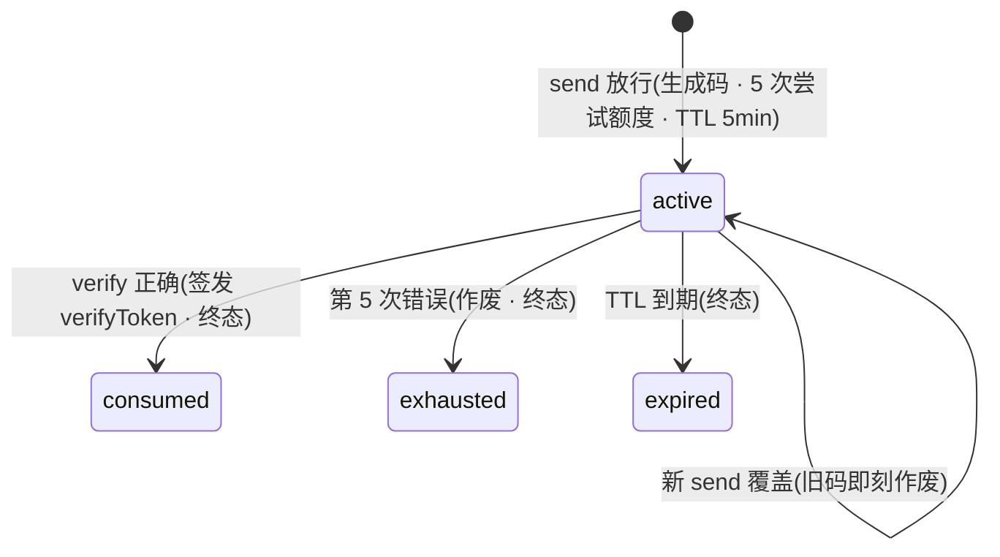

verify 业务错误:`otp_invalid`(附剩余次数)/ `otp_expired` / `otp_attempts_exceeded` / `otp_not_found`(终态或无记录时提交);成功签发一次性 `verifyToken`,由后续会话创建 / 注册提交 / 重置密码端点重新出示校验,不得仅凭 verify 成功响应放行敏感操作

#### 4.6.3 服务端存储与传输

- 密码全程通过 HTTPS 传输,服务端**绝不**存明文或可逆加密
- 服务端使用 `argon2id`(或同等 KDF)+ 随机 salt 哈希存储,memCost ≥ 64 MB / timeCost ≥ 3 / 并行度 ≥ 1
- hash 字段不参与任何日志 / 错误响应 / 客户端 echo / telemetry
- client 表单字段 `type="password"`,用户主动点 eye toggle 可临时切 `type="text"`;明文不发到任何 analytics

#### 4.6.4 修改密码流程

`/me/security` 内联表单:

| 字段 | 校验 |
|---|---|
| 当前密码 | server 校验,失败回 `errors.currentPasswordWrong` + 锁定计数器累加 |
| 新密码 | 应用 §4.6.1 全部规则 + 不能等于当前密码 |
| 确认新密码 | 必须等于新密码 |

成功后 server 失效该用户**所有非当前会话**的 session token(等同 §4.5 Revoke All Other Sessions),client 保留当前 session;toast `密码已更新 · 其他设备已登出`。

#### 4.6.5 真后台对接

| Endpoint | Method | Payload | 用途 |
|---|---|---|---|
| `/api/auth/password/check-strength` | POST | `{password, phone, nickname?}` | (可选)预校验强度 + 黑名单命中,UI 防弱密码提交;不存储 |
| `/api/auth/password/change` | POST | `{currentPassword, newPassword}` | /me/security 修改密码,需有效 session;成功后失效其他 session |
| `/api/auth/password/reset` | POST | `{country, phone, code, newPassword}` | 忘记密码完成(同 §4.2.5);成功后返 session token |

所有 endpoint server-side 完整执行 §4.6.1 强度规则、§4.6.2 锁定逻辑、§4.6.3 存储规则。

#### 4.6.6 支付密码

本节同步已批准的 [DOC18 支付密码方案](https://github.com/agentabatiuo572-byte/uvel-docs/blob/main/handoffs/2026-10-28/app/18-payment-password.md)；完整覆盖范围、密码规则、接口、身份找回及异常恢复均以该文档为准，不将本次能力自动扩展到其他资金业务。支付密码只用于钱包支付，HDPAY银行卡和外部USDT-BSC不读取也不验证。支付密码为独立于登录密码的 **6 位数字**，不能沿用本节登录密码的长度、强度或锁定规则。

**入口与状态**：个人中心直接显示“支付密码”及服务端状态，进入 `/me/payment-password`（正式前端页面 `src/pages/me/payment-password.vue`）。明确未设置才进入首次设置；已设置进入修改，并提供“忘记支付密码”。加载、读取失败或未知不得显示为“未设置”，失败须允许重试。H5 刷新后登录会话恢复前页面保持加载中，会话恢复后自动读取状态，不显示读取失败。

**首次设置与付款**：结算内和个人中心首次设置前完整显示 **“您暂未设置支付密码，这是初次设置，设置成功后请牢记。”**；结算来源另显示“设置完成后，请再次输入支付密码，继续本笔支付。”。首次输入与再次确认一致后提交设置；设置成功清空两次输入，回到本笔结算上下文，要求用户重新输入第三次支付密码，不能自动复用设置值或视为已付款。付款输入区提前说明输入完成即提交，第 6 位输入完成后才将本次凭证交给原业务支付接口。

**修改与身份找回**：修改使用“当前支付密码／新支付密码／确认新支付密码”三个独立字段，旧密码由服务端验证，新密码两次一致且不能与当前相同。忘记密码只通过当前账号符合恢复条件的已验证绑定手机验证身份，再两次设置新密码；不能现场填写任意新号码重置，也不能只凭登录态跳过身份核验。手机不可用时引导既有客服渠道协助核实身份。结算来源找回成功后仍需重新输入新密码授权原支付，个人中心来源不触发支付。

**安全与锁定**：密码、短信验证码和找回证明只在必要的请求与内存生命周期内使用，不写入本地持久化、日志或埋点；取消、离页、进入后台、登录失效或切换账号清空敏感输入。支付密码失败次数、锁定及解锁由服务端决定，前端显示服务端剩余次数与时间；倒计时结束需重新读取状态，不能自行判定解锁或放行。

**未知结果与退出**：设置、修改、重置或支付提交后结果未知，先用原命令键查询原结果，仅保留当前账号的非敏感命令与交易摘要；不得因超时认定失败或“未扣款”，也不得换键重发。只有服务端明确允许同键恢复且用户主动继续，才重新输入密码并恢复原请求。关闭支付密码弹层只返回原结算确认页，不自动取消原订单；确认页顶部“返回退出”仍按原单取消合同处理。已有未决支付或取消须先解决原结果，不能以新密码输入绕过。

### 4.7 Onboarding 流程

H5 Lite 没有手机算力初始化：注册成功进入注册成功页（§4.1.1），由「继续网页版」进入首页；普通登录正常进入首页。Lite 提供启动页（§4.7.1）、语言匹配（§4.7.4）与服务条款页（§4.7.5）；§4.7.2 估算页与 §4.7.3 连接页只在 App 内提供，Lite 不注册这两个路由，下文仅记录 App 端行为供对照。

#### 4.7.1 Step 1 — `/onboarding/intro` 启动页

Hero 信息层:

| 元素 | 文案 / 内容 | 设计意图 |
|---|---|---|
| 系统状态 chrome | iOS 标准 status bar(时钟 + 信号 + 电量) | 真平台仿真 |
| 标题 line 1 | "AI 时代,算力就是钱。" | 资本视角钩 — AI 缺算力,你刚好有 |
| 标题 line 2 | "24 小时 替你打工。" | 第二人称 + 强动词 + 数字前置 |
| 副标题 | "插上充电,就开始接 AI 任务。越多 · 越久 · 赚得越多。" | 隐性 phone hint + 增长承诺 |
| 实时统计 chip | 在线设备与累计已发放读取 H9 首页数字增长批次；每秒按共享序列显示，刷新不重置，失败显示“—”；两项都带千分位，累计已发放走动时同样带（2026-11-04，BUG-070） | 独立展示数据；开关、随机批次与性能规则见本轮同步规格 §4 |
| 中央 ComputeOrb | SVG 动画:旋转轨道 + 卫星节点 + 中央芯片标 "N" | 真平台仿真 — 算力网络可视化 |
| 主 CTA | "立即开始 →"(brand 大按钮) | 零门槛字眼,无扣款 / 绑卡暴露 |
| 副 CTA | "登录"(surface ghost) | 复访用户路径 |
| 条款脚注 | "继续即表示你同意 服务条款"(「服务条款」下划线可点 → §4.7.5 `/onboarding/terms`) | 合规可读护栏 |
| Skip 按钮 | **删除** — 不允许跳过 intro | 法务+教育护栏 |
| LocaleSwitcher | 顶部右侧,默认根据 `navigator.language` 自动匹配 | 见 §4.7.4 |

文案合规护栏:hero 字眼禁用 "保证 / 稳赚 / 暴富";"白领 / 白嫖 / 等你领 / 手快有手慢无" 等口语化 + 紧迫感字眼可用(SKILL `nexion-design` 漏斗心理学第 4 节)。

#### 4.7.2 算力估算（estimator）（仅 App，Lite 不提供）

手机估算只在支持的原生 APP 执行：先读取当前账号与安装的服务端校准结果；需要校准时采集原生可读取信号，由服务端按现行硬件规则匹配并保存。未匹配或缺少必需信号时保持待核验，不给默认算力或收益。页面展示服务端返回的算力、档位、双币日收益与设备收益对比。H5 访问估算页直接进入 APP 下载引导，不采集、登记或校准手机。

H5 仅查看服务端手机状态，不提供手机激活、停用、任务结束后停用或强制停用入口，也不提交对应命令。已购设备继续沿用共享的管理规则。原生 APP 的能力暂不可用提示不得使用浏览器或下载 APP 的说明。

已有 `CALIBRATED` 或 `ACTIVE` 结果直接复用；已有 `DEFERRED` 保留暂不开启的选择，并提供主动恢复入口。网络、会话、配置或保存异常时显示“预估暂不可用”，允许重试或显式暂不开启；不得伪造成功、收益或硬件检测结论。

#### 4.7.3 Step 3 — `/onboarding/connect` 算力校准（仅 App，Lite 不提供）

连接页展示设备算力估算结果、任务接取规则与显式启用按钮。首次注册从估算页进入时自动读取并复用已有结果，不再要求重复点击开始校准。设备仓库中的重新校准和暂不开启后的恢复先展示说明，用户点击后才提交新的观测。

**Phase A · intro（主动重新校准/恢复说明）**

解释采集范围：原生 APP 记录实际可读取的型号、SoC、GPU、物理内存、核心数及联网、供电状态。H5 直接进入下载引导；不声称已完成 NPU 跑分或散热测试。CTA 为“计算手机算力”。

**Phase B · calibrating（等待实际请求）**

显示“正在计算手机算力预估”与等待指示。请求完成后展示服务端结果；请求失败进入可恢复错误页。没有固定等待时长、倒计时、模拟进度或模拟数值。

**Phase C · result（服务端结果 + 政策告知）**

展示服务端 computeValue（平台算力）、tier、规则版本、收益配置和可用的网络/供电观测；未知观测显示“—”。待核验结果保留原因与重试入口，禁止激活；不把未知状态标为检测通过。

CTA "激活手机算力 →" 在服务端确认绑定成功后路由到 `/`(Home Dashboard)。激活规则:

1. user 进入 L1 阶段(`{ tier: "L1" }`)
2. `POST /api/onboarding/calibrate/activate` 以校准 revision 和幂等键创建/更新 `nx_user_device` 手机设备，并把校准记录与 `user_device_id` 绑定；只有服务端回读 `activationStatus=ACTIVE` 才算激活成功
3. UI 在 `/me/devices` 显示 phone "在线" 状态(若 `isCharging + isWifiConnected` 满足);否则按中断状态显示「重连中」或「未接单」(见 §12.2 手机算力门槛与任务中断模型)
4. 校准检测、网络失败或结果未知时显示「重试」「暂不激活」，重试复用原观测值/幂等指令；服务端明确返回 `PHONE_REPLACEMENT_DISABLED` 时说明「当前安装记录与已绑定记录不一致，暂时无法激活。请联系支持确认手机绑定，其他已购设备不受影响」，主操作为「联系客服」进入既有消息页，保留「暂不激活」，不盲目重复激活或断言用户使用了另一部手机。真实 `PHONE_REPLACEMENT_COOLDOWN` 保持换绑间隔未到的独立说明，可在间隔满足后重新读取资格重试，不解释成安装记录错误。暂缓不阻塞注册完成；不据同型号自动迁移安装ID、解绑或放开策略，详见[安装记录不一致提示](UVEL_手机安装记录不一致提示_20261101.md)
5. 暂缓后设备仓库显示重新激活入口；手机未绑定或校准状态不是 `ACTIVE` 时，不得分配任务，也不得写收益、回执或钱包奖励

**真后台对接**:

| Endpoint | Method | Payload | 用途 |
|---|---|---|---|
| `/api/onboarding/phone-installation/challenge` | POST | 历史 `{deviceId}` | 已退役（superseded，2026-10-03）；返回 410，零业务副作用，不生成挑战 |
| `/api/onboarding/phone-installation/verify` | POST | 历史 `{deviceId,certificates,signature}` | 已退役（superseded，2026-10-03）；返回 410，零业务副作用，不验证或发放资格 |
| `/api/onboarding/phone-installation/login` | POST | `{deviceId}` | 保留的显式手机绑定核验端点，兼容 `connect?mode=login`；普通登录/会话恢复不自动调用，标准主动校准/激活仍走对应校准 API |
| `/api/onboarding/calibrate` | POST | `{deviceId,signals,expectedRevision}` + `Idempotency-Key` | 服务端按观测值确定性派生并保存 score/tier/yield baseline |
| `/api/onboarding/calibrate/result?deviceId=` | GET | — | 回读该账号、设备与环境下的服务端校准事实 |
| `/api/onboarding/calibrate/activate` | POST | `{deviceId,expectedRevision}` + `Idempotency-Key` | 原子绑定 canonical 手机设备并发布 `ACTIVE` |
| `/api/onboarding/calibrate/defer` | POST | `{deviceId,expectedRevision}` + `Idempotency-Key` | 停用已绑定手机并发布 `DEFERRED`；首次检测未落校准行时以 revision 0 持久化无能力数据的 `DEFERRED` |

估算页完成首次校准后，连接页复用服务端结果并等待用户点击启用；不以 revision 0 重复校准。设备仓库中的显式重新校准先读取当前 revision，再提交一次新观测；不自动覆盖已启用或暂不开启的决定。请求结果不明时回读服务端，重试保持原观测、revision 和幂等键；账号/设备作用域变化后丢弃旧响应。等待界面随实际请求结束，不展示固定 12 秒倒计时或模拟检测进度；业务结果始终来自服务端。当前浏览器可读取的机型、内存、CPU 核数、屏幕/WebGL、供电与联网状态属于能力观测，不等同于原生 NPU 真机 benchmark；后续接 Janus 真机执行器时可替换信号来源，但不得改变上述激活与奖励门禁。

#### 4.7.4 Locale 自动匹配

LocaleSwitcher 在第一次 mount 时调用 `useLocale.ensureSystemDetected()`:

1. 读取 `navigator.language` + `navigator.languages` 候选列表
2. exact match LOCALES.code(如 `"zh"`)→ 命中
3. 否则 fallback base prefix(如 `"zh-CN" → "zh"`)→ 命中
4. 未命中 → 保留 `DEFAULT_LOCALE = "en"`

Persist 字段 `userSet: boolean`:false 时允许 auto-detect 覆盖;一旦用户在 LocaleSwitcher 主动 `setLocale(code)` → `userSet=true`,后续 session 永远尊重用户选择,不再 auto-detect。

#### 4.7.5 服务条款页 `/onboarding/terms`

平台服务条款的可读页,供 onboarding、注册与结算的条款链接进入。

**公开法律阅读与会话恢复（2026-11-04，BUG-157）**：服务条款、隐私政策与风险披露均为公开法律页。已登录用户直接打开或刷新时保留原页和 `return=` 参数；登录页和介绍页仍按既有规则重置。保留阅读位置不代表同意法律文本：条款沿用注册时的同意规则，风险披露仍须满足阅读时长、读到底部及明确勾选后才能提交确认。

**入口**:
- intro 启动页脚注「继续即表示你同意 服务条款」的「服务条款」(§4.7.1)
- 注册页底部脚注「创建账号即表示同意服务条款和隐私政策」的「服务条款」(§4.1)
- 结算页底部「售后说明 | 服务条款」与售后说明弹层里的「服务条款」(§7.3)
- 信任中心「规则与资料」的「服务条款」(§11.3)

页面返回(顶部 back chevron / 底部「我已了解」)回到来源页,冷启动无历史时 fallback 回 intro。隐私政策为独立页 `/onboarding/privacy`。返回地址指向 Lite 已移除的页面(手机校准、连接、旧入口)时一律回首页;登录、隐私政策和风险披露的返回地址同样处理(2026-11-04,BUG-065)。

**结构**:顶部返回头 + 生效日与版本 eyebrow + 标题 + 摘要 + 7 编号条款段 + 风险披露交叉链接 + 底部「我已了解」按钮。

**内容来源**:正文读服务端已发布版本 `GET /api/legal/terms/current`(标题、摘要、按 sortOrder 排序的章节);未接远端(`remoteApiEnabled=false`)时用 i18n `terms.heroTitle/heroSubtitle/s1Title/s1Body … s7Title/s7Body` 兜底。本地预览夹具与兜底文案同为下列新版条款(2026-11-03,取代原 10 段条款与「服务条款 · 演示」样例)。

**7 条款段**(章节 key 与 sortOrder:account 10 / service 20 / purchase 30 / earnings 40 / wallet 50 / conduct 60 / updates 70):

| # | 主题 |
|---|---|
| 01 | 账户与安全(年满 18 周岁 · 真实信息 · 妥善保管密码、验证码和支付密码) |
| 02 | 服务内容(设备购买、算力任务、钱包等 · 以 App 内当前显示为准) |
| 03 | 购买与售后(下单前确认商品、价格和费用 · 以结算页「售后说明」为准) |
| 04 | 收益与奖励(收益为预估,以实际到账为准,平台不承诺收益) |
| 05 | 钱包与提现(核对收款信息、金额和手续费 · 链上转账确认后不可撤回) |
| 06 | 禁止行为(欺诈、多账户刷奖励、攻击或干扰平台) |
| 07 | 条款更新与联系(重大变更 App 内通知 · 客服或 staff@uvel.ai) |

摘要:「本条款适用于 UVEL AI LTD 运营的 UVEL 服务。注册或使用即表示你同意以下内容。」(英、越同步)。

风险披露交叉链接 →「另见:平台风险披露」`/me/risk-disclosure?return=<条款页>&country=VN`(§11.4a)。

#### 4.7.6 登录态路由守卫(Auth Guard)

受保护页的访问依据真实认证、有效会话和账号绑定状态。`useAuth` 的 `onboardingComplete` 仅表示手机初始化状态，不参与登录态路由守卫；已登录但未校准或未激活手机算力的账号也可正常进入首页与其他业务页。

**守卫规则**:每次路由变化(以及应用回到前台时)校验当前页面:

| 条件 | 处置 |
|---|---|
| 当前页在白名单内 | 放行(漏斗自身页面不自我重定向,避免循环) |
| 无有效登录态或服务端会话已失效 | 进入既有登录/会话恢复流程，不进入手机校准 |
| 有效登录态，手机未初始化、未校准或未激活 | 放行；普通登录进入首页或合法业务返回目标 |
| 新账号注册成功 | 由注册入口明确启动注册后引导，不由通用守卫推断 |

**公开页**：沿当前公开路由白名单开放登录、注册、介绍、条款/隐私/风险披露及指定推荐、交易凭证入口。手机连接/校准不是因此全部公开；其主动设备操作仍需认证与设备校验。公开页不自我重定向。

**默认登录态**：正式 App 全新安装没有服务端有效会话时不伪造已登录状态；已有会话按既有安全存储和服务端恢复规则处理。恢复成功不检查手机绑定来决定路由，也不以历史 `onboardingComplete` 字段缺失或为 false 强制初始化。

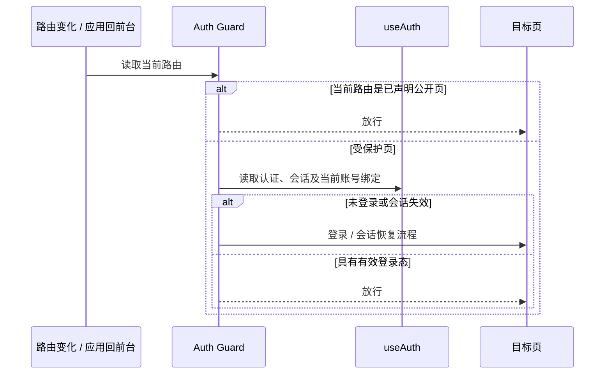

**服务端事实**：登录和恢复沿现有认证 API、会话与账号隔离实现执行，`onboardingComplete` 只作为信息保留；不增加手机初始化前置条件或新的认证接口。手机激活与换绑由用户主动设备操作或新账号注册引导负责。

### 4.7 多载体会话、会话下线与新设备校准

**目的**:SPEC-4 后,同一账号允许签名 App / H5 / 白 App 接管态等多载体会话并存,算力设备在线状态与业务登录会话解耦。包含三项能力:① 多载体 session registry;② 会话被主动退出、指定下线或风控停用时在途任务中断回退;③ 用户在 App 设备管理主动发起手机校准(Lite 不提供手机校准)。普通登录不因新物理设备、未校准或未激活而插入手机初始化流程。

**设备身份**:每个安装持有稳定的 `deviceId`(`lib/device-id.ts`,首次用 `uni.getSystemInfo` + uuid 生成并持久化 `nexgrid-device-id-v1`)+ 友好 `deviceName`(如「iPhone · iOS」)。deviceId 是「是否同一台物理设备」的判据。

**会话模型**:账户级 session registry (`nexgrid-account-sessions-v1` = `{schema, sessions:{[sessionId]:{accountKey, deviceId, deviceName, entrySurface, loginAt, lastSeenAt, killedAt?, endedAt?}}}`)代表服务端会话表的 mock。每次登录新增一条会话,不覆盖其他设备 / 载体。每个端内存持有自己的 `sessionId`,通过轮询(`GET /api/auth/session`,H5 额外监听跨标签 storage 事件)读取自己的会话记录:

- **同账号其他会话**(不同 `deviceId` / `entrySurface`)→ 并存,不触发强踢;
- **当前会话退出**(`endedAt`) / **记录被删** / **吊销**(`killedAt`)→ 当前端判定为登录失效。

**失效处置(任务中断回退)**:当前会话失效 → 在途任务无宽限立即作废(`interruptAllTasks`,见 §12.2:所有激活设备 `currentTask=null`、清 `miningSince`、不发收据、放弃进度=「回退」)+ 冻结挖矿(`miningPaused`)+ reLaunch 到登录失效阻断屏 `/session/kicked`(显示原因[已退出 / 会话已停用]+ 任务已回退提示 +「重新登录」)。重新登录新增当前载体会话 → 守卫恢复挖矿(`resumeMining`)。

**按需手机校准（2026-11-02）**：密码、验证码和第三方普通登录正常进入首页；已有合法业务返回目标继续沿用现有安全返回规则。登录与冷启动恢复不调用手机登录核验来自动跳转，不因 `onboardingComplete=false`、`requiresRecalibration`、未绑定、需换绑或手机状态不可用而进入手机连接/校准页，也不据此停止原手机任务或修改校准记录。App 的自动初始化引导仅由新账号注册成功流程发起，已有账号可在 App 设备管理主动发起 `/onboarding/connect?mode=recalibrate`，规则沿用 §6.10。H5 Lite 没有初始化引导，也不提供该校准入口。

**会话状态机**:

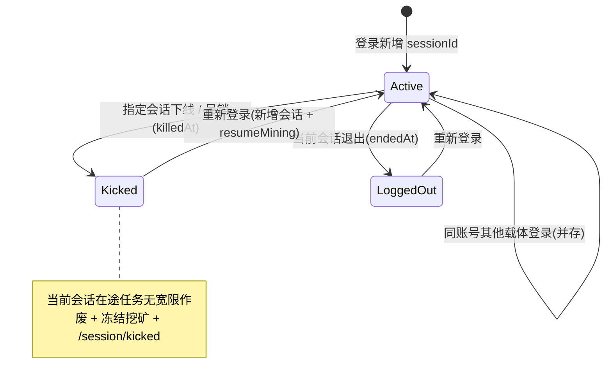

**真后台对接**(mock-first,可零重写):

| Endpoint | Method | 返回 / 作用 |
|---|---|---|
| `/api/auth/signin` | POST | `{token, sessionId, deviceId, entrySurface, requiresRecalibration}`;服务端新增当前载体会话 |
| `/api/auth/session` | GET | `{sessionId, status, killedAt, endedAt, entrySurface}`,客户端轮询 / 心跳镜像 |
| `/api/auth/logout` | POST | 标记当前会话 `endedAt` |
| `/api/account/sessions` | GET | 当前账号多载体会话列表 |
| `/api/account/sessions/:id/revoke` | POST | 指定会话置 `killedAt` |

运营后台「指定会话下线 / 吊销会话」置 `killedAt`(后台 C5 会话域)→ 对应端轮询检测登录失效。不得因另一个 deviceId 登录而自动覆盖当前会话。

### 4.8 账号数据作用域与隔离(per-account 存储)

**目的**:同一台设备 / 浏览器可先后登录多个账号,每个账号的资产、记录、进度必须互不可见——换账号只见自己的数据。持久层据此三分:

| 作用域 | 归属 | 例 |
|---|---|---|
| **用户资产**(随账号走) | 按账号分行:`{[accountKey]: row}` 表(`accountKey` 即用户主键),换账号即换行 | 订单 · 账单 · 质押持仓 · 佣金 · 券包 · 试用状态 · 兑换记录与风控计数(KYC/日限/终身额)· 绑卡 · 钱包配对 · 签到 · 任务/周任务/活动/里程碑/成就/目标/转盘票据/每日增益 · 通知 · 算力凭证 · 工单 · 购物车 · 资料 · 安全设置(2FA)· 奖励已读水位线 · 创世持仓 · V 等级 |
| **平台态**(设备共享,账号无关) | 全局键 | 创世售出进度与上所信号 · 兑换市场汇率 · 转盘真实奖降级 flag · 运营配置镜像 |
| **设备偏好** | 全局键 | 主题 · 语言 · 通用偏好 · `deviceId` |

**重绑收口**:账号确定的四个时点——登录 / 注册 / 冷启动会话恢复 / 登出——统一调 `rebindAccountScopedStores(accountKey)`(登出与被踢传 `"default"` 清空内存残留),把全部用户资产 store 重绑到目标账号行。业务写入处处即时落本账号行,换账号无需先落盘。

**资格与凭证按账号**:任何资格判定所依赖的凭证 / 计数(创世邀请码、KYC-Express 已验证、兑换终身额、单人限购持有数)必须按账号——设备级继承会造成资格旁路(账号 B 白继承 A 的 KYC / 邀请资格)。跨 store 派生须确认上游源也按账号,不得由设备级源经页面 mount 镜像回灌账号字段。

**真后台对接**(mock-first,可零重写):行数据即 per-user 服务端资源,`accountKey` 即用户主键;`GET /api/me/*` 拉本账号数据,`rebindAccountScopedStores` 对应「切账号 → 重新拉取该用户资源」。

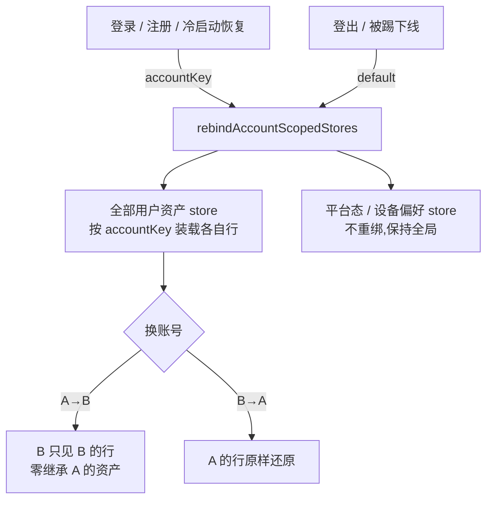

---

## 5. Home Dashboard（2026-10-25 更新）

本节按用户批准的 UI/UX 审查和最终设计画布修订，取代原 14/16 模块首页。设计依据见 `docs/audit/2026-10-25-ux-audit.md`；后续明确要求为：除底部 Liquid Glass 导航外按最终画布还原，福利卡也使用画布的并排票券/试用设计。历史模块的出现位置不再作为当前首页验收标准。

### 5.0 H5 Lite 差异（2026-11-03 追平合并）

H5 Lite 首页采用本节的 App 结构与视觉（P-56 / P-57 / P-62），只保留以下网页规则：

- **我的设备**（§5.6）：折叠条头像、展开卡带、作业数和「我的算力动态」中的进行中作业都不显示手机设备，按明确设备身份（`kind=phone` 等）识别，不按显示名称判断。隐藏的手机仍占服务端槽位：槽位环与空闲槽位数按服务端正式占槽数，手机所占槽位画成已占用段，不显示成空位，也不按可见卡片数重算。
- **待办**（§5.5）：不出现手机绑定 / 校准待办，H5 不提供手机执行入口。
- **设备对比**（§5.8b）：不以手机为基准，也不展示手机升级对比；服务端投影以手机为基准时整个区块隐藏。
- **App 下载横幅**：仅 H5、已登录时在每日签到下方显示通用 App 下载横幅，「下载 App」进入 `/pages/register/success?download=1` 下载专用模式（§4.1.1）。
- **新手 / 周任务**：正式模式读取服务器首次进入时冻结的任务组，不在客户端重建任务或逐项发奖。显示时隐藏手机连接、校准、激活及购买任务；`stakingVisible=false` 时同时隐藏质押 / 复投任务。首页待办里的新手任务摘要（完成数、奖励与可领取状态）、任务页和周任务转换横幅一致过滤；服务端组数量与领取判定保持原样。若首日任务组有成员因 Lite 范围被过滤，整组显示「该任务组包含网页版不可用的任务，暂时无法在此完成或领取」，隐藏进度和领取入口，不把剩余任务展示成完成。浏览类任务的进度记录被服务端以“需完成初始设置”（`USER_ONBOARDING_REQUIRED`）拒绝时，任务下方显示「任务进度暂时无法记录，请联系客服。」，操作为「联系客服」（进入 `/support/messages`）与「重新访问任务」，不出现设置文案（2026-11-03 BUG-068）。
- **资金记录**：今日收益、收益流水、最近收入等金额记录完整包含手机收益，不套用设备列表过滤。
- **网络实况**（§5.8）：只显示注册用户与在线设备两栏，不显示「设备排名」栏及其排名说明（App 的排名按当前绑定手机的有效算力计算，Lite 不承载手机算力），也不读取个人排名接口；两栏任一不可用时整卡隐藏。
- **活动位**（§5.7）：活动按 §11.10 的明确身份规则展示，只含手机商品的活动不出现；赠品为手机的规则（`DEVICE` 奖励的 `giftProductNo` 是手机身份）同样算手机规则，赠品名称、图片与权益都不展示（2026-11-03 BUG-078）。混合活动去掉手机商品和手机规则后不再使用运营上传的活动图（图上可能是手机），改用商品与奖励卡片；某商品的规则全部被去掉时，该商品也退出这场活动，仍作为普通商品在商城出售；所有规则都被去掉的活动不出现。按活动编号打开的商城、商品详情与组合页同样适用，被整场过滤的活动按不存在处理。团队页的邀请购机卡不再宣传被整场过滤的邀请活动，但用户在该活动已获得的奖励记录（如 USDT / UVT）仍显示在「我的购机礼」，可进入奖励详情；该活动的进度首次读取失败时，这一栏显示「信息暂不可用」与「重新加载」，不会让记录无提示地消失（2026-11-03 BUG-083）。

### 5.1 页面结构与问候

顺序为问候与今日收益、每日签到、我的福利、待办、我的设备（§5.6）、单个活动位、我的算力动态（§5.8a）、UVEL 网络动态、网络实况、设备对比、算力市场，底部为平台资质（§5.5a）。可选内容按实际资格、可用资料和未处理状态出现，不以样例补齐空位。常规内容左右 16px，区块间距 20px，单一内容面圆角 22px；玻璃用于导航和操作控件。收益流水只在赚取页（§6.4a），首页不显示（2026-11-02 P-62 起）；首页也不放设备规格或快捷四宫格。

问候和今日收益的现有视觉、光晕、网格、实时标签保持；昵称来自当前账号完整资料，不擅自截短。顶栏独立搜索与消息玻璃按钮，滚动背板保护文字可读性；底部导航沿用现有折射与交互效果。

### 5.2 今日收益

继续显示服务端首页汇总，不在客户端重新更改财务口径。设备、团队等实际收入与 Earn 页设备收益有不同范围；范围解释放在赚取页。服务端成功读取并确认今日结算笔数为 0 时返回今日金额 0，首页显示 `$0.00`；读取未就绪、失败或今日笔数未知时显示缺值「—」，失败保留可恢复状态，不把未知值转成 0，不用样例金额替换真实账号。

收益下方第二行显示「较昨日同期」/“vs same time yesterday”/“So với cùng giờ hôm qua”，金额直接读取 `earnings.todayVsYesterdayUsdt`：今日已结算 USDT 减昨日相同时间段已结算 USDT，沿用业务日历和同一次汇总快照。成功确认结算笔数为 0 的窗口按 0 参与计算；任一窗口的汇总、笔数或非空窗口金额未知时差额为 `null`，App 显示「—」。差额允许正、负、零，保留正负号、美元符号及三位小数；不由百分比反推，也不替代上方今日主金额。原布局、样式、动效与隐私遮罩保留。

原生基座进入首页时，动态初始化和后续刷新须兼容其运行环境；汇总返回有效金额后沿用现有收益布局显示，不根据历史动态推算今日收益。

### 5.3 每日签到

收益区之后保留签到：连续天数、今天的已发布奖励、7 天进度与签到按钮。奖励数量、签到日及完成状态由现有签到接口返回；不硬写第 7 天奖励。用户点击才签到，等待结果期间禁重复提交，成功按读回状态更新；已签到仍可查看签到详情。账号切换、离开页面后不应用旧结果。

签到卡在深浅主题均保留完整的圆角软边及顶部、侧面高光，与收益区底光形成分层。

### 5.4 我的福利

区块标题为「福利」。上排放还能领的领取卡，下排放领了还没用完的待使用小卡，两排间隔 12px；两排都没有内容时整个区块隐藏，不留占位。面额来自可领取及未使用券的实际定义，非可叠加券不得求和。若存在无封顶折扣券，不将其他券的有限金额称作整体最高金额。试用保留“购机抵扣、不可提现”含义，不采用未经确认的随时取消承诺。弹层中的抵扣上限、资格与领取操作继续由现有接口控制。

领取卡：代金券和试用都能领时两张半宽卡并排，只有一项时该卡整宽。领取卡是液态玻璃柔边卡，材质同签到卡（半透明填充、柔和内缘、顶部与侧面高光，深浅主题各一套），不加背景模糊；左上角一团氛围光（券琥珀、试用青绿）铺在卡片最底层，内缘与高光压在光晕之上，四周边缘完整。整张卡是一个入口，按钮胶囊只是视觉提示。

- 代金券为票券样式：券图、面额（主金额字体）、「代金券 · 购机时抵扣」，打孔虚线两侧半圆缺口，缺口描边与卡片内缘同色；底栏「领取后可用」＋品牌玻璃「领取」。整宽版横排为券图｜「代金券 · N 张」、面额、「购机时抵扣 · 领取后可用」｜竖向撕线｜「领取」。点击时券数据已就绪且可在首页领取则打开领取弹层，否则进入券列表。
- 试用：试用机型图、预计收益（主金额字体，币种与小数为辅助色，金额为可抵扣上限，与详情及结算一致）、「机型名 · 预计收益」。半宽底栏「免费 N 天」＋「领取」；整宽版顶部标签「免费 N 天」，底栏「无需付款」＋「领取试用」。冷却结束可再领时按钮为「再次领取」，点击打开再领确认。队列已满时底栏为「槽位已满」＋「管理 ›」，点击进入设备管理。资格核实中、读取失败或缺货时按钮显示对应状态并变淡，卡片不可点；资格读取失败时区块下方给出重试。

待使用小卡（64px 高、实底卡，不用玻璃材质）：
- 代金券：「$50 代金券」＋警示色「待使用」；整宽版补「 · 结算时自动抵扣」，右侧「去使用 →」；点击进入商城。
- 试用：试用中缩略图带在线点。半宽显示「试用中」或「可抵扣 $x」＋倒计时；整宽显示机型名＋「试用中 · 剩 …」或「抵扣有效 · 剩 …」，右侧「可抵」＋金额（跟随统计隐私遮罩）。倒计时为 `2d 23h:44`，按剩余分钟向下取整，与读屏文案、「我的算力列队」和赚取页试用舞台一致（2026-11-04，BUG-028）；未知显示“-”，显示到零不改变服务端状态。已结束且不能再领时缩略图变灰，显示「试用已结束」，整宽版右侧「选购设备 →」。点击进入试用详情。已转购不在首页显示。

首页不自动打开福利弹层，chassis 不向其他 tab 重复注入。

### 5.5 待办

单一列表容器：手机绑定、新手任务、待支付订单、已有券、试用进度、安全提醒及继续学习。默认最多 3 个待办；更多通过查看全部展开。已处理状态不持续占位。副文案按性质着色：等你处理的状态（如「N 笔待处理」「N 张可用」）用提醒色、500；说明类副文案用正文色 ink-2；新手任务的奖励与倒计时保持原配色。手机执行权限只属于 APP；H5 不提供校准、绑定、心跳或执行任务入口。

课程推荐优先未完成且已有进度的课，其次已发布推荐课，再次首个未完成课；全部完成改为复习/查看教程中心。推荐课和奖励均来自接口。

### 5.5a 平台资质（首页底部信任入口）

区块标题「平台资质」，右侧「信任中心 ›」，整卡点按同样进入信任中心。卡内依次为：运营主体与公司名、「美国纽约州注册的 AI 算力服务平台」与官方可查说明、三项资质标签（纽约注册／FinCEN MSB／IRS EIN，同排、各配图标，资质尺寸 28px）、「已完成提现」与宣传口号「资质看得见，参与更安心」。主体、说明与资质标签只在信任中心资料接口读到时显示，读取失败时显示中性引导文案；「已完成提现」读取与引导页「累计已发放」、首页 On grid 相同的服务端展示数据（`/api/config/home-display`），卡片在屏幕上时逐秒更新、离开屏幕或页面隐藏时暂停；读不到时整行不显示。配色用创世金（盾牌、资质标签、实时圆点与口号面板），与绿色的收益、领取操作区分。不展示活跃账户、在线设备或核验统计等平台运营明细；合作伙伴标识须有对方授权的官方文件后再上线，不以占位图或虚构金额代替。

### 5.6 我的设备

2026-11-02 起（P-62 设计 B）。标题「我的设备」，其后是槽位分段环，右侧「管理 ›」进设备仓库。

**槽位分段环**（首页与赚取页共用）：每个槽位一段，依次为试用、Online 设备、其他已占用设备、已占用但未分类、开通中、空位；Online 为成功色，其他已占用为禁用色，开通中为品牌色半透明，空位为浅色。占槽数未确认或隐藏统计时所有段统一灰色，不露占比。读屏读「{n}/{max} 个槽位已占用」，隐藏时读「槽位占用已隐藏」。段数以服务端正式占槽数为准：多于已分类条目时补中性段，少于已分类条目（如过期的试用快照）时先去掉试用段再截尾，与读屏数字一致。

**默认折叠**（每次进入首页都折叠，不记忆）：一条卡片，左侧设备头像叠排（顺序同环，第一个在最上层；在线灯 Online 时呼吸，其余静止；空位为虚线加号，开通中为转圈；≤374px 最多显示 4 个），中间「{n} Online」和「{n} 个作业运行中」，右侧展开箭头，整条是展开/收起按钮。作业数只计服务端状态为运行中、且未中断、未在恢复的作业；暂停、排队、重连中、恢复中不计；作业快照未确认时显示「—」。

**展开**：横滑卡带（吸附，左右出血）。设备卡：状态（Online / 状态待确认 / 恢复中，沿用下方激活即 Online 规则）、机图（Online 时淡绿光，非在线灰度）、名称、「今日 +$x」、「作业」状态（作业中 / 空闲 / 作业已暂停 / Reconnecting / 恢复中 / 排队等服务端状态；非在线或未确认显示「—」），点进设备详情（`from=home`）。首页不显示作业名称、进度或百分比，这些只在赚取页。试用卡：「试用」角标、剩余倒计时（如 `1d 23h:12`，按分钟向下取整）与可抵金额，点进试用详情。有空槽时末尾一张「添加设备 · {n} 空闲槽位」卡，打开槽位操作弹窗（§6.9）。卡带下方「在赚取页查看作业 ›」。

**状态**：无设备时折叠条换成「添加设备 / {n} 空闲槽位」，整条打开槽位操作弹窗，不展开。首次读取时环为灰色，条内 6 个静止占位圆和「正在读取设备」。设备或试用读取失败时条内显示「设备状态暂不可用」和「重试」（重新读取设备与试用状态）。隐藏统计时环为灰色，今日收益与可抵金额为 ••••，状态与名称照常。

**动效**：环分段依次淡入、头像依次弹入、卡片从右侧依次滑入，均为一次性；循环只有在线灯呼吸和开通中转圈，离开视口（含被卡带裁掉的卡片）或页面隐藏时暂停；减少动态时全部静止。

槽位数统一为服务端正式占槽数加一个有效试用预留；转购以真实设备替换预留，结束释放预留。读取失败不把设备当作 0 台；同账号已确认的设备快照仍可见。设备读取进行中商品目录发布新快照时，该次读取作废并自动重新读取，首页、赚取页和设备仓库不会一直停在「正在读取设备」。添加设备入口继续遵守资格与原生/H5 边界。

设备在线呈现纠正（2026-10-30）：购买成功自动激活，激活即业务 `Online`（绿色圆点），取消激活直接退出算力队列并回到仓库，中英越一致；不显示 Offline，也不并列四种设备状态。暂停、重连及执行器健康属于任务运行信息，不改写设备激活事实；实际执行权限、回执及收益仍依原真实证明。未确认激活事实保留读取/确认反馈。设备仓库展开后左侧显示「已获得收益」及该设备累计收益（服务端累计产出；隐藏数据时遮盖，设备读取未确认时显示“-”），激活/停用操作在右侧，禁用和二次确认规则保持。

### 5.7 活动位

仅展示有效且 `placement=home.purchase-promotion` 的活动；每次一个，用户手动切换，有页码指示，无自动轮播。优先已发布活动图片；无图时标题、实际商品和赠品图来自活动规则与目录，不把条款作为广告副标题。规则、截止时间与退款条件仍在操作前可查看。可选活动无数据时隐藏，不自行补活动或紧迫数字。

### 5.8 网络实况

三栏：注册用户、在线设备、设备排名。「注册用户」为按 H9 公布起跳值、锚点、间隔和步长推算的注册用户估算值，「在线设备」为 H9 发布的 `networkPulse.onlineDevices`，两者都按人口档显示（≥1 万为「x.xW+」，≥1000 为「x.xK+」，≥100 为整百「+」，否则「<100」）；估算值只用于展示，不能写入真实人口、财务或排名。「设备排名」为当前账号真实排名。

不显示更新时间、估算标注或历史折线。个人排名独立读真实排名接口，H9 失败不能抹掉已取得的个人排名。注册用户估算、在线设备或排名任一不可用时整卡隐藏，不用其他口径填充。H5 Lite 不显示设备排名栏，见 §5.0。

**同源展示（2026-11-03）**：信任中心「平台运行数据」（§11.3）与邀请落地页「网络脉搏」（§4.3.1）的注册用户、在线设备与本卡同源同格式，并加一项「累计已发放」（读首页展示批次 `/api/config/home-display`，千分位金额）；这些页面不再显示真实平台聚合（活跃账户、真实在线设备、已完成提现、注册账户数）、来源或统计时刻，单项不可用时显示 `-`。三处的注册用户共用同一时钟，按发布间隔边界刷新，跨档时同时变化（2026-11-04，BUG-072）。

**UVEL 网络动态（On grid）**：标题右侧「地图 →」进入全球网络页。客户行来自首页概览投影，每行显示客户首字、客户名与「模型 · 城市」；自 2026-11-03 起不再显示每个客户的 GPU 数量。底部左侧为 `networkPulse.onlineDevices` 的人口档「x 在线」，右侧为首页展示批次的每秒发放额「+x/sec」，两项各自降级为 `-` 并可点按重试，都不可用时合并为一行「暂无数据 · 重试」。

### 5.8a 我的算力动态 / 最近收入

设备规则任务在运行中、结算动态与凭证上均展示派发时冻结的 PC 任务名称。例如 E2 配置的 `image gen - watercolor portrait` 在入账后仍使用该名称。运营改名影响后续派单，已入账记录保留当时的名称；旧真实模型记录仍可按原资料查询。

任务凭证列表和详情显示同一编号，例如 `UVEL-RC-00C1HE`（14 个字符）。`UVEL-RC-` 后接凭证主键的大写 36 进制编号，左补零至至少 6 位，超过 6 位保留全部位数。已签发凭证下次查询时自动使用同一格式。查询、核验和复制继续使用完整原业务号。详情字段值均单行，超宽用省略号。长按普通字段可复制全文，凭证号、作业号、设备编号和哈希可点图标复制。类型与派发时的名称分行。规则任务的「核验信息 → 证明哈希」展示服务端以随机凭证号、任务、用户、设备、规则版本、周期与实际入账金额计算的 SHA-256 **凭证哈希**；反复查看结果相同，可复制完整 64 位。真实模型凭证继续显示原始证明哈希。详情为独立固定弹框，只有正文可滚动；在正文上下边界继续拖动不移动弹框、不触发列表刷新。关闭后列表仍停在原位置。

本次清理涵盖整个公共 TEST，按截点冻结任务、逐笔账本和用户余额。旧设备收益、设备 UTC 日奖及推荐收益按各自原件核对，英文版本及截点后新入账保留。指定余额不足的测试账户先用 C3「系统纠错」补差，再扣旧收益；补差不记为累计收益。C3 须不同管理员复核，已解锁的关联推荐走原 F5/A2 冲正。无入账的终态可先归档；已付款记录在相应冲正生效后移出业务列表、统计和凭证直达，原资金原件及 D4 对账保留。此流程不自动清理其他环境。
直属设备推荐收益跟随源任务凭证归档。归档生效后，App「直属设备收益」的明细、笔数和合计同步移除该来源。受益人钱包里的原推荐入账按已核准的结算组关联到源任务。购买推荐和其他设备的收益仍按各自凭证查询。


本次公共 TEST 验收数据清理仅适用于选定账号和旧任务清单。以旧模型执行记录或初始六项配置的派发版本识别旧单；新版英文任务即使复用同一配置 ID，也保留其凭证和收益。已入账的旧收益按原币种、实际流水冲回一次，未入账的不扣款；完成后旧单不再进入用户任务历史、凭证、收益明细和汇总。原账及冲回关联留作对账。清理不是正式环境的自动到期规则。

首页卡片双页签，固定 5 行、行高一致，作业从进行中转为已结算时卡片高度不变。「动态」：账号设备上进行中的作业最多 2 条（进度、预计收益），其下为首页结算账本的已结算记录（对勾图标、客户与完成时间、收益），新结算逐条滚入，滚入期间锁定列表高度。「收益」：收入方向账单最近 5 条（类型图标、类型与状态、说明与时间、金额与币种），切到该页签时才读取；点一行进入账单页并预选收入与该行币种。「查看全部」分别进入作业回执与账单页（预选收入）。不显示「你」之类的身份标签，不生成模拟数据。

原生基座首次挂载、返回首页及后续滚入均不依赖较新运行时的数组取尾方法；无待滚入记录时保持现有内容，有记录时沿用原顺序与节奏。

### 5.8b 设备对比

只展示服务端首页投影 `doTheMath` 的有效对比，基准为当前账号最高日收益的活跃真实设备，目标为服务端选定的可购买目录商品；不展示云份额对比，不用 `derivePromoUpgrade`、本地档位或样例兜底。已拥有最高档设备、没有更高档可购商品、购买资格探测失败或没有有效基准设备时，服务端返回空对比。投影为空、尚未读到有效数据或读取失败且无可用对比时，整个区块隐藏，包含标题、加载/错误/暂无设备提示与占位；前后可见模块保持正常 20px 间距。刷新重新读到有效投影后恢复展示。

有效对比沿用设备图、收益柱、倍数和日收益，CTA 按投影的目标 `productNo` 进入商品详情，不由本地档位推断。隐藏统计时遮盖个人收益与倍数，柱高统一，不泄露比例；离开视口或页面隐藏时暂停循环动效。

### 5.9 状态与验收

320/390px、中/英/越、亮暗主题与减少动画均须检查；长文自然换行，不裁掉金额或关键条件。每日自动奖励提示按账号和 UTC 日限频，不影响实际奖励发放或账本。页面滚动留足底部导航安全区，浮标不挡主要操作。

最终画布版本为 `1792868600-583d`（artifact `7cc57828-35e5-42d6-b889-f92286cb8aad`）。视觉评分与运行截图是前端隔离证据；真实 TEST 服务和 Android 真机另行验收，不能用构建或测试响应代替。

---

## 6. Earn(算力赚取)

### 6.0 页面结构

2026-11-02 起（P-62「赚取页定稿」）自上而下：周期切换（今天 / 本周 / 本月 / 全部）→ 便当格（§6.4）→「我的算力列队」与设备舞台（§6.1）→ 收益流水（§6.4a）→ 行情看板（§6.5）→ 作业中心（§6.3）→ 更多赚取方式。§6.6–§6.8 的三条横幅当前未在赚取页渲染（组件保留）；§6.9 的槽位卡已由设备切换条和舞台里的添加入口取代。

**H5 Lite（2026-11-03 追平合并）**：Lite 采用同一赚取页结构。设备舞台、设备切换条、槽位环和作业中心里的设备任务不显示手机设备（PHONE、MOBILE），按明确设备身份识别；隐藏的手机仍占服务端槽位，占槽数按服务端正式占槽数。设备切换条不出现手机，也不默认选中手机；没有可见设备时显示添加设备入口，而不是空舞台。手机专有内容（重连、无充电 / 无网络暂停、后台模式、锁定作业、实时算力等）在 Lite 不出现。「更多赚取方式」不显示「手机算力 · 下载 App」卡；网页的 App 下载只走首页通用下载横幅（§5.0），不宣传手机算力。账号级收益汇总、便当格、收益流水、结算批次与明细及凭证历史完整包含手机收益（§6.11、§11.5.1）。

### 6.1 我的算力列队与设备舞台

区块标题「我的算力列队」，其后是槽位分段环（§5.6）和火箭按钮（作业产能说明弹层）。只显示已激活设备（`activatedAt !== null`，见 §12.2）；已购未激活的设备在 `/me/devices` 管理。

**设备切换条**（横滑胶囊，`tablist`）：试用排第一（有试用时），其后为已激活设备的现有顺序；胶囊含机图、名称、试用角标和状态点。有空槽时末尾一个虚线「+」打开槽位操作弹窗。每次访问固定一个选中项：默认第一个有进行中作业的设备，没有就选第一个；选中设备存在期间不随作业刷新改变，设备消失时才换，新访问或切换账号时重置。选中屏幕外的胶囊时切换条横向滚到它，减少动态时直接定位，不平滑滚动（2026-11-04，BUG-042）。

**设备舞台**（`tabpanel`）：
- 顶行：设备名与状态；「…」打开现有设备菜单（统计 / 升级置换 / 取消激活，与长按相同，守卫不变）。
- 半圆仪表：6px 轨道；进度弧从品牌色 12% 渐变到 70%，进度点为 4px 实心圆，不发光；进度来自现有作业进度估算，入场从 0 扫到当前值一次（1400ms），之后平滑过渡不回 0。作业运行中，已完成弧段内有柔和波纹持续流向进度点（不从起点单独滑出），进度点外圈脉冲；试用累计中同样（琥珀色）；暂停、排队、重连中、恢复中、等待结果确认、隐藏统计时不循环。波纹遮罩与进度弧共用同一次入场和过渡，波纹不会跑到进度弧前方（2026-11-04，BUG-049）。空闲为虚线轨道；非在线只显示灰度机图；状态待确认 / 恢复中只显示状态文案、不画进度。
- 作业行：跳动条（只在作业运行中跳）+ 作业名称与百分比。作业名称按作业类别显示英文名（Image Gen / Video Gen / LLM Inference / Fine-tune / Embedding / Speech），中英越三种语言相同，不显示服务端的 `taskName`（后台配置的单一文案，不随语言切换）；暂停、重连中、等待结果确认等提示放在下方。空闲显示「暂无进行中作业，等待新作业」。
- 手机专有内容（重连、无充电 / 无网络暂停、等待作业、后台模式、锁定作业、实时算力等）保留现有逻辑，放在作业行下方。
- 三格统计：今日收益、今日 UVT、作业产能（新机期显示新机期文案；可降级设备点按打开产能说明）。
- 「今日最近完成」胶囊（模型与金额）+「查看全账户收据 ›」；右下「设备详情 ›」。
- 试用舞台：琥珀色仪表，进度为当前可抵扣占预计抵扣的比例；显示当前可抵扣、预计抵扣、剩余时间与「抵扣仅用于购机，不能直接提现」；底部「取消试用」（现有确认与防重入）、「详情」与「提前购买 →」（到期抵扣期为「抵扣购机 →」）。
- 隐藏统计：仪表只留轨道，模型名、百分比、三格统计和胶囊金额为 ••••，数值不再着色，舞台不显示在线光晕。
- 无设备且无试用时，舞台位置换成虚线「添加设备 · {n} 空闲槽位」入口卡；首次读取时为灰色占位（三个胶囊、标题、空轨道、「正在读取设备」、三格占位），读取被商品目录发布作废时自动重读（§5.6）；设备读取失败时显示「设备暂时无法刷新」条与「重试」。

### 6.2 添加设备入口

赚取页的添加设备入口为切换条末尾的「+」和无设备时的虚线入口卡，均打开槽位操作弹窗（§6.9）。原 EmptySlotsHint 槽位卡已移除。

### 6.3 作业中心(Task Center)

区块标题「作业中心」，右侧心跳图标与「{n} 个全球作业进行中」。
「{n}」= 首页概览的真实进行中作业数（`onGrid.activeJobs`）+ H9「首页与网络展示设置」发布的全球作业展示基数（`publicStats.activeJobsBase`，0–100,000,000 的整数），按千分位显示。基数只用于这里的展示，不写入任何真实统计。基数未发布（缺失、为 null、不是整数或超出该范围）时只显示真实数，与原来一致（2026-11-04，BUG-076）。真实数加基数超出安全整数时按不可用显示「—」。真实数为空时：当日结算为 0 USDT 且 0 UVT 时按 0 计（显示基数，未发布时为 0），否则显示「—」，不显示基数。全球网络页（§11.6）「进行中任务」与这里是同一个数，由同一处计算。（基数字段依赖后端 B21。）

卡内两行入口：
- **作业历史**（「最近 {n} 笔作业凭证」）：点按展开现有跨设备已完成作业列表（最近 20 笔，按完成时间倒序；有收据的行可打开 Proof-of-Compute 收据详情，§11.5）和「查看全部」（`/me/receipts`）；升级可解锁的高阶作业示例（VRAM 门控，点进商城）也在展开区内。作业历史与解锁示例的作业名称同 §6.1，三种语言都显示英文类别名。
- **结算批次**（「按批次查看到账明细」）：服务端提供结算批次时才出现，点按展开现有批次列表与明细。
读取失败的就地说明与重试保留。

### 6.4 收益统计（便当格）

- 大格：「设备收益 · {周期}」与隐私开关、「不含团队奖励」；主金额（整数、`$` 与小数分开，首次计数动画），下方 UVT 数额。右上角一团琥珀色光，是赚取页唯一的氛围光。收益汇总读取失败时就地说明并提供「重试」。
- 小格「已完成作业」：当前周期作业数（中文后缀「个」），未知为「—」。
- 小格「最新结算」：收益流水第一条的金额与「模型 · 客户」，点按进入账单页（与收益流水「查看全部」相同）；无数据时金额为「—」并显示收益流水的状态文案。
- **作用域：仅设备算力收益**，不含团队奖励、质押或任务奖励；Today 与首页今日收益口径不同，差额来自首页包含的其他收入。
- 隐藏统计时金额与计数为 ••••。

### 6.4a 收益流水

区块标题「收益流水」与「查看全部 ›」（账单页）。卡内最近 5 条已结算收益：「模型 · 客户」与金额，不显示时间（04.6）。数据来自首页汇总的结算账本；读取中、无数据和失败沿用现有文案与重试。首页不再显示这张卡。

### 6.5 行情看板(Market Overview)

- 区块标题「行情看板」，右侧「● 已更新」（汇总读取成功时）。
- AI WORKLOAD PRICE INDEX：每个工作负载一格（每行 3 格），含名称、单位、单价、24h 涨跌（↑ 涨 / ↓ 跌 / → 持平）与 7 点走势线；有旗舰档涨幅时在该格内追加一行（如「405B flagship ↑32.1%」，持平时不加箭头）。
- 设备预估日收益排行：名次、机图、名称（有「适用场景」时在名称下方）、`$x/天` 与按最高值等比的细条；有机型的行点进该机型商品页。
- 数据来自首页汇总的服务端行情；读取中或不可用时显示现有状态文案与重试，不用样例数字。

### 6.6 错过收益 Banner(MissedIncomeBanner)

位置:**TotalEarnedCard 紧后**,与今日已赚数字形成"赚到 $X / 少赚 $X"对比对(损失厌恶最大化)。Trial 入口在其后,提供正向救济出口。

**目的**:显式化"用户当前用手机赚到的"与"NexGridBox S1 上限可以赚到的"之间的差额,把潜在损失搬到桌面。

**UI 规格**:

- 顶部 `↓ MISSED TODAY` 标签(TrendingDown icon)
- 大字 `−$X.XX` + 副字 `vs NexGridBox S1 ceiling`
- 双 progress bar:
  - `Your phone $0.06/d` — 细条,宽度按 phone/S1 比例(~0.16%)
  - `NexGridBox S1 ceiling $7.00/d` — 实条,100% 满
- 底部 row:
  - 左:`Cumulative missed since signup` + 大字 `−$X,XXX` + 小字 `NNd`
  - 右:pill CTA `Stop the bleeding →` → /store
- 整张卡 `<Link href="/store">` 包裹,任意位置点击都跳商城

**计算公式**:

| 量 | 公式 |
|---|---|
| PHONE_DAILY | 0.06 (USDT/d 常量) |
| S1_DAILY | 7.00 (USDT/d 常量) |
| dayProgress | `min(1, elapsedHoursToday / 24)` |
| missedToday | `(S1_DAILY − PHONE_DAILY) × dayProgress` |
| daysSinceJoin | `max(1, floor((now − user.joinedAt) / ONE_DAY_MS))` |
| cumulativeMissed | `(S1_DAILY − PHONE_DAILY) × daysSinceJoin` |

**SSR 处理**:用 mounted 守卫(参 §16.5 pattern),server 输出静态 `−$—` 骨架,client mount 后才填入 Date.now 派生数字,避免 hydration mismatch。

**刷新节奏**:client mount 后 setInterval(60s)重新计算,让数字在用户停留期间持续上涨。

### 6.7 任务锁定累计 Banner(TaskLockCumulativeBanner)

位置:MissedIncomeBanner 与 DeviceLifecycleBanner 之间。**无条件渲染**(任何用户都被锁定在某个 task tier 之外,banner 永远有数字)。

**目的**:在"设备 baseline 差额"(§6.6)与"任务产能递减"(§6.8)之外补第三层语义 — **任务 tier 锁定** — 把"高价 AI 任务无法承接,本月被锁掉的潜在收益"以累计数字呈现。三 banner narrative:

| Banner | 损失类型 | 触发条件 |
|---|---|---|
| §6.6 MissedIncomeBanner | 与 S1 baseline 的日产差额 | 所有用户(对比锚 = S1)|
| §6.7 TaskLockCumulativeBanner | 高价任务 tier 锁定的月度累计 | 所有用户(每用户都被锁某 tier)|
| §6.8 DeviceCapacityBanner(车队任务产能) | 已购设备接单量递减的损失 | 仅持有参与递减硬件的用户 |

**UI 规格**:

- 顶部 `LAYERS TASKS LEFT ON THE TABLE` 标签(Layers icon)
- 大字 `−$N`(`<TickerNumber>` 0.8s)+ 副字 `this month · {modelA} · {modelB}`(从 `getLockedTeasers(maxVram, 2)` 拿 2 个具体被锁 model 名,使数字具象化)
- 月进度 progress bar:宽度 = `monthProgress`(当月已过 fraction)
- 底部 row:
  - 左:`since signup` + 大字 `−$X,XXX`(累计)
  - 右:pill CTA(44pt tap target)
    - **P1-P2** 文案:`See higher tiers →` → `/store`(新用户引导到主商城)
    - **P3+** 文案:`升级更高算力设备 →` → `/me/devices`(老用户引导到设备仓库的升级置换入口,§7.5)
- 整张卡 `<Link>` 包裹

**计算公式**(`lib/store/task-lock.ts`):

```
MONTHLY_LOCKED_TASK_USD = { P1: 40, P2: 40, P3: 140, P4: 140, P5: 450, P6: 450 }

monthProgress     = (now − monthStart) / (nextMonthStart − monthStart)  // 日历月进度
phaseMonthlyUSD   = MONTHLY_LOCKED_TASK_USD[currentPhase.id]
thisMonthUSD      = phaseMonthlyUSD × monthProgress

cumulativeUSD     = Σ MONTHLY_LOCKED_TASK_USD[getPhaseForMonth(m).id]  // m ∈ [1, floor(monthsSinceJoin)]
                   + thisMonthUSD
```

**Examples row 数据源**:`getLockedTeasers(maxVram, 2)`(`lib/mock/tasks.ts`)— maxVram 来自用户 fleet 的最大 VRAM(phone 12 / S1 96 / Pro 192 / Rack 640 / cloud-share 12),保证 example 与用户实际能力对齐(锁的就是 fleet 装不下的 model)。

**SSR 处理**:沿用 §16.5 mounted-skeleton,server 输出 `<Skeleton.Hero accent="purple">` + 2 条 `<Skeleton.Line>`,client mount 后填入派生数字。

**刷新节奏**:setInterval(60s)更新 `now`,让 `thisMonthUSD` 在用户停留期间持续上涨。

**铁律**:文案不暴露 `phase id / phase name / "P3-P4" / "subscription push"` 等 PM 内部术语,只显示具体 model 名 + 美元数字(参 [[feedback-no-meta-in-product]])。

### 6.8 车队任务产能 Banner(DeviceCapacityBanner)

位置:**My Devices 列表 + EmptySlotsHint 之后**(仅在用户至少持有 1 台参与产能递减的硬件时渲染,phone-only 用户零显示)。语义上"刚扫完自己具体设备 → 立刻看到车队接单量递减提示"比单看一个抽象数字更有共鸣,转化力更强。

**机制叙事(权威口径)**:平台 AI 任务池的算力要求随时间演进 — 高阶任务(大模型推理/训练)占比增大、低阶任务减少;设备算力固定,随持有月数可承接的任务份额逐步下降。**不使用"硬件衰减/损耗/老化"叙事**(硬件性能相关文案统一走"随使用逐步损耗"的定性表达,禁止具体数值,参 memory 硬件衰减文案规约);正向出口 = 升级更高算力设备承接高阶任务(§7.5 升级置换)。

**任务产能节奏**(per-device,基于 `purchasedAt` 计算;数值与旧效率曲线**逐点等效**,机器门 `check-capacity-curve-parity.mjs` 以 golden 表锁定 diff<1e-9):

| 月段 | 月度产能递减 | 累计产能(段末) |
|---|---|---|
| 月 1-3 | −4% / 月 | 100% → 88.5% |
| 月 4-8 | −6% / 月 | 88.5% → 65.1% |
| 月 9-12+ | −23.7% / 月 | 65.1% → ~22%(floor) |

**豁免设备**(不参与递减,产能恒 100%):phone(产能本就 trivial)、cloud-share(平台托管算力池)、pc-gpu(共享算力按实时贡献计)。后台可按 SKU 配置豁免开关(后台 PRD E 域「任务产能节奏」面板)。

**新机任务补贴**:新购设备 30 天内展示「新机任务补贴」标识 — 解释"新买的低阶设备为何满产"(平台对新购设备定向倾斜任务分配)。**纯展示派生**(`now − purchasedAt ≤ subsidyDays`),不改任何结算数学(曲线首月本就 100%,补贴期恰与其重合,经济零变化);补贴天数后台可配。

**核心 utility**(`src/store/device-lifecycle.ts`,API 形状冻结、内部读产能阶梯配置):

```
TASK_CAPACITY_BANDS = [ {throughMonth:3, monthlyDeltaPct:-4},
                        {throughMonth:8, monthlyDeltaPct:-6},
                        {throughMonth:null, monthlyDeltaPct:-23.7} ]   // 服务端可配(GET /api/config/task-capacity, TBD)
CAPACITY_FLOOR = 0.22
SUBSIDY_DAYS   = 30
CAPACITY_EXEMPT_KINDS = ["phone", "cloud-share", "pc-gpu"]

isDegradable(kind)                  → kind ∉ CAPACITY_EXEMPT_KINDS
getMonthsOwned(purchasedAt, now)    → 浮点月数(平滑曲线)
getEfficiency(monthsOwned)          → 累计产能系数 ∏(1+rate)(跨段边界积分,floor 封底)
getLifecycleSummary(device)         → { isDegradable, monthsOwned, efficiency,
                                        dailyRateAtFull, dailyRateNow,
                                        dailyLossUSD, monthlyLossUSD }
getNetworkMonthlyLoss(devices)      → { totalMonthlyLossUSD, degradableCount }
```

**展示派生(永不落库)**:设备卡"今日接单 ≈ N 单"由 `dailyRateNow ÷ 单任务均价`(`src/mock/tasks.ts` 价格表)实时派生;产能百分比、接单数、补贴标识均为展示层派生值,存储中不新增任何任务计数字段。

**行为要点**:

- 边框按车队平均产能分档:≥85% / 65-85% / <65%
- 主数字 = 车队平均产能 `XX.X%`;辅行 = 相对满产的月度差额 `−$X.XX` + 最老设备月龄
- CTA `升级更高算力设备 →` → /me/devices(§7.5 升级置换入口);整卡可点
- 配套:/earn 任务池区顶部有"AI 任务算力需求升级中"提示线(W-CAP1 产能规则说明弹层三入口之一)

**SSR 处理**:沿用 §16.5 mounted 守卫,server 输出骨架,client mount 后填入派生数字。

**刷新节奏**:client mount 后 setInterval(60s)重计算,monthsOwned / 产能系数在用户停留期间持续平滑变化。

### 6.9 槽位口径与槽位操作弹窗

原 EmptySlotsHint 槽位卡（潜在日收益 hero、6 格槽位、Fill slots CTA）已于 2026-11-02（P-62）移除；槽位占用改由首页与赚取页的槽位分段环（§5.6）表达，添加入口见 §5.6 与 §6.2。

**槽位口径（2026-10-30 更新）**:全部设备共用最多 6 个激活槽位，Cloud Share、手机、PC 算力、Box、Rack 每个有效激活实例各占一槽，同款重购不合并。未激活、取消激活或已回收设备不占槽；原有试用与订单预留规则保持。首页、赚取、设备仓库和选择弹窗统一计数，满槽不能新增激活任何型号。此规则取代 2026-08-25 的 Cloud Share 免槽规定，不改变购买资格、收益和抵扣置换规则。

**槽位操作弹窗(Slot Action Sheet)** — 由首页「添加设备」卡与无设备条、赚取页切换条的「+」与无设备入口卡触发,两个并存入口引导填满空槽位:

1. **购买新设备**(主入口):跳转 `/store`。**始终呈现**。
2. **激活已有设备**(次入口):仅当存在未激活设备(`activatedAt === null` 的库存设备)时出现,**默认折叠**;展开后列出全部未激活设备,点选即调 `activateDevice` 激活进槽。激活受 `MAX_DEVICES`(6)上限约束 —— 槽位已满(`activeCount + trial 预留槽 ≥ MAX_DEVICES`)则提示槽位已满、不激活。

仓库无未激活设备时,弹窗仅呈现「购买新设备」入口;每次打开弹窗,次入口默认折叠。

### 6.10 手机算力显示规则与校准（App 端规则，Lite 不提供）

H5 Lite 不展示手机设备、不采集或校准手机；本节只记录 App 端规则，供理解服务端手机数据（如完整资金记录中的手机收益）。

**状态文案（2026-11-04，BUG-155）**：机型未确认显示「机型待确认」；激活被拒绝只说明暂时无法激活及重试 / 客服入口。已激活但显示未更新时，说明同步操作，无需再次激活。九种语言使用用户可理解的状态与操作，不叙述内部处理方式。

手机算力使用明确标注的「平台算力」指标，不等同于物理 TOPS、NPU 跑分或已完成的 AI 推理。原生 APP 采集实际可读取的型号、SoC、GPU、物理内存、核心数与联网/供电状态，服务端根据已发布硬件规则自动匹配；普通激活无需人工审批。

规则包含平台、可选精确型号、SoC、GPU、内存区间、平台算力值及来源说明。精确型号规则优先；同型号硬件不符不得退回泛型号规则。缺失必需信号、无匹配或规则不可用时返回 PENDING_VERIFICATION，不给假值，不允许激活；运营补充核实后的规则，持有人主动重试校准。MATCHED 返回 computeValue、tier、ruleVersion 和 ruleId；四个递增阈值划分五档，档位收益继续读取 E2 双币配置。阈值与硬件规则在 E6 经 A2 审批发布，仅影响后续校准，不回写既有设备或历史结算。

校准结果只绑定当前账号、安装身份和环境。激活须重新检查当前生效规则、校准版本、换机资格及幂等键；规则变化要求重新校准。服务端确认 ACTIVE 后刷新设备仓库，不在客户端重写其他手机的能力值。页面等待真实请求，无模拟检测时长、随机能力值或未知硬件兜底得分。

### 6.11 APP 与 H5 的手机执行资格

H5 Lite 是唯一网页产品线。手机号注册和带注册回执的第三方注册进入注册成功页（§4.1.1），由「继续网页版」进入首页，不经过任何手机激活或暂缓步骤；登录、注册恢复、试用、充值及任务恢复均不进入 `/onboarding/connect` 或 `/onboarding/estimator`，两页不注册进 Lite 路由；旧 `entry-surfaces/index|signed|h5|white` 三端走查页也从 Lite 路由移除，不再通过旧链接展示手机算力或原生入口。直接打开、刷新任何未注册的页面地址（含上述旧链接与 `/pages/tabs/tabs`），或在已打开的网页里把地址栏改成这类地址时，都回到首页（未登录再由首页进入登录），不停在空白页（2026-11-03 BUG-077）。是否已注册与网页路由的匹配方式完全一致：不区分大小写，允许带查询参数和一个结尾斜杠，不解码编码字符、不合并重复斜杠。地址栏改成 `/pages/STORE/store` 或 `/pages/store/store?x=1` 时正常打开该页，不回首页（2026-11-03 BUG-083）；改成 `/pages/%73tore/store` 这类含编码字符或重复斜杠、网页路由打不开的地址时回到首页（2026-11-03 BUG-086）。Lite 没有初始设置步骤：结算、试用领取、首日任务进度与课程开始遇到服务端“需完成初始设置”（`USER_ONBOARDING_REQUIRED`）时，统一提示该操作暂时无法进行并提供「联系客服」（`/support/messages`），不出现“完成初始设置”文案（2026-11-03 BUG-068）。首页保留通用 App 下载横幅，下载页保留 iOS / Android / 官网链接。

Lite 不展示手机设备、激活 / 校准卡、手机收益方式、重新校准动作或扫码邀请入口；首页、Earn、设备仓库、详情和搜索只展示可在网页管理的设备。隐藏手机仍保留在服务器设备账本中并占用原槽位，不以可见卡片数重算容量。设备与实时任务视图同时排除 PHONE / MOBILE；账号级结算汇总、批次及明细、任务 / 周期凭证历史仍完整包含手机收益（§6.3、§11.5.1），不套用设备列表过滤。试用独占一槽，服务器 slotsUsed 已包含试用与预留时不再叠加（§6.4）。服务端任务以明确手机动作路由、任务码或中英越文标题识别并隐藏；账号手机号任务先按稳定代码（如 `bind_mobile` / `bind_phone` / `verify_phone`）或资料 / 安全页动作路由豁免，不依赖标题翻译判断。商品只按明确身份过滤：结构化 `productType=SHARE` 与已知硬件 SKU 优先保留，包括 Mobile Cloud Share，以及 ID 为 `stellarbox-pro`、名为 Mobile GPU Server 的设备。其余仅在明确 `kind=phone` 或已知手机 SKU ID / code（`phone`、`phone-basic`、`iphone15`，不区分大小写）时隐藏，绝不按显示名称推断手机；目标推荐共用此规则并可读取现有目录类型。当前目录只有 DEVICE / SHARE，没有手机专属 device kind；未知 SKU 保留，后台仍需约束手机发布并补充结构化身份。首页促销在 API 边界先将后端原始 `SERVER` 归一为 `DEVICE`，再校验并保留 `productType`；`SERVER` 不得导致首日 / 周任务快照整体失效。随后选取周任务来源和生成卡片时共用同一份身份过滤结果；`targetDevice` 仅精确匹配已知 SKU，不对自由名称作手机判断。活动 SHARE 无论名称都保留，未下发类型的旧促销仍兼容。首日任务的原始组条件、数量和奖励不改写，若服务器组仍要求隐藏任务，应由服务器调整发布。无法识别的运营自由文案需后台清理，不猜测不透明标识。公开法律文本及手机号身份、验证码功能保留。

以下各段为 App 原生端的手机执行与校准规则，Lite 不实现这些流程，仅供对照。

APP 普通登录及冷启动会话恢复直接进入首页或既有合法返回目标，不自动读取手机登录核验来决定路由，不要求手机已校准或已激活。新账号在 App 注册成功后仍由注册流程进入 estimator → connect；H5 注册仍进入注册成功与下载引导页。已有账号需要手机算力时从设备管理主动进入校准/激活，届时核验当前安装绑定与 E6 的 allowReplacement、minReplacementIntervalDays；明确不允许或处于冷却期时提示，未知或失败允许重试，不称已校准或已换机。显式激活原子替换绑定及槽位，旧仓库手机不能借旧结果在新安装激活。重新校准、暂缓、退出均不重置换机冷却时间。购机、置换、提现等其他业务门禁不因本次导航修改而变化。

账号只允许当前执行安装领取或提交手机任务。PHONE/MOBILE 任务领取与完成以普通业务头 X-Phone-Installation-Id 与当前账号绑定匹配；心跳使用既有请求体 calibrationDeviceId 与绑定匹配，不重复添加安装头。非手机任务不受此头约束，正式 App 当前无任务领取/完成 API 入口，本次不新增。原绑定手机执行恢复由用户主动设备操作与既有服务端规则负责；普通账号登录不自动触发手机状态变更。设备恢复只解除换机引起的暂停，保留运营或风控暂停，并等待新心跳。H5 不采集或上报原生手机运行状态；H5 登录本身不踢掉仍在线的原 APP，原 APP 离线后按服务端心跳有效期停止手机任务，不进行离线托管补收益。已购设备沿用各自运行和结算规则。

2026-10-03 起采用最小业务校验：不再使用 AndroidKeyStore、挑战/签名/证书、包签名校验或证明资格有效期，不新增安全开关或资格 TTL。安装标识仅用于账号与当前手机绑定的业务匹配，不证明硬件真实性。保留服务端规则匹配、canonical 结果、幂等/revision、换机资格、任务状态与收益结算校验；手机心跳超时继续沿用现有运行规则。

**2026-10-28 Android / iOS 手机算力（代码已合入 test，待真机验收）**：Android 与 iOS 原生 App 均支持手机算力。Android 按手机上报的芯片标识（`Build.SOC_MODEL`、系统芯片属性、`Build.HARDWARE`，最多 4 个）匹配后台芯片档，不区分机型和内存：六档区间为旗舰 115–140、次旗舰 95–115、高端 75–95、中端 55–75、中低端 38–55、入门 20–38，同一账号同一档只抽一次值；通称、多颗芯片共用的标识、未知或互相冲突的芯片进入待核验，同一安装改报其他芯片按机型锁拦截、由客服解除。E6 维护芯片档并可载入版本化芯片预设（只补缺失，主动删除的不自动恢复），经 A2 审批发布，详见 [Android 芯片档校准方案](../docs/plans/2026-10-28-android-soc-calibration.md) §12。iOS 只按原生识别的机型（名称或已核验的硬件标识符）精确匹配后台 iPhone 机型规则，不区分容量，不要求 SoC/GPU/内存。首次成功校准时服务端在该机型区间内抽取两位小数并保存，重试、换幂等键、重装和刷新都读回同一值，试算、预览、GET 和激活复核不抽取。未知、通称或停用机型进入待核验，不授予算力。后台 E6 维护机型、别名、上下限和启停，可载入从 iPhone 6 起 47 款已售机型的预设目录（只补缺失），经 A2 审批发布，A2 显示与已发布规则的差异。用户侧校准中只显示「算力校验中…」，结果只显示算力值、档位和下一步，不显示机型、芯片、区间或运营规则；H5 保持只读。详细设计见 [机型区间校准方案](../docs/plans/2026-10-27-ios-model-calibration.md) §12。iPhone 真机、iOS 最低系统版本和正式发布另行验收。

**2026-11-01 校准结果兼容**：服务端面向 App 的结果会省略原始芯片与 GPU 回显（`signals.socIds`、`signals.soc`、`signals.gpu`）。Android / iOS 的校准、回读、激活和暂缓响应共用解析边界，允许省略这些回显；省略的文本在客户端保留为空字符串，不推断硬件或能力。显式非法 GPU 类型（含 `null`）及超长文本仍按协议错误处理。`MATCHED` 仍须满足服务端权威、账号与安装身份、状态和有效算力校验；`PENDING_VERIFICATION` 保持待核验且能力为空，不能激活；无能力的 `DEFERRED` 仍须是服务端明确的暂缓记录。候选验证、TEST 发布及 Android / iOS 真机验收分别记录。

历史方案（superseded，2026-10-03）：原生证明挑战绑定账号、会话与安装，一次性且两分钟过期；通过 Android 硬件密钥证书、应用包名、签名及设备启动状态验证后发放十五分钟资格。此方案仅留作历史背景，不再作为当前执行或验收要求。

---

## 7. Store(设备商城)

### 7.1 商品列表 `/store`

商品卡片由服务端当前目录提供，数量、SKU、价格及产能以目录为准；Lite 按 §6.11 的明确身份规则过滤：SHARE 与已知硬件 SKU 始终保留，仅隐藏明确手机 kind 或已知手机 SKU ID / code；商品名称不参与过滤，含 Mobile / Phone 的合法设备名称不影响展示或购买。当前目录尚无手机专属设备种类字段，未标明身份的设备商品保留，手机发布仍需后台约束。搜索、商品详情与下单入口共用过滤后的目录；商城与商品详情不显示「你的手机 vs 设备」比较卡、手机收益条或手机倍数，升级推荐只以已拥有的真实硬件为基准（下表「倍数 vs Phone」列只是历史基准说明，Lite 页面不展示）；升级动力由 §6.8 任务产能递减 + §7.5 升级置换驱动(**代际概念已取消**,无代际字段/无固定升级映射):

| 产品 | 状态 | 价格 | 日产 USDT | 日产 NEX | 倍数 vs Phone |
|---|---|---|---|---|---|
| Phone(基准) | — | $0 | $0.06 | 10 | 1× |
| NexGridBox S1 | **legacy** | $649 | $7.00 | 40 | 117× |
| NexGridBox Pro | **legacy** | $1,199 | $13.00 | 80 | 217× |
| NexGridBox Pro v2 | active | $1,319 | $14.00 | 90 | 233× |
| NexGridRack P1 | **legacy** | $4,499 | $45.00 | 300 | 750× |
| NexGridRack P2 | active | $7,499 | $75.00 | 500 | 1,250× |
| Cloud Share | active | $19.9 | $0.19 | 3 | 3× |

**经典款(市场售卖状态)**:S1 / Pro / Rack P1 标 `status="legacy"`(目录较早上架的型号,与置换资格**正交**),ProductCard 左下角显示「经典款 / Classic」chip(i18n `store.cardLegacyBadge`)。仍正常售卖;§6.8 产能递减 + §7.5 阶梯抵扣共同引导升级更高算力。

**升级置换(设备级,无固定映射)**:任何已购付费设备可随时下架,按其累计产出落阶梯折抵购买**任何更高价 SKU**(默认规则;详见 §7.5)。

**上架节奏门**(`Product.unlocksAtPhase`,控市场投放节奏):

| 产品 | unlocksAtPhase | 时点(参 §13.4 phase 月段)|
|---|---|---|
| NexGridBox Pro v2 | `P3` | 月 ≥ 4 |
| NexGridRack P2 | `P5` | 月 ≥ 8 |

上架门对**置换路径同样生效**(未正式上架的 SKU 不可作置换目标,结算深链同拦)——例外为「置换侧抢先购」开关(`tradeInEarlyAccess{enabled, leadDays}`,上架参数配置项,**默认关闭**,后台 E1 面板可配):开启后**仅置换路径**可在正式上架前 `leadDays` 天(运营档位 7/14/30/60/90)内购买该 SKU,置换目标行带「抢先升级」标;商城正门(列表 Locked 卡/详情/非置换深链)始终不受抢先购影响。与运营「强制解锁」动作的优先级:强制解锁=全面正式上架,抢先购开关随之无作用面,两者不冲突。

**两层口径(预热 vs 购买)**:**转化预热面**(首页/收益页升级推广位等纯营销入口)允许预告未上架机型——点击落"即将上架"卡(带上线通知订阅),为发售蓄水;**购买面**(商城列表/详情购买、组合建议、置换目标、结算)严格按上架门(置换侧叠抢先购窗口)拦截,且支付时刻二次复验。

**列表渲染**(`/store`):

- 已上架产品(`unlocksAtPhase` 未设 / 已 reached)→ 渲染常规 `<ProductCard>`
- 未上架产品 → 过滤出主列表,聚合到底部 **"Coming soon"(即将上架)section**,每张以 `<LockedProductCard inline>` 渲染(名称 + tagline + ETA + "上线时通知我" pill)
- SSR 阶段(mounted=false)默认把 `unlocksAtPhase` 产品视为锁定,与 first paint hydration 对齐(参 §16.5);client mount 后按真实 phase 重算

**购买门(等级门 + 锁额门)**(`Product.purchaseGate`):

上架节奏门(`unlocksAtPhase`,阶段门)之外,高客单设备可挂第二类 per-product 购买门 —— **等级/条件门**(谁有资格买)+ **锁额门**(本期限量多少)。两者正交,任一可单独设。目的:高价机型挂资格条件 + 限量,制造稀缺感并把"达成团队条件"作为购买前提,驱动用户冲直推数 / 团队算力额。门为**后台可配**(运营在后台 SKU「购买限制」配置组设定,server-canonical,见后台 PRD E 域),前端只读、服务端二次校验为权威。

数据结构 `PurchaseGate`(全字段可选,任一条件省略=不校验该项;`purchaseGate` 整体未设=自由购买无门):

| 字段 | 含义 |
|---|---|
| `rankMin?` | 最低 V 级(0-12),需 `myRank ≥ rankMin` |
| `activeDirectMin?` | 最少活跃直推数 |
| `teamVolumeMin?` | 最低团队算力额(USD) |
| `mode` | 多条件判定:`all`(全满足 AND)/ `either`(任一满足 OR)|
| `quotaCap?` | 锁额:本期可售上限(未设=不限量)|
| `quotaSold?` | 已售(服务端维护;余量 `remaining = max(0, quotaCap − quotaSold)`)|
| `quotaPeriod?` | 锁额周期:`month` / `lifetime` |
| `enforce` | `true`=硬拦截(售罄即禁购)/ `false`=仅展示 FOMO 不拦 |

**单源判定** `evaluatePurchaseGate(product, { rank, activeDirect, teamVolumeUSD })` → `{ eligible, soldOut, blocked, remaining, conditions, unmet, progressPct }`,商品列表 / 详情 / 结账 / 配额页(§8.9)**共用此纯函数**,杜绝口径分叉:

- `eligible` = 无条件→true;`mode=all`→所有条件满足;`mode=either`→任一满足
- `soldOut` = `enforce && remaining ≤ 0`
- `blocked` = `!eligible || soldOut`(结账据此拦截)

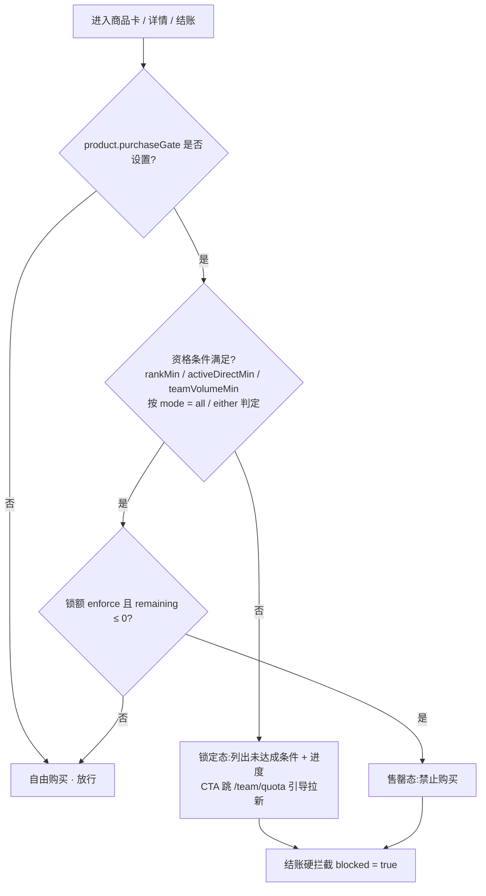

**Pro / Rack P1 上线默认**(后台可改):

| 产品 | 门类型 | 条件 | mode | 锁额 cap / sold | enforce |
|---|---|---|---|---|---|
| NexGridBox Pro | 单活跃直推 | ≥ 5 活跃直推 | all | 1,000 / 977(余 23)| 硬拦 |
| NexGridRack P1 | 组合 | V≥3 **或** ≥15 活跃直推 **或** 团队算力额 ≥ $20,000 | either | 100 / 92(余 8)| 硬拦 |

> 锁额 `remaining` 是该 SKU"还剩 N 件"的**单一来源**(收编原 `stock` 展示,消除双口径)。其余 SKU 默认无购买门;Pro v2 / Rack P2 维持阶段门(`unlocksAtPhase`)。

**算力阶梯（2026-11-03 P-66 起 5 档，H5 Lite 不含手机行）**：商城顶部倍数 Hero 下方的「算力阶梯」自下而上为 Box S1、Box Pro、Box Pro v2、Rack P1、Rack P2，分别取当前目录 `stellarbox-s1` / `stellarbox-pro` / `stellarbox-pro-v2` / `stellarrack-p1` / `stellarrack-p2` 的 `dailyEarn`；某个 SKU 缺失或无效时该行仍保留并显示「—」、进度条为空。Lite 不承载手机算力，阶梯不显示手机行，标题右侧显示实际行数「5 档」。进度条宽度按最高日产等比，透明度自下而上 0.35 → 0.75 逐档递增；两档 Rack 的 $/天 用品牌色，其余用正文色。用户已激活的最高硬件所在行显示「←你」并用 brand-2 色，金额取该设备自身日产；名称列宽固定，放不下标记时标记折到第二行，不截断；只拥有手机时不标记任何行。各档放在一张内容卡内，滚动到该区域时进度条从 0 逐行展开（系统减少动态时直接显示）；收益按 DS-27 用统计数字字体，设备名与「/天」用界面字体。Lite 商城不显示「手机 vs Box S1」对比卡（VsPhoneHero），顶部倍数 Hero 只以用户已拥有的真实硬件为基准（见本节开头）。

**Promo 并存**:升级置换横幅(§7.6)已改为按「用户是否持有可置换设备」动态显隐(无 phase 窗口),与 S1 促销条各自独立渲染;旧「window 开放时隐藏 S1 promo」互斥规则随 phase 窗口机制一并退役。

**卡片 ROI-first hero metric**(自上而下):

1. **大字日产**:USDT 主数字(如 `$7.00/d`)+ 同行 `+N NEX` 副字(双币)。Cloud Share 同为入门级日产出设备,显示 `$0.19/d` + `+3 NEX/d`,与硬件同形(无年化 / 份额 / 锁仓语义)。
2. **倍数徽章**(卡片右上角):`NNN×` + 副字 `vs phone`(= round(dailyEarn / 0.06),如 S1 117× / Pro 217× / Rack P1 750×)。
3. **价格行**:`Price $649 · $60/mo × 11` 小字。Cloud Share 改 `$19.9`。
4. **AI Performance 行**(已有):chip,展示 SDXL img/min · LLM tok/s · 解锁池信息。

> **商品卡不展示回本天数 / 年化 / 首年净利**——避免在卡片层引导用户自行算年化(数字可信不自曝,§13.1)。回本 / 年化 / 首年净利等 ROI 派生值仅在商品详情页(§7.2)与结账页展示。

**卡片元素**:
- 商品主图(目录 `imageUrl`)+ Best Seller / Trending badge + 库存告警(<50 时显示 `NN LEFT`)。主图套图(2026-11-03 P-66)统一为同一透明圆盘底座、同一机位,机身体积按档位递进:Box S1 < Box Pro < Box Pro v2 < Rack P1 < Rack P2;Box Pro v2 与 Box Pro 的区别是三列格栅、顶部柠檬绿灯条、石墨黑机身且更大;Cloud Share 为从半透明整机中抽出的一片算力模块,表达「整体中分出的一份」。
- 标题 + 副标 + GPU · VRAM 规格小行
- 上述 4 行 ROI hero metric
- 评分行(⭐ X.X · N reviews · N sold)
- 底部 footer 双按钮:Details (i 圆) + Buy Now CTA(内嵌价格)

### 7.2 商品详情 `/store/[productId]`

**硬件规格、AI 性能与相关资料（2026-10-25）**：硬件区依次显示 GPU、显存、功耗、在线率，数据来自 E1 当前商品配置；数据中心保留在部署位置 FAQ，不替代在线率。在线率只显示运营配置值，不自动补写 99.9% 或把自由文本扩大为 SLA 保证。已配置质保可追加显示。AI 性能在正式 App/H5 展示图像生成、LLM 推理、视频生成、LoRA 微调和解锁任务池；真实零值保留，小于 1k 的词元速率不能取整为零。各项缺值显示 `-`，不借用原型的 320/12.4k/18/6 等数值。任务池读取当前商品所选内容，已知任务类别按三语显示。

“相关资料”优先使用 E1 当前商品的资料名称与 HTTPS 链接（`specDocumentTitle/specDocumentUrl`），展示厂商规格或产品手册，独立于 I4 加载状态；切换商品/刷新以当前商品配置为准。未配置时回退 I4 已发布审计/储备资料；均无有效资料时显示“暂无相关资料”，资料区无重试按钮。技术规格不作为 UVEL 审计或实机性能证明。PC 可单独填写 GPU 型号与数量，App 读组合规格如 `4× RTX 4090`；功率值应写明 GPU 额定合计或整机实测口径，默认不推算 AI 吞吐和在线率。

**标题栏（2026-10-25 对齐原型）**：商品详情顶部使用一整条圆角玻璃栏，返回图标、居中商品名称与消息图标置于同一背景内，不为两侧按钮另加圆形底。商品名称下显示当前目录商品的 `tier`（如 S1 的 Entry、Pro 的 Pro），不固定套用截图商品名称。双行高 56px，未提供副标题时高 44px；内容与栏底间距 24px。滚动时整条栏和标题保持可见。目录加载、错误、未找到状态保留相应标题，不展示旧商品副标题；返回和消息入口保持可用。

**商品图片缓存（2026-10-25，仅原生 App；H5 Lite 不适用）**：原生 App 的商品列表与详情共用本地持久缓存，首次下载后重复访问和重启均复用；只缓存当前目录提供的有效签名商品图片。缓存按图片资产版本识别，签名续期不重复下载，换图后下载新资产。最多 64 张、32 MiB，按最近使用顺序清理；文件缺失或损坏时重新下载，保存失败仍可展示本次下载图片。H5 保持网页图片加载方式，不调用原生文件缓存。购买资格失败通过错误提示反馈，详情上方不额外放置资格说明；底部入口依据真实资格保持购买限制。

**当前资格交互**：详情上方移除资格、条件和错误说明块；底部“查看解锁条件”展示真实等级及配额条件；配额耗尽则显示耗尽状态并禁用按钮，不跳解锁页。查询失败用统一错误提示，未知资格仍限制购买，恢复后重查，离页后丢弃迟到反馈；服务端最终购买校验保留。图片压缩与缓存异常边界见本轮同步规格 §6。

**Phase gate（历史原型，仅作背景，不替代当前服务端资格流程）**:商品详情外层包 `<ProductDetailGate product={product}>` 客户端 wrapper。读 `useProductPhase()`,若 `product.unlocksAtPhase` 未 reached,**post-mount 替换整页**为 `<LockedProductCard>` 完整变体(lock icon + `New silicon — coming next quarter` 大字 + tagline + GPU/VRAM mini-spec + Estimated arrival + 全宽 `Notify me when live` 按钮)。直链 URL(`/store/stellarbox-pro-v2` 等)仍返回 HTTP 200,不走 `notFound()` — 用户从分享链接落地也能看到 anticipation 卡。SSR + first paint 渲染完整产品页(避免 hydration mismatch),mount 后再 swap,接受短暂闪烁(deep-link 场景为边缘 case)。

页面自上而下(unlocked 状态,2026-11-03 按 H5 Lite 现行页面更正):

1. **Hero card**:商品主图(目录 `imageUrl`,可带详情视频)+ 角标 ribbon + 主图左下实时成交弹幕(§7.2.2);下方商品名、tagline,再下为两项销售数据:左「累计已售」(`sold`),右「本周剩余」(硬件 `stock` > 0 时;缺货显示「暂时缺货」)。
   - **团队算力点(2026-11-03 P-66)**:销售数据正下方一行提示「[三节点图标] 每台为团队增加 12,990 算力点」,Cloud Share 为「每份为团队增加 … 算力点」(英文 `Each unit/share adds {n} compute pts to your team`,越南语 `Mỗi máy/phần cộng {n} điểm tính toán cho nhóm`)。数值读目录 `computePoints`(单件计入团队的算力点,与后端 `nx_product.compute_points` 同值),按语言千分位(越南语用「.」);数字用统计数字字体,其余为 12px 弱化正文,无分隔线、无强调色、不可点击。只在商品详情显示,商品卡和结算页不显示;`computePoints` 缺失、null 或为 0 时整行隐藏;不受「隐藏数据」遮盖(商品信息,非个人数据);窄屏可折成两行,不得溢出。目录下发该字段前此行不显示。
2. **活动 / 代金券提示**:从活动或代金券入口进入时,在 Hero 下方显示活动状态或代金券条款。
3. **Cloud Share 收益卡**(仅 Cloud Share):见下方 Cloud Share variant。
4. **预估收益**(仅硬件,非活动入口):「预估每日收益」「预估每月」两格,来自当前目录日产;不显示回本天数、年化或首年净利,也不显示与手机的对比(Lite 详情页没有手机收益条或倍数)。
5. **硬件规格** / **AI 性能**:见本节开头「硬件规格、AI 性能与相关资料」。
6. **信任资料**:合作方与本商品相关资料。
7. **FAQ**。
8. **底部固定购买栏**:价格、预估每日收益(硬件)、数量步进和「立即购买」;资格与配额状态见上方「当前资格交互」。

Cloud Share variant:Cloud Share 是数字份额(`productType=SHARE`,`inventoryMode=UNLIMITED`,不占实物库存)。详情页不显示预估收益两格,改为「预估每日收益」卡:USDT 日收益按当前价格、所选份数与目录参考年奖励率区间(`shareYieldMin`–`shareYieldMax`)折算成区间,另列 UVT 日收益和「参考年奖励率」,附「以实际到账为准」说明;不显示本周剩余。走立即购买流程。

#### 7.2.1 ROI Calculator

放在详情页底部,允许用户调整数量(1-10)实时重算。

**结构**:

- 标题 `CALCULATE YOUR RETURNS`(verify.sh 关键文案断言)
- 数量 stepper(`− 1 +`)— 仅硬件 SKU;Cloud Share(入门设备 · 日产微量)不含此计算器(见 §7.2 Cloud Share variant)
- `Total investment: $X,XXX` 即时小行
- **5 ROI block**(2 列 grid + 第 5 块 col-span-2):
  - Est. Daily
  - Est. Monthly
  - Est. Annual + 副字 `+N NEX/yr`(双币年度展示)
  - Payback(显示 `N d` 或 `X.X mo`)
  - **Year 1 Net**(col-span-2 突出,`+$XX,XXX`)
- **12-Month Cumulative Return Chart**(仅非 Share):
  - 标题 `12-MONTH CUMULATIVE RETURN` + 右上角终值 `$XX,XXX`
  - 12 根柱(月累计收益,profitable 月 / 未回本月)
  - `Purchase price` 水平虚线(对应 totalPrice)
  - `▲ Break-even M{n}` 竖虚线 marker(标第几月回本)
  - 底部 legend(Purchase price 点 / Profitable 点)
- Footer 免责声明:"Projections use current network parameters (live). Actual earnings fluctuate ±15%. ROI excludes electricity (covered by managed hosting)."

**计算公式**:

| 量 | 公式 |
|---|---|
| daily | `product.dailyEarn × qty` |
| monthly | `daily × 30` |
| annual | `daily × 365` |
| paybackDays | `round(totalPrice / daily)` |
| year1Net | `annual − totalPrice` |
| annualNEX | `product.dailyEarnNEX × qty × 365` |
| 月柱值 cumulative[i] | `daily × 30 × (i + 1)`, i ∈ [0, 11] |
| breakEvenMonth | `ceil(paybackDays / 30)` |

#### 7.2.2 LiveSocialProof 实时购买动态

商品详情页主图左下角的购买动态字幕。**目的**：用户看商品时感到「有人在看、有人在买」，缩短犹豫期。

**展示**：主图左下角浮层，文字无底色，同时可见 3 行（行高 22px），列表首尾相接匀速向上滚动（每行约 2 秒），上下边缘渐隐。字幕不在视口内时暂停滚动，系统开启「减少动态」时不滚动。每行为色点 + 数字 + 标签。

**内容**（读 `GET /api/storefront/products/{productNo}/social-proof?windowDays=30`）：

- 返回 `liveActivity` 时显示三行：「N 在看」「N 24h 售出」「N 30 分钟售出 ⚡」。
- 未返回 `liveActivity` 时显示「N 已售 · 30 天」「N 累计已售」，库存少于 50 时加「N 台剩余」。

**实时数据为模拟数据（2026-11-03）。** 后端在 `liveActivity` 返回三项模拟值。正式模式读取正式商品目录，TEST 沙箱接口只读取当前 run 的目录。发布客户端只接受正式来源和空 runId。本地预览按同一算法生成，参考实现为 `scripts/lib/prototype-demo-data.mjs` 的 `demoLiveActivity`，精确算法、哈希和对照样例见 uvel-docs B24。商品编号、目录销量和时间相同时，各用户读到相同的数值。

- **模拟销量**以当前数据源目录中该商品的 `sold_count` 为基数。日均售出 = 1.2 × √`sold_count`。商品编号与分钟序号的哈希决定该分钟是否成交，概率 = 日均售出 ÷ 1440。「24h 售出」取最近 1440 分钟的成交笔数，上限为 `sold_count`。「30 分钟售出」取最近 30 分钟的成交笔数。若 24h 售出为 0 则为 0，否则至少为 1，且不超过 24h 售出。两项只随成交进入或滑出时间窗而变化。接口的 `cumulativeSales`、`windowSales` 仍按原有真实销售口径返回。
- **在看**：保底人数 = 200 + 0.8 × 日均售出 + 0–20（按商品固定）。在保底之上叠加两条平滑曲线后取整：慢曲线每 150 秒换一个目标，在保底之上 0 至 +25% 之间变化；快曲线每 15 秒换一个目标，幅度 ±1.5 人。两条曲线在目标之间缓入缓出过渡。实际人数因此大致在保底到保底 +25% 之间（快曲线可再偏出 1–2 人），结果低于 200 时取 200。
- **效果**：在看人数始终在 200 以上，每 4 秒刷新多数变化 0–2 人，偶尔 3 人；累计已售上万时偶尔 4–5 人（约 1%）。原型现有商品（累计已售 42–107）在看约 210–285 人，24h 售出约 6–20，30 分钟售出多为 1。累计已售约 5,000 时，在看约 270–360 人，24h 售出约 85 上下，30 分钟售出 1–5。

**刷新**：字幕在视口内时每 4 秒静默读取一次，上一次返回带 `liveActivity`（或尚未读到）时才继续轮询，同作用域请求不重叠。离开详情页（页面 onHide）或字幕滚出视口后停止。明确的临时网络或服务故障保留当前快照；首次读取失败显示「购买动态暂不可用」，下次可见读取可恢复；认证或权限失效时清空。切换账号或商品后不显示旧响应。

**i18n**：`store.liveProof.{viewingLabel,sold24hLabel,sold30mLabel,cumulativeSalesLabel,stockShortLabel,unavailableLabel}`、`store.soldLabel`、`store.detPaybackDays`（中、英、越）。

### 7.3 结账流程 `/store/checkout`

**活动结账首次读取（2026-11-04，BUG-159）**：先完成本页商品目录刷新，再读取活动报价与可用优惠券。正常首次加载不显示「选择已保留，重试后确认」。真实读取失败保留失败提示和「重试」入口；重试成功后恢复原商品、数量与报价，不改变优惠计算、建单或付款规则。

H5 Lite 保留网页结算与导航，不售卖手机。普通购买、组合购买、活动结算、试用转正、升级置换与容量购买使用相同的付款方式；旧机抵扣的可选来源按明确设备身份（`kind=phone`）去掉手机，即使服务端资格里包含手机也不列出（2026-11-03 BUG-078）；订单详情可继续原付款。活动与组合的新购买也按 Lite 商品身份规则校验，直接携带手机 SKU 的商品明细链接、以及明确选择的活动报价中含手机赠品时都不能确认或建单；未选择活动时服务端自动匹配到送手机的活动，结算改为读取不自动匹配活动的普通报价供用户确认，不从服务端报价里删减奖励（2026-11-03 BUG-078）；用户明确选择的优惠券（含「不使用优惠券」）保持不变，未明确选择时重新比较可用优惠券并自动选用最优的一张，原来输给该活动、不可叠加的优惠券也会被选中，替换后的金额在确认前显示（2026-11-03 BUG-083）；已有订单和未决命令仍按原身份恢复。

#### 7.3.1 确认与支付方式

商品确认显示美元金额；服务端负责库存、购买资格、优惠与容量的最终校验。新组合购买进入共用商品明细结算，旧组合命令继续按原身份恢复。已创建订单、未知创建命令、试用转正及 KEEP/置换恢复先处理原结果，不能因余额、券或库存变化重新创建。

正数应付可选钱包、银行卡或 USDT（ERC20 / BEP20）。外付渠道与网络按 `/api/app/purchase-payment-policy` 配置显示；未配置的选项隐藏。选 USDT 后 ERC20 排第一并默认选中，ERC20 未配置时默认 BEP20，用户可手动切换；政策尚未读到时先按 ERC20 报价，报价或随后读到的政策表明 ERC20 未配置时自动切到 BEP20 并重新报价；政策读取失败时只把报价明确返回未配置的通道隐藏，银行卡等其他通道仍可选（2026-11-03）。配置读取失败时继续通过报价核验渠道，明确的“未配置”报价拒绝会移除该选项。零应付权益仍走钱包确认与 PIN，不创建零金额外付单。

结算页底部显示「支付前请阅读以下说明」和两个链接「售后说明 | 服务条款」(en: After-sales | Terms;vi: Hậu mãi | Điều khoản),两链接与中间分隔线居中排列;底部不再单列风险提示(2026-11-03)。「售后说明」打开「购买、退款与售后说明」弹层:展示商城 FAQ 的退款、位置与需求说明,以及「付款前请阅读服务条款和风险提示书，确认所选商品的购买与售后条件。」,弹层内提供「服务条款」(§4.7.5)和「风险提示书」(§11.4a)两个链接。

只有钱包付款要求六位支付密码；首次设置需两次输入，再输入本笔支付 PIN，设置成功本身不授权扣款。PIN 拒绝保留原订单；取消时查询原付款结果，服务端明确未执行后才取消原单。找回、锁定、账号切换及离页清理沿用支付密码生命周期。外付不读取或提交 PIN。

#### 7.3.2 报价、费用与倒计时

普通、试用转正、活动与组合结算的支付操作固定在 Lite 底部栏，窄屏允许金额和按钮分行，正文保留底部滚动空间。普通远端结算在资格读取后显示旧机抵扣入口；容量满可选择替换，读取失败可重试。Lite 没有手机初始化设置步骤：服务端要求初始设置时显示「暂时无法购买，请联系客服。」并提供「联系客服」（`/support/messages`），不显示重试，也不跳转注册成功页的设置模式或估算页（2026-11-03 BUG-068）。已有订单或原命令优先恢复。顶部返回执行原单查询与安全取消，不能因 PIN 拒绝直接离开并遗留预留，也不能取消付款中或结果未明的订单。

- 外付本金、渠道费用、网络确认费与总额来自服务端，未知费用不得按免费处理。ERC20 网络费由用户承担并计入总额，外部钱包另收 ETH Gas；BEP20 外部钱包另收 BNB Gas。
- 外部付款的费用明细（商品金额、通道手续费、网络确认费、支付总额）都按两位显示：商品金额取服务端已取两位的收款本金 `subtotalUsdt`，不单独显示舍入差额或六位业务本金，各行相加等于支付总额（2026-11-03 BUG-085）。
- 银行卡确认、等待与结果金额显示 `$`；银行卡实际支付页之外不显示 VND 金额或锁定汇率。原 intent 的 VND/FX 快照仍保留用于协议核验。
- 方法页显示原订单剩余时间；钱包不足显示差额并可去充值。充值携带原单、金额与截止时间，余额足够后返回原单续付。
- 报价到期前 30 秒自动刷新，失败按 3/6/12 秒递增重试（上限 30 秒）。已建 intent 通常每 5 秒读取，失败按 5/10/20/30 秒退避；后台暂停，回到前台立即查原单。
- 可付款截止取订单、intent、服务端 deadline 与银行 expirationTime 的最早时间。确认宽限只允许等待确认，不延长转账时间；`paymentAllowed=false` 时关闭付款入口与地址。

#### 7.3.3 外部付款与原单恢复

USDT 页绑定所选网络，显示应付总额、二维码、地址、复制操作、倒计时与等待状态；到账后显示资金已收到，再读取交付结果。银行卡先确认美元总额及付款提醒，H5 在 UVEL 页头下用受信任 URL 的 iframe 嵌入支付页，不使用原生 webview。

付款前、剩余时间不足、离开、超时、银行失败、人工核对、迟到款与交付异常使用居中提示。服务端判定 EXPIRED / MANUAL_REVIEW 后不再显示可付款地址或银行入口。已交付后收到额外款项，保留交付事实与人工核对提示，不自动补钱包或退款。

原 kind/key/quote/intent 及网络按账号保存；刷新或离开后查询原 intent，不改网络、不重新报价建单。创建响应丢失时按原键查询；只在明确未见且原协议允许时同键继续。报价变化等明确拒绝也先查原键，查询失败继续保留身份。置换同时保存付款命令是否已提交，刷新恢复后不改变该状态；明确未提交且原键查询为未见、允许同键恢复时，可以取消并释放原键、报价和恢复锁。已提交、历史提交状态缺失或读取失败都保留原身份；外部付款发起后关闭界面不取消付款。处理中或结果未明都不能移除抵扣、切换为普通购买或另起付款；明确拒绝后才可重新选择，成功后核验原交付结果。

结算初始化及提交前均检查该商品未完成的容量 KEEP 和 REPLACE 命令；恢复使用保存的原身份和报价。即使新容量报价变为有空位，也不能绕过原付款新建普通订单。

普通、活动及组合购买的支付选择保留原订单号与服务端截止时间，充值补足后返回同一订单，到账页可查看同一订单。冷恢复后超时提示可关闭或查看原单；银行失败可回原业务续付，先确认旧 intent 已终结，再核验订单可付款状态。Esc 不触发新付款。

#### 7.3.4 购买成功与激活

支付回执与原业务身份、金额匹配后先显示购买成功，再显示激活或入库结果。动效只展示服务端事实，不触发扣款或模拟激活。普通、订单详情及活动结果卡优先显示 `paidTotalUsdt`（含渠道和网络费用），未提供时回退原业务金额；银行结果显示美元。平台奖励币显示 UVT，试用奖励按服务端回执展示，不再固定承诺首单奖励。

### 7.4 订单管理 `/store/orders`

2026-11-01 SKU 主图一致性：订单列表、详情与支付结果、首页设备/试用入口、设备仓库与配额入口，按真实 SKU 使用与商城相同的当前目录 `imageUrl`。历史订单仅剥离已知数量后缀，组合单按首条结构化 SKU；设备按服务端 `productCode`，不把 Pro/Pro v2、Rack P1/P2 合并成家族图。目录缺图、未知 SKU 或失效上下文只显示中性占位，禁止回退到内置机型图。后台更换主图后跟随当前目录更新，冷启动等登录态绑定后读取目录，换号不沿用上一账号图片；深色模式下保留商品图原色，缩略图不得被系统自动反色成其他外观；手机、优惠券、创世权益等独立装饰资产不充当商城设备主图。

2026-11-01：设备订单首次仅查询 20 条，真实向下滚动接近列表底部才带原游标再查 20 条；不预取、不循环拉全量。到末页停止，分页失败保留已有订单和同游标重试；无滚动事件的平台保留加载更多。创世订单保持独立来源和分页。配图按成交 SKU（组合单按首条结构化明细）选取；兼容历史置换快照中“SKU×数量”的展示后缀，只用于选图，不改订单身份、数量或金额。设备配图复用轻微上下浮动；减少动态偏好下静止。

订单 4 阶段直通车:`placed → paid → provisioning → activated`(平台为机房托管模式,无实物物流环节)。

**结算与驻留态**：服务端创建订单后可停留 `placed` 待付款，付款与创建为独立动作。付款、交付与激活均读取服务端规范状态，前端不以定时器宣布成功。`inventory` 表示已购买并入库，尚未激活。

**待付款与恢复**：列表待付款行显示服务端到期时间对应的剩余分钟和「继续付款」；点击直接打开详情的原单支付。详情显示倒计时，所有状态的主操作固定在底部；未到达的进度节点只显示点。正在外付的原单继续查询其 intent，不能改走一笔新钱包支付。

**取消与关闭原因**：只有服务端允许的未付款订单可以取消；付款处理中取消受阻时显示原因并提供继续付款。取消、过期、支付失败、交付失败及拒付按 `closeReasonCode` 显示关闭原因，保留订单号和支持入口。付款成功后的退款与人工处理不由前端自行决定。

**订单详情**：保留完整订单号复制、数量、结构化商品明细、折扣、业务总额、时间线与退款字段。成功结果使用含费用的实付总额（如服务端已提供），查看设备从 Lite 的设备页进入，返回仍遵循 Lite 导航。更多支付行为见 §7.3 与 `docs/PRD/payment-17-18-lite.md`。

### 7.5 升级置换(Trade-in)— 随时下架 + 产出阶梯抵扣

**中文命名（2026-10-30 用户统一）**：面向用户的功能名称统一为「升级置换」，包括页面、入口、搜索及推荐文案；`tradein`、API 与路由标识保持不变，不改变资格或支付规则。

**代际概念已取消**。任何已购付费设备可**随时下架**,按其累计产出落阶梯折算抵扣金额,用于购买**任何更高价 SKU**(默认规则,后台可配)。三个入口表面:

1. **设备仓库置换条**(`/me/devices`,主动入口)— 每台合规设备行内「可抵 $X」chip(→阶梯规则说明弹层)+「升级置换」CTA(→选目标 → 确认 → 去结算);
2. **Checkout intercept**(`/store/checkout` mount-time)— 买任一设备 SKU 时,若持有可置换设备自动弹分叉 sheet(置换抵扣 / 全价购买);
3. **商城横幅**(`/store` 顶部,§7.6)— 按用户最优可置换设备动态报价,CTA 跳设备仓库。

**总不变量**:抵扣**仅在结算时抵减应付款,永不写入余额**、不可提现、不可拆分;真值 server-authoritative(`POST /api/orders` 携 `tradeInDeviceId`,服务端同事务复算抵扣 + 下架旧机)。

#### 7.5.1 Eligibility 评估 + 产出阶梯抵扣

**购买资格**(与旧版一致,仅 trade-in 规则去定向):`eligibility[kind]` 定义,模式 `open / any-of / all-of`,9 种规则类型:`open / own-kind / own-prev-tier / v-rank-min / cumulative-deposit-usdt / kyc-tier / days-active / referral-count / trade-in`。`trade-in` 规则**不再限定来源型号**(fromKind 可省,任意合格设备的置换即满足该通道)。

**默认 eligibility**:
- **S1**:`open`(任何用户可购)
- **Pro / Pro v2**:`any-of`〔own ≥1 S1 / V-Rank ≥2 / 累计入金 ≥$1000 / trade-in〕
- **Rack P1 / P2**:`any-of`〔own ≥1 上一档 / V-Rank ≥4 / 累计入金 ≥$5000 / trade-in〕

**设备置换资格**(计算候选清单 `eligibleTradeInDevices(targetKind)`):实付价 > 0(赠送/免费设备排除,前端零痕迹)∧ kind ∈ `applyTo` 白名单 ∧ 目标目录价严格更高(`requireHigherPrice`,可配)∧ 非「激活中且任务运行」(阻断判定单源 `isDeviceTaskBlocked`:**库存设备上的出厂任务不在跑、不阻断**;激活设备走「先停用(自带等任务/强停保护)→ 库存态再置换」既有链路)。活跃与库存设备均可置换;候选按可抵额降序。

**置换目标合规**(三个目标面——retire 目标列表 / 设备行 strip / 商城横幅——统一判定 `isTradeInTargetAvailable`):目标 SKU **已正式上架(unlocksAtPhase 已达,与商城正门同源)∨ 处于抢先购窗口**(§7.1 `tradeInEarlyAccess` 开关,默认关);未上架且不在窗口的 SKU 不出现在任何置换目标面。

**产出阶梯抵扣公式**(`computeTradeInCredit`,唯一抵扣引擎;无持有时长门槛——套利防护由阶梯本身承担:刚买产出≈0 → 落最高档,抵扣 ≤75% 实付,立即置换必亏 25%):

```
ratio  = cumulativeEarningsUsdt ÷ paidPriceUsdt        // 产出比(分子=该设备累计 USD 产出,分母=实付净额)
credit = paidPriceUsdt × creditPct(band(ratio)) × promoMult,  clamp 到 [0, 目标价]
```

| 档 | 产出比区间(左闭右开) | 抵扣比例(默认) |
|---|---|---|
| 1 | 0% – <25% | 75% |
| 2 | 25% – <50% | 60% |
| 3 | 50% – <75% | 45% |
| 4 | 75% – <100% | 30% |
| 5 | ≥100% | 15% |

- **实付基数**:`paidPriceUsdt` = 实付净额(订单 total,已扣券与置换抵扣;trial 转正 = 促销价 − 收益抵扣),非目录价 — 防券/试用低价买入套利。
- **paidPrice = 0(赠送)⇒ 不可置换**(资格排除,非"∞ 产出比落档 5")。
- **规则参数**(后台「升级置换阶梯」面板可配,详见后台 PRD E 域):阶梯 5 档界点与比例(区间连续、比例严格递减,结构由机器哨兵锁)/ `requireHigherPrice`(默认 true)/ `maxDevicesPerOrder`(默认 1)/ `promoMult`(默认 1.0;>≈1.47 时 clamp 可能绑定)/ `applyTo` SKU 白名单 / `enabled` 总开关(关闭 = 全部置换入口隐藏)。
- 所有参数 server-canonical via `GET /api/config/tradein`,运营可热改无需 client redeploy。

**铁律**:抵扣 **永不写余额** — 仅在结算中作为扣减项(`debitBalance(price − discount − credit)`),不可提现、不可累加;累计产出越多抵扣越低(合规口径向用户明示,引导尽早置换)。

#### 7.5.2 Checkout intercept 触发条件

结账页 mount 时按序评估(**全部设备 SKU 均可触发**,旧 v2/P2 白名单排除已取消):

-1. **上架节奏门**(先于购买门——没上架谈不上资格):`unlocksAtPhase` 未达的 SKU,仅当「携置换上下文 ∧ 抢先购窗口内(开关默认关)」放行;否则提示「即将上架」+ 跳回 `/store`(深链防线,与商城正门口径同源)。
0. **购买门硬拦截**:对挂 `purchaseGate` 的商品跑 `evaluatePurchaseGate`(§7.1),若 `blocked` → 阻断支付 + 跳 `/team/quota`。**门优先级高于置换**——向被锁 SKU 置换同样被拦(retire 流选中被锁目标时在此兜底)。服务端下单二次校验为权威。
1. **已带置换上下文**(用户从设备仓库 retire 流确认后到达,`appliedTradein.targetKind` = 本单 SKU)→ 不再弹分叉,直接渲染抵扣行。
2. 若持有 ≥1 台可置换候选 → 弹**分叉 sheet**(选哪台设备置换(设备级,含各台实时可抵额)/ 全价购买)。
3. 否则若 `activeCount ≥ MAX_DEVICES` → 弹**让位 sheet**(让出最低产出设备)。
4. 否则正常 checkout 流程。

#### 7.5.3 Sheet 状态机 + 结算原子块

`useTradeinSheet` 单一 discriminated union 防双开:`{ kind: "none" | "choice" | "retire" | "tradein" | "replace" | "block" }`,block 态按来源分裂(`origin: "replace" | "retire"`)。

| Sheet 态 | 触发 | 主流程 |
|---|---|---|
| `choice` | Checkout intercept 分叉 | 列全部可置换设备(每台带实时抵扣额),选设备 → tradein;或全价购买(槽满 fallback replace) |
| `retire` | 设备仓库「升级置换」CTA | 选升级目标(**点选列表**,仅列合规目标 SKU,每行带抵后价;无自由输入)→ tradein |
| `tradein` | 置换确认 | 确认卡:旧机 / 累计产出 / 抵扣档位 / 本次抵扣 / 预计应付 + 合规披露 → 确认写入结算抵扣上下文(`appliedTradein`,仅内存态,离开结算页即弃)→ 去结算 |
| `replace` | Path B 槽满 | 让出最低产出设备 / 保留全部槽位入库 / 取消(原有流程不变) |
| `block(origin=retire)` | 目标设备激活中且任务运行 | 「任务完成后即可下架」+ 查看任务进度 / 知道了(**无强拆选项**) |
| `block(origin=replace)` | 让位目标 mid-task | Wait / Force-replace(放弃任务,原有流程不变) |

**结算原子块**(钱与设备的唯一变更点,checkout 持久块同步执行、无 await 无半执行窗口):

```
支付确认 → 复检抵扣上下文(设备仍在 ∧ 非任务阻断 ∧ 开关开;失效 → 拒单重报价,绝不静默按全价扣)
        → debitBalance(净额 = 价 − 券 − 抵扣, ≥0)      // 失败 → 退回支付步,零状态变更
        → 移除旧设备(下架) + 持久化
        → createOrder{ tradeInCredit, tradeInDeviceId }   // order.total = 价 − 券 − 抵扣
        → 账单(i18n memo 含置换明细) → 清抵扣上下文
```

新设备由订单履约管线生成(**未激活入库**,`paidPriceUsdt = order.total`),不在本块内。

**关键不变量**:
- M1(原子):扣款成功前零状态变更;扣款后同步序列无失败分支(移除为幂等 filter)
- M2(抵扣不入余额):`debitBalance(净额)` 是唯一接触余额的调用,抵扣不经 `creditBalance` 路径
- M3(双击防御):每个 composer 入口 confirming 守卫,成功/失败路径均复位
- M4(判定单源):任务阻断 `isDeviceTaskBlocked` 与抵扣引擎 `computeTradeInCredit` 各自单源,全部消费面(候选/入口/确认/结算复检 × 七个抵扣展示面)禁止旁路自算

**业务流程图(retire 主链)**:

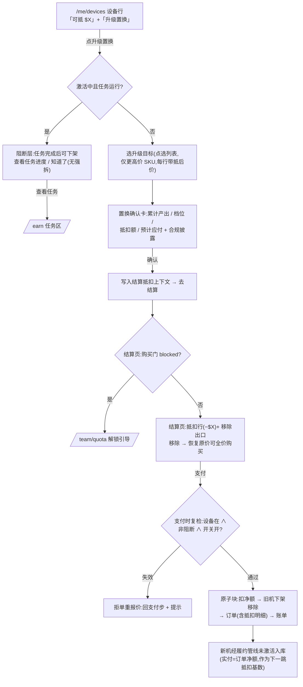

**确认弹窗购买资格（2026-10-30 用户补充，F07截图精简覆盖）**：确认层读取精确目标 SKU 的服务端购买资格。资格满足时保留完整报价与旧机位置继承说明；未达标／名额耗尽时采用短标题「暂未满足升级条件」，删除旧机、累计产出、抵扣比例／金额、预计应付整块及余额、交付和支付长说明，只呈现真正阻挡的未满足条件及当前值／门槛／差额／进度。已满足的规则组、直推和可用名额不展示。EITHER已有门槛满足而仅名额耗尽时，只呈现名额阻挡；多个缺项才保留必要的全部／任一关系，不重复标题。累计／月度名额按已用／总额与剩余展示，不参与任一解锁，不将剩余名额误称尚差。精确SKU只读条件页仍展示完整E1及所有F4B条件。总资格与各规则矛盾或未知时按未确认处理，不重算或放宽资格。

- 未达标：短弹窗仅显示缺项及进度，单缺项应在手机一屏看见主操作与取消，无须长滚动；主按钮「查看解锁条件」，只打开该 SKU 的条件页；该只读入口不提供购买或跳商城 CTA，不创建订单、不扣款、不取消旧设备。返回原确认弹窗重新读取，旧报价仅为当前流程内存，不持久化为成交意图。
- 满足：主按钮显示原「确认置换 · 去结算」，点击时强制复验最新资格，满足才传原报价进入结算；后端成交资格、容量、资金及幂等守卫保持。
- 未确认／加载／失败（F08）：只显示小的中性资格验证提示或错误重试与取消，不渲染旧机换新大标题、完整报价、资金缺口或交付／支付长说明，也不展示旧条件快照。结果直接进入精简未达标态或本次明确eligible的完整确认态，禁止先显示完整卡再收缩；首次进入、返回条件页、重试及点击确认的fresh读取均适用，不以旧快照缓存放行。加载不重复操作，失败可重试；名额耗尽保留原因、禁用主按钮与独立刷新。资格明确满足时，钱包不足才随完整确认独立显示权威缺口，不冒充资格失败。原交易恢复入口仍优先。
- 读取和延迟导航按账号绑定代际、旧实例及版本、精确目标、弹窗代际和页面可见性隔离；关闭、换号、换源、换目标后的迟到响应不覆盖或导航。同 SKU 存在原待确认交易（已知回执或响应未知）时先读原账号指针，不发新资格 GET、不要求已回收旧机仍存在，仅导航原结算恢复；点击再次查指针，存储读取异常阻止新购。原交易沿既有只读或同键恢复，不另建单、不重复扣款。三语、隐私遮挡、滚动可达操作沿用现有组件。

#### 7.5.4 `/me/devices` 设备仓库置换条 + 阶梯说明弹层

**常驻置换条**(取代旧 `<TradeInPromoBanner>` 弹出式推送,入口从"节奏推送"升级为"行内常驻"):每台设备行底部按资格渲染:

- 合规设备:「可抵 $X ›」chip(点开**阶梯规则说明弹层**:5 档表 + 当前档高亮 + 该设备产出比/落档描述 + 合规脚注,数据全派生自阶梯单源)+「升级置换」CTA(→ §7.5.3 retire 流)
- 免费设备(paidPrice=0)/ 不在 applyTo:**零痕迹**(不渲染置换条)
- 无更高价目标(已持最高档):显示禁用原因「当前已是最高算力档位」
- 激活中且任务运行:CTA 可点,进阻断层(业务链必有下一步)

旧 promo 推送配置组(`cooldownHours / maxPerSession / delayMs / routes / triggerWhen`)保留为后台预留参数(server-canonical),当前版本无弹出式推送消费者。

#### 7.5.5 i18n

`tradein.*` namespace 按面组织(en/zh 全镜像):eligibility hint 组(9)/ choice 分叉组 / retire 目标选择组 / tradein 确认卡组(含档位行)/ checkout 抵扣行组(含移除)/ 设备行置换条组(strip*)/ 阶梯说明弹层组(ladder*)/ replace & block 组(含 retire 阻断专用文案)/ 错误组。结算账单 memo 走 `store.coBillMemo*` 模板(账单页直接渲染,禁硬编码英文)。

#### 7.5.6 Demo 演示工具(PM-facing)

`/me/replay-tour` 顶部新手引导回放后,挂"Lifecycle demo"section,PM-facing 演示 action,让 prototype 演示者绕过"购买 → 等月份"的真时间延迟,立即呈现任务产能递减 + 升级置换流程效果。

| Action | Store call | 效果 | i18n key |
|---|---|---|---|
| Seed S1 | `_devSeedLegacyDevice("stellarbox-s1", 5)` | 加一台 5 个月前购买的 NexGridBox-S1(落地产能 ~70%) | `replay.demoSeedTitle/Hint/Cta` |
| Seed Rack | `_devSeedLegacyDevice("stellarrack-p1", 8)` | 加一台 8 个月前购买的 NexGridRack-P1(落地产能 ~50%) | `replay.demoSeedRack/RackHint/RackCta` |
| Fast-forward | `_devFastForwardAll(3)` | 全部参与递减设备 purchasedAt 拨回 3 个月 | `replay.demoFastForwardTitle/Hint/Cta` |
| Reset | `_devResetDevices()` | 重置回 phone-only(purchasedAt = user.joinedAt) | `replay.demoResetTitle/Hint/Cta` |
| Trigger milestone | `useMilestones.reset() + _devBumpEarningsTotal(150)` | 重置已触发的里程碑 + 拨高 earnings 跨过 $100 阈值,§11.3a watcher 下次 poll 时 fire celebration overlay | `replay.demoMilestoneTitle/Hint/Cta` |
| Trigger Nova push | `useStella.push(monthlyTaskLockPush + tradeinNudge)` 走唯一 cooldownKey 绕过节流 | Sprint 2 收尾(Gap D)— 立即 force-fire 月度任务锁定推送 + Trade-in nudge(若条件满足),文案随当前 phase 切换,PM 演示无需等真 cadence | `replay.demoStellaTitle/Hint/Cta` |

每个 action 触发 toast 反馈(模板 `replay.demoToastSeeded/FastForwarded/Reset/Full`),容量校验 MAX_DEVICES。

**设计意图**:快速展示"用户买了 NexGridBox 4-5 个月后看到接单量递减 + 升级置换引导"完整路径,不能等真时间。这些 demo helpers 不影响真实用户流程(用户从 /store 正常购买的设备 purchasedAt = Date.now())。

### 7.6 升级置换横幅(TradeinWindowBanner)

位置:`/store` 顶部,VsPhoneHero 之下、商品列表之上。**条件渲染** — 用户持有 ≥1 台可置换设备(§7.5.1 资格:实付>0 ∧ applyTo ∧ 存在合规目标 ∧ 抵扣>0 ∧ 总开关开)即显示;无合格设备整横幅隐藏,无 phase 窗口概念。

**目的**:把用户手上"最划算的一台置换机会"以动态报价固化在 `/store` 顶部,与 §6.8 车队产能 Banner(/earn 入口)、设备仓库置换条(§7.5.4)互补 — 三侧任一进入 §7.5 置换流程都有 1-tap 路径。CTA target 为 `/me/devices`。

**报价派生**(全实时,无写死金额):遍历用户可置换设备,每台按其**最低升级价目标**计算阶梯抵扣,取**抵扣额最高**的一台展示 —— `你的 {name} 可抵 ${credit}` + `升级 {target} 只需再付约 ${net}`(net = 目标价 − 抵扣)。

**i18n**(`store.tradeinUpgrade.*`):`label` / `title{name,credit}` / `body{target,net}` / `cta`。旧 `store.tradeinWindow.*` 窗口键组已删除。

**铁律**:文案永不暴露 phase / 内部参数名等 PM 术语;抵扣口径向用户明示"按累计产出计算、越早置换抵得越多"(合规透明,同时构成紧迫感)。

### 7.7 代金券(Voucher · 领券促销)

平台促销代金券:运营在后台(运营控制台 H7)创建 / 配置,用户领取后在结算对应设备时自动抵扣。两类:**满减(fixed)**= 订单满 `minPurchaseUSD` 减 `amountUSD`;**折扣(percent)**= 按 `percent`% 抵扣、封顶 `maxDiscountUSD`。

**目的**:以可控的获客 / 活动促销降低首购门槛,定向(新人 / 全部受众)+ 定 SKU(指定设备或全设备)+ 限时(有效期),全部参数后台可配、随时可投放 / 暂停。

#### 7.7.1 领取入口与弹窗

- **首页自动弹窗**:用户进首页(`/`)后延迟自动弹出领券弹窗,展示当前可领代金券(名称 / 面值 / 门槛 / 适用范围 / 有效期)。弹窗有节流(冷却 + 单会话上限),且**优先于免费试用弹窗**(同一次进站只弹一个;无可领代金券时让位给试用弹窗)。
- **回退 banner**:用户关闭弹窗后,在后台为该券配置的页面(`home / store / me / earn` 子集)顶部显示领券 banner 入口;点击重新打开领券弹窗。banner 仅在一级 tab 页出现,子页不出。
- **领取**:点击「领取」即领入个人钱包(claim);同一券每用户限领一次。

#### 7.7.2 领取后跳转(马上去使用)

领取后同一按钮文案变为「马上去使用」,点击按券的适用范围跳转:
- **指定单一 SKU 券** → 跳该设备购买详情页 `/store/[productId]`。
- **多设备 / 全设备券**(`applicableSkus` 为空 = 全设备)→ 跳商城 `/store`。

#### 7.7.3 结算抵扣

进入某设备结账(`/store/checkout`)时:
- 系统在用户**已领、未使用、在有效期、适用本 SKU** 的代金券中,自动选取**抵扣额最大**的一张(`bestVoucherFor`)。
- 价格摘要新增「代金券 −$X」行;**满减**按门槛判定(订单额 ≥ 门槛才抵),**折扣**按百分比并受封顶约束;抵扣额不超过设备价。
- 卡支付的 3.5% 手续费按**抵扣后**小计计算;`Order.discount` 记抵扣额、`Order.total = 单价 − 抵扣`;账单(useBills)备注带券。
- 下单成功后该券置为已使用(单次核销,`markUsed`)。
- 若用户已领、适用本 SKU 的券**已过期**(被自动选取跳过),价格摘要显示一行「代金券已过期」提示,而非静默无折扣。

#### 7.7.4 性质与叠加规则(后台可配)

- **不可提现**(固有性质):代金券只在结算抵扣价格,**永不计入可提现余额**、不会转化为现金。
- **不可拆分**(`splittable`,默认否):一张券整张一次性用于一笔订单,不跨单拆分。
- **叠加策略**:`stackWithTrial`(可否与试用收益抵扣叠加)/ `stackWithOthers`(可否与其它优惠叠加),默认均为否(二选一取最优);当前结算流中代金券为唯一折扣来源。
- 领取资格、有效期、核销均以服务端为权威(claim / 下单核销服务端二次校验);客户端为乐观镜像。

#### 7.7.5 个人中心入口

「我的奖励」(`/me/rewards`,见 §11.5a)是代金券的用户侧查看入口:类别汇总页显示可用张数,分类记录页列出可用券(带「去使用」)与已过期券;个人中心(`/me`)「账户」分组提供带未读红点的入口项。

#### 7.7.6 业务流程

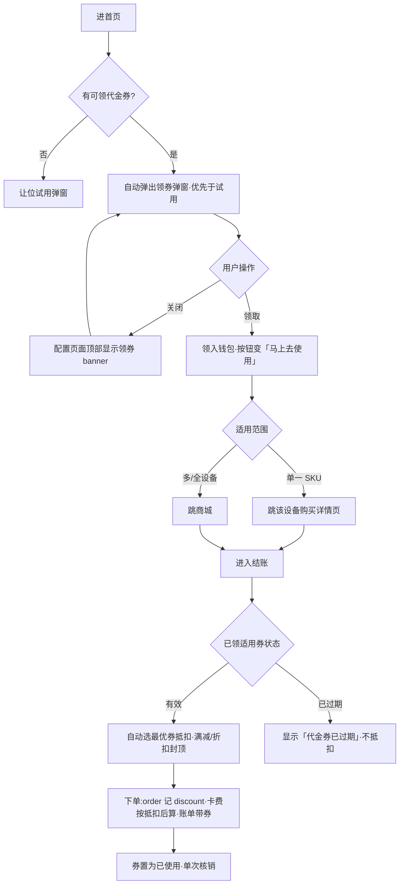

**铁律**:代金券是真实促销折扣,文案与展示不暴露任何运营 / 漏斗术语。

---

## 8. Team(团队中心)

### 8.1 团队主页 `/team`

汇总枢纽,显示:
- 邀请 hero(ReferralHero,见 §8.1.1)
- 3-stat 行:Direct(自直推人数)/ Network(直推+扩展总数)/ Today(今日团队收益)
- V 级 hero + 升阶进度条 + 等级奖励 chip(培育奖 NEX)
- 5-track Team programs 卡(V-Rank ladder / Influence Royalty / Dual-Track Binary / Leadership Pool / Regional Ambassador)— 每行 icon + label + sub + 右侧 value;value 按 §8.1.0 规则分类显示
- 团队收益卡(TeamLedgerCard,见 §8.1.2)— 本月 + 累计 + Direct/Extended 拆分 + 可提现/冷却 + 提现入口(单一聚合卡,替代原"团队 lifetime 卡 + 月份佣金卡"的拆分布局,消除 lifetime $195.09 与本月数据重复显示)
- Influence Network 入口(链 §8.7 orbit live map)/ Genealogy 入口(链 §8.8)
- Genesis FOMO 卡:销售进度 + 剩余配额 + 链 Genesis 详情
- Leaderboard preview:Top Inviters + 自己排名 + ↑N 周变化 + 链 §8.11

#### 8.1.0 ProgramRow value 字段分类

ProgramRow 右侧 value 按内容自动分类,影响视觉强度:

| Value 类型 | 示例 | 语义 |
|---|---|---|
| Active earnings(含 `$`) | `+$11.00/d` / `$240/wk` | 真实 active earnings,强调显示 |
| 状态 / hint | `Active` / `+14% next` / `Locked` / `V5+` | 状态指示 / 升级 hint,次级显示 |
| Disabled 锁定 | 任意 + `disabled: true` | 未解锁,弱化显示 |

判断方式:`val.includes("$")`。语义:earnings 强化"钱在流入",status hint 引导 unlock 动作。

#### 8.1.1 邀请 Hero(ReferralHero)

**目的**:展示"我的邀请码 + 双向奖励经济 + 实时社会证明 + 分享路径",降低分享决策门槛,提升直推转化。

**内容**(自上而下):

1. **邀请码展示 + 复制**:文字邀请码由服务端首次成功返回后，按当前 API 服务与登录账号持久缓存到 App；再次进入团队页、切换语言、奖励接口刷新或 App 重启时直接读取该账号缓存，不为展示邀请码额外查询，也不随奖励加载/失败闪成空值。账号切换先读取新账号自己的缓存，退出登录或切换 API 服务清空当前展示，禁止串号或使用演示码。后续正常奖励接口若确认邀请码已变更则更新缓存；奖励金额、邀请人数、奖励记录仍按原规则实时读取，不从邀请码缓存取得。配复制按钮，调用跨端剪贴板并反馈复制结果；分享面板、分享链接及海报使用同一个邀请码。本规则只缓存文字邀请码，不持久缓存二维码图片或整张海报。

2. **双向奖励**:
   - 邀请人注册奖励读取注册奖励政策；直属购买与设备收益分成读取 §8.3 的独立政策，不展示固定购买费率或未来收入估算。
   - They get(被邀人):welcome gift 同源 `rewards.welcomeGift`(默认 `$5 + 20 NEX`,§4.3.2),不另设常量
   - **发放规则**:邀请人奖励不直入余额——被邀人注册成功计一笔,入账按邀请人**当时风险评估分桶**(与新人礼同口径,§4.3.5 三桶);被邀新号与邀请人命中同一多账户风险簇(自推链)时,该笔奖励进锁定桶或停发(SPEC-7 §4 反自推链口径,阈值后台可配)

3. **Social proof**:`247 inviters earned today · 30-day cooldown per friend`(mock 实时社会证明,无需对接后端)

4. **分享动作(四入口,链接单源构造)**:
   - 分享链接 = `share.baseUrl + referralCode`(§13.3;未配置时回退当前站点地址直连落地页,扫码可达);四入口产出的码 / 链接 / 二维码同源一致;邀请码为空时四入口置灰并 toast 提示。
   - **海报**:打开分享海报面板——canvas 生成 750×1000 海报,含**可扫二维码**(payload = 分享链接)、邀请码、可开关的用户名;模板轮播:新人礼(恒可用)/ 我的产出(取用户设备今日实际产出,无设备自动隐藏)/ 我的网络;海报仅承载被邀方向价值(新人礼 + 产品故事),**不出现邀请人向金额**;面板含被邀方奖励说明行、底部渠道行、保存图片(受限浏览器降级为长按保存引导)、复制链接;生成中 / 失败态禁分享与保存,失败可重试。
   - **邀请码 / 链接**:复制到剪贴板;复制失败不展示成功态、不计分享事件。
   - **立即分享**:打开渠道面板——顶部邀请人奖励说明行(数额随 §8.1.1.1 阶段倍率)+ 渠道 grid(`share.channels` 配置驱动,顺序即展示序,§13.3)+ 弱化「取消」。渠道行为:web intent 型直接唤起并预填文案 + 链接(被拦截自动复制降级);无网页直发口的渠道(Zalo / Messenger)在 H5 走「复制文案 + 引导到该 App 粘贴」;系统分享项仅在浏览器支持时显示;渠道配置为空时兜底「复制 + 海报」两项,面板永不空。分享文案模板含礼包金额占位,与 `rewards.welcomeGift` 同源。
   - **分享事件与任务接线**:任一入口的成功分享动作(复制成功 / 唤起渠道 / 保存海报)记录分享事件(server-canonical `share.performed`),并幂等触发首日任务 `invite_friend` 完成(新手任务见 §5.0「新手 / 周任务」与 §5.5,以服务端任务组为准;仅首次发奖,重复分享不重复计酬)。

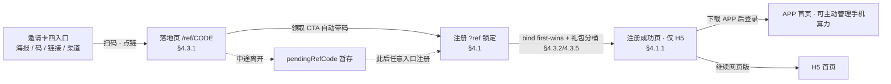

**关键参数**:
- `REWARD_USDT_LIFETIME_ESTIMATE` = 200(`You get` 数额,代表被邀人 lifetime 平均贡献 ≈ unilevel + binary + 平级奖之和;× §8.1.1.1 阶段倍率展示)
- `REWARD_NEX_INVITER`:同源 `rewards.inviterReward.nexAmount`(默认 200,后台可调,§13.3 配置映射),不另设常量;发放过风险分桶见 §8.1.1「发放规则」
- 被邀人礼包:同源 `rewards.welcomeGift`(§13.3),不另设常量

#### 8.1.2 团队收益卡(TeamLedgerCard)

**目的**:把"本月可领、累计算力额、网络结构拆分、可提现/冷却余额、提现入口"聚合在单卡,替代原"团队累计 lifetime 卡 + 月份佣金卡"双卡布局,消除同一 $195.09 数据重复出现。

**内容**(自上而下):

1. **Header**:`This month` eyebrow + `View details →` link(跳 `/team/commissions`,§8.6)

2. **本月 hero**(主指标):
   - 本月 USDT 收益(`monthUSDT`,来自 `useCommission.monthlyUSDT()` aggregate)
   - 副字:`+ {monthNEX} NEX`(本月 NEX 佣金,`useCommission.monthlyNEX()`)

3. **累计摘要行**(单行 mono):`Lifetime ${totalUSDTLifetime} · {contributors} contributors · ↑ +12.4%`
   - `totalUSDTLifetime`:`useCommission.totalUSDTLifetime()`
   - `contributors`:`useNetwork` 总成员数(直推+扩展)
   - `+12.4%`:MoM growth(mock 静态,Sprint 4 接 history aggregate)

4. **Direct / Extended 拆分**:
   - Split bar:Direct(brand)+ Extended(brand-2)按 lifetime USDT 比例
   - 2-cell 数额:`Direct · N% · $X.XX` / `Extended · N% · $X.XX`
   - 总佣金directUSDT/extendedUSDT保留原分类；extended包含其他奖种，不等于网络购买。购买两类只读unilevel聚合

5. **流动性 2-cell**:
   - 累计已到账:`unlockedUSDT`来源累计，不代表当前可提现；当前可提现余额由钱包及提现政策提供
   - Cooling (30d):`coolingUSDT`(30 天冷却中)
   - 注:原 lifetime cell 已上移到累计摘要行,此处删除以消重

6. **提现入口**:跳 `/me/wallet/withdraw`(§9.3)— P-mini phase 仅展示可提现额对应入口;接 NEX 抵扣式提现手续费(§9.3.2)

**数据流**:`useCommission`(月度/累计 aggregate)+ `useNetwork`(成员数 + 直推/扩展划分)+ `useApp.wallet`(可提现/冷却余额)

**i18n key**(`teamV3` namespace):`thisMonth` / `viewDetails` / `lifetime` / `withdrawable` / `coolingDown` / `withdrawUSDT`

**关键参数**(`INVITE_REWARDS` 常量,Sprint 3 第三阶段改为 base + phase multiplier):
- `REWARD_USDT` = 1(单次签约真实结算,不随 phase 变化)
- `BASE_REWARD_NEX` = 200(NEX 奖励 base)
- `BASE_REWARD_DOLLAR_LABEL` = 200(hero base,代表"被邀人 lifetime 平均贡献 ≈ unilevel + binary + 平级奖之和")

#### 8.1.1.1 phase-driven 邀请奖励 promo(Sprint 3 第三阶段)

接 `useProductPhase().inviteBonusMultiplier`(§13.4),根据用户当前 phase 自动派发奖励倍数:

| Phase 派发 multiplier | 派发表现 |
|---|---|
| `> 1.0`(P1=2.0,P2=1.5) | 顶部加 Flame chip `Limited time · {N}× bonus this week`(真实庞氏话术);左侧 hero 大字显示派发后金额(`$400` / `$300`)+ 原价 `$200`;Share CTA 跟随派发数额;NEX 显示 `400` / `300` |
| `= 1.0`(P3+) | 无 promo chip,显示基础 `$200 + 200 NEX`(无变化) |

**⚠️ 铁律(参 §13.4 + [[feedback-no-meta-in-product]])**:**永远不在 UI 暴露 phase id / phase name**。promo chip 用"Limited time · N× bonus this week"真实电商促销话术,等同 Coinbase / Binance 的限时活动文案。

`Math.round(BASE × multiplier)` 计算 → 整数显示;multiplier toFixed 仅在小数时显示一位(避免 `1.5×` → `2×` 取整后变成 `2x` 误导)。

### 8.1.3 Team finance controls

- Commissions:展示 5 类佣金事件明细,入口必须可从 Team 主页到达。
- V Rank:展示 V0–V8 进度、晋升条件、维持期与等级奖励/培育奖。
- Balance Match:展示双轨 balance、弱区/强区、日封顶与 spillover 逻辑。
- Leadership Pool:展示全球领导奖池、参与资格、分配周期与说明页。

以上四入口不得为占位按钮;点击后必须进入对应业务页面或任务式说明页,并保留 i18n copy。

### 8.2 V 级头衔体系 `/team/rank`

#### 8.2.1 V0–V8 有效等级

有效范围为 V0–V8（共 9 个等级），名称、升级条件、权益、领导池票数及等级/培育奖励均读取后端发布配置，不以旧原型的固定门槛或奖励表代替。PC F1 与后端停用 V9–V12 配置并保留历史记录；迁移前检查存量高等级账号，不静默降级。购买资格和佣金计算仍按对应服务端规则，不因展示范围调整而重写结算。

#### 8.2.2 升级判定规则

**条件类型**(每阶可组合 4 种,具体见 §8.2.1 表):

| 条件 | 字段 | 计入规则 |
|---|---|---|
| 自买累计 | `selfBuyUSD` | **仅本人下单**支付的 NexGridBox / NexGridRack / Cloud Share USDT 金额。复投锁仓 / NEX 内购 / 礼包赠送 **不计**。退款金额从累计中扣除。 |
| 直推数 | `directRefs` | 直接邀请并完成注册 + KYC-Express 的下家数(数学层 L1)。**仅去重计数**(同手机号 / 同钱包重复绑定不重复计)。降级 / 注销的下家从计数中扣除。 |
| 团队算力额 | `teamVolumeUSD` | 直推 + 扩展网络全部下线**所有订单 USDT 金额累加**(数学层 L1-L7;超过 V7 后按对应 unilevelDepth)。包括首购 / 复投 / 商城升级 / Cloud Share 充值。退款扣减。 |
| 下属 V 级数 | `vDownlines` | "≥Vn 等级"直推下家数,**含直推中达到目标 V 级或更高的人**。例:V3 要求 `vDownlines: { 1: 2 }` 表示需要 ≥2 个 V≥1 的直推(若直推中有 V3,也按 V≥1 计 1 个)。 |

**判定方式**:

- **同时满足全部条件**(`AND` 逻辑)才晋升。`progressPct = avg(每个 check 完成度)`,但实际晋升要求 **每个 check 必须独立 ≥ 1**(并非平均 ≥ 1)。
- 进度条 UI 显示 `progressPct`(平均完成度),Missing 文案逐条列出未达成项。
- **不可越级**:必须按 V0→V1→V2→...→V8 顺序升,每跳一阶。即使一次性满足 V5 的条件,系统也只先晋升到 V3(下一阶),下一次结算再升 V4,以此类推。这保证奖项 / 解锁深度 / 培育奖按阶逐次发放。

#### 8.2.3 晋升触发时机

- **被动评估**:每次以下事件触发后台 re-check:
  - 用户自买订单 paid → 重算 `selfBuyUSD`
  - 任意直推 / 扩展网络下家订单 paid → 重算 `teamVolumeUSD` 和上线 `vDownlineCounts`
  - 直推下家完成注册 + KYC → 重算 `directRefs`
  - 直推下家自身晋升 V 级 → 上线 `vDownlineCounts` 更新
- **晋升瞬时性**:check 通过后系统**当前帧自动 setMyRank**(无审批等待 / 无月结结算),立即生效:
  - 扩展版税覆盖范围加宽(下一笔订单按新覆盖度结算)
  - 按发布配置和能力状态展示平级权益；能力未开放时标明未发放，不因达到 V3 就承诺发奖
  - 解锁领导池票数(下次周结自动并入)
  - 上线触发 cultivationBonus NEX(见 §8.2.5)
- **晋升通知**:推送至 useNotifications(`kind: team`)+ Nova 推一条 `🎉 Congratulations! You're now V{n} {Title}.` + Home BoostUpsell 轮换插入 5s 庆祝条幅

#### 8.2.4 维持期 / 降级规则

- **不降级**:V 级一旦达成,**永久保留**。即使后续团队算力额缩水 / 下家流失 / V 级下家降级,自身 V 级不回退。
- **不需要月度维护**:无"月度算力额门槛""活跃考核""90 天激活窗口"等典型 MLM 维持机制。
- **唯一例外**:账户注销 → V 级清零(账户重新注册视为 V0)。
- **保留机制**：保留已达等级；可用权益、奖励与领导池票数按发布配置和实际能力状态展示，未开放能力不能作为已锁定的未来收益承诺。

#### 8.2.5 等级奖励 & 培育奖

**等级奖励(运营可配)**:每个 V 级的晋升奖励由运营后台(F1 V-Rank)配置,支持 **USDT / NEX / 代金券 / 系统 SKU / 自定义** 多种类型,可一阶多项。原「实物奖品 + 发货队列」机制已下线。下方「培育奖 NEX」是默认随阶发放的代币奖励(发给上线 sponsor)。

**培育奖（`cultivationBonus`，展示 UVT）**：读取各有效等级发布值，不写死金额。字段和资产代码仍为原协议；本人等级奖励与发给直接推荐人的培育奖励分开显示。

- **触发对象**:被培育者的**直接上线**(L1 sponsor)。L2 及以上不分培育奖。
- **重复触发限制**:同一被培育对象升 V 级时仅触发**该次跨阶**对应奖励;若被培育者从 V2 直接达成 V5 条件(实际仍需逐阶升,见 §8.2.2),则直接推荐人分别按 V3 / V4 / V5 各阶发布配置取得对应培育奖励（显示 UVT），不采用旧示例写死金额。
- **结算**:NEX 即时入 `user.nexBalance`,无冷却期,无门槛。
- **通知**:`kind: team` 推一条 `🌱 Your direct {name} just hit V{n} — you earned +{nex} NEX cultivation bonus.`

#### 8.2.6 等级范围与展示边界

V0–V8 为当前有效等级；已停用的 V9–V12 不作为新增晋升目标，也不提供当前等级奖励入口。V8 展示已达最高有效等级，不生成 V9 的升级差额。奖励、条件与票权按当前配置展示，不写死未来等级收益示例。

#### 8.2.7 UI 规格

- 整条圆角标题栏显示“V 级头衔”，保留返回、消息和“规则介绍”入口。
- 当前等级区保持紧凑；下方列出 V0–V8，并标记已达成、当前、未解锁。
- 每级展示所需条件、对应权益及奖励；下一阶进度与差额放入该级条目，移除上方重复的长说明和升级引导块。
- 奖励标明本人/直接推荐人等实际领取对象，未配置或未开放权益不冒充已开放。团队金额统一显示“算力额”，计量与业务计算不变。

### 8.3 网络版税 `/team/unilevel`

#### 8.3.1 来源与计算

购买奖励沿用原七层订单预算、资格、层位、活动倍率、Influence与整链封顶；直属购买为该订单L1，网络购买为L2–L7，资格不符或暂停不压缩层级。A→B→C时，B购买给A原L1预算，C购买分别给B的L1与A的L2。普通、组合、换购、容量替换、保留旧购新和试用转正均按权威实付订单一次计佣；零基数不发奖。

原L1基础预算率固定10%，不是拆分后的USDT现金率。令U1为原引擎最终L1预算、s为购买USDT占比、p为锁定价格：`USDT=floor6(U1*s)`，`NEX=floor6(U1*(1-s)/p)`。拆分NEX替代该新来源的旧L1额外NEX；L2–L7原USDT及额外NEX不变。拆分关闭时未来L1恢复原发放构成，七层购买不停，已锁定来源不重算。

直属设备收益以已入账合格设备凭证为准：Q=凭证USDT+凭证NEX×p，r为设备总比例，s为设备USDT占比；`USDT=floor6(Q*r*s)`，`NEX=floor6(Q*r*(1-s)/p)`。只奖励直接邀请人，平台额外支付，设备本人两币不减少。包括合格免费手机真实任务，排除影子、开发测试、注册礼、活动、佣金及其他团队奖励；H5不获原生手机执行权限。对碰、V等级、培育、领导池、注册礼保持各自原规则。

v2政策来自 `GET /api/config/commission/direct-referral?schemaVersion=2`，包含实际settlementMode、purchaseSplit(enabled/usdtSharePct)、deviceEarning(enabled/totalRatePct/usdtSharePct/coolingDays)与只读sevenLayerReference(revision/baseRatePct/coolingDays/legacyNexPerUsd)。购买总预算与冷却只引用原七层，设备可独立配置。启用拆分严格0..100之间；空配置不伪造正式费率。切换前v2读取旧代际真实规则，不将旧独立购买比例改解释为七层L1。

服务端冻结来源、受益人、整链预算、规则、政策与价格；缺价显示等待计算，已预留预算不转赠深层。新两币向下六位且同组原子到账；任一币舍入为零不伪造另一币到账。购买冷却自首次整链准备起算，设备冷却自凭证确认起算；缺价重试不重置。新七层订单全额退款撤销/追回整链两币，余额不足保留每位受益人每币欠额；设备后来退款不自动撤销有效历史设备收益分成。历史无证据不补算或扩层。

#### 8.3.2 查询与状态

同页显示直属购买、网络购买、直属设备收益三个分组。购买列表、全期间两币汇总与组数的唯一来源是 `GET /api/app/team/insights/unilevel?schemaVersion=2&filter=direct|extended|all`；设备只读 `GET /api/app/team/insights/direct-referral?schemaVersion=2&kind=device_earning`，不得再把该接口的历史purchase聚合加到购买总额。服务端先按类别筛选再汇总、计数与分页，不能以当前页无匹配冒充全期间空。

期间today/week/month/all，分页沿同一snapshotAt；新组id为稳定settlementNo，旧无组账项保持原标识。奖励组数、总佣金账项数与贡献成员数分别计数。金额汇总为服务器有效净额；撤销、拒绝、待追回不计有效收入但仍在可查组数中。已到账累计不等于当前可提现，当前可提现只认可钱包及提现政策；榜单保留实际已解锁USDT口径，不增加NEX估值排名。

等待计算、冷却、冻结、到账、已支取、拒绝、撤销与待追回均有可读状态；价格暂缺、空列表、加载和接口失败提供重试与返回。切期间/账号/环境清除旧快照，晚返回不串状态；切分组服务端重新查询并沿原快照，加载更多去重。未配置、暂停仍保留历史可查。

网络购买组保留逐币状态statusUSDT/statusNEX；两币不同时分别显示可读状态，如USDT已撤销、NEX已到账。记录保留原gross金额，有效净汇总按每币实际事实计算，不因一币被冲正而隐藏另一币。旧响应缺逐币状态时保留原组状态显示。

#### 8.3.3 说明与兼容

规则页与佣金说明读取已发布且模板版本及语义匹配的三语正文，七层购买继续现行、L1拆分替代旧额外NEX、设备奖励平台承担。业务切换后受影响Team旧版读取返回明确更新提示，不发送误导金额；账户、钱包、本人设备收益原接口继续。已发布运营自定义正文只走正常发布流程，不自动覆盖。APP共享UI与业务同轮受控同步H5，保留网页手机权限边界。

### 8.4 双轨平衡匹配 `/team/binary`

**用户端命名**:Balance Match · Dual-Track Growth(中文"平衡匹配 · 双轨成长")。UI 一律称"轨道 Track A / Track B",**不暴露**"翼 wing / 左 / 右 / 空降 spillover / 上线 / 下线"等 MLM 词汇;内部 enum 仍用 `binary: "left" | "right"` 字段,网络数学层不变。

#### 8.4.0 设计动机

##### 8.4.0.1 在团队体系中的角色

双轨平衡匹配与直属分成(§8.3)并行；对碰按原算力额及结算规则执行，直属分成只来自直接成员的合格购买与真实设备收益，两者互不替代。

##### 8.4.0.2 4 个核心机制要点

| # | 机制 | 业务效果 |
|---|---|---|
| 1 | 较小轨匹配公式 | Balance Match = `min(A, B) × 10%`,日上限随平台 Phase 收紧(P1–P3 $5,000 / P4+ $2,000,详见 §11 Phase 参数表)。仅按较小一轨体量发放,鼓励两轨均衡发展。**结算周期**(每日 / 每周 / 每月)与**沉淀处置策略**(较大一轨未匹配体量如何处理:每月清零 / 每次对碰清零 / 转结)均由运营后台配置(默认每月结算 + 每月清零),详见 §8.4.1.2。 |
| 2 | 最低算力额门槛 | 强制两轨各 ≥ $1,000 才进入结算队列。未达门槛的算力额计为 pending,达标后批量结算 → 自然形成算力额沉淀缓冲池,稳定平台日结资金流。 |
| 3 | 自动分配机制(内部 spillover) | 网络伙伴在某轨算力额饱和时,新邀请自动分配到下游轨道,形成"网络伙伴主动帮你扩展轨道"的体验。增强网络绑定关系,降低用户主动退出意愿。 |
| 4 | LTV 延长 | 两轨无封顶 + 强制平衡,提供"持续投入还能再增长"的长期激励路径,把用户活跃生命周期从单一网络版税的 ~6 个月延长到 ~18-24 个月(基于行业基准数据)。 |

##### 8.4.0.3 与 NexGrid 产品目标的契合

| 产品目标 | 双轨对碰的贡献 |
|---|---|
| 用户增长速率 | 自动分配机制把网络伙伴的拉新激励传递给下游用户,加速底层用户基数扩展 |
| 用户留存率 | 强制平衡门槛 + 算力额沉淀机制提升用户继续投入意愿 |
| 体系包装一致性 | Dual-Track Growth Program 命名与 V 级 / 影响力网络版税 / 领导池等模块共用"成长激励"语义,保持产品语言统一 |

#### 8.4.1 规则

每个用户开两条独立轨道 Track A + Track B(内部存储 `binary: "left" | "right"`)。

**Balance Match** = `min(A, B) × 10%`,日上限随平台 Phase(P1–P3 $5,000 / P4+ $2,000,详见 §11)

**强制平衡**:必须 Track A ≥ $1,000 且 Track B ≥ $1,000 才能领奖,否则当月归零

##### 8.4.1.1 轨道月活跃算力额(Group Volume, GV)计算

每条轨道的月活跃算力额 = **该轨道全部下游成员**(从直推到轨道末端,不限网络深度)**当月合格交易 USDT 金额累加**。

**计入项**:
- 设备首购(NexGridBox S1 / Pro / NexGridRack P1 / Cloud Share)
- 设备复购(同账户购买第二台及以上)
- Cloud Share 加仓充值
- §9.5 复投激励中用 USDT 余额触发的复投订单

**不计入项**:
- NEX 兑换购买(`/me/wallet/exchange` NEX→设备)
- 礼包赠送
- 注册新人首充礼(`WELCOME_GIFT_USDT`)
- 同账户跨轨道内部转账

**扣减项**:
- 30 天内退款 / 取消订单的 USDT 金额按比例扣减当月 GV
- 下游成员降级 / 注销后,其历史算力额从对应轨道累加值中移除

**周期**:按自然月统计,每月 1 日 00:00 UTC 滚动归零;月底 23:59 UTC 锁定结算。

**实现引用**:
- `useNetwork.leftVolumeMonth()` / `rightVolumeMonth()` — 遍历 `members[]` 按 `binary === "left" | "right"` 筛选,累加 `monthVolumeUSD` 字段
- `monthVolumeUSD` 字段在每笔合格交易完成时增量更新

##### 8.4.1.2 结算周期与沉淀处置(运营可配置)

平衡匹配的**结算周期**与**沉淀处置策略**为平台级可配置参数,由运营后台 F3 双轨结算引擎设定(server-canonical),前端读取后联动渲染。

**结算周期 `settlePeriod`**:对碰奖金的派发节奏,枚举 `每日 | 每周 | 每月`,默认 `每月`。

- 每条轨道的活跃算力额(GV)始终按自然月累计(§8.4.1.1);结算周期决定按何种节奏计算并派发 Balance Match Bonus。
- **预计金额口径**:hero 显示的预计奖金随结算周期联动 = 较小轨「该周期算力额」× 10%,封顶 = 日封顶 × 周期天数。其中「周期算力额」= 月算力额 ×(周期天数 / 30),周期天数 `每日=1 / 每周=7 / 每月=30`。
  - 默认每月:hero 显示「本月平衡匹配奖估算」= `min(月 Track A, 月 Track B) × 10%`,与双轨卡可见的月算力额、玩法说明页 `$2,000 × 10% = $200` 示例同口径,用户可自行验算。
  - 每周 / 每日:hero 标签与金额随之切换为「本周 / 今日 …估算」并按周期天数折算。

**沉淀处置策略 `residualPolicy`**:较大一轨未被匹配的剩余算力额(沉淀池)在周期边界如何处理,枚举三档,默认 `每月清零`:

| 策略 | 语义 | 平台资金影响 |
|---|---|---|
| 每月清零 | 每自然月边界,较大轨未匹配体量重置归零 | 沉淀不累积,负债口径最紧 |
| 每次对碰清零 | 每次结算事件后较大轨未匹配体量即清零(清零频率 = 结算周期) | 与每月清零在周期=每月时重合,但概念为「结算事件驱动」而非「日历驱动」 |
| 转结 | 较大轨未匹配体量结转到下一周期继续累计,不清零 | 沉淀持续累积、最终可被匹配派发 → 拉大利息负债(科目 #3)与佣金应付,改前须过 B1 兑付覆盖率核验 |

**最低算力额门槛**(独立于结算周期):必须 Track A ≥ $1,000/月 且 Track B ≥ $1,000/月 才进入结算队列,未达门槛该周期匹配归零;此门槛恒按月口径,与结算周期正交。

**前后端联动**:运营在后台改 `settlePeriod` / `residualPolicy` → server-canonical 配置经平台配置接口下发 → 前端读取并联动:① 预计金额数字与「本周期…估算」标签;② 公式行「{周期}结算」节奏文案;③ 玩法说明页结算频率 FAQ 与沉淀处置 FAQ。前端以 backend-replaceable 单源(`lib/binary-settlement.ts`,枚举 `settlePeriod` / `residualPolicy` + i18n label map)承接,接真后台时把常量换成配置接口拉取即可,渲染层零重写。

#### 8.4.2 自动分配机制

当网络伙伴某节点已满后,新发展的成员自动分配到下游用户的轨道下面(内部 `isSpillover: true` 标记)。系统推送:`↳ Network partner V5 Sarah K. auto-placed 3 new members into your Track B`。

#### 8.4.3 UI 规格

- 本周期(默认本月)Balance Match 预计 hero(大字,金额随结算周期联动,见 §8.4.1.2)+ 公式(min(Track A, Track B) × 10% · 日上限 · {周期}结算)
- 阻塞警告(若任一轨 < $1,000)
- Track A / Track B 双轨卡(月算力额 + 成员数 + Top member)
- 较大 vs 较小差距比较条
- 自动分配记录(`↳` 图标)
- 最近匹配历史
- hero 上方 entry chip `📖 New here? Learn how the program works →` 链 `/team/binary/how-it-works`

#### 8.4.4 玩法说明页 `/team/binary/how-it-works`

**目的**：一页讲清团队平衡奖励怎么来：团队分 A 组 / B 组，按较小一组的订单额发放，以实际发放为准。用户端统一叫「团队平衡奖励 / Team Balance Reward / Thưởng cân bằng nhóm」、「A 组 / B 组」、「自动分组」，不出现轨道、双轨、网络伙伴、推荐位、placement 等说法（术语对照见 APP-COPY-AUDIT 第二节，2026-10-29 用户确认）。

**页面结构**（2026-11-04 按代码核对）：

1. 标题 `团队平衡奖励 · 玩法说明`，返回 `/team/binary`。
2. **接后端时**：显示后台发布的正文（content-key `team-binary-how`），Hero 标签「团队平衡奖励」，底部按钮「查看我的两组」。
3. **未接后端时**（本地兜底）：
   - Hero：「两组越均衡，奖励越多」/「奖励看较小一组的订单额，以实际发放为准。」，附按主题阅读目录。
   - 奖励怎么来：「你的团队成员分在 A、B 两组。两组都有订单时，按较小一组的订单额发放奖励。」+「部分成员会自动分到 A 组或 B 组。」
   - 发放说明：「订单额按已确认订单统计，奖励以实际发放为准。」，下方明示发布说明暂不可用（不展示比例、门槛等未发布的规则数值）。
   - 常见问题 3 问：新成员会分到哪一组？（答：部分成员会自动分到 A 组或 B 组）/ 一组没有订单怎么办？（答：至少一组订单额暂未达标，邀请好友可尽快达标）/ 多久发放一次？（答：发布说明暂不可用，请重试）。
   - 底部按钮「查看我的两组」回 `/team/binary`。
4. 已删除的旧本地文案（2026-11-04）：选择 A/B 轨道并永久锁定、轨道向下生长、自动分配协助、两条轨道按周期统计、较大轨转结、「完全不邀请也能赚」等说明；这些词条在页面上早已不再引用，现从九种语言中移除。

### 8.5 全球领导奖池 `/team/leadership-pool`

#### 8.5.1 规则

- 池子来源:平台每周总交易额(GMV)的 5% 注入;池额 = 周 GMV × 比例派生,当前周池约 $487.3K(GMV ~$9.75M)
- 参与门槛:V3(Captain)解锁——票权首个非零等级;V3 以下可查看池子但不参与分配
- 分配：有效等级的票权读取服务端领导池配置，个人份额 = 个人票数 ÷ 全网总票；不以旧 V12 固定票表生成当前分红。
- 结算:每周一次——周日 23:59 UTC 票权快照 → 周一 00:00 UTC 自动派发入钱包(无需 claim)
- **头部集中(派生)**:高阶领袖稀少但指数票权碾压,池子向 V-Rank 顶层集中。顶部 N 名领袖(当前全网分布下 ≈ V8 星上将及以上约 10 人)凭票权分走约六成奖池。集中度按真实全网 V 级分布 × 票权运行时派生展示,不写死固定百分比;调整全网分布或票权,集中度同步变化

分布、周池、个人份额和分红均读取当前真实结果，不展示旧 V12 的静态收益示例。

**业务流程(周结算循环)**:

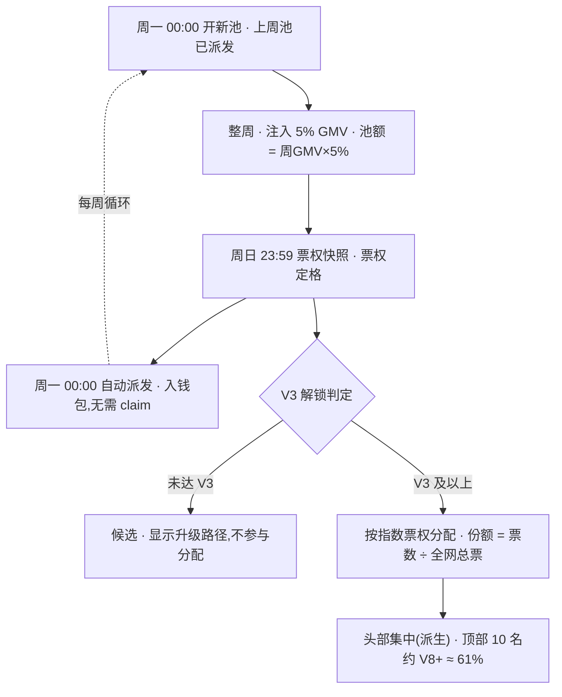

#### 8.5.2 UI 规格

- hero 上方 entry chip `📖 New here? Learn how the Leadership Pool works →` 链 `/team/leadership-pool/how-it-works`
- 本周池子总额 hero
- 距结算倒计时
- 你的预估分红 + 票数 + 全网票数 + 占比
- V<3 时显示"V3+ to unlock" + 升级路径 CTA
- 顶部集中度提示条(派生):顶部 N 名领袖分走约 X% 池子,X 按当前全网分布与票权派生
- V 级 → 票数权重完整表(显示全网 V3–V8 分布 + 各档占池比与人均派发,派生)
- 历史周池列表

#### 8.5.3 玩法说明页 `/team/leadership-pool/how-it-works`

从全球领导奖池页进入。标题「团队激励池规则」，副标题「查看参与资格、发放时间和奖励记录。」，下方是三节目录。

- 状态：读取中显示加载提示；读取失败或奖池暂未开放时显示对应提示和「重试」。已有奖池数据或等级规则时，重新读取期间保留现有内容。
- 「当前规则」：「达到 V{rank} 即可参与，奖励以实际发放为准。」，参与等级以服务端返回为准；有奖池数据时另起一行「下次发放时间：{time}」。两项都读不到时本节不显示正文，不显示本地兜底说明。
- 「当前等级票数」：按服务端等级配置列出参与等级及以上各级的票权（等级 / 票数），不写死权重；等级配置读取中或失败时显示加载或失败提示与重试。
- 「本期参与情况」：我的票数、本期总票数、本期占比（数据隐藏开启时遮罩），下方按等级列出人数 × 票权与该级总票数，附「实际发放金额以发放记录为准。」。
- 底部按钮「查看本期票数、占比与分配记录」返回 `/team/leadership-pool`。

文案在 `poolHowItWorks.*` 和 `network-reaudit` 的奖池部分，中、英、越三语。

### 8.6 佣金事件 `/team/commissions`

| 类别 | 触发 | 结算 | 备注 |
|---|---|---|---|
| 直属购买分成 | 直接成员实付设备订单 | 由当笔政策决定等待期 | USDT + NEX，同一结算组 |
| 直属设备收益分成 | 直接成员真实已入账设备凭证 | 由当笔政策决定等待期 | USDT + NEX，同一结算组 |
| 网络购买奖励 | 网络成员实付设备订单 | 原七层冷却规则 | L2–L7保留原USDT及额外NEX；历史原账保留 |
| 团队平衡奖励(binary) | A、B 两组均有合格订单 | 每日 | USDT,30 天冷却 |
| Peer | 保留配置参数；当前能力未开放、未发放 | 不作发放承诺 | USDT |
| Cultivation | 直接推荐人按下属晋升有效等级的发布配置获得奖励 | 按实际结算状态 | UVT（协议 NEX） |
| Leadership | 领导池周分红 | 每周 | USDT(V3+ 解锁) |
| Genesis | 创世节点持有人排放 | 上所后 | $NEX(创世持有人,vesting 释放) |

列表按奖励类型筛选（2026-11-04 按代码核对，`commission-filter-copy.ts`）：全部、邀请购机、邀请设备收益、团队购机、团队平衡、协作奖励、成员成长、团队激励、创世节点、晋升奖励、其他（en：All / Referral purchase / Referral earnings / Team purchase / Team balance / Collaboration / Member growth / Team incentive / Genesis node / Rank reward / Other），并有服务端账项汇总。总佣金两币同组计两条账项，不称成员或奖励组数；网络版税页按来源组同时展示两币。状态包含等待计算/冷却/已到账/已支取/冻结/撤销/拒绝/待追回；待追回两币金额不能作为可提现收益。

**Commission row layer chip 二分类显示**:Row 内紧跟 `sourceUserName` 显示来源 chip,基于数学层 `e.layer` 字段二分类:
- `layer === 1` → **好友**(`commissions.directBadge`，en `Friend`)
- `layer >= 2` → **团队**(`commissions.extendedBadge`，en `Team`)

层级标签区分购买的直属/网络来源；设备分成只认服务端真实直属来源，不按客户端月算力额推算。

#### 8.6.1 玩法说明页 `/team/commissions/how-it-works`

帮助用户区分"每笔到账钱来自哪个渠道",对应入口 entry chip。

**页面结构**:
1. iOS nav back + 标题 `How commissions work`
2. 说明佣金来源及历史兼容，所有正文由服务端发布。
3. 当前直属规则与其他独立奖励的边界。
4. 渠道说明：
   - 直属购买、网络购买与直属设备收益；购买预算/资格与冷却沿原七层，L1拆分及设备规则取生效政策。
   - ⚖️ Binary · Balance Match Bonus
   - 🤝 Peer · same-rank bonus(V3 解锁)
   - 🌱 Cultivation · sponsor bonus (NEX)
   - 👑 Leadership · weekly pool share(V3 解锁)
   - 💎 Genesis · founder dividend(创世持有人)
5. 结算生命周期按真实事件解释等待、到账、冻结、撤销与待追回；不能预设固定等待期。
6. 规则演示以当前配置和有效价格为输入，只作说明，不当实际收益合计；缺配置不展示数值承诺。
7. FAQ说明有效来源、提现状态、退款及独立培育奖励。
8. 底部 CTA 回 `/team/commissions`

### 8.7 影响力网络 `/team/network`

2 圈轨道(orbit)可视化,与 §8.3 影响力网络版税的双组件结构对齐:

- **中心 YOU**(显示当前 V 级)
- **Direct 内圈**(实线轨道):直推朋友均匀散布 360°
- **Extended 外圈**(虚线轨道):扩展网络节点带轻微径向偏移分散,呈环带分布
- **Top metrics**:Members 总数 / Active 活跃数 / **Direct** 直推数
- 每 1.2 秒随机 pulse 一个 active 节点(模拟新订单经过)
- Tap 节点 → bottom sheet 显示详情(头像 + V 级 + DIRECT/EXTENDED badge + city + 月算力额 / 累计 / 加入天数 / 头衔 / 状态)
- Legend:Direct friends / Extended network
- 不暴露 L1-L7 / 左右翼 / 4 色 layer 编码 / Spillover ring;内部数据仍保留 layer 字段供数学层使用,可视化层只呈现 Direct(L1) vs Extended(L2-L7 合并)
- SVG cx/cy 计算后 `Math.round(n*100)/100` 规整精度,避免 SSR/CSR 浮点字符串化漂移

### 8.8 族谱树 `/team/tree`

Direct / Extended 二分类可折叠列表:

- **Top metrics**:Total network 成员数 / Monthly volume 全网月算力额
- **Direct section**(DIRECT badge,默认展开):
  - Header subtitle:`{n} contributing · ~$X/mo Direct Royalty`
  - member row 按 monthVolume 降序
- **Extended section**(EXT badge,默认展开):
  - Header subtitle:`{n} members · ~$X/mo Network Yield Bonus`
  - member row 按 monthVolume 降序
- 成员记录保留关系、等级、活跃状态与入网信息；收益只读服务端结算记录，不按成员月算力额或旧层级费率推算。
- 不展示 7 层 sections / 左右翼 filter / Spillover badge

### 8.9 硬件配额解锁 `/team/quota`

| 设备 | 解锁条件 | 月度库存 |
|---|---|---|
| NexGridBox Pro | 5+ 已激活直推 | 1,000 台(余 23)|
| NexGridRack P1 | 15+ 直推 **或** 团队月算力额 ≥ $20,000 | 100 台(余 8)|

> 解锁条件 / 阈值 / 库存 / 进度**单源自商品目录的 `purchaseGate` 配置**(§7.1)与 `evaluatePurchaseGate`,本页不自带硬编码数值;运营在后台调门槛 / 锁额,本页与商城卡 / 详情 / 结账同步变化。tier 的名称 / 价格 / perks 同源自 catalog,杜绝口径分叉。

UI:
- 用户当前邀请数 hero
- 每个 tier 卡片显示:解锁条件进度条(`progressPct`)+ 月度库存进度(`remaining / quotaCap`)+ perks + Buy/Invite CTA
- 满足条件 → 直跳 store 完成销售
- 不满足 → "Invite to unlock" 跳 team

### 8.10 区域大使 `/team/agent`

V5 Wing Leader 起开放,提供 4 项可申请预算:

| 预算项 | 额度 | 申请规则 |
|---|---|---|
| 线下活动场地 | $1,000 - $10,000 | 签到 QR ≥ 100 人 |
| KOL 推广配比 | 50% 补贴 | 结束后提交发票 + 流量数据 |
| 物料印刷 | 区域配额 | 海报 / 手册 / 名片 |
| SDK / 开发支持 | 按小时 | 为顶级客户定制集成 |

UI:
- Hero:Lead the network in your region
- Eligibility 状态(V<5 显 locked + 升 V5 路径 CTA)
- 4 预算桶卡片
- 申请表单(Date + City + Budget,V<5 时禁用)
- "Recently approved" 案例展示 3 个(Tokyo Web3 Summit / Berlin DePIN Meetup / São Paulo AI Devcon)
- 提交 → 等待 3-5 工作日合规审核

### 8.11 邀请排行榜 `/team/leaderboard`

#### 8.11.1 目的

公开展示全平台 Top 100 邀请人,提供持续的社会证明 + 排名对标,驱动用户增加邀请频次以争夺奖池席位。
任何持卡用户可访问,展示自身排名 + 距下一档差距,鼓励用户冲榜。

#### 8.11.2 页面结构(自上而下 6 段)

1. **Prize Pool Hero**:
   - 标签 `PRIZE POOL · {periodLabel}`
   - 大字 USD 金额(`$5K / $50K / $250K / $1M`)
   - 副字 `Pays to top {topN}`
   - 右上 Trophy icon
   - 分割线下:`Resets in` + 右对齐倒计时(`08:42:11 / 3d 12h / 12d / —`)

2. **Period Tabs**(单层胶囊):
   - `Today / Week / Month / All-time`
   - 切换时整页数据重新计算(同一份 mock dataset,不同 multiplier)

3. **My Rank 卡**:
   - 标签 `YOUR RANK`
   - `#412 / 100+` 大字(+ `/total` 副字)
   - Flame icon + `earn ${gap} more to climb` 进度提示文案
   - 右侧 Share to climb CTA(Share2 icon + 按钮,跳 `/team`)

4. **Podium(Top 3)**:
   - 顺序:#2(左)/ #1(中,凸起)/ #3(右)
   - 每格:奖牌 emoji 🥇🥈🥉 + 圆头像(单字符)+ handle + 国旗 + USD 金额 + `{n} directs`
   - 卡下方 3 行实物奖列表:`#1 Genesis Node + Rack ×1 / #2 NexGridBox Pro ×3 / #3 NexGridBox Pro ×1`

5. **#4 - #100 List**(单卡 + 4 列):
   - 列头:`# / Inviter / Directs / Earned`
   - inviter 列:头像 + handle + 国旗 emoji + Cpu icon(verified hardware)
   - 副行:`V{n}` chip + `{n} team` + `↑{delta}` / `↓{delta}`
   - 数值列:右对齐,Earned 列 compact(`$3.5K`)

6. **Share CTA**:
   - Share2 icon + `Share my invite link`
   - 链 `/team`,触发原页 InviteEarnCard 的 share path

7. **Footer note**:
   - `Rankings update every 5 minutes. Pool pays out automatically at period reset.`

#### 8.11.3 业务规则

- **排序键**:本期累计 USDT 佣金(unilevel + binary + leadership + 邀请奖 + 平级奖之和)
- **更新频率**:服务端每 5 分钟 snapshot,前端按 period 切换读取
- **奖池派发**:周期结束时按比例自动派发到对应 USDT 余额,触发 `commission` 事件
- **入榜门槛**:本期累计 ≥ $1
- **匿名化**:handle 显示完整(真实平台均不做 mask,反而强化攀比)
- **My Rank 取数**:服务端按当前用户 referrer 计算,>100 则只显示 `#NNN / 100+`

#### 8.11.4 奖池参数(`PERIOD_PRIZE`)

| Period | Pool USD | TopN | Resets In | Label |
|---|---|---|---|---|
| today | $5,000 | 20 | 08:42:11 | Daily |
| week | $50,000 | 50 | 3d 12h | Weekly |
| month | $250,000 | 100 | 12d | Monthly |
| all | $1,000,000 | 100 | — | All-time |

#### 8.11.5 Podium 奖品(`PODIUM_PRIZE`)

| Rank | 奖牌 | 实物 |
|---|---|---|
| #1 | 🥇 | Genesis Node + Rack ×1 |
| #2 | 🥈 | NexGridBox Pro ×3 |
| #3 | 🥉 | NexGridBox Pro ×1 |

---

## 9. Wallet(钱包系统)

### 9.1 钱包入口(独立钱包页已并入「我的」)

2026-11-03 起与 App 一致：独立钱包总览页 `/me/wallet` 已移除，钱包内容并入「我的」页顶部的钱包卡（§11.0）：USDT 余额、待结算提示、UVT 余额与参考价、充值 / 提现 / 兑换快捷入口、账单入口与设备槽位行。`/me/wallet` 及旧复投入口的链接统一重定向到「我的」页，不再打开旧的分组列表页。钱包卡的已激活设备数不含手机设备（§6.11），余额和账单保持完整。
### 9.2 充值 `/me/wallet/topup`

#### 9.2.1 通道与可见性

正式 H5 Lite 提供银行卡与 USDT（BEP20 / ERC20）充值，页面与 App 一致（P-44 设计，2026-11-03 起），默认进入银行卡分段；费率、最低额、确认数和限额均读取服务端。旧国际卡 token 表单和 TRC20 本地模拟不作为正式充值入口。后台未配置或已关闭的通道、网络直接不显示，界面不出现「暂不可用」「暂停服务」「维护中」类文案。

银行通道配置关闭且当前账号的历史单已读取、没有待付款或核对中订单时，隐藏银行分段。已有银行订单仍可打开并查看原支付快照；配置重新打开后页面重新读取并恢复分段。USDT 仅读取选中网络的地址；接口明确未配置/关闭该网络时隐藏并切换到可用网络，不为预判可用性提前分配地址。返回页面或重试时重新探测已隐藏网络。

#### 9.2.2 金额与原单

新建充值本金必须是正整数，最低额和每日额度依服务端配置，费用与实际到账额分别显示。历史小数单保留原身份、金额及 hosted 快照；重建回到空白整数输入，不把历史金额自动改成新单。账号改变后清理旧账号展示与待执行操作。

#### 9.2.3 USDT 充值

用户按选中网络使用服务端分配的专属地址，二维码和警示绑定 BEP20 或 ERC20；只发送相应网络的 USDT。手续费、最低充值额及确认数来自地址响应，记录按服务端到账状态显示；余额和账单不由前端推算入账。充值未到账可联系支持。

网络手续费（2026-11-04，BUG-058）：地址接口只返回所选网络的费用，所以费用只显示在选中的网络行上，未选中的网络行显示「通道费 — USDT」，不显示别的网络的费用。切换网络后，读到新网络的费用前选中行同样显示「—」。实际提交及付款总额仍以选中网络服务端数据为准。

#### 9.2.4 银行卡充值

银行页继续使用现有服务端配置、原单恢复及 hosted 打开行为。银行充值的锁定 VND/FX 属于充值单快照；购买支付确认中的美元规则见 §7.3，不改变历史充值对账金额。生成、等待、已到账、过期或核对中状态以服务端为准，返回与重新打开不新建订单。

银行分段隐藏且没有打开中的银行单时，页面自动切到 USDT；带 `channel=bank` 进入时按可见分段选择，落在 USDT（2026-11-04，BUG-060）。银行单打开期间（付款中、已到账、已过期等）隐藏通道切换。

#### 9.2.5 从购买补足余额

从付款方式页携带原订单进入充值，顶部显示为哪个订单充值、还差多少（钱包余额读到后才显示差额）及订单剩余时间。余额足够后底部固定「返回继续支付」，打开原订单详情并直接拉起支付方式。充值到账本身不自动执行订单扣款。

#### 9.2.6 接口与状态权威

| 接口 | 用途 |
|---|---|
| `GET /api/app/payments/config`、`GET /api/app/payments/fx-quote` | 银行启停、费用、额度和牌价 |
| `GET /api/deposits/address?network=BEP20或ERC20` | 当前账号选中网络地址及政策 |
| `GET /api/deposits` | 链上到账与确认记录 |
| `/api/app/deposits/vietqr/intents`、`/api/app/deposits/vietqr/receipts` | 银行原单及到账记录 |

所有资金状态和余额由后端确定；预览场景仅存在于 `scripts/`，不接真实支付机构或链上资金。

### 9.3 提现 `/me/wallet/withdraw`

#### 9.3.1 流程

| 步 | 字段 | 校验 |
|---|---|---|
| 1 | 金额 | ≥ $20 |
| 2 | 网络 | 随绑定地址派生,只读;换网络 = 走换绑重新验证 |
| 3 | 收款地址 | 只读,取当前已验证的绑定地址;不手输 |
| 4 | NEX 抵扣手续费(可选) | 见 9.3.2;NEX 不足不阻拦,仅手续费升高 |
| 5 | 提交 | 进入提现追踪 |

#### 9.3.1-1 出金币种与网络

出金仅支持 USDT,网络同充值三条链(TRC20 / ERC20 / BEP20)。BTC / Ethereum 提现通道已下线。
收款网络不再由用户在提现页选择,而是随当前绑定地址派生并只读展示 —— 杜绝选出与地址不匹配的网络。

#### 9.3.1-2 提现地址换绑

单地址原则:同一时刻只有一个已验证的提现地址,提现一律打到该地址。更换走独立流程:

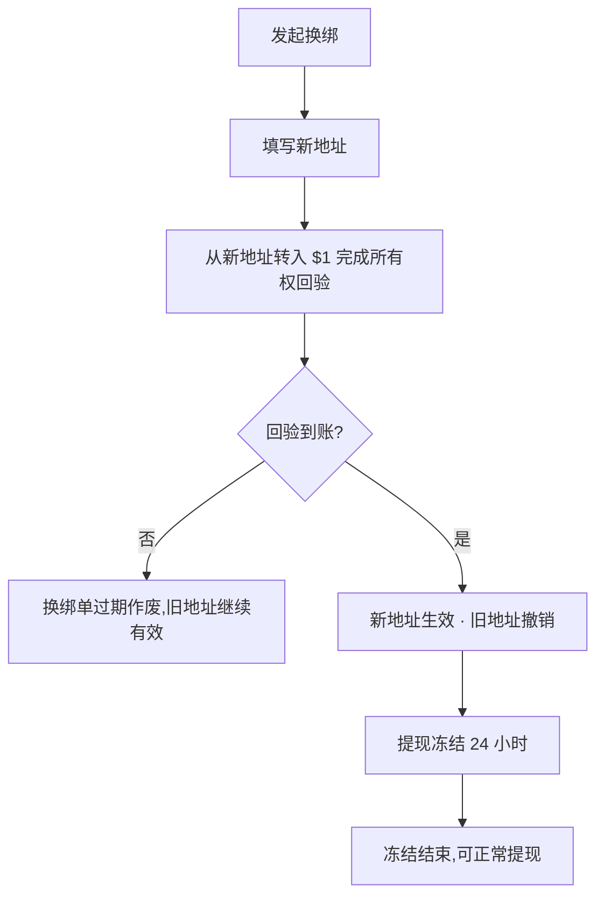

- **$1 回验**:必须从新地址主动转入验证金额,证明用户掌握该地址私钥;回验金额入账不退。
- **24 小时冻结**:换绑生效后冻结提现,防盗号即时转移资产。冻结判定下沉在风控评估层,
  绕过界面直接调用同样拦得住,不只是按钮置灰。
- **换绑频次**:每 7 天最多一次(后台可配)。
- **新地址大额审核**:绑定未满 7 天的新地址提现 $1,000 以上,自动转人工审核。

#### 9.3.1-3 出金三道闸

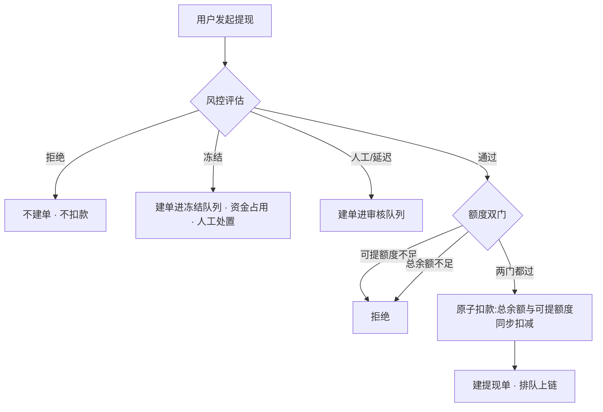

- **第一道 风控路由**:拒绝路由不建单不扣款;冻结 / 人工 / 延迟三种路由建单进队列,
  资金占用但不放款,状态由服务端与人工推进。
- **第二道 额度双门**:可提额度门(只有已解锁收益可提,充值本金不可提)+ 总余额门
  (纵深兜底,任何情况下不放行超过总余额的提现)。两门独立校验。
- **第三道 原子扣款**:总余额与可提额度在同一步扣减,不存在扣一半的中间态。

#### 9.3.1a 提现提交闭环

- 未 KYC 用户先进入 KYC-Express,完成后回到提现页继续提交。
- 提现提交必须生成 tracking record 与 USDT 提现单;烧了 NEX 抵扣手续费时另写一条 NEX 抵扣单。
- 提交为原子操作:若 nexBurned > 0 先扣减用户 NEX 余额(`debitNex(nexBurned)`),再提交提现单;提现单失败则回滚已扣的 NEX,保证不出现"扣了 NEX 却没提现"或"提现了却没扣 NEX"。nexBurned = 0(用户无 NEX)时不扣 NEX,直接按全额惩罚费提交。
- USDT 提现单记录 `fee = actualFee`(见 9.3.2 计算),账单金额 = 提现金额(全额出金,手续费为其中差额);NEX 抵扣单记录烧掉的 NEX 数与抵扣的手续费。提现追踪页与账单显示的手续费均为 `actualFee`(三处口径一致)。
- `/me/wallet/withdraw/tracking` 必须展示 pending / review / paid / rejected 等状态轨迹,并允许从 bill hash 反查。

#### 9.3.2 NEX 优惠抵扣提现手续费(关键业务规则)

**模型**:提现按惩罚费率收取手续费;用户可烧 NEX 按优惠率抵扣该费(NEX 取代旧贡献积分门槛)。**不再硬拦截**——没有 NEX 也能提现,只是手续费高;NEX 越多手续费越低,烧够则全免。这是 NEX 的两大功能之一(另一为兑换 USDT,见 §9.4)。

**参数**(后台可调,随 phase 派发,见 §13.3):
- `withdrawPenaltyFeeRate`:无 NEX 抵扣时按提现金额收取的费率(默认 20%;P5 → 25%,P6 → 30%,锁定期摩擦上升)。
- `nexFeeOffsetRate`:每烧 1 枚 NEX 可抵扣的手续费(默认 $0.40 / NEX)。该值**远高于 NEX 兑换市价**(~$0.027),即用 NEX 抵手续费比兑现更划算,引导持有与抵扣。

**计算**(提现金额 A):

```
grossFee   = A × withdrawPenaltyFeeRate          // 无 NEX 抵扣时的费
requiredNex = grossFee / nexFeeOffsetRate         // 全额免费所需 NEX(A=$100/20%/$0.40 → 50)
nexBurned  = min(用户 NEX 余额, requiredNex)       // 部分抵扣
feeWaived  = min(grossFee, nexBurned × nexFeeOffsetRate)
actualFee  = grossFee − feeWaived                 // 烧够 → $0
到账        = A − actualFee
```

**三档结果**(以 A=$100、20% / $0.40 为例):

| 用户 NEX | 烧 NEX | 抵扣 | 实付手续费 | 到账 |
|---|---|---|---|---|
| 0 | 0 | $0 | $20 | $80 |
| 25 | 25 | $10 | $10 | $90 |
| ≥ 50 | 50 | $20 | $0 | $100 |

**业务流程**:

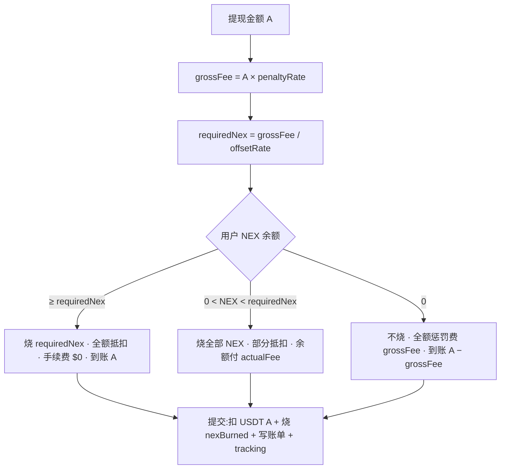

**NEX 来源**:
- 主产出:设备挖矿(NEX 即时滴灌入钱包持仓)
- 每日签到水龙头(基础 +2 NEX / 天,连续 7 天额外 +5 NEX)
- 团队佣金部分以 NEX 计

**NEX 抵扣面板 UI**(金额 > 0 时显示):
- 进度条:当前 NEX 余额 / requiredNex(全额抵扣所需)。
- 全额抵扣:`✓ 已烧 N NEX · 提现手续费全免($0)`。
- 不足时:`按惩罚费率收 $X · 攒 NEX 可降低甚至免除`,并双 CTA 引导补 NEX:
  - `Daily check-in`(签到攒 NEX,跳 `/daily`)
  - `Mine more NEX`(去挖矿赚 NEX,跳设备 / 商城)
- 规则说明:`每 1 NEX 抵 ${offsetRate} 手续费(远高于兑换价值)· 烧够 {requiredNex} NEX 即全免;不足按比例抵扣,余额以 USDT 支付。`

#### 9.3.3 KYC-Express 门槛

首次提现需完成 KYC-Express($1 USDT 验证钱包所有权)。已 KYC 显示 ✓ chip。

#### 9.3.4 反向劝阻卡 `<StakeAlternativeCard>`

Sprint A-1 / B.2。当用户输入金额 ≥ $20 时,在 amount input 之后、NEX 抵扣面板之前显示 hero 卡,把"现在拿走 $X"转换为"$Y 在 N 天后"的对比,导出 USDT 质押转化(质押为 USDT 锁仓,见 §9.5)。

**核心心智**:不阻止提现 / 不动 Submit 按钮 / 不强制留下,只展示机会成本。维持 §1 转化优先原则,把提现冲动导向更深锁定而非阻拦。

**计算**(沿用 §13.3 staking pool APYs,simple-interest 与 staking 页 UI 一致):

```
future = amount × (1 + APY × days / 365)
```

| Tier | APY | 30d → | 90d → | 180d → |
|---|---|---|---|---|
| 30d | 12% | $X × 1.00986 |  |  |
| 90d | 35% |  | $X × 1.08630 |  |
| 180d | 80% |  |  | $X × 1.39452 |

示例:$500 → 30d $502 / 90d $515 / 180d $549

**UI 结构**:
1. Sparkles label `WHAT THIS BECOMES IF YOU STAKE INSTEAD`
2. 大字 headline:`{amount} staked for {peak.days} days at peak APY becomes {peak.value}.`
3. 3 档 tier grid(横排):每档 N-day 标签 + future value 大字 + `+$delta`(30d / 90d / 180d)
4. 全宽 pill CTA `Stake for +${delta} in {peak.days} days →` → `/staking`
5. 免责声明:`Projections use current APY snapshot · Early unlock forfeits 100% of accrued premium · Not financial advice`

**i18n**:`walletV3.stakeAlt.{label/headline/tierLabel/cta/disclaimer}`(en + zh 镜像)。

#### 9.3.4a 提现确认与风险说明（2026-11-03）

移植 App `95641b63`：提现直接进入现有金额 / 地址 / 费用确认，不读取 `risk.accepted`，确认后不调用风险披露 `checkGate`，不跳转风险说明页。冻结提交快照、账号 / epoch 守卫、幂等键、提现资格复核及服务端失败处理保持原样。风险说明仍可作为独立法律文本阅读（§11.4a）。该客户端决策不代表后端已解除门禁：B12 交接落地前，未确认账号的提现仍可能在提交时由 `AppWithdrawalService` 占用余额，之后在 `OpsFinanceService` 的 APPROVE 阶段被 `RISK_DISCLOSURE_ACK_REQUIRED` 拒绝；不能把前端确认框验收等同于提现批准或到账。

#### 9.3.5 Compliance hold banner(Sprint 3,phase 派发)

当 `useProductPhase().complianceHoldEnabled === true`(P5 + P6)时,在 KYC-Express verified 卡之后、Amount input 之前显示 AlertTriangle banner:

- 标题:`Extended compliance review`
- 副文(模板):`Platform reached its lock-in phase. Withdrawals over $1,000 enter a {days}-day enhanced review window before settlement. Smaller amounts still settle on the standard timeline.`
- `{days}` 从 `phase.withdrawalCooldownDays` 派发(P5+ = 45)

P1-P4 阶段不渲染 banner(无 phase gate)。提现惩罚费率 / NEX 抵扣率 / 冷却均随 phase 派发(见 §13.3 / §13.4.2),不硬编码常量。

#### 9.3.6 提现追踪 `/me/wallet/withdraw/tracking`

5 状态:`submitted → review-passed → processing → sent → confirmed`

每状态显示时间戳 + 进度条 + 预计完成时间。

「再提一笔」按服务端提现政策的每日笔数上限判断，用完时置灰并说明何时可再次提交；政策读不到时不置灰（最终由提现页与服务端拦截）。H5 刷新后在登录会话恢复、账号绑定后与提现记录一起读取政策。

### 9.4 NEX↔USDT 兑换 `/me/wallet/exchange`

#### 9.4.1 Swap UI

- From token + amount input
- 大箭头(可点击切换方向)
- To token + 自动计算
- 实时汇率(`1 NEX = $0.171`)+ refresh 按钮
- "Quote refreshing" indicator
- 历史 5 笔 swap

#### 9.4.1a 兑换确认与写入

NEX↔USDT 兑换确认必须展示 from/to amount、rate、fee、KYC/cap 状态与兑换后余额预估。确认后写入 swap record、wallet bill 与 cap 变化;失败时不得只 toast,必须保留原余额并展示失败原因。

#### 9.4.2 风控参数

| 参数 | 值 |
|---|---|
| 每用户日 cap | $50 USDT 等值 |
| 全平台日 cap | $20,000 USDT 等值 |
| KYC 触发线 | 累计 ≥ $100 lifetime |
| 排队 | 超 cap 进入下日队列 |

#### 9.4.3 Gate 决策

提交前自动检查,3 种拦截:

| Reason | 触发 | 用户操作 |
|---|---|---|
| `kyc-required` | 累计 > $100 且未 KYC | 引导到 `/me/wallet/topup?kyc=1` |
| `user-cap` | 本日个人额度已满 | 弹窗 "Queue for tomorrow",可选排队 |
| `platform-cap` | 全平台日额度已满 | toast 拒绝,提示明日重试 |

#### 9.4.4 风控仪表盘 UI

- header 之下 entry chip `📖 New here? Learn how exchange works →` 链 `/me/wallet/exchange/how-it-works`
- 用户日 cap 进度条($X/$50,超 85% 变红)
- 平台日 cap 进度条($XK/$20K)
- KYC 状态行(verified 绿 / 未验黄 + lifetime $Y)
- Queue 列表(下一日待处理)

#### 9.4.5 玩法说明页 `/me/wallet/exchange/how-it-works`

**页面结构**:
1. iOS nav back + 标题 `How exchange works`
2. Hero + 标签 `NEX ↔ USDT EXCHANGE` + 大标题 `Convert NEX to USDT (or back) at live market rate.`
3. §1 Why a built-in exchange?(USDT 提现 vs NEX 持有的两种钱形态)
4. §2 三步操作 StepRow(选方向金额 / 确认报价 / 资金即时结算)
5. §3 三层风控限制 IconRow:
   - 📅 用户日上限 $50/day(00:00 UTC 重置)
   - 🌐 全平台日池 $20,000/day(满即排队)
   - 🪪 KYC 门槛 $100 lifetime
   + CalloutBox `💡 Why daily limits?`(FATF Travel Rule + MiCA 合规)
6. §4 触及上限 3 步透明流程 + CalloutBox `✓ Your funds are never locked unilaterally`(排队随时可取消)
7. §5 FAQ 4 问(汇率来源 / 是否收费 / 能否直接兑法币 / 超过 $50/日)
8. 底部 CTA 回 `/me/wallet/exchange`

i18n keys 在 `exchangeHowItWorks.*` namespace ~35 keys。

### 9.5 锁定计划（已删除）

2026-11-04 按用户决定删除。锁定计划页 `wallet-repurchase.vue`、玩法说明页 `wallet-repurchase-how.vue`，以及只为它们服务的组件、store、接口封装（`repurchase-row`、`store/repurchase`、`api/repurchase-api`、`repurchase-runtime-policy`）、玩法说明内容键 `wallet-repurchase-how` 和九种语言的 `repurchase.*`、`repurchaseHowItWorks.*` 词条已一并移除。两页自 2026-10-28（55075a49）起就不在 `pages.json` 中，用户可见内容不变。

旧路由 `/me/wallet/repurchase`、`/me/wallet/repurchase/how` 及对应 uni 路由仍跳转「我的」（`src/lib/route.ts`），因为服务端下发的活动链接和周任务跳转仍可能指向 `/pages/me/wallet-repurchase`。

### 9.6 Staking 质押(USDT 锁仓)`/staking`

**Lite 可见性**：采用 App `45f60a23` / `d4cae8b9` 及后续修正的 `featureFlags.stakingVisible`。服务端字段缺省视为开启，未取得配置前不显示。关闭时隐藏首页快捷入口、提现替代卡、签到质押增益、首日 / 周任务与转换横幅、搜索、活动、Genesis 增益入口、钱包复投入口；拒绝 `/pages/staking/*` 及复投页导航。直接打开这些页面也重读开关并回首页，页面在前台期间每 15 秒重读，关闭已有弹层。Lite 既有 Earn 模板没有 App 的收益方式卡，不新增手机或质押卡。

正式模式的期限、参考年奖励率、最低金额及提前退出规则由服务端 G1 方案提供；下表仅为旧本地演示示例，不覆盖服务器配置。

质押与复投(§9.5)均为 **USDT 锁仓**产品;NEX 不可质押(NEX 仅两大功能:兑换 USDT 与抵扣提现手续费,见 §9.3 / §9.4)。用 NEX 余额需先在兑换页换成 USDT 再质押。

| 期限 | APY | 提前赎回罚款 |
|---|---|---|
| 30 天 | 12% | 5% 本金 |
| 90 天 | 35% | 15% 本金 |
| 180 天 | 80% | 30% 本金 |
| 365 天 | 180% | 50% 本金 |

#### 9.6.1 UI

- Hero:Total locked + Accrued + Active count + Matured count
- 当前服务器发布的方案卡片（期限、参考年奖励率、描述、提前退出规则及质押入口）
- Positions 列表:
  - 期限 + APY chip + 本金
  - 实时累积利息(每 4s tick)+ 剩余天数 + 进度条
  - 已到期 → `Claim` CTA
  - 进行中 → `Early withdraw` + `Track` 双 CTA
  - 已领取 / 已早赎 → 状态显示

#### 9.6.2 Stake Bottom Sheet

- 金额输入 + presets($100 / 500 / 1,000 / 5,000)+ Max
- 90 天后预测(本金 + 利息 + 解锁日期 + 合计)
- Lock CTA + Early withdraw 警告

§9.6.1 hero 上方加 entry chip `📖 New here? Learn how staking works →` 链 `/staking/how-it-works`。

#### 9.6.2a 开仓确认与写入

Staking 开仓必须展示档位参考年奖励率、锁期、提前退出规则、预计收益和最低金额。确认后提交服务器开仓指令并读取仓位与账单；用户端展示值必须与后台 G1 参数源一致。App `95641b63` 的行为移植到 Lite：不再调用风险披露 `checkGate`，也不因 `RISK_DISCLOSURE_ACK_REQUIRED` 跳页；保留指令租约、账号 / epoch / 弹层守卫和错误映射。B12 前若当前账号拥有的新开仓请求收到准确的 `RISK_DISCLOSURE_ACK_REQUIRED`（code 409，HTTP 409 或成功 HTTP 下的业务拒绝），因 `AppStakingService.open` 在 `executeOnce` 之前返回，按确定未扣款处理并仅退役该请求的准确 intent；提示「暂时无法质押」「本次未扣款。账户仍需完成风险确认，请联系客服后重试。」（英文、越南语同步），不显示「上一笔质押未完成 / 核对上一笔」，不跳转风险页，用户可再次提交（2026-11-03 BUG-086：追平合并曾丢失这条提示，此时显示「上一笔质押未完成」）。普通 `NOT_FOUND`、旧请求恢复、未知错误和其他账号请求均不据此退役；本地退役失败继续核对原请求。

#### 9.6.3 玩法说明页 `/staking/how-it-works`

零基础说明页,文风对标 "类银行定期存款" 类比,**三段坦诚风险说明**确保用户在锁仓前完全理解。

**页面结构**:
1. iOS nav back + 标题 `How staking works`
2. Hero + 标签 `STAKING VAULT` + 大标题 `Lock USDT, earn interest. Like a fixed-term deposit, but on-chain.`
3. §1 What is staking?(定期存款类比,2 段)
4. §2 4 档计划数字对照表(以 $100 为例:30d/5%/$4.11 · 90d/12%/$29.59 · 180d/20%/$98.63 · 365d/35%/$350)
5. §3 操作 3 步 StepRow(选计划 + 金额 / 锁仓 / 到期 Claim)
6. §4 **风险说明**(3 个 IconRow):
   - 🔒 资金锁定整个期限
   - ⚠️ 提前赎回 forfeit 全部累计利息(只拿本金扣罚款)
   - 📉 APY 浮动,但已质押位按原利率到期
   + CalloutBox `Why it's safe`(102.4% 超额抵押兑付 + 信任中心公开储备)
7. §5 FAQ 5 问(最低金额 / NEX 能否质押 / 到期不 claim 怎样 / 多笔并行 / 是否算团队算力额)
8. 底部 CTA 回 `/staking`

### 9.7 账单 `/me/wallet/bills`

2026-11-01 分页规则：USDT / UVT 与全部 / 收入 / 支出 / 奖励各组合首次只向服务端查询 20 条；用户向下滚动至列表底部附近才携带原筛选和游标查询下一页 20 条并追加，不预取或循环拉完整个列表。切换币种或筛选从该组合第一页重新读取，禁止混入旧组合。分页中合并重复触发；失败保留已加载记录并允许同游标重试，游标耗尽停止查询。切换币种、筛选、账号或离开页面后，旧触底通知失效。保留“加载更多”与失败重试入口。共用账单分页的奖励分类记录同为每批 20 条；按单号定位仍沿用独立查找流程。

2026-10-30 起为收支统计页：
- 顶部 USDT / UVT 切换；概览卡为所选币种的本月收益，下列今日、本周、累计，取首页收益汇总的同一组时段数据，随全局隐藏数据一起遮罩。
- 筛选：全部 / 收入 / 支出 / 奖励（奖励按服务端 `REWARD` 类别筛选），每种币种与筛选组合各自分页读取服务端账单。可带 `?filter=in&asset=UVT` 预选筛选与币种进入（首页「最近收入」）。
- 流水按天分组（今天 / 昨天 / 日期 · 星期，跨年带年份），每组一张卡片；行内为类型图标、类型名与状态标签、说明 · 参考号 · 时分、带正负号的金额与币种，USDT 行显示服务端下发的余额。
- 提现行进入提现追踪，可确认网络的链上充值行进入交易详情；其余行点开账单详情弹层（类型、时间、来源、状态、单号可复制、余额），只展示这条账单自己的字段。
- 按单号定位（`?ledgerBizNo=`）时隐藏切换、概览与筛选，在全部账单里查找。

### 9.8 每日签到 `/daily`

> 2026-11-02 改版（P-65）：能量环 + 横滑奖券 + 2×2 增益 + 领奖台榜单，签到主按钮移到底部固定操作栏。下文为现行结构；奖励数额、里程碑与增益一律以后台配置和接口返回为准，文中数字只是当前默认配置。

#### 9.8.1 规则

签到是小额 UVT 奖励入口（UVT 主产出仍是设备挖矿，见 §13.1）。规则由后台签到规则表（`nx_growth_checkin_rule`）配置，接口 `/api/points/state` 的 `rules` 下发，页面只读不写死：

- `baseline` 每日基础奖励（默认 1 UVT）；按钮文案「签到 · 基础奖励 {n} UVT」取这个值，取不到时只显示「签到」
- `bonus7` 连续 7 天额外奖励（默认 5 UVT）
- **幸运加倍**：服务端随机，`p15` 概率 1.5×、`p2` 概率 2×（默认 15% / 5%），作用于当次 UVT 发放；页面显示的概率取自这两项，取不到时退回一句通用说明
- `broken` 断签判定小时（默认 48h）；`revive` 默认复活卡张数（默认 1）
- 同一业务日（服务端 `serverDate`）只能签一次；签到幂等键用服务端业务日
- **签到加成**（连签增益 CHECKIN_MULTIPLIER，默认 30 天解锁，×1.5）：激活后签到奖励按倍率计，断签即失效，可与活动倍率叠加（后端交接 B17）

#### 9.8.2 连签里程碑奖励

里程碑由后台配置（`nx_streak_milestone`），默认 7 档：

| 天 | 奖励 | 类型 |
|---|---|---|
| 3   | 5 UVT | UVT |
| 7   | 15 UVT | UVT |
| 14  | 1 USDT | USDT |
| 21  | 100 UVT | UVT |
| 30  | 抽奖次数 ×1 | SPIN |
| 60  | 10 USDT | USDT |
| 100 | 徽章「连续签到大师」 | BADGE（STREAK_MASTER） |

- 每档一张奖券（上半：第 N 天、奖励类型图标、单位与金额；中间打孔线和两侧缺口；下半票根）。标题右侧有可领取时显示「{n} 个可领取」。
- 票根状态：可领取 = 品牌色「领取」按钮，整券琥珀→珊瑚描边；已领 = 「已领」，右上角灰勾，金额变灰；下一档 = 「还需 N 天」（琥珀）；其他未解锁 = 锁 +「还需 N 天」；服务端尚未确认可领（天数已到但未解锁）= 「领取资格待确认」。点未解锁的券提示「保持连签继续解锁」。
- 进入页面时横滑条自动滚到第一张可领取的券（没有则下一档），保留它左边一张可见。
- 领取成功提示奖励与「第 N 天里程碑已领取」；抽奖次数奖励发放抽奖券（进入 §11.10.9 幸运转盘）。

#### 9.8.3 断签复活卡（Streak Saver）

- 卡片显示剩余张数（插画角标 ×N）、「中断连签后可用复活卡恢复」、「N 张复活卡可用」/「暂无可用复活卡」。
- 只有连签真正断掉（距上次签到超过 48h）且还有复活卡时按钮「使用 1 张」可点；否则按钮半透明，点了提示「断签时才能使用复活卡」。
- 使用后由服务端恢复连签并扣 1 张，页面显示服务端返回的恢复后天数，提示「连签已恢复」，复活卡回到连签增益之后的位置。

#### 9.8.4 签到达人榜

- 标题右侧「你的最长：N 天」。前三名在领奖台上（顺序 2-1-3，第一名带皇冠，头像为名字首字母），显示名字、国家代码与连签天数；第 4 名起为列表行。名次柱高度只是装饰。
- 远程模式数据来自接口 `topStreakers`；不足 3 人时领奖台只放现有人数，0 人显示空态。

#### 9.8.5 页面结构（自上而下）

页头沿用子页面头（返回 + 标题「每日签到」）。读取失败时页头下方显示琥珀提示条「暂时无法确认账号状态，请重试」+「重新同步」。区块间距 32px（≤374px 为 24px）。

1. **连签能量环**（主视觉）——环按「当前阶段」分格：里程碑天数升序，上一档（≤ 当前连签的最大里程碑天，没有为 0）到下一档之间每天一格；已签格从琥珀渐变到珊瑚（今天刚签的一格为珊瑚端），今天未签那格为品牌色并缓慢呼吸；超过最后一档时画 7 格全亮、不放礼物标记。签到当天正好达到某个里程碑天（如第 14 天）时，当天显示刚完成的这一阶段满环（上一档到这一档全部点亮），环顶礼物标记变为「已达成」（琥珀实心底、礼物图标用页面底色），第二天再切到下一阶段。环顶礼物标记表示下一档奖励；环心为火焰、连签天数、「连续天数」。环下一行：0 天「今日开始你的连续签到」，有下一档「再签到 N 天可领取 {奖励}」（奖励名琥珀色），无下一档「暂无下一档连签奖励」；再下一行「幸运加倍」+ 1.5× / 2× 两个概率胶囊。环背后是整页唯一一团琥珀→珊瑚氛围光。
2. **断签复活卡**——断签可复活时（见 §9.8.3）整块移到能量环正下方，描边改为珊瑚渐变、按钮可点；否则在连签增益之后。
3. **连签里程碑奖励**——横滑奖券，见 §9.8.2。
4. **连签增益**——2×2 卡格，见 §9.8.6。
5. **签到达人榜**——见 §9.8.4。
6. **UVT 卡**——余额（UVT，整数大字 + 小数辅助色）；下方两栏「累计 · 已入账奖励」「消耗 · 提现抵扣净额」；口径说明「累计包含全部已入账 UVT 奖励；提现抵扣已扣除退回金额」；余额或汇总读取失败时卡内说明并给重试；卡底整行入口「UVT 可用于抵扣提现网络费」→ 提现方式页（UVT 用于抵扣提现手续费，见 §9.3.2）。
7. **最近**——UVT 账单最近记录（名称、时间、金额，入账为成功色）；空、读取中、失败重试各有状态。
8. **底部固定操作栏**（DS-30）——见 §9.8.7。内容底部留白，最后一行能滚到操作栏上方。

远程模式下账号签到事实还没读到（读取中或失败）时，不显示任何连签数、里程碑、增益或榜单：能量环显示空轨道和「—」，读取中时环下显示「正在加载最新签到状态…」，里程碑区显示 3 张虚线占位券，增益和榜单显示「—」。

#### 9.8.6 连签增益（Streak Power-Ups）

增益由后台配置（`nx_streak_power_up`），接口返回状态（LOCKED / AVAILABLE / ACTIVATED）和目标业务可用性。默认：

| 天 | 增益 | code | 激活后去向 |
|---|---|---|---|
| 7  | 团队成长徽章 | ROYALTY_BOOST | 团队页 |
| 14 | 连续签到徽章 | STREAK_BADGE | 奖励页 |
| 30 | 签到加成（签到奖励 × 1.5，断签后失效） | CHECKIN_BOOST（CHECKIN_MULTIPLIER） | 留在本页（`/daily` 不在跳转表） |
| 60 | Genesis 资格入口 | GENESIS_ALLOWLIST | Genesis 页 |

- 标题右侧「当前 N 天」。两列卡格：图标块 + 门槛「N 天」、名称、有效果说明时一行描述、底部状态。图标按 code：团队（天蓝）、徽章（琥珀）、签到加成（闪电，琥珀）、Genesis（宝石，珊瑚），其他未知 code 用通用图标。
- 门槛显示「N 天」（英文「N days」、越南语「N ngày」）。
- 状态：可激活 = 「激活 ›」按钮，激活成功提示「已激活「{name}」」并按去向跳转；已激活 = 成功色勾「已激活」；未解锁 = 虚线空位卡 + 锁「再签 N 天解锁」（越南语「Mở sau N ngày」）；目标业务暂停 = 「业务暂停」+ 说明；业务状态无法核实 = 「业务状态待核实」+ 说明。
- 卡下提示：有可激活时「「{name}」已解锁，可以激活了」；否则「再签 N 天即可解锁「{name}」」；全部激活「全部 N 个增益已激活 · 继续签到保留权益」；再下一行「连签权益以当前可用状态和签到记录为准。」
- 质押展示关闭（G1 `stakingVisible=false`）时，除 `staking_boost` 外，激活去向指向质押页的增益（如 `STAKING_APY` → `/wallet/staking`）也不显示，卡下提示只按剩余增益计算（2026-11-03，BUG-081）。

#### 9.8.7 底部操作栏与签到反馈

- 未签到：品牌色主按钮「签到 · 基础奖励 {n} UVT」；提交中显示加载、不可重复提交；读取中保持按钮外观但不提交。
- 已签到：中性玻璃胶囊「今日已签到」+ 时钟 + 倒计时「HH:MM:SS 后可签」（按服务端下次重置时间每秒走；页面隐藏时停走，回到页面按当前时间重算）。
- 签到状态未确认（读取失败）：中性按钮「签到状态未确认 · 请重新同步」，点击重新读取（不发签到请求）。
- 签到成功：今天那格补满并迸一次光点，天数从旧值数到新值，实际奖励「+{奖励} UVT」从环心数字处升到火焰位置停留后再微微上移淡出，共约 1.9 秒，期间火焰淡出、结束后淡回，飘字不压环顶礼物标记（触发幸运加倍时附倍率；能量环已滚出屏幕时，同一飘字改为从底部操作栏上方升起），不再弹成功提示；离页或切换账号时取消。失败、地区限制与冲突仍用提示条。
- 动效只用位移和透明度；循环只有今天那格的呼吸和已签到倒计时，离屏或页面隐藏时暂停；系统「减少动态」下全部静止，上飘改为在火焰位置原位淡入淡出并保留 1.9 秒，火焰同步隐藏和恢复。

### 9.9 NEX 资产详情页 `/me/wallet/nex`

#### 9.9.1 目的

为 NEX 持币用户提供 user-level 资产视图(对比 §11.9 `/market` 是 platform-level 价格视图)。
集中展示:持仓 + 估值 + 24h 涨跌 + 持仓结构 + 盈亏 + 用途入口 + 历史活动,降低用户管理 NEX 的认知门槛,
强化"NEX 不是空气币 — 有真实结构 / 真实收益 / 真实用途"的产品感。

#### 9.9.2 页面结构(自上而下 6 段)

1. **Hero**:
   - 标签 `YOUR HOLDINGS`
   - 大字 NEX 余额 + 副字 `NEX`
   - 右侧 USD 估值 + `▲/▼ XX.XX% (24h)`
   - sparkline area chart
   - `View market →` 链 `/market`，按普通子页压栈保留钱包入口；行情顶部返回及原生系统返回优先回到原钱包页面并保留原滚动位置，余额继续按钱包原有权威读取更新。只有无上一级页面的行情直达/冷开，才沿用首页返回目标；不以清栈打开行情，不改变买卖方向、报价或交易资格。

2. **Quick Actions 4-cell**:
   - Buy(TrendingUp)→ `/me/wallet/exchange`
   - Sell(TrendingDown)→ `/me/wallet/exchange`
   - Stake(Lock)→ `/staking`
   - Re-invest(RefreshCw)→ `/me/wallet/repurchase`

3. **POSITION BREAKDOWN**(3 行):
   - Liquid balance · `{nexBalance} NEX` · USD 估值
   - Today's mining accrual · `+{todayNEX} NEX` · From your active fleet
   - Pending cooldown · `0 NEX` · 默认无 NEX cooldown(NEX 不走 30d cooldown,USDT 才走)

4. **PROFIT & LOSS**:
   - 顶部右侧 `+$XXX.XX (+XX.X%)`
   - 3 cell:Avg cost `$0.085` / Total invested `$X` / Current value `$X`
   - 公式:`pnl = nexBalance × nexPrice - nexBalance × costBasis`,`costBasis = 0.085`(initial day-0 price,后续可改成事件追踪)

5. **USE YOUR NEX 2×2 grid**:
   - 👑 Genesis Node · "Stake NEX → permanent share" → `/genesis`
   - 🔄 Re-invest boost · "90d lock + 4× rewards" → `/me/wallet/repurchase`
   - 🔒 Stake NEX · "30d / 90d / 180d / 365d" → `/staking`
   - ❤️ Donate · "Community grant pool" → `#`(暂占位)

6. **RECENT NEX ACTIVITY**(10 行混合):
   - 来源 1:devices.todayEarningsNEX 累加(过去 5 天 mock 衰减比例,Cpu 紫 icon,标签 `Mining payout · fleet`)
   - 来源 2:`useCommission.events` 中 `amountNEX > 0` 的事件(Users icon,标签 `{sourceUserName} · {kind}`)
   - 每行右侧:`+{nex} NEX` + ≈ `${usd}`
   - 顶部 `View all` 链 `/me/wallet/bills`

#### 9.9.3 入口

- `/me/wallet` Balance Hero 内的 NEX 副字加 ChevronRight 链 `/me/wallet/nex`
- 未来可加 Home Mission Control NEX ticker 卡的副 CTA(本期暂用 `/market` 单一目的地)

#### 9.9.4 SSR/CSR 安全

- nexBalance / activity 列表均依赖 persisted store + Date.now(),需 `mounted` flag 守卫
- sparkline tick 由 `useMarket.tickPrice` 每 3s 推进,在 `useEffect` 内开 interval,unmount 清理

### 9.10 我的银行卡 `/me/wallet/cards`

**目的**:Card 支付方式的"绑卡一次复用"管理入口。用户绑定一次,后续 checkout 只需复选 + CVV 二次验证,无需重填卡号 / expiry / 持卡人。对标 PSP(Stripe / Adyen)的 token 化模式。

**两个路由**:

| 路由 | 用途 |
|---|---|
| `/me/wallet/cards` | 列表 + 设默认 + 解绑 |
| `/me/wallet/cards/new?returnTo=...` | 绑定新卡表单;`returnTo` 参数支持从 checkout 跳来,绑完自动跳回 |

**列表页内容**:
- 空态:dashed 框 + "还没有绑定的银行卡 / 绑定一次,结算时一键复用" + 底部 `添加新卡` brand pill
- 列表:每张卡 → CreditCard icon + `{Brand} •••• {last4}` + `有效期 MM/YY · {持卡人}` + 默认 chip(若是默认)+ 底部双 action(设为默认 / 解绑)
- 解绑用 `confirm()` 二次确认("解绑这张卡? · 解绑 / 取消")
- 列表底部 sticky `添加新卡`(brand pill)
- 页面底部声明:"完整卡号、CVV 不会保存。仅留存品牌、末四位、有效期、持卡人姓名,符合 PCI DSS 标准。"

**绑卡页字段**:
- 卡号(4-4-4-4 格式化,最多 19 位,inputMode numeric,autoComplete cc-number)
- 有效期 MM/YY(autoComplete cc-exp)
- CVV(3-4 位,autoComplete cc-csc)
- 持卡人姓名(自动 uppercase,autoComplete cc-name)
- 头部右侧自动 detect 并显示 brand chip(`Visa` / `Mastercard` / `Amex` / `UnionPay`)
- 选项:设为默认支付卡(checkbox,默认勾选)
- 完成后 toast `已绑定 {Brand} •••• {last4}`,push 跳 returnTo
- 安全声明:"只留存品牌、末四位、有效期、持卡人姓名;完整卡号、CVV 不会保存。"

**Brand 检测规则**(`detectBrand`,Luhn 前缀启发式):
- `^4` → visa
- `^(5[1-5]|2[2-7])` → mastercard
- `^3[47]` → amex
- `^62` → unionpay
- 否则 → unknown

**与 checkout 衔接**:
- checkout 页 `CardPaymentForm` 调 `useCards()` 读列表 + defaultTokenId
- 已绑卡:列出可选卡 + CVV 复验(托管字段,平台不接触明文)
- 无绑卡:空态 + 去绑卡入口,入口须带返回地址,绑完回到结账流程
- 选中卡 + CVV 填足才允许付款,否则按钮禁用并显示禁用原因
- CVV 仅换取一次性 `cvvToken` 供本次提交,**平台侧不持有、不持久化**

**解绑试用绑定卡拦截**(Sprint #146-2 MVP-C):
- 用户在 `/me/wallet/cards` 点击解绑按钮时,若该卡 `tokenId === useFreeTrial.cardTokenId` 且 trial status ∈ {`active`, `grace`, `extended`}:
  - **不走** 默认 confirm 弹窗,改为弹 `<TrialUnbindRetentionSheet>` 挽留 sheet
  - 挽留 sheet 内容:警告 ribbon · 累计 shadow 收益 · 剩余天数 · 30 天 cooldown 锁定 · "继续试用更划算" 钩子
  - 主 CTA "保留这张卡 · 继续试用"(挽留方向)
  - 次 CTA "确认解绑 · 终止试用"(弱化破坏性动作)
  - 用户点确认解绑 → 调 `useFreeTrial.cancel("unbind")` + `useCards.remove(tokenId)` + toast,顺序服务端事务化
- 非 trial 绑定卡,走原默认 confirm 流程

**卡数据采集模型**(2026-07-28 定,前端已按此实现):

采用**收单方托管字段**(hosted fields)模型 —— 卡号、有效期、CVV 由收单方 SDK 在其自有域内采集与令牌化,**平台前端与平台后端都不接触明文卡号与 CVV**。这是产品对用户承诺「不会接触你的完整卡号」的实现方式,也是把合规自评保持在最轻档位的前提。

- 卡号 / CVV:只存在于收单方 SDK 的采集面内,平台侧任何代码都读不到。
- 有效期:随令牌一并返回平台(卡列表需展示「有效期 09/30」),真实收单方亦然;它属持卡人数据但不属敏感认证数据,与卡号 / CVV 不同级。
- 持卡人姓名 / 账单地址:非卡数据,由平台自行采集并随令牌提交。

🔴 **禁止**把明文卡号或 CVV 提交给平台自有接口 —— 那会让整个平台后端进入持卡人数据环境,合规成本与责任范围完全不同。

**Cards 后台接口契约**(server endpoint TBD,候选命名,真后台对接时正式确认):

| Endpoint | Method | Payload | 用途 |
|---|---|---|---|
| `/api/cards/session` | `POST` | — | 换取收单方 SDK 的一次性客户端会话凭证(用于在页面挂载托管字段)。凭证短时效、限单用户 |
| `/api/cards` | `GET` | — | 列出当前用户已绑定的卡(返回 tokenId / brand / last4 / expiry / holder / boundAt)|
| `/api/cards` | `POST` | `{ token, holder }` —— **token 来自收单方 SDK,平台不接触明文** | 绑卡:后端持 token 向收单方确认并落库,返回展示字段。**幂等**:同一 token 重复提交视为重绑,更新展示字段而非新增一行(真实收单方对同一张卡返回同一 token)|
| `/api/cards/:tokenId` | `DELETE` | — | 解绑(撤销 token)。Trial 绑定卡解绑前必须先 POST `/api/trial/cancel { reason:"unbind" }` |
| `/api/cards/:tokenId/default` | `PUT` | — | 设为默认支付卡 |

用已存卡付款时,CVV 复验同样走托管字段产出一次性 `cvvToken`,随订单提交(`POST /api/orders` 携带 `{ tokenId, cvvToken }`),平台不接触 CVV 明文。

⚠️ 当前原型用本地状态模拟收单方 token 库,并用一个托管字段容器组件充当 SDK 的对等物:卡号 / CVV 的明文只存在于该组件内部,三个调用面(充值 / 绑卡 / 结账)在代码上取不到。真后台对接时替换该组件为收单方 SDK,调用面不改;所有 mutation 走 server endpoint,client 只 cache 展示字段(`brand / last4 / expiry / holder`)。

### 9.10a 银行收款账户（越南银行卡提现）`/me/wallet/cards/new`

正式 App 的「绑定银行卡」是越南银行卡提现的收款账户（VND 到账），不是 9.10 的支付卡。规则来自 2026-09-16 用户决定；绑定与更换流程按 2026-10-30 P-31 设计稿（设计画布 P-31 ①–⑦）。

**规则**

- 只填收款账号与收款户名，按收款账号入账，不选择银行，不采集有效期／CVV。须使用本人账户。
- 首次绑定不需要短信验证；更换必须验证账号绑定手机号的短信验证码（5 分钟有效，60 秒后可重发，与提现地址共享每日 10 次发送上限）。
- 绑定和更换都立即生效，没有 7 天间隔，也没有等待期。
- 有未决报价或在途提现（`config.unresolvedIntent` 非空）时不能更换；服务端同样拒绝。
- 保存前用户须核对收款账号与户名，请求携带 `accountRoutingConfirmed=true`，否则服务端拒绝。
- 收款账号、户名和验证码只留在页面内存，离开页面即清除；结果未知时只用原请求重试，不重新提交新绑定。

**流程与界面**

| 状态 | 界面 | 主操作 |
|---|---|---|
| 已绑定（概览） | 当前收款账户卡：脱敏账号、生效时间、状态标签（已生效／暂不可用）；下方绑定及换卡规则 | 中性玻璃「更换收款账户」 |
| 有提现处理中 | 同概览，更换按钮禁用并在下方写明原因 | 文字链接「查看提现进度 ›」 |
| 更换 · 第 1 步 | 步骤条「1 新账户 · 2 核对并验证」；收款账号、收款户名 | 「下一步」 |
| 更换 · 第 2 步 | 原账号 → 新账号、户名，可返回修改；短信验证码与发送／倒计时 | 「确认更换」即提交（本步即核对确认） |
| 首次绑定 | 添加收款账户：收款账号、收款户名（无短信） | 「确认绑定」→ 底部核对弹层「确认并保存／返回修改」 |
| 已保存 | 首次为「银行账户已保存」，更换为「收款账户已更换」；新脱敏账号、账户状态、立即生效说明 | 「去提现」／「完成」 |

页头返回在更换流程中逐步后退（第 2 步 → 第 1 步 → 概览），其他状态返回上一页。读取失败、通道不可用、短信发送失败、验证码错误或过期、结果未知各有就地提示；结果未知时按钮改为「核对原绑定结果」。

**接口**：`GET /api/withdrawals/bank/config`（就绪状态、`bindingOtpRequired`、脱敏绑定资料、`unresolvedIntent`）· `POST /api/withdrawals/bank/beneficiary/otp`（更换短信，返回 challengeNo、有效期与重发间隔，不返回验证码或完整手机号）· `POST /api/withdrawals/bank/beneficiary`（幂等绑定／更换，需 `accountRoutingConfirmed=true`，更换另带 challengeNo 与验证码）。

### 9.11 免费试用 `/me/trial`

免费领取无需绑卡，不自动扣款、不自动下单；购买必须由用户主动确认并完成现有支付授权。首页福利、Earn、我的设备和详情共用 `use-trial-presentation` 与服务端试用状态，避免各入口自行推进生命周期。

2026-11-03 起试用详情、领取弹层与首页福利卡和 App 一致（P-59 设计）。详情页剩余时间一天及以上显示天、小时、分钟，按剩余分钟向下取整，与首页福利卡和「我的算力列队」同一方向；不足一天沿用时分秒（2026-11-04，BUG-028）。Lite 差异：领取或取消成功后重新读取设备列表与槽位，领取等待中关闭了领取弹层时，领取成功后也照常读取（2026-11-04 BUG-086）；领取遇到服务端要求初始设置时显示「试用暂时无法领取，请联系客服。」，按钮为「联系客服」（`/support/messages`），不进入注册成功页的设置模式或估算页（Lite 无手机初始化，2026-11-03 BUG-068）；要求确认条款时按钮进入条款确认。

#### 9.11.1 状态与入口

| 展示状态 | 服务端状态 | 行为 |
|---|---|---|
| 未领取 | ELIGIBLE | 资格与空位满足时可领取；明确点击领取确认 |
| 试用中 | ACTIVE | 展示机型、累计收益、到期倒计时、提前购买报价；独占一槽 |
| 抵扣期 | GRACE / EXTENDED | 停止累计，展示抵扣到期倒计时；仍独占一槽 |
| 已结束 | FAILED / CANCELLED | 显示到期/取消原因；不保留可用抵扣，是否可再领取以 canStart 为准 |
| 已转正 | REDEEMED | 展示订单与设备入口；退款时展示退款及收益追回结果 |

领取弹窗说明试用期限与当前机型，成功后可看设备或提前购买。接口失败显示重试，不用本地缓存推断已领取、已到期或已转正。未知资格/报价不显示为零优惠。没有额度上限时显示「不设上限」，不能把空配置解释为 0。

#### 9.11.2 P-59 详情

详情采用 P-59：机型环形倒计时、当前累计收益、服务端报价票据、规则与固定底部 CTA。试用中/抵扣期共用票据结构；未领取、结束、转正、退款各有独立状态。金额跟随实时权威数据更新，支持隐私遮罩；缺商品图显示中性占位。所有新增文案提供中、英、越三语，平台币显示 UVT；「在线」状态与按天的剩余倒计时随当前语言显示。

#### 9.11.3 提前转正与同一报价

详情与 checkout 都读取 `/api/trial/state` 的同一个 `quote`：原价、促销折扣、已累计收益、抵扣额、提前优惠、补足的整期收益、到账余款及应付金额。`FULL_TERM_ON_CONVERSION` 可在试用期内补足整期权益；抵扣以真实累计收益为基础，领取快照有上限时先取小值，再限制在扣除促销后的剩余价款内；上限为 null 时不设领取上限。余款为 settledUsdt 减抵扣，整期补足收益不参与抵扣。促销加抵扣形成的购买折扣不超过原价，提前优惠不超过剩余应付。真实累计与补足金额分别列示。客户端不自行推导优惠、不叠加另一张代金券、不将未累计收益当作已累计。

试用详情 CTA 进入共享结算页（§7.3）。六位服务器报价用于金额计算及报价身份，确认付款金额则按十进制 HALF_UP 保留两位小数，卡费计算规则不变。确认弹窗、支付授权、`convert.expectedAmountUsdt`、`TRIAL_CONVERT` 外部支付 payload 和命令键使用同一个两位确认金额；所有确认金额校验都与当前报价按相同规则取两位后的金额比较，不能与未舍入的六位数直接比较。例如 342.123456 确认为 342.12，342.135 确认为 342.14。结算页与底部栏显示的支付总额也是这一金额；客户端直接由服务端报价的六位应付金额取两位，不先把各分项按二进制舍入再相加（2026-11-03 BUG-081：原来 342.135 显示并确认为 342.13，被服务端拒绝）。服务端仍按六位权威金额结算，只在当前金额按 HALF_UP 取两位后高于确认金额时拒绝 `TRIAL_AMOUNT_MISMATCH`，确认入参超过两位则拒绝 `TRIAL_AMOUNT_INVALID`。

支付线合并后，已有订单、创建中订单和结果未知的原命令仍优先按原订单 / 原命令恢复，不因当前试用报价变化另建购买。新试用支付保留路由、账号、试用适用状态和报价读取保护；外部支付同时保留六位业务金额、两位付款本金及舍入差额，渠道手续费另按服务器报价展示，不混入 `expectedAmountUsdt`。

确认时同时固定 `quoteVersion`。整期报价版本绑定领取号、整期两币收益、促销、配置的提前优惠及领取抵扣上限；真实累计增长不会改变版本，只会降低应付。即使两位确认金额相同，版本变化仍需重新确认。累计报价版本只标识规则。确认后及支付前检查版本不变且当前两位金额不高于确认值：试用抵扣随累计增长，同一版本下应付金额只会下降，此时直接继续支付，不要求重新确认，包括停留在付款方式、支付密码和外部付款步骤；`expectedAmountUsdt`、外部付款 payload 和命令键仍使用用户确认的金额，它是上限，钱包按服务端当时报价结算，外部付款按报价时的金额收款，收款本金可以低于确认金额（2026-11-04，BUG-111）。结果未知的原命令重放时不同：原 payload 和命令键保持不变，这次授权也必须覆盖原确认金额，不能用较低的当前金额授权更高的上限；金额与页面不同时先提示，取消不发送任何请求，服务端拒绝原命令后下次点击释放它并回到重新确认。版本变化、金额上涨、报价过期或读取失败时重新确认，禁止将未知金额当作零值下单。转正请求携带 `productNo`、`expectedAmountUsdt`、`quoteVersion` 和现有支付授权；订单、试用结算、设备交付由服务端确认，成功后重新读取试用与设备。退款结果读取 `conversion.refunded/rewardsReversed`，不在客户端回滚余额。

### 9.11a 后台接口（已接入）

- `GET /api/trial/state`：权威生命周期、服务器时间、资格原因、claim 版本、累计金额、报价、转正/退款结果与试用配置。
- `POST /api/trial/start`：显式领取；服务端检查资格、库存/容量与规则，成功后占用独立槽位。
- `POST /api/trial/cancel`：确认取消后读取结果并释放试用槽位。
- `POST /api/trial/convert`：按确认的金额和报价版本购买；沿用订单及支付命令幂等规则，未知结果查询原命令，不重复创建。

真实数据仅在 API 边界解析并校验；组件使用类型明确的状态。`scripts/` 预览固定数据不进入业务代码，也不代理真实后台。

### 9.11b TrialConfig 数据模型

试用机型、期限、抵扣窗口、日收益、优惠及资格均由服务端配置/领取快照决定。`trialOffsetCapUSD` 运营留空表示不设收益抵扣上限，App 配置与报价均返回 JSON `null`，是有效试用状态，界面使用无上限文案，不显示为 $0 或默认 $50；有限值按配置展示，超出部分按购后结算规则处理。领取时固定该上限（含无上限），后续配置不改写已领取快照。报价有版本时优先采用报价金额，不能用当前活动配置重算旧领取快照。配置和权威状态未知时保留加载/不可用态，不能用默认金额让购买通过。

### 9.11c 全平台后台可控参数清单(非 trial 模块)

`9.11a` 仅覆盖免费试用模块。全平台另有 23 张业务参数表 / 内容池目前以 hardcoded const 形式分散在前端文件,必须在真后台对接时迁移到 server。

#### 9.11c.1 业务参数表(运营常调)

| 参数 / 表 | 当前前端位置 | 提议接口 | 调整频次 / 触发场景 |
|---|---|---|---|
| Unilevel rates L1-L7(USDT + NEX) | `lib/v3/commission.ts:56-62` | `GET /api/config/commission/rates` | Promotion 周 multiplier / phase 紧缩 |
| Commission 30-day cooling-off | `lib/v3/commission.ts:141` | `GET /api/config/commission/cooling-days` | 监管紧缩 → 拉长 30d→45d→60d |
| V-Rank ladder(V0–V8 有效等级 selfBuyUSD / directRefs / teamVolumeUSD / votes / prize) | `lib/v3/v-rank.ts:49-140` | `GET /api/config/v-ranks` | 阶段调整门槛 |
| V_VOTES + GLOBAL_V_DISTRIBUTION | `lib/v3/leadership-pool.ts:27-43` | `GET /api/config/leadership-pool` | 周池金额 + vote weight |
| Staking pools 统一(USDT 锁仓 + NEX 池)| `lib/v3/staking.ts:28-40` + `lib/mock/staking-pools.ts:13-46` | `GET /api/config/staking/pools` | APY / penalty / enabled / minStake |
| Genesis 节点经济(TOTAL_SLOTS / unitPriceUSDT / dailyDividendShare) | `lib/v3/genesis.ts:25,76,82` | `GET /api/genesis/state` | 供应 / 单价 / 排放比例 |
| Genesis 二级市场 stats(floor / vol_24h / sales_24h / listed / owners) | `app/(main)/genesis/marketplace/page.tsx:48-52` | SSE `/api/genesis/marketplace/stats` | 实时市场数据 |
| NEX 市场参数 + 拉盘曲线(price / pump 概率 / 幅度) | `lib/v3/market.ts:50-76` | WebSocket `/api/market/nex` | server canonical |
| Exchange 三阈值(USER_DAILY_CAP / PLATFORM_DAILY_CAP / KYC_LIFETIME) | `lib/v3/exchange.ts:20-22` | `GET /api/config/exchange/caps` | 合规调阈值 |
| Phase engine 全表(每 phase 多个时变 dial × 6 phases,含 `withdrawPenaltyFeeRate` / `nexFeeOffsetRate`)| `lib/store/product-phase.ts` | `GET /api/admin/platform/phase-config` | 12 月节奏 dial 调优 |
| Task pricing 表(6 类 min/maxReward + QUEUE_SATURATION)| `lib/mock/tasks.ts:31-193` | `GET /api/config/task-pricing` | 每周市场行情 |
| Device specs(baseRate / baseRateNEX / price 全表) | `lib/store/index.ts:33-86` | `GET /api/products/specs` | 产品上下架 / 定价 |
| 任务产能节奏(3 段月界+递减幅度 + 产能下限 + 豁免 SKU + 新机补贴天数) | `src/store/device-lifecycle.ts`(TASK_CAPACITY_BANDS 等) | `GET /api/config/task-capacity`(TBD) | 产能节奏决定终身收益;运营可调段界/幅度/补贴 |
| Sponsorship welcome gift(金额 + 发放模式)| `platform-config.rewards.welcomeGift` | `GET /api/config/platform` | 后台调额度 / 发放模式(H8)|
| Inviter reward(邀请人奖励 NEX)| `platform-config.rewards.inviterReward` | `GET /api/config/platform` | 后台调邀请人奖励额度(H8)|
| Earnings milestones(5 档阈值 + NEX 奖励) | `lib/store/milestones.ts:28-34` | `GET /api/config/milestones` | 阶段调整 |
| Sign-in lucky multiplier(5% 2x / 15% 1.5x / 7d streak,作用于签到 NEX 发放)| `lib/v3/nex-faucet.ts` | `POST /api/faucet/sign-in` 返 multiplier | A/B 实验值 |
| 升级置换全配置(抵扣阶梯 5 档界点/比例 + `requireHigherPrice` / `maxDevicesPerOrder` / `promoMult` / `applyTo` / `enabled` + `eligibility[kind].rules[]` + promo 预留组 + `inventory.softMax`)| `src/mock/tradein-config.ts` | `GET /api/config/tradein` (TBD; candidate) | 抵扣定价 + 资格门槛;阶梯结构由哨兵锁(连续/递减) |
| Tradein composer endpoints | `lib/store/index.ts:recycleDevice / replaceDevice / moveToInventory` | `POST /api/devices/recycle` / `POST /api/devices/replace` / `POST /api/devices/deactivate` (TBD; candidates) | 服务端原子 tx 替代 client composer |
| Trade-in promo dismissal log | `app/components/tradein-promo-banner.tsx` localStorage | `GET/POST /api/users/me/promo-dismissals` (TBD; candidate) | 跨设备 cooldown 一致性 |
| User cumulativeDepositUsdt | `recordDeposit` action | `GET /api/users/me.cumulativeDepositUsdt` (TBD; candidate) | trade-in 资格门槛源 |
| Deposit write path | topup PSP webhook | `POST /api/wallet/topup` (TBD; candidate) | PSP webhook → server tx 写 bill + 更 cumulativeDepositUsdt |
| Wallet 提现限额 + fee 公式 + 日额度 | `app/(main)/me/wallet/withdraw/page.tsx:55,69,209,311` | `GET /api/config/wallet/withdraw-limits` | 监管 / 风控调阈值 |
| Bundle 折扣 ladder(4 件 12% / 3 件 8% / 2 件 5%)| `lib/store/cart.ts:22-26` | `GET /api/config/cart/bundle-discount` | 促销活动 |
| Day-One quest 时窗 + 奖励(24h / 72h grace / 500 NEX / 200 NEX)| `lib/mock/quest.ts:33-38` | `GET /api/config/quest/day-one` | 新人转化最核心钩子 |
| 平台 marketing stats(activeDevices / activeJobs / nodes / countries / uptime + 资金口径由日发放锚派生)| `src/store/app.ts:createInitialGlobal` + `src/lib/platform-stats.ts`(单源锚) | SSE `/api/platform/stats` | 首页/globe/trust 信任数字,server broadcast;服务端沿用同一恒等式(在线设备 × 公布档 = 日发放) |
| Nova push cadence(10 channel × `{enabled, tickMs, cooldownMs, …}`,见 §11.0A.1)| `lib/v3/_config/stella-cadence.ts` | `GET/PUT /api/admin/stella/cadence-config` (TBD; candidate) + SSE `/api/stella/config-invalidate` 推变更 | 运营 throttle AI 推送频率(per cohort / phase / risk regime),每条 channel 独立 kill-switch |
| 用户多 range 收益聚合(today / week / month / all)| `useApp.earnings.{today,thisWeek,thisMonth,total}` | `GET /api/me/earnings?range={today\|week\|month\|all}` (TBD; candidate) + SSE `/api/me/earnings/stream` 推 today 滚动 | 4 个 range 独立 server 计算,客户端只渲染;Earn hero 4-tab toggle 全部 streaming |

#### 9.11c.2 内容池(运营 + 法务必须可调)

| 内容池 | 当前位置 | 提议接口 | 触发场景 |
|---|---|---|---|
| Stella v3 频道推送(team / staking / market 3 频道 ~30 模板) | `app/components/stella/stella-triggers-v3.tsx:34-155` | `GET /admin/stella/channels?type=X` | 虚假宣传文案监管点名立即下架 |
| Stella 推送模板池(quick reply / cadence / quest / social / market event) | `lib/mock/stella-templates.ts:36-480` | `GET /admin/stella/templates/{key}` | A/B 文案实验 |
| Stella social-event pool(SOCIAL_NAMES / CITIES / AI_CLIENTS + 5 variants)| `lib/mock/stella-templates.ts:299-369` | `GET /admin/stella/social-event-pool` | 每市场轮换姓名/城市/金额 |
| Home ConversionBanner(this week's bonus + payback 天数 + ROI anchor)| `app/components/home/mission-control.tsx:558-2202` | `GET /admin/home/conversion-banner.copy` | 主 CTA 跨平台,A/B 优先 |
| Trial claim sheet + lifecycle 全套 ZH 文案 + legal disclaimer | `app/components/trial-claim-sheet.tsx:99-133` + `me/trial/page.tsx:199-346` | `GET /admin/trial/copy?locale=` | 转化 #1 wedge,合规改文案当天必须能改 |
| Risk-disclosure s1-s7 bodies(MiCA / FATF / FinCEN MSB# / PwC / Chainalysis 等)| `lib/i18n/messages/en.ts:556-569` | `GET /admin/legal/risk-disclosure?locale=&jurisdiction=` | 监管要求改条款当天必须能改 |
| Withdrawal limit copy("Daily limit: 1 withdrawal · 80% balance max") | `app/(main)/me/wallet/withdraw/page.tsx:310-311` | `GET /admin/wallet/withdraw-limits.copy` | 调阈值时文案必须同步 |
| Events(8 类活动:flash sale / refer / wheel / regional PK)| `lib/mock/events.ts` | `GET /api/events?status=ongoing&region=` | 季度活动滚动 |
| Weekly quests(Tier1 / Tier2 ID 表) | `lib/mock/weekly-quests.ts` | `GET /api/quests/weekly?weekKey=` | 周更新 |
| Monthly challenge(5 个 ChallengeId + monthsFrom/To) | `lib/mock/monthly-challenge.ts:11-18` | `GET /api/quests/monthly` | 月主题轮换 |
| Day-One quest tasks(Stella 推送 + 任务文案) | `lib/mock/stella-templates.ts:253-273` + `lib/mock/quest.ts` | `GET /admin/onboarding/quest-tasks` | A/B 引导文案 |
| Marketing namespace(home / tradein / milestones)| `lib/i18n/messages/{en,zh}.ts` 内对应 namespace | `GET /i18n/{namespace}?locale=` | 运营 A/B 多版 |

#### 9.11c.3 核心数字口径三端同源

- staking:APY / penalty / minStake / lockDays。
- Genesis:slot price $24.08、年化 87.9%、royalty/dividend、一级/二级市场开关。
- 设备任务产能:递减 -4% / -6% / -23.7%, floor 22%, 产出阶梯抵扣公式。
- 商品与收益:SKU price、daily earning、route threshold、trial price。
- Team:七层购买、L1拆分与设备分成政策、V Rank条件、binary cap、leadership pool rule；关系网络保留。
- Wallet:withdraw min / fee / cap / KYC gate。

任何端修改上述数字必须同步更新机读 canon source,否则验收失败。

### 9.11d Admin Kill Switch + Client-tamper Defense

#### 9.11d.1 Kill Switch(监管点名 / 紧急下架)

| Switch | 触发场景 | 接口 |
|---|---|---|
| **Staking pool 单档 disable**(尤其 180% APY / 365d) | 监管定性"高息违法集资" | `POST /api/admin/staking/pool/:id/disable` |
| **Genesis 一级 + 二级市场全局 pause** | 证券类风险 | `POST /api/admin/genesis/pause` + `geo_block: string[]` |
| **NEX↔USDT swap 全局 pause** | OFAC / FATF 链路 | `POST /api/admin/exchange/pause` |
| **Free-trial entry kill switch**(`phaseOpen=false`)| 诱导销售定性 | `POST /api/admin/trial/{open\|close}` |
| **Risk-disclosure 版本号 + 司法辖区双维度强制 re-acknowledge** | 监管更新条款 / 跨国合规 | 加 `acceptedVersion: number` + `acceptedJurisdiction: "MAS" \| "BaFin" \| "FinCEN" \| "SFC" \| ...` 双字段;server `GET /api/legal/risk-disclosure/current?jurisdiction=` 返当前 user IP / KYC 所属辖区的 `{ version, body }`;client 检测 `acceptedVersion < current` 或 `acceptedJurisdiction ≠ current` 任一时强制 re-prompt。**单 version 不够 — 跨国真平台必须 per-jurisdiction 分别记录接受**(同一用户在 SG 接受 MAS 条款 ≠ 在 DE 接受 BaFin 条款)|
| **Region geo-block**(Genesis marketplace 等) | 国家级要求屏蔽 | 各 endpoint 加 `geo_block: string[]` 字段,server 边缘判 IP |

#### 9.11d.2 Client-tamper Defense(localStorage 篡改路径)

下列状态目前 100% client 持久化,DevTools 一行 setState 即可篡改。真后台必须 **server canonical + client 仅做 UI cache**:

| 篡改路径 | 攻击效果 | server 修复 |
|---|---|---|
| `useFreeTrial.{status,finishedAt}` 重置 | 无限领试用 + 折扣 | `GET /api/trial/eligibility` server 单源,localStorage cache 失效自动重 fetch |
| `useWalletPairing.setState({walletPaired:true})` | 跳过 $1 KYC-Express | `GET /api/kyc/status` server 单源,提现 endpoint 二次 enforce |
| `useRiskDisclosure.setState({accepted:true})` | 跳过强制阅读解锁出金/staking | server 持有 user 接受版本号,所有 gated action server 重校验 |
| `useSecurity.setState({twoFactorEnabled:true})` | 伪造已开 2FA(若涉及风控降级) | session token claim 持有真实 2FA 状态 |
| `useProductPhaseOverride.pinned`(localStorage)+ URL `?dev=1` | 跳 phase 解锁高 invite multiplier / 短 cooldown | `?dev=1` 移除生产支持 + phase 完全 server 决策 |
| `MAX_DEVICES=6` 改常量 | 多设备 yield | server `POST /api/devices/activate` enforce slot cap,client 限制纯 UI |
| `_devSeedLegacyDevice` / `_devFastForwardAll` / `_devBumpEarningsTotal` 生产 bundle 仍在 | 伪造老化设备 / 改 lifetime USD 领里程奖 | build-time strip(`process.env.NODE_ENV === "production"` 块剥离)+ tree-shake |
| OTP 闸门状态(`nx_otp_*` storage)篡改 | 清发送计数绕滑块 / 伪造 active code → 批量开号 | client 已按 server 同构接口消费(send 闸门 / TTL / 尝试次数 / 一码一 / 一次性 ticket,规则 §4.6.2);PROD 状态全 server 持有,`POST /api/auth/otp/{send,verify}` + captcha 接口整体替换,`verifyToken` 由后续端点二次校验 |
| Bills 客户端 push 无 server 二次入账 | 伪造账单 | server 是唯一账本,client 拉 `GET /api/bills?cursor=` 不写 |
| Order ID + Withdrawal ID + Bill ID + Card tokenId 客户端 mint | 可枚举 / 撞 ID / 伪造 PSP token | server 单源 ID,响应携带 |

#### 9.11d.3 Feature Flag / A/B 实验值(必须 server-driven)

| 实验值 | 当前位置 | 替换 |
|---|---|---|
| 试用购机结果 | 正式 `POST /api/trial/convert` | 由真实钱包余额、订单事务及幂等结果决定，客户端不模拟扣款成功率 |
| Unilevel rates promotion 周 multiplier | `lib/v3/commission.ts:56-62` | server feature flag(server-side 计算佣金时按 user bucket 应用 multiplier)|
| Sign-in lucky multiplier(5% 2x / 15% 1.5x,作用于签到 NEX 发放)| `lib/store/nex-faucet.ts` | `POST /api/faucet/sign-in` 返 multiplier |
| PHASES 全表(每 phase 多个时变 dials,含 `withdrawPenaltyFeeRate` / `nexFeeOffsetRate`)| `lib/store/product-phase.ts` | `GET /api/admin/platform/phase-config` + user bucket-aware override |
| NEX 拉盘曲线(isPump=0.08 / ±3%)| `lib/v3/market.ts:73-76` | server-driven price feed |

### 9.11e 跨 store mutation 原子性(transaction boundary)

下列用户操作目前由前端拼装多个 store 写入(非原子),crash 中途 → 部分持久化。真后台必须收敛到 single endpoint + server transaction:

| 用户操作 | 当前 client 序列 | 真后台 endpoint |
|---|---|---|
| Sign in(三模式) | `useAuth.signIn` + `useSponsorship.bind`(若带 `?ref=CODE` 且未绑定) | `POST /api/auth/login` / `POST /api/auth/otp/verify` / `POST /api/auth/password/reset` 原子(create session / bind sponsor / 返 canonical `{session, sponsorBound}`)— 非原子时 crash 中途会留下 auth=true / sponsor=null 永久状态,sponsor first-wins 不可补绑 |
| Open staking position | `useApp.debitBalance` + `useStaking.stake` + (missing `addBill`) | `POST /api/staking/open` 原子(debit / create stake / write bill / 返 receipt id) |
| Claim staking position | `useStaking.claim` + `useApp.creditBalance` + (missing `addBill` / `addReceipt`) | `POST /api/staking/:id/claim` |
| Early withdraw staking | `useStaking.earlyWithdraw` + `useApp.creditBalance` + (missing `addBill` / penalty bill / `addReceipt`) | `POST /api/staking/:id/early-withdraw` |
| Re-invest from wallet | `useApp.debitBalance` + `useStaking.stake` + (missing `addBill`) | `POST /api/wallet/reinvest` |
| Submit withdrawal | `useApp.debitNex`(烧 nexBurned 抵手续费,可为 0) + `useApp.submitWithdrawal(amount,network,address,fee)` | `POST /api/withdrawals` 原子(烧 nexBurned / 扣 USDT / queue tx / 写 USDT 提现单(fee=actualFee)+ 烧 NEX 时写 NEX 抵扣单 / 返 withdrawalId;失败回滚 NEX) |
| Open free trial | `useFreeTrial.start` 请求并读回同一领取单，不写本地正式资产 | `POST /api/trial/start` |
| 试用早购 | 显示真实抵扣与应付、用户二次确认；订单/余额/设备由后台同一事务完成 | `POST /api/trial/convert` |

每个 endpoint 必须支持 `Idempotency-Key` header(由客户端 mint UUIDv4,server 用作 dedup key 24h)— 当前所有 client mutation 都没有 idempotency,网络抖动 retry 会造成重复扣款 / 重复开仓。

### 9.11e.1 组合攻击路径(单 audit 维度看不到)

单条 client-tamper 路径(`useFreeTrial` 重置 / OTP 任意 6 位过 / sponsor 无反多账户检测)分开看每条都 manageable,**叠加起来**形成机器人养号闭环,获客成本 ≈ 0:

```
主账号生邀请 → 子账号注册(OTP 任意 6 位过)
                ↓
           sponsor bind + 拿 $5+20NEX welcome gift(无反多账户检测)
                ↓
           子账号开试用 → 拿 shadow earning(client Math.random 99% 成功)
                ↓
           子账号取消试用 → 进 30 天冷却
                ↓
           localStorage.removeItem('nexgrid-trial-v1') → 重置全部 state
                ↓
           canStart() 重新返 true → 回到"开试用"步骤,无限循环
```

**真后台修复(组合 + 跨维度)**:
- OTP 必走 `POST /api/auth/otp/verify`,server-side TTL + 试次限制
- Sponsor bind 走 `POST /api/sponsorship/bind` + **反多账户检测三层**(IP / device fingerprint / payment instrument 任一重复 → reject)
- Trial state 100% server canonical,client localStorage 仅 UI cache
- Welcome gift server-side 用 `userId.created` 单次幂等发放,localStorage reset 不影响 server 记录

### 9.11f 状态机失败/退款路径(server canonical)

订单已接入服务端失败、过期、退款与拒付状态，关闭原因按服务端字段展示（见 §7.4）。其他模块原有扩展清单保留如下：

| State machine | 当前状态 | 缺失状态 | 备注 |
|---|---|---|---|
| Order | placed / paid / provisioning / activated / inventory / cancelled / payment_failed / expired / refunded / chargeback / provisioning_failed | 本批已接入以上状态 | 关闭原因取 `closeReasonCode`；退款字段与交付结果分别展示，不把所有失败归为 cancelled |
| Withdrawal | submitted / review-passed / processing / sent / confirmed | `review-rejected` / `address-invalid` / `tx-failed` / `tx-orphaned` / `refunded` / `frozen` | 全部 server canonical,client 仅订阅 |
| Staking position | claimed: bool + earlyExit: bool | 改为 status union: `pending_lock` / `active` / `mature_unclaimed` / `early_withdrawn` / `claimed` / `slashed` / `refunded` |  |
| Free trial | idle / active / grace / extended / redeemed / failed / cancelled | ✓ 已完整 | 7-state, MVP-A 已实现 |

服务端是所有状态机的唯一权威;client 通过 `GET /api/{module}/:id` 或 SSE 订阅获取当前状态,**绝不本地推进**。

---

## 10. Genesis 创世节点

### 10.1 一级预售 `/genesis`

#### 10.1.1 规则

- 限量 1,000 张;一级预售按累计售出分 3 档阶梯定价,售罄硬跳价:

  | 档 | 累计售出区间 | 席位 | 单价 |
  |---|---|---|---|
  | 白名单 / OG | 0–99 | 100 | $7,999 |
  | 公售 Tier 1 | 100–549 | 450 | $9,999 |
  | 尾盘档 | 550–999 | 450 | $11,999 |

- **当前认购资格（server-canonical）**：只使用后台 `market.genesis.ops.eligibility.enabled / maxPerUser / minAccountAgeDays` 三项新配置。App 通过 `GET /api/genesis/eligibility` 展示服务端判定与原因；一级认购和二级承接均由服务端在成交事务内复核账户有效性、账户龄、国家/地区、地域限制、销售时间、市场开关、库存与单账户上限，客户端不得自行放宽。
- **旧/新区别**：旧 FEAT-GEN08 的“累计入金 / 旗舰设备 / V 等级 / 创世邀请码”四项组合规则及其 `mode / appliesTo` 等前端配置已退役，不再展示、不再配置、不再参与判定。设备 SKU 的 E1/E3 购买资格是独立模块，本次不修改。

- 席位 = 创世 OG 身份 + $NEX 协议排放优先权;持有特权:
  - **$NEX 排放优先额度**:上所后按 vesting 曲线释放的优先排放份额(以 $NEX 计价,非每日现金分红)
  - 生态奖励池份额
  - DAO 治理(1 席 = 1 票)
  - 年度忠诚空投
  - 二级流动性(可转让,2.5% 网络版税)
- **分红延期**:排放**上所(运营中期)后才开阀**——上所前只持有预留额度、赚积分冲排行榜,无每日收益、无可领余额。开阀由全局信号 `nexListed`(server-canonical,fail-closed:脏 / 未知数据默认不开)控制,后台 H1 `genesisDivOpen` 逐月旋钮据平台生命周期第 7 月(上所窗口)翻开。

#### 10.1.2 UI

- header 之下 entry chip 链 `/genesis/how-it-works`
- Hero:极简吊钩(标题「优先领 $NEX」+ 副标「限量 1000 · 售完即止」+ 免责「上所后释放 · 参考非保证」)+ 销售进度条(`847/1,000` + 剩余)
- 阶梯档卡:3 档(已售档打钩灰显 / 当前档高亮 / 未来档预告更高价)+ 当前档价 + 「较白名单 +50%」溢价说明
- 权益卡 4 层(优先领 $NEX / 生态奖励池份额 / DAO 治理权 / 年度空投)+ 「玩法详情 →」链 `/genesis/how-it-works`
- Live social proof(每 8-14s 滚动)+ 销售 ticker(每 30s 销售数自动 +1-3)
- Sticky 底部 CTA `认购 · $<当前档价>`(售罄→「去二级市场」)
- Confirm sheet:数量调节 ± + 小计 / 网络费 / 到手(创世 OG 席位 · 上所优先权)/ 合计

#### 10.1.3 玩法说明页 `/genesis/how-it-works`

零基础说明页,文风对标传统 founder 股权 + 协议排放权益类比,降低 NFT 概念门槛。

**页面结构**:
1. iOS nav back to `/genesis` + 标题 `About Genesis Nodes`
2. Hero + 标签 `GENESIS NODES` + 大标题 `1,000 founder NFTs. Each a permanent share of the network.`
3. §1 What is a Genesis Node?(2 段:类比 founder 股权 + 限量 1,000 张永不增发)
4. §2 持有 1 张的 4 项权益 IconRow:
   - 🪙 $NEX 协议排放优先额度(上所后按 vesting 曲线释放,$NEX 计价)
   - 🎟 每月 Genesis 抽奖券(中奖额外 ~$5,000 NFT)
   - 📜 创始成员证书(链上验证)
   - 🗳 DAO 投票权(每张 1 票)
5. §3 获取途径 3 步 StepRow:预售阶梯价认购 / 二级 OpenSea 竞价 / 持有获排放优先权(上所后开阀)+ CalloutBox `💡 Why pre-sale beats secondary`(尾盘档价通常高于早期档价)
6. §4 二级市场交易 4 步流程(打开 marketplace → 挂单 → 设价上 OpenSea → 卖出后排放权跟随 NFT)+ CalloutBox `⚠️ Once sold, emission moves with the NFT`
7. §5 FAQ 5 问(为什么只有 1,000 张 / 排放什么时候开始、怎么算 / 阶梯价怎么定 / 平台关停怎么办 / 能持多张吗)
8. 双 CTA:`Got it · go to pre-sale` 链 `/genesis` + `Browse secondary market` 链 `/genesis/marketplace`

i18n keys 在 `genesisHowItWorks.*` namespace ~55 keys。

### 10.2 二级市场 `/genesis/marketplace`

#### 10.2.1 Collection Hero

- Collection 名 + Verified ✓ chip + `ERC-721 · Ethereum · 1,000 supply`
- 4 stats:Floor $25K / 24h vol $1.2M / Listed 89 / Owners 953
- Floor 7d 涨幅 chip + "View on OpenSea" 外链

#### 10.2.2 3 Tab 结构

| Tab | 内容 |
|---|---|
| Listings | 顶部 List-for-sale 引导 banner(文案随是否持有动态切换)+ 2 列 NFT grid + sort pills(Price asc / Recent / Last sale)+ 8 张 listing 卡 |
| Activity | 8 条 feed(Sale / Listed / Transfer / Mint 4 类 icon + 地址 shortener + 时间) |
| Mine | 用户已持有 grid + 每卡内 inline 价格 input(可编辑)+ List CTA(主操作)|

**挂单入口设计原则**:Mine tab 卡片内的 List 按钮是挂单流程的**唯一入口**;不在顶部 nav 加冗余 Sell 按钮,Listings tab 顶部用引导 banner 把用户推到 Mine。

#### 10.2.3 NFT 卡

**ListingCard**(他人挂单):
- 视觉:Crown icon + `#NNN` 大字 + `FOUNDER · 2.5×` chip(i18n key `marketplace.founderLabel`)
- 价格 + 上次成交对比(涨跌幅 chip,绿 / 橙)
- Buy CTA 接 `useApp.debitBalance + useGenesis.purchase`
- 成功 toast `Genesis #N acquired · Paid $X · holdings N`(i18n,en + zh)
- 失败 toast `Insufficient USDT · Need $X · balance $Y`(i18n,en + zh)

**MyTokenCard 三态设计**(自己持有):

| 状态 | 触发条件 | 表现 | 操作 |
|---|---|---|---|
| **未挂单** | tokenId ∉ `myListings` | Crown,`你的 · 2.5×`,价格 input(一眼可编辑)+ "地板 $X K" + "挂单"按钮 | 输入价格 → 点"挂单" → confirm dialog |
| **挂单中** | tokenId ∈ `myListings` | Crown,右上角 `挂单中` chip + pulse 圆点,显示 `标价 $X` + `<1m 挂单` 时间,`✕ 取消挂单` 按钮 | 点"取消挂单" → confirm dialog(danger) |
| **已售出** | 买家承接挂单后服务端回写(tokenId 从 `ownedTokenIds` 移除) | 卡片消失 | 成交 toast `Genesis #N 已售出 · 买家支付 $X · 到账 $Y(扣 2.5% 版税)`,由 canonical 成交结果驱动(客户端不自动撮合) |

**二次确认 confirm dialog**:
- **挂单**:`确认以标价挂单 Genesis #N? · 标价 $X · 地板 $Y K · 成交时扣 2.5% 版税 · 买家成交前你可随时取消` → "确认挂单" / "取消"
- **取消挂单**:`取消 #N 的挂单? · 节点将回到你的钱包(下架),你之后可以重新设价上架` → danger "确认取消" / "取消"

**tokenId 一致性规则**:
- Mine tab 从 `useGenesis.ownedTokenIds[]` 渲染,**显示真实购买的 token 序号**(对应 listing 的 #N)
- 一级预售购入 → ID 序列 `soldSlots + 1`, `+2`, ...
- 二级购入 → 直接记录 listing 的真实 tokenId(`purchase(n, [listingTokenId])`)
- 卡片 key 用 `tokenId`(不要用 array index)避免 React 复用错误

**OpenSea 外部市场 modal**(全屏 z-120 fixed):
- 触发:点 Collection Hero 右下 `在 OpenSea 查看 ↗` 按钮
- Phase 1(2.4s):spinner + "正在连接 OpenSea…" + "加载 collection · 0xNX...A98F"
- Phase 2(超时):随机 5 种可信错误之一:
  - `OpenSea API 请求频率受限,请 15 分钟后再试`
  - `Collection 同步中 — OpenSea 通常需要挂单后 24-48h 显示`
  - `跨链桥维护中。预计恢复:24h`
  - `Collection 正在 OpenSea 等待 ✓ 认证审核,通过后可见`
  - `Cloudflare 1015 错误:OpenSea 边缘节点限流`
- 安抚文案:`别担心 — 你的挂单仍在 NexGrid 站内市场正常显示`
- 站内导流 chip:`💡 大多数持有人选择在 NexGrid 站内 P2P 交易 · 更快 + 零 gas`
- 双按钮:`重试连接` + `返回 NexGrid 市场`(主 CTA)
- 重试逻辑:再次 2.4s loading,从 5 个错误中随机选,直到用户点 `返回 NexGrid 市场` 关闭

所有 marketplace 文案 i18n key 在 `marketplace.*` namespace(~70 keys,en + zh)。

#### 10.2.4 挂单管理与二级承接

持有人在 Mine tab 把某节点挂单(`listNode(tokenId, askPriceUSDT)`,校验:持有该 token、未重复挂单、价 > 0)或撤单(`cancelListing`,节点回到钱包、可重新设价上架)。挂单进入二级市场挂单池,由其他用户主动承接:

- **主动承接**:买家在二级市场列表点「Buy」承接某挂单(`acquireSecondary(tokenId)`),由服务端按与一级认购相同的新资格策略及单账户持有上限复核;承接为**转让**(不动一级 `soldSlots` / 档价、不走售罄门),扣买家、转 token。
- **卖家侧成交为服务端事件**:真后台在真实买家承接挂单时触发结算(扣 2.5% 网络版税后贷卖家)。客户端**不模拟自动撮合、不持有任何成交赌注**,只反映 canonical 成交结果;卖家挂单在无买家承接时保持挂出、可随时撤单。
- 2.5% 网络版税(§13.3 `Genesis 二级版税`)在成交时扣除并进入网络金库,卖家实得为净额。

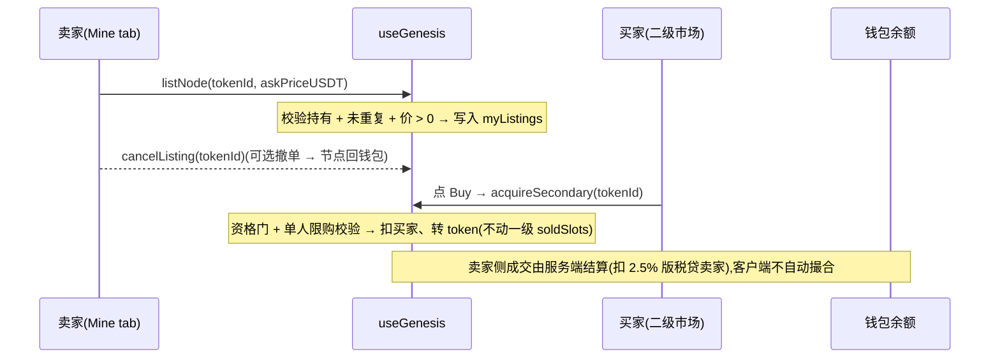

> 真后台对接:`POST /api/genesis/secondary/fulfill`(原子:校验挂单+资格 → 扣买家 → 贷卖家扣版税 → 转 token);挂单/撤单走 `POST /api/genesis/{list,unlist}`。客户端只发起主动承接、反映 canonical 结果,不含任何客户端撮合逻辑。

### 10.3 持有人 Dashboard `/genesis/holder`

#### 10.3.1 目的

为 Genesis Node 持有人提供完整的 holder portal,集中展示排放 / 权益 / 持仓 / 二级流动性。
看板由全局上所信号 `dividendsOpen`(= 服务端 `nexListed`,fail-closed)分**两态**渲染:上所前作战舱(排放优先额度 + 上所进度 + 积分榜)/ 上所后排放态(NEX 排放 vesting)。
当 `useGenesis.myOwned === 0` 时**显示真实空状态**(0 节点 / 无排放数字)+ 引导购买,不伪造数据。Perks / Footer 保留作为"购买能得到什么"的预览。

DAO 治理功能本期**仅作为持有人权益的文字承诺**(在 Perks 列表显示"1 节点 = 1 票")**不提供 active 投票 UI**,未来如开放可重新加 Active Governance section。

#### 10.3.2 页面结构(按 `dividendsOpen` 两态 × 持有状态分支)

**A. 上所前(`dividendsOpen === false`)· 排放优先额度作战舱**

`myOwned > 0`:
1. **Hero** — 排放优先额度卡:优先级 + 区间表述(非保证死数)+ 免责「上所后按排放与参与度确定」;**无每日收益数字、无可领余额**
2. **上所进度条 / 倒计时** — 真实话术「上所后开放」,不渲染 P1–P6 阶段字面
3. **积分排行榜名次卡** + 锁仓加倍 CTA(升 OG 排放优先倍率)+ 里程碑追溯奖励条
4. **动态条**(替代旧 live feed)— 「额度锁定 / 积分入账 / 里程碑达成」滚动;原 30 天柱图改标「积分趋势」

`myOwned === 0`:单一引导卡「你还没有创世节点」+ 认购 CTA(跳 `/genesis`),不显任何虚假持有 / 额度数字。

**B. 上所后(`dividendsOpen === true`)· NEX 排放态**

`myOwned > 0`:
1. **Hero** — NEX 排放收益:已释放 NEX 大数 + 参考 USDT 等值(「≈$X 参考 · 非保证」)+ vesting 环形进度(已释放 / 锁定中)
2. **排放明细 feed** — 复用原 feed 组件,数字换 NEX;下次释放倒计时
3. **YOUR NODES 列表** — N 个 NFT 卡(`NEX-GEN-XXXX` serial / 铸造日 / 二级市场 ExternalLink)

`myOwned === 0`:同上所前空状态引导。

**共享 Perks**(描述性权益,无交互入口):$NEX 协议排放优先额度 / 生态奖励池份额 / V5 直通 / Founders Circle(闭门 TG + AMA + alpha)/ DAO 治理(1 节点 = 1 票,文字承诺)/ 年度忠诚空投 + 二级流动性(OpenSea / 站内市场)。

**Footer note** — `Genesis Nodes are ERC-721 on Ethereum mainnet · Smart contract 0xNX...A98F · Audited by CertiK and Halborn`

#### 10.3.3 业务规则

- **持仓数据**:用真实 `myOwned`,0 时显示空状态,不伪造预览数据。
- **上所门(核心)**:`dividendsOpen = (nexListed === true)`,服务端权威 + fail-closed(脏 / 未知默认 false,绝不误显 live 排放);client **禁**本地由 false 推 true。后台 H1 `genesisDivOpen` 逐月旋钮据平台生命周期第 7 月(上所窗口)翻开。
- **上所前**:只持有排放优先额度(区间 / 优先级表述,派生自持有量 × `airdropPct`,默认 8%)+ 积分名次;**零累积可领余额**(推迟期不攒数,TGE 从 0 起按排放浮动发)。
- **上所后排放**:`emittedNEX`(累计已释放)/ `lockedNEX`(锁定中)/ `nextReleaseAt`(下次释放锚)均 server-canonical,按 vesting 曲线(TGE 10% + 18 月线性 + 每 6 月减半,后台 G4 `G.genesis.emissionCurve` 可配)派发,client 不本地推进。
- **参考等值**:`refUSDTValue ≈ emittedNEX × 平台参考价`,标「参考非保证」;取不到 = 隐藏(不显 $0 / NaN)。承接双口径设计——保底口径(节点价 × 0.1% ≈ $10/节点/日)挂后台负债科目#4,展示口径改 NEX 计价参考。
- **熔断**:`J.killswitch.genesis` 触发 → 排放区显「维护中,暂停派发」态,不报错白屏。

#### 10.3.4 入口

- `/genesis` 顶部 chip row 加 `Holder dashboard`(Diamond icon)与 `How it works` 并列

#### 10.3.5 SSR/CSR 安全

- 持仓数 / 倒计时 / Live feed 时间戳 / Holdings 卡铸造日期 都 mounted guard
- chart bars deterministic mock(纯函数 useMemo),无 Math.random in render

---

## 11. 扩展功能

### 11.0 Me 主页 `/me`

**H5 Lite（2026-11-03 追平合并）**：「我的」页采用 App 当前设计（账户与安全 P-51/53/54/55、钱包卡与快捷区），钱包总览已并入本页（§9.1）。Lite 差异：顶栏不显示扫码按钮，也不显示「请在 App 内扫码」类占位，邀请链接、手填邀请码和二维码生成保留；不显示系统通知权限 / 系统设置项（Lite 无系统推送，站内通知照常）；钱包卡与设备摘要的设备数不含手机设备。下文为历史结构说明，以现行页面为准。

`/me` 是 5 个 tab 之一,定位为**导航 / 摘要中心**,而非完整资金操作中心。所有完整流程(钱包、设备、网络、成就、设置)都通过摘要卡的链入口跳到对应子页。**首屏 4 张大卡** + 下方 Settings 列表 + 底部 Sign out。

**2026-10-31提现提醒归属决定**：收益概览下面不展示任何提现状态卡，包括处理中、失败、冻结、待处理、已退回及最近提现；不留空壳、占位或替代横条。原钱包及充值/提现/兑换操作入口保留。提现失败及需用户处理的事项统一在消息中心资金分类查看，点击进入对应原单详情；账单和提现历史继续保留真实记录。接口读取错误仍走原页尾恢复区，不在收益与常用功能之间插卡。

**1. Profile compact row**(无独立 card,扁平 Link row → `/me/profile`)
- 头像
- 显示名 + V badge + KYC pending chip(若未验证)
- 单行 mono:`{phoneMask} · {region} · Joined {n}d`
- 整行点击跳 `/me/profile`,右侧 chevron 提示

低视觉权重,减少跟核心信息(钱包余额、网络收益)抢夺注意力。

**2. 我的钱包卡** `Card` 非 Link,内部多入口
- Header eyebrow `我的钱包` + 右侧 `钱包 →` Link 跳 `/me/wallet`(完整资金中心)
- USDT 余额 hero + 待结算提示(`≈ ${n} 待结算 · 每 24h 自动入账`)
- **3 个 quick action**(min-h-[64px] Apple HIG):**充值 / 提现 / 兑换**,各自跳对应 `/me/wallet/{topup, withdraw, exchange}`。充值用 accent 突出,提现/兑换次级。
- **设备槽位转化条**(仅在 `devices.length < MAX_DEVICES` 时渲染):
  - 左:`{n} 个设备槽位空闲 · +$X/d`(潜在日收益 = emptySlots × 7 取整)
  - 右:`添加设备 →` Link → `/store`
  - 计算:`emptySlots = MAX_DEVICES(6) − devices.length`;`slotPotential = emptySlots × 7`(取整)
- Footer compact 行:左侧 NEX chip + 数量 + USD 估值;右侧 `{n} 条本月` 链 `/me/wallet/bills`

设计动机:用户高频操作是充值/提现/兑换,放一级减少 1 步点击。设备槽位转化条在余额下方直接展示"有多少空位 + 填满能多赚多少",把资金管理动线与硬件购买动线合并于同一卡片,减少跳转层级。其他资金管理(质押 / 复投 / Bills / NEX 详情等)在 `/me/wallet` 子页。

**3. 我的网络卡** `Card href="/team"` 整卡可点击

定位:升级引导卡 — 展示距下一阶 V 级的具体动作 + 升级解锁的核心权益,引导用户进 `/team` 操作。**不展示状态信息**(可提现 / cooling 已在钱包卡覆盖),保持单一主题。

**进行中状态**(`gap.next` 不为空):
- 奖励锚点：当前发布配置中的下一阶本人权益/等级奖励；培育奖须单独注明发给直接推荐人，不当作本人升级奖励，不写死示例金额。
- 主标:`距 V{N+1} {title}` + 主缺口文案(取 `nextRankGap(state).primaryGap`,按 `progress = have/required` 比例选离完成最远的条件)
- 升级权益:`topUnlocks` 取前 2 项(emotional weight 排序见 §13.2)
- 进度条 + 百分比;`progressPct ≥ 0.8` 时进度条切 warning(冲刺暗示)
- "+N more" 副字:`unmetCount > 1` 时提示尚有几条未达

**Server-eligible 过渡态**(所有 conditions met 但 server 未确认):
- 主缺口位置显示 `条件全部达成 · 等待确认`(success 色)
- 进度条满格
- Server 仍可能 reject(anti-abuse / race-condition fraud check)— UI 仅提示

**Max-rank 终态**(`gap.next === null`):
- 卡片塌缩到单行 dignity row:`已达最高阶 · {title}` + V 级 prize icon
- 不显示进度条 / 权益对比

**数据来源**:`nextRankGap(state)` helper(`lib/v3/v-rank.ts`)— client preview only,server canonical 见 §13.2。`/team/rank` 详情页参 §8.2。

**4. 成就 strip**
- 6 个 BadgeTile 横排(`首次收益 / 7 天连签 / 后台设备 / 推荐达人 / 100 俱乐部 / Founder`)
- 已解锁数 / 总数 chip
- Footer SettingsRow `查看全部勋章 → /me/achievements`

**5+. 设置区**(`§11.X` 子页入口列表)
- 账户 / Earn extras / 资产 / 安全 / 帮助 / 语言 / 等等(参 `app/(main)/me/page.tsx` SettingRow 渲染列表)


浮动 bubble + Drawer 聊天面板。

### 11.0A 自动通知与人工服务边界

Nova AI 会话已下线，App 内的 AI 会话、帮助页 AI 问答及相关代码已于 2026-10-30 移除（BUG-008）。浮标只提供人工顾问/客服快捷入口；铃铛与 Me 消息中心包含通知和服务两个分区，具体契约见 §11.2、§11.8.4。

#### 11.0A.1 自动通知

后端现有 Nova 命名的业务频道作为自动通知来源保留；只有已真实生成且可送达的通知进入通知分区。频道启停、频率、受众、账户语言和去重由后端决定，客户端不制造收益、交易或活动事实。

#### 11.0A.2 展示分类

服务端原始 kind 保留，按资金、设备、团队、活动奖励、系统五组展示。频道名称不决定人工消息归属；未知通知安全归入系统。未读、保留与优先级见 §11.2。

#### 11.0A.3 人工服务

人工顾问、普通客服与工单进入服务分区，复用服务端会话和工单。打开列表不清除未读，进入具体线程并成功确认已读后同步角标；旧 AI 链接返回现有服务入口。

### 11.0B 个人资料 `/me/profile`

账户公开资料页。**整页无自由文本输入、无手动配置项**(内容治理设计:平台不产生对其他用户可见的 UGC 自由文本,昵称违规在结构上不可能发生,无需事后内容审核机制;工单/客服输入属「用户→客服」私信通道,由客服人工在环,不在本命题内)。页面仅含:昵称(候选挑选)、头像(上传图片)、加入时间/等级/钱包绑定(只读或跳转);地区、时区、个人简介均已从产品中移除。

**昵称(displayName)** — 预置词库构造器,唯一改名路径为候选挑选:
- 生成规则:`{形容词} {名词} {10-99 两位数}`,策展词库形容词/名词各 16 词(约 2.2 万组合;词库刻意避开 Node 等产品业务词,防与设备/节点术语同屏混淆),示例 `Nova Pilot 27`
- 改名流:点击昵称行 → 候选面板(一批 6 个不重复候选,可整批换新)→ 选定 → 回填编辑缓冲 → 「保存修改」持久生效;未选中时确认不可用
- 新账号默认昵称按账号标识确定性派生(同账号恒定,不同账号大概率不同)
- 露出面:团队成员可见 · 收益证明分享卡(§11.5)· 邀请海报(海报侧按最长词库组合 18 字符适配);参与支付密码等价黑名单比对(提现安全章节)
- 数据接口:`GET /profile/nickname-candidates` 返回候选数组(mock 以 `lib/nickname.ts` 等价实现,backend-replaceable)

**头像** — 用户上传图片作头像;未上传时显示账号首字母头像。
- 更换流:点击头像 → 确认弹窗(更换后 7 天内不能再更换)→ 相册或拍照选 1 张 → 上传成功即生效,提示「头像已更新 · 7 天后可再次更换」;不经「保存修改」
- 规则:PNG / JPEG / WebP(按文件内容判断,改扩展名无效),不超过 2MB;与昵称分别计时,每 7 天可更换一次,冷却期内点击提示下次可更换时间
- 上传前预检:H5 选图后在本地检查大小和格式;原生 App 选图会压缩重编码,只检查大小,格式由服务端判断。不符合时不上传,直接提示原因:「图片格式不支持 · 请选择 PNG、JPG 或 WebP 图片」/「图片超过 2MB · 请选择 2MB 以内的图片」;0 字节文件单独提示「图片文件是空的 · 请重新选择一张图片」(2026-11-04,BUG-041);服务端同类拒绝(`USER_AVATAR_TYPE_INVALID` / `USER_AVATAR_SIZE_INVALID`)显示同样提示
- 数据接口:`POST /api/app/profile/avatar`(multipart `file` + `Idempotency-Key`);资料读取返回带签名的 `avatarUrl`、`avatarRevision` 和下次可更换时间 `avatarChangeAvailableAt`
**保存语义** — 页内编辑缓冲,统一「保存修改」提交(仅昵称可产生变更);无变更时提交给出无变更提示。

**运营配套** — 后台 C2「重置昵称」处置动作(操作确认 + 审计留痕,重置为系统生成默认,用户可重新挑选),处置存量违规/历史昵称;规格见运营后台 PRD C2 章。

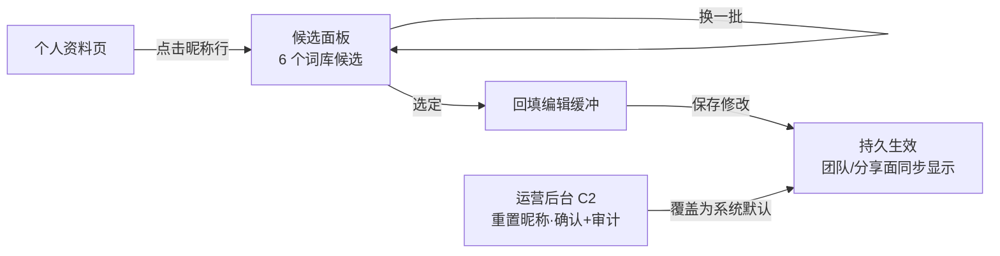

### 11.1 我的设备 `/me/devices`

**目的**:全 inventory 管理入口。购买成功自动激活为 Online，手动停用后退出算力队列、回到仓库并保留归属，可在空闲槽位内重新启用。六槽仍由后端验证，购买失败不产生成功激活。

2026-10-30 纠正：算力队列按已激活 Online 的设备实例展示；同型号重购保留独立实例和历史订单。全部类型含 Cloud Share 共用六个激活槽位，每实例各占一槽，取消 Cloud Share 免槽。（App）账号已激活手机的业务状态不由当前安装是否已校准或技术心跳决定，本机执行资格仍独立校验；Lite 不显示手机设备，见本节「H5 Lite」。首页添加设备先查可选仓库、有则弹窗选择、无才进商城；折叠队列仍展示当前任务与进度条。六槽与本轮口径见[算力激活队列与六槽](UVEL_算力激活队列与六槽_20261029.md)。

**两段分组**:

抵扣升级（2026-10-30 用户补充）按指定旧实例的位置继承：旧机已激活→先取消旧激活并抵扣→新机原槽激活；旧机仓库未激活→新机仓库。无需按满槽分支，失败回滚设备、任务和付款；真实旧任务只取消、不生成完成奖励。此为抵扣置换规则，普通全价购买仍按正常容量和资格自动激活。
- **Online**：权威确认已激活的设备，每行显示设备名、收益、规格与停用动作；任务结束后停用的设备在实际停用前仍 Online。
- **仓库**：权威确认未激活或已停用的设备，不显示 Offline 状态，每行同上并提供激活动作，槽位满时禁用；读取未确认与错误另提供反馈。

**顶部 slot meter（2026-10-30 容量投影）**:`slotsUsed / slotCap` 双色进度条(6 格)+ 文字 mono 标识。总占用`C=实际激活N+有效订单预留+有效试用预留`；原后端容量上限保持6。`GET /api/devices/earnings` 数据顶层与Home overview的`onboarding`均提供 `reservedSlotCount`、`trialSlotCount`、`slotsUsed`及既有`slotCap`，实际激活N由同一fleet真实激活实例统计，Home的`onboarding.activeDevices`仍为N。槽位条、空槽与普通新增容量守卫用同一fleet epoch/revision接收的权威C，不能再次叠加本地试用或被Home独立旧快照覆盖；Online列表与执行仍按真实激活实例，订单预留不生成设备、额外任务或收益。等待停用在实际停用前仍计N。旧后端缺字段时兼容原有`N+已确认试用预留`回退，容量事实未知不当零并关闭新增动作；复用账号epoch/revision隔离，迟到结果不能跨账号、覆盖较新投影或放行操作。抵扣升级位置继承、试用预留交换和原交易恢复不变，详见[六槽专题](UVEL_算力激活队列与六槽_20261029.md)。

**H5 Lite**：不展示手机设备（PHONE、MOBILE）；设备卡与槽位卡隐藏手机，但不扣减服务端 `slotsUsed`，隐藏的手机仍占原槽位，画成已占用、无标签的槽位，不显示成可添加的空位。账号资金历史仍完整展示手机收益。

**停用与停止任务（2026-11-03 与 App 一致）**：空闲设备确认后停用；有任务时可选等当前任务完成后停用，或立即停止并放弃未完成任务的收益。服务端任务周期设备通过 `POST /api/tasks/simulated/stop`（`deviceId`、`afterCurrent`）停止；安装 ID 请求头只用于手机设备（Lite 不展示手机，因此不会发送），请求不再携带 `expectedVersion`。返回 `CLOSING` 表示服务端仍在确认已完成收益，设备继续占槽直到实际停用；浏览器不自行结束周期或释放槽位。其他设备沿用设备命令接口（带行版本与幂等键）。

停用只改变运行状态，不删除库存、订单和历史收益。重新激活后等待服务端下发任务；首页、Earn 与详情刷新同一个权威状态，不在本地随机挑任务。

### 11.2 消息中心 `/me/notifications`

统一查看业务通知、人工顾问/客服会话和工单回复。通知、会话、工单各保留原数据与已读协议，中心只聚合展示，不复制人工消息为系统通知。NOVA/AI 入口关闭，AI 未读不计入。

#### 11.2.1 类型

一级分区为通知、服务。通知原始 `rawKind` 保留后端来源，展示使用共同映射：

| 展示分组 | 来源 |
|---|---|
| finance 资金 | 充值、提现、支付方式、订单、佣金、锁仓和行情通知 |
| device 设备 | 设备状态及运行收益通知 |
| team 团队 | 团队业务事件 |
| rewards 活动 | 活动、任务奖励、Genesis 及对应已启用业务提醒 |
| system 系统 | 安全、维护、风险披露与未知类型 |

提现失败及需要用户关注/处理的提醒统一在资金分类承载，不在My收益下重复展示。提醒使用真实状态、原因及事件时间；查看/处理（含 App 原生推送深链；Lite 无系统推送）须携有效原提现单号，银行单沿原银行详情分流。无原单标识时不回退到最新提现单；读取或重复事件不重复造提醒，不重置已读，不自动执行提现、退款或重试写命令。

分组不改变旧六键通知偏好协议。未知类型必须可读、可执行原 CTA。服务分区按最近更新时间展示人工会话及工单，可按专属客服、工单筛选；advisor/support 历史类型合并展示，不修改原会话标识或消息作者。

#### 11.2.2 未读与读取

- 总未读 = 服务端通知全量未读 + 可见人工会话未读 + 全部工单未读；人工浮标仅显示人工会话未读。
- 通知分页返回的 `unread` 是全量值，不能按已加载列表重新计数。单条/CTA 已读确认成功后仅减一次；清理已读不减少其他未读；批量已读后补拉服务端状态。
- 通知与服务分区分别展示完整未读数量。通知接口的 `unreadByKind` 按原始类型汇总同账号全部可见未读，合计等于 `unread`，不受游标、页大小或当前筛选影响；客户端按既有五组映射生成分类提醒，未知类型归入系统。旧接口缺少摘要时仅可显示已加载记录中确定存在的提醒，不能声明分类已全部读完。专属客服分类合并可见advisor/support会话未读，工单单独统计；会话行和会话管理分类在读取失败、缺失或未读无效时显示“-”，不得把未知显示为0，已确认0不显示未读角标。
- 展开通知才确认该条已读；打开中心、切换分类不读会话或工单。“通知全部已读”仅影响通知。
- 人工与工单只在实际详情内容展示后按现有版本读确认协议更新；有新回复冲突时刷新，不能吞掉未看过的内容。
- 加载、失败、无记录及当前页无匹配但还有下一页分别展示；失败保留已有快照并提供重试，不把失败当零未读。
- 通知按当前「全部／资金／设备／团队／活动／系统」分类在服务端筛选后分页，当前分类的游标只代表该分类还有记录；到尾页隐藏「加载更多」，其他分类仍有数据不能令当前分类继续分页。空分类直接展示该分类空态，不自动循环翻阅其他分类的页。
- 周期补拉只刷新当前分类，保留该分类已加载历史和游标；已到尾页时不因头页刷新重新显示分页按钮。分页操作去重，后台头页刷新不冒充「正在加载更多」；真实错误保留重试。切分类独立管理结果与游标，账户退出/重绑后清除旧快照，旧分类或旧账号请求不得回写。
- 浏览长列表时收起大标题与一级分区、保留末级筛选和当前分区上下文；明显回滑恢复一级切换，回到顶部恢复标题，轻微滚动不反复切换。

#### 11.2.2a Swipe-to-action(conversion-tied)

通知 CTA 与既有左滑导航均由服务端确认动作后返回路由，前端不能猜测已到账、代发资金操作或改变业务权限。重复动作按原幂等键查询；主动作成功但附属读确认失败，仍保留已确认路由并允许后续读状态对账。

清理已读须确认，只删除服务端允许清理的记录，保留 critical 消息。正式模式不提供客户端单条删除；通知与业务记录不是同一对象，清理通知不删除订单、资金或会话历史。

「清空已读」位于通知分区固定页底操作区，置于消息列表滚动容器之外，长列表顶部和滚动后均可触达；沿用原按钮样式，适配安全区且不遮挡末条内容。服务分区不显示通知清理入口。清理范围仍为当前账号全部可清理已读通知，不限当前筛选；确认、取消、系统返回和离页/换账号后的旧意图失效规则保持。

#### 11.2.3 入口

- 主页面和子页面右上角铃铛：直接进入 `/pages/me/notifications` 全屏消息中心，显示总未读，页内提供通知设置入口；无侧边抽屉和遮罩。`section=notifications/service` 指定初始分区，未指定时保留当前分区；已在中心时不重复压栈。返回恢复来源页面，冷启动进入时返回 Me。
- Me「消息中心」：进入 `/pages/me/notifications`，显示相同总未读。
- 人工浮标和客服渠道“在线会话”：进入 `/pages/me/notifications?section=service`，直接显示服务分区；浮标保留人工未读，不恢复 AI。点会话进入现有全屏聊天。
- 会话详情 `/pages/support/chat?cid=`；工单详情 `/pages/me/support-tickets?ticket=`，复用原归属、权限和已读协议。
- 工单详情提供“查看工单列表”快捷入口，回到现有工单列表；返回操作继续沿用来源页面返回规则。
- 已登录前台由一个全局循环补拉通知与工单，目标间隔15秒；人工保留 WebSocket 及既有断连轮询。回前台立即补拉，退后台/退出停止。首次加载不重放历史为新提醒。
- 原生系统级离线推送须完成应用标识、厂商配置、设备令牌和真机验收后单独启用；前台刷新不等于后台或杀进程推送。

#### 11.2.4 优先级、保留与送达

| Priority | 适用类型 | 保留策略 |
|---|---|---|
| `critical` | 服务端认定的资金冻结、安全或风险披露通知 | 不参与自动淘汰及清理已读 |
| `high` | 重要业务进展或需要处理的通知 | 按后台配置保留最新记录，超出淘汰最旧记录 |
| `normal` | 常规业务与设备、团队事件 | 按后台配置保留最新记录，超出淘汰最旧记录 |
| `low` | 非关键活动提醒 | 按后台配置保留最新记录，并淘汰超过48小时的记录 |

优先级、排序与保留由服务端决定；前端展示 critical/high 的重要标识，不自行重置已读或提升优先级。低优先级过期由服务端执行，客户端不作为权威消息仓库。资金、安全和风险披露必收规则由后端执行，不能仅靠禁用开关实现。

**真后台接口契约**:
- `GET /api/notifications?cursor=&limit=&priority=&category=` — 按分类与优先级筛选后分页；category可省略或all表示全部，其余为finance/device/team/rewards/system，未知类型归system，非法分类拒绝。`unread`及可选未读摘要仍是账号全量，不随分类/游标变化。
- `POST /api/notifications/:id/read` — server-side 标读
- `POST /api/notifications/read-all`、`DELETE /api/notifications/read` — 批量已读、清理已读；服务端校验账户归属与保留规则。
- 客户端通过游标及前台补拉对账，不宣称存在未接入的通知 SSE。

#### 11.2.5 支付方式生命周期推送模板(银行卡解绑 / 换绑引导)

后台「用户银行卡查询与解绑」能力(运营控制后台 PRD v1 Ch5 [C1·deepening] 支付方式)的用户端配套推送,两条模板,均由 **server 在事件流上触发**(client 仅收 feed,不本地判定触发时机):

| 模板 | 触发事件(server) | Kind | Priority | CTA 深链 | 文案要点 |
|---|---|---|---|---|---|
| 银行卡已解绑 | `card.unbound`(真实解绑完成) | payment_method | high | `/pages/me/wallet-cards`(§9.10 我的银行卡) | 说明解除绑定，提示查看当前支付方式 |
| 支付卡换绑提醒 | `card.rebind_notified`(后台换绑提醒动作) | payment_method | high | `/pages/me/wallet-cards` | 说明需要查看或更新支付方式，不宣称已完成换绑 |

- 卡片换绑与解绑资格由后台决定；免费试用无需绑定或担保银行卡，不因试用状态阻止解绑。
- 文案由后端按账户语言提供中/英/越，已发消息保留原文；本地 builder 仅适用于 mock，正式模式不伪造通知。

### 11.3 信任中心 `/trust`

展示 I4 发布的平台简介、平台运行数据、公开资料，以及 UVT 使用说明、服务条款、隐私政策、风险披露四个正式入口。「平台运行数据」与首页网络脉搏卡同源同格式（2026-11-03，§5.8）：「注册用户」「在线设备」按人口档显示（如 1.2W+、3.2K+），「累计已发放」为首页展示批次的千分位金额并在页面可见时逐秒更新；不显示活跃账户、真实在线设备或已完成提现等真实平台聚合，不显示「实时更新」、来源或统计时刻，单项不可用时显示 `-`。资料入口在远程请求失败时仍可使用。标题和内容分组遵循 App 圆角标题栏样式，三语适配。

原型中的投资方、认证、审计、媒体、客户、上市交易所、财务数字及占位文件不是已验证资料，不得直接发布。仅展示有证据支持且链接有效的公开内容，资料缺失时不编造。详见[现行规则 §3](UVEL_首页信任与活动规则_20261025.md)。

#### 11.3.1 NEX 代币说明页 `/trust/nex`

零基础说明页,向新用户解释 NEX 平台代币本质 + 用法 + 价格机制。

**页面结构**:
1. iOS nav back to `/trust` + 标题 `About NEX token`
2. Hero + 标签 `PLATFORM TOKEN` + 大标题 `NEX — the token that powers NexGrid's compute economy.`
3. §1 NEX vs USDT 对照表(Property / USDT / NEX 三列;Token type / Current price / Volatility / Primary use 四行)
4. §2 NEX 4 个来源 IconRow:
   - ⚙️ 设备挖矿(主产出:每笔推理任务完成 mint NEX,即时滴灌入持仓)
   - 🤝 团队佣金(unilevel / peer / cultivation 部分 NEX 计价)
   - 📈 质押利息(NEX 计价收益)
   - 🎁 签到 + 注册礼包(每日签到水龙头 + 20 NEX 注册礼)
5. §3 NEX 5 种用法 IconRow:
   - 💱 Convert to USDT 提现(经 `/me/wallet/exchange`)
   - 🔥 提现网络结算费(每 $100 提现燃烧 N NEX,见 §9.3.2)
   - 🛒 支付升级 / 复投
   - 🔒 质押锁定 NEX 收益
   - 🚀 持有看涨
6. §4 价格涨跌机制双卡:
   - DEMAND SIDE:AI 客户付费 → 月度 buyback
   - 🔥 BURN MECHANISM:30% 平台费永久销毁
   - 💡 Track NEX in real time CalloutBox(指向 Trust Center 实时数据)
7. §5 FAQ 5 问(NEX 是否稳定币 / 是否可直接提现 / 价格下跌怎么办 / Binance 上市 / 与 memecoin 区别)
8. 双 CTA:`Open Exchange` 链 `/me/wallet/exchange` + `Back to Trust Center` 链 `/trust`

### 11.3a 收益里程碑庆祝(MilestoneWatcher)

Sprint A-1 / E.2。平台以固定节奏(每 4 秒一拍)监听用户累计收益(life-to-date = `earnings.total + earnings.today`),当其跨越下一个未触发阈值时,被动触发一次全屏庆祝 overlay 并自动派奖,无需用户操作。

**与 §11.4 成就系统的差异**:Achievements 是用户主动 Claim 的成就(条件评估 → 可见 lock 状态 → Claim 入账);**MilestoneWatcher 是被动触发的庆祝**(条件越过 → 自动 fire + 自动入账 NEX 奖励,无需用户操作)。两者并行,不冲突。

**跨档派奖动作**(单次跨档):

1. 标记该档已触发(幂等守卫,先标记防同档重入);
2. 入账 NEX 奖励(`creditNex(nexReward)`);
3. 写一条 `achievement` 类账单(NEX,金额 = `+nexReward`,ref `MILESTONE-{id}`,memo 注明 `Earnings milestone · ${thresholdUSD}`);
4. 打开庆祝 overlay(自带 confetti + 5.2s 自动 dismiss)。

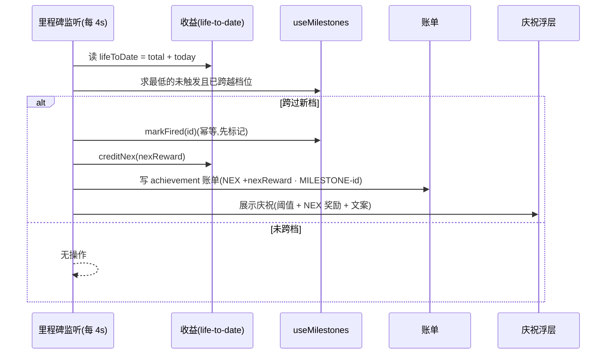

**5 档阈值**(`lib/store/milestones.ts` 常量):

| ID | 阈值 (USD lifetime earnings) | NEX 奖励 | 业务文案钩子 |
|---|---|---|---|
| earn-100 | $100+ | +100 NEX | "First $100 earned — your phone has officially paid back its activation overhead." |
| earn-500 | $500+ | +250 NEX | "Half-grand reached. Hardware tier upgrades start unlocking measurable ROI." |
| earn-1000 | $1,000+ | +500 NEX | "Four-figure earner. You're outpacing 88% of solo-phone accounts." |
| earn-5000 | $5,000+ | +1,500 NEX | "Mid five-figure operator. Most users at this stage already own a NexGridBox Pro." |
| earn-10000 | $10,000+ | +3,000 NEX | "Top 2% of NexGrid earners. Founders Tier consideration unlocks at $25K." |

**Overlay UI**(portal 到 body):
- Trophy icon spring 入场
- 大字 `$X+`
- 标题 + 阈值专属业务文案
- chip `+N NEX` 奖励
- `<Confetti originRef={medalRef}>` 同步触发
- 5.2s 自动 dismiss

**fire 节奏**:一次只触发一个 milestone,即使越过多档也走 cascade(每 4s 检查一个),避免视觉打架 + 增强戏剧化。

**Persist**:`useMilestones` zustand persist(key `nexgrid-milestones-v1`)记录 firedIds,刷新不重触发。

**Demo 触发入口**(`/me/replay-tour` Lifecycle demo section,Sprint 2 第三阶段 §7.5.6 同位置):"Trigger earnings milestone" 按钮 → `resetMilestones() + _devBumpEarningsTotal(150)` → 下一次 poll 时 fire $100 阈值。

**i18n**:`milestones.*` 7 keys(title 模板 + 5 阈值业务文案 + genericBody fallback)。

### 11.4 成就系统 `/me/achievements`

24 个成就分类(First / Earnings / Social / Loyalty / Hardware),每解锁触发弹窗 + 可领取 USDT/NEX 奖励。

### 11.4a 风险提示书 `/me/risk-disclosure`

强制阅读的平台风险说明,正文由运营在后台(PC I5)按地区发布;后端在没有已发布版本时写入一份默认版本(只插入,运营发布新版本即替换)。

**入口**:结算页「购买、退款与售后说明」弹层的「风险提示书」(§7.3)、信任中心「规则与资料」的「风险披露」(§11.3)、服务条款页「另见:平台风险披露」(§4.7.5,未登录可读)。个人中心不设入口;提现与质押不再在提交前拦截。

**数据**:Store `src/store/risk-disclosure.ts`(`useRiskDisclosure`,随账号切换重绑)。已登录读 `GET /api/legal/risk-disclosure/current`,未登录(带 `country`)读 `GET /api/legal/risk-disclosure/public/current`;确认写 `POST /api/legal/risk-disclosure/acknowledgment`,是否已确认以服务端返回为准。章节按当前语言显示已发布原文,缺该语言时显示可用语言并提示。

**页面结构**:
1. 顶部返回头 + 标题
2. Hero:「必读文档」标签 + 标题 + 副文 + 地区 · 版本 · 生效日期
3. 7 章节(编号 01-07 由页面生成 + 标题 + 正文)
4. 未滚到底时显示「请滚动浏览所有章节后再确认」
5. 确认区:滚到底后才能勾选已阅读;勾选且阅读满 `minimumReadingSeconds` 秒(按钮显示剩余秒数)后「我已知悉 — 继续」可点;确认后回到来源页,已确认时显示「已确认」

**默认版本 7 章(2026-11-03,中/英/越)**:
| # | 中文标题 | 要点 |
|---|---|---|
| 01 | 收益为预估，不构成承诺 | 以到账记录为准,可能低于预估或无收益 |
| 02 | 设备产出会变化 | 任务供给、在线时长、网络电力维护影响产出;产能随使用时长下降;手机受机型、电量和系统限制 |
| 03 | UVT 价格波动 | 价格和流动性可能大幅波动,可能暂时无法交易 |
| 04 | 购买、退款与活动 | 设备一般不退款可置换;退款时相关奖励可能收回 |
| 05 | 充值与提现 | 转错网络或地址可能无法找回;链上确认后不可撤回;提现可能需安全确认 |
| 06 | 推荐与团队奖励 | 依当期规则,不保证持续;虚假账户等获得的奖励作废 |
| 07 | 账户安全与服务变更 | 保管密码与验证码;为安全或合规可能暂停部分功能;变更在 App 内通知 |

页面只渲染后台返回的章节;未连接后台时显示加载失败,不显示本地文案。本地预览夹具(`/api/legal/risk-disclosure/current`、`/public/current`)使用此默认文本,取代原「演示说明 … 原型演示资料」样例;i18n `riskDisclosure.s1Title/s1Body … s7Title/s7Body` 同步为此文本,当前不参与渲染;原 `riskDisclosure.s4BodyLargeAmount` 已删除。

页面内容按当前账号地区和语言读取服务器发布版本，确认状态也由服务器管理；加载失败、地区未配置或账号切换不产生本地“已确认”事实。页面自身的阅读完成与勾选规则保留。**后端 B12 依赖尚未解除**：客户端不再前置确认，不等于服务端不检查确认状态。当前 `content/application/AppRiskDisclosureService.java#checkUserGate` 对未确认账号返回 code 409；`market/application/AppStakingService.java#open` 在 `executeOnce` 前拒绝开仓；`finance/application/AppWithdrawalService.java` 提交时仍可能先 `reserveFunds`，而 `finance/application/OpsFinanceService.java` 在 APPROVE 阶段调用 `disclosureGateFacade.checkUserGate`，返回 `RISK_DISCLOSURE_ACK_REQUIRED` 后不继续批准。B12 必须解除对应后端门禁并完成真实提交 / 审批链验收，才可声称风险确认不再影响这些业务；Lite 保持与 App 相同的前端产品决策，不恢复确认步骤。zh / en / vi 均使用 `riskDisclosure.*` 文案；移除已无调用方的 `search.routes.risk` 和 `riskDisclosure.gateUnavailable`。

### 11.5 推理收据 `/me/receipts` + `/me/proof`

#### 11.5.1 任务与计算凭证 `/me/receipts`

计算收据详情和历史摘要的 `settledAt` 读取服务端实际入账时间。新详情有 `postingTimeVerified` 时，同一秒完成和入账也可按实际入账时间读取。没有入账事实时返回空值，详情沿用已有的完成时间兜底。旧后端普通模型详情重复完成时间时按未知处理，摘要的 `completedAt` 继续表示完成时间。

列表和详情读取服务端 `/api/tasks/receipts`，展示真实任务号、名称、设备、起止时间、实际时长、六位 USDT/UVT 收益，以及服务端已明确提供的入账时间。`SIMULATED` 为任务周期凭证；`RULE_CYCLE` 携带规则结算元数据；`executionMode`、`proofKind`、`modelExecuted` 保持原始事实，不能把未执行模型的收益说成推理证明。空模型或空 proofHash 不生成假值，有 proofHash 时才提供复制。

Lite 凭证历史与账单都属于账号资金记录，展示所有设备（含 PHONE、MOBILE）的任务和周期收益。列表、total 与游标使用服务器口径，时间一栏标注「完成时间 / Completed at / Hoàn thành lúc」。周期凭证与 v2 任务中心可以读取各自的实际入账时间（§6.3）。接口失败时显示错误并允许重试。H5 刷新后登录会话恢复、账号绑定后才读取，恢复前保持加载，不提示读取失败（2026-11-03 BUG-079）。任务中心只在已入账且有凭证号时打开详情。

#### 11.5.2 Proof of Contribution 分享卡 `/me/proof`

分享中心提供 Earnings / Streak / Network 三种卡片，分别显示累计收益、最长连续签到和团队规模。卡片保留品牌、用户名、加入日期、V 等级、活跃天数、非手机在线设备数、网络分位与成就摘要；无权威数据时显示占位，不推算成绩。推荐区展示邀请码、完整链接与按该链接生成的真实二维码。

**Lite 分享触点**：
- 顶部「复制分享内容」直接复制当前卡片文案，提示粘贴到所选应用或网站，不调用原生 `uni.share`。
- X / Telegram / WhatsApp / Instagram 按钮复制分享文案；Copy link 只复制推荐链接；Save PNG 生成 1080 × 1350 海报并通过浏览器下载。
- 二维码是可导出的邀请内容；Lite 不提供相机扫码入口。

分享内容以 UVEL / UVT 显示，Network 文案只描述成员数，不再承诺多层收益。正式模式以 `proofApi.snapshot()` 为累计收益、加入日期、活跃天数、连续签到、推荐码、团队人数和网络分位的来源；设备数读取服务器设备列表并排除手机，V 等级读取正式梯度。失败显示重试与占位，账号或运行环境切换后失效旧快照。本地演示才读取对应本地 store。中英越按钮与提示使用 `proof.*` 文案；既有导出分享正文仍为英文。

### 11.5a 我的奖励 `/me/rewards`

个人中心的奖励聚合入口,两级结构。

**入口与红点**:`/me`「账户」分组「我的奖励」项,带未读红点,条件(满足其一):
- 存在已领、未使用、在有效期的代金券 — 持续显示,直到券被使用或过期;
- 存在入账时间 > `rewardsSeenAt` 的奖励类账单条目 — 打开 L1 即更新 `rewardsSeenAt`(服务端权威:用户档案字段,`PATCH /api/me/rewards/seen` 由服务端盖时间戳,客户端仅缓存);首装 `rewardsSeenAt=0`,历史入账视为未读。

**L1 类别汇总**(`/me/rewards`):三个分类入口——优惠券(可用张数;有过期券时提示过期张数)、USDT 奖励(累计入账总额)、NEX 奖励(累计入账总额)。零值时三分类仍显示并附引导文案。

**L2 分类记录**(`/me/rewards/list?cat=voucher|usdt|nex`,cat 非法或缺失回退 voucher):
1. **优惠券**(voucher)— 已领、未使用、在有效期的券(面值 / 名称 / 适用范围 / 有效期),每张提供「去使用」:单一 SKU 券 → 该设备详情页,多 / 全设备券 → 商城(§7.7.2);已领未用但已过期的券置灰标「已过期」,不可使用。
2. **奖励记录**(usdt / nex)— 该币种的奖励类入账(活动 / 推荐 / 成就 / 客服补偿,账单类型 ∈ {活动奖励, 推荐佣金, 成就奖励} 且金额 > 0),按时间倒序,每批 10 条,滚动到底自动续载;真后台 `GET /api/me/bills?type=reward&symbol=USDT|NEX&cursor=&limit=10`(游标分页)。

**数据源与口径**:代金券钱包(useVoucher,§12.20)+ 账单流水(useBills,§9)。红点、L1 汇总、L2 记录共用同一奖励条目判定(单源派生);客服补偿以奖励类账单入账后自动计入本页与红点,无额外接口。

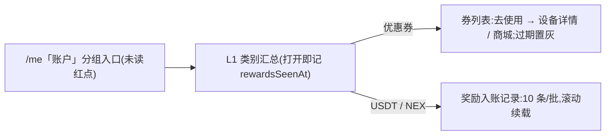

### 11.6 全球节点地图 `/globe`

从「我的」进入。顶部两格：「在线节点」与「进行中任务」；下方为抽象点阵世界地图（8 个超级算力中心节点，新加坡为「你」所在中心并画连接线，脉冲按采样节奏依次扫过各中心），再下为 8 个中心列表（名称、「超级算力中心」、任务/小时），点按打开中心详情抽屉（在线节点、任务/小时、延迟）。页面不显示「模拟展示」「仅作示意」一类说明（§16.2.5）。

数据来源（与首页、赚取页同一配置入口）：
- **在线节点总数** = 首页网络脉搏卡的在线设备数（H9 `networkPulse.onlineDevices`，同一个数；运营在 H9「首页与网络展示设置」的「首页数字增长」模块配置），顶部按千分位显示。
- **进行中任务总数** = 赚取页作业中心「{n} 个全球作业进行中」的同一个数（§6.3：真实进行中作业 + H9 全球作业展示基数，未发布时只取真实数），由同一处计算供两页共用；本页显示时与赚取页一样读取首页概览和设备列表。
- **按中心拆分**：两个总数按各中心占比拆到 8 个中心，用最大余数法取整，8 个中心之和恰好等于总数。`globeDisplay` 接受两种格式：新格式（后端 B22）每个中心都带 `sharePct`（百分比，0–100，最多两位小数，8 个合计 100），占比取它，不要求 `nodes` 和已退役的 `nodeJitterPct` / `activeJobsMinPct` / `activeJobsMaxPct`；旧格式所有中心都不带 `sharePct`，以各中心 `nodes` 为相对权重（占比 = nodes ÷ 各中心 nodes 之和，nodes 全为 0 视为无效）。部分中心带 `sharePct`、`sharePct` 越界、超过两位小数或合计不为 100 时视为无效（2026-11-04，BUG-076）。两种格式都校验采样间隔、吞吐区间和延迟。已退役字段即使下发也不参与展示，在线节点不再叠加抖动。
- **任务/小时** = 该中心进行中任务 × 吞吐漂移（`throughputMin`–`throughputMax` 之间平滑漂移）。**延迟** = 中心 `latencyMs` + `latencyJitterMs` 漂移。采样间隔为 `intervalMs`，均与原来相同。
- 抽屉里的中心在线节点按首页人口档显示（≥1 万「x.xW+」、≥1000「x.xK+」、≥100 整百「+」，否则「<100」）。
- 占位各自独立：顶部「在线节点」直接读在线设备数，不可用时只这一格显示「—」；「进行中任务」直接读作业中心的数，不可用时只这一格显示「—」；两格都不依赖 `globeDisplay`。8 个中心的数字依赖拆分输入：`globeDisplay` 缺失或无效时各中心在线节点、任务/小时、延迟都显示「—」；在线设备数不可用时各中心在线节点显示「—」；任务数不可用时各中心任务/小时显示「—」。

### 11.7 Developer API `/developer`

展示性 API 文档 + 代码 sample + SDK 下载链接。

### 11.8 帮助 + 客服

#### 11.8.1 帮助中心 `/me/help`

FAQ accordion,分类:Account / Earnings / Hardware / Payment / Security。

#### 11.8.2 客服渠道枢纽 `/me/support`

- Live status chip(`Online now · avg response 4m`)
- 5 个渠道行:**在线会话**(链 §11.8.4 统一会话中心)/ Telegram / Discord / Submit a ticket(链 §11.8.3 `/me/support/tickets`)/ Email
- Pinned 公告 4 条

#### 11.8.3 工单系统 `/me/support/tickets`

**目的与入口**：提供仅本人可访问的客服工单、历史消息与后续回复。UniApp 页面为 `/pages/me/support-tickets`，包含列表、创建、详情三种状态；`?mode=create&cat={category}` 可预选合法分类，`?ticket={ticketNo}` 可进入指定工单。消息中心“服务”分区聚合工单提醒，客服渠道页可直接进入创建页。

**列表与详情**：列表支持全部、进行中、已解决、已关闭筛选，展示服务端返回的工单号、分类、状态、标题、更新时间、消息数和未读数。详情读取真实消息线程，支持加载较早消息；成功读取并提交已读回执后更新未读。仅查看服务总览不标记工单已读。响应时限读取服务端分类 SLA 目标，不将目标当作历史平均响应统计。

**创建输入与数据**：

| 字段 | 约束 |
|---|---|
| 分类 | `account` / `withdrawal` / `deposit` / `hardware` / `earnings` / `genesis` / `technical` / `other`，共 8 类 |
| 标题 | 去除首尾空白后必填，1–160 字符 |
| 描述 | 去除首尾空白后必填，1–2000 字符 |
| 优先级 | 数据枚举为 `low` / `normal` / `high` / `urgent`；App 新建固定为 `normal`，不由表单自行升级 |

创建页按当前语言和分类读取相关 FAQ。工单包含编号、标题、分类、状态、优先级、版本、创建及更新时间、消息数、未读数；详情另含消息作者、正文、时间和历史分页游标。正式数据经 `src/api/support-api.ts` 读写，不由本地示例工单生成。

**专属客服归属**：四类创建入口都由服务端读取当前有效的客服绑定，自动确定工单负责人；App 不选择或上送任意负责人。未绑定时仍可提交，进入既有待分配流程。首次绑定或正式转绑时，同事务同步该账号全部未删除工单（含已关闭及归档）的当前负责人，历史消息作者保持原样。客服忙碌、离线或停用不自动改派，交接沿用主管客户分配流程；工单不能独立转给其他客服。后台回复仍验证当前绑定与既有权限，工单归属变化不扩大私聊副本的阅读范围。

**建单规则**：同一账号的 App 建单、App 会话转工单、后台建单及后台会话转工单共用服务端限制，提交时重新判定，客户端预检查不保留名额。

| 规则 | 默认值与判定 |
|---|---|
| 相邻新单冷却 | 60 秒 |
| 滚动建单总量 | 任意连续 24 小时最多 10 单；关闭、归档或软删除不返还该窗口内的次数 |
| 活跃工单数量 | 已有 3 张未软删除的工单处于 `open` / `in_progress` / `pending_user` 时禁止新建；仅归档不释放活跃名额 |
| 重复内容 | 24 小时内，同账号、分类、标题与首条正文相同则不再建单，返回已有工单号供继续处理；标题和正文先做 Unicode NFC 及空白规范化，分类忽略首尾空白与大小写 |

三个数量参数由服务端 `support.ticket.creation.cooldown_seconds`、`support.ticket.creation.max_per_24h`、`support.ticket.creation.max_active` 控制，App 以接口返回值为准。建单限制不阻断既有工单的合法回复或重开。

**状态与动作**：

| 状态 | App 可用动作 |
|---|---|
| `open` 待处理 | 回复、关闭 |
| `in_progress` 处理中 | 回复后回到 `open`；可关闭 |
| `pending_user` 待补充 | 回复后回到 `open`；可关闭 |
| `resolved` 已解决 | 可回复，回复后重开为 `open`；页面不显示关闭按钮 |
| `closed` 已关闭 | 只读历史，不可回复 |

归档工单不可回复。回复、关闭和已读写入携带预期状态与版本；并发冲突应读取服务端最新结果，不覆盖较新状态。

详情按服务端消息顺序和日期展示记录；长记录可展开与收起且保留完整原文，折叠状态按账号、工单和消息隔离，历史作者仅显示消息公开署名或通用客服称谓。

**接口与异常**：`GET /api/app/support/tickets/creation-policy` 返回当前可建单状态、限制原因、重试时间和可继续处理的工单号。策略读取中、读取失败或内容不合法时禁用新建提交，保留当前表单输入并提供重试。`POST /api/app/support/tickets` 成功后进入真实工单详情；暂时拒绝保留输入，提示何时重试或查看已有工单，重复内容以 409 返回旧工单号，其他建单限制以 429 返回策略。

创建和回复使用 `Idempotency-Key` 标识同一提交意图：成功重试返回原结果，不新增工单或消息；暂时拒绝可在限制解除后以原键重试。结果未知时查询原命令或同键重试，不因刷新或网络失败另建同一工单。换账号清除前一账号的页面输入与策略状态。

**验收**：空白及超长输入被拒；八类均可按合法参数提交；并发建单不突破限制；关闭后不能绕过 24 小时次数限制；重复内容可定位旧单；策略失败保留当前输入并停止提交；`resolved` 回复可重开，`closed` 不可回复；详情返回消息中心后仍在服务分区。文案使用 `tickets.*`，覆盖中、英、越三种语言。

### 11.8.4 统一会话中心 `/support/messages` + `/support/chat`

**目的**:在统一消息中心“服务”分区提供一个专属客服入口；人工消息由当前专属客服接续。§11.2 聚合人工与工单提醒，原会话/工单详情继续承担读取和回复，会话管理页保留新建、历史与移除列表功能。

**会话类别(`ConversationType`,可扩展)**:

| 类别 | 角色 | 会话语义 |
|---|---|---|
| `advisor` 专属客服 | 当前专属客服 | 人工服务的新建及展示入口；未分配时客户可留言等待分配 |
| `support` 兼容类型 | 当前专属客服 | 旧链接和历史会话继续读取；入口及类别可用性按专属客服处理，不迁移历史标识 |
| `ai` | 兼容类型 | 服务端仍可能返回该分类；App 不展示、不计入总未读，旧 AI 路由回到会话中心 |

**入口与路由**:
- `/me/notifications?section=service` — 人工服务统一入口；会话行直接进入全屏聊天。
- `/support/messages` — 会话管理:按类别查看历史、发起新会话和移除列表；保留旧链接与聊天异常回退。
- `/support/chat?cid={id}` — 人工类别会话聊天线程；旧 `/support/chat?type=ai` 等其他参数一律回到会话中心。
- 入口:人工服务浮标、客服渠道枢纽 `/me/support`「在线会话」行(§11.8.2)统一到消息中心“服务”分区；分区内“会话管理”进入管理页。

**业务规则**:
- 人工 `advisor` / `support` 均采用当前归属；客户端读取 `GET /api/app/support/advisor` 的当前专属客服、归属状态和可用性。未分配、客服停用或忙碌均可留言，界面说明实际状态；未知在线状态不显示在线。
- 客户只可读取和发送自己的会话。归属变更后，服务端按当前归属授权，客户端清除旧会话缓存、图片和待发草稿，再取新快照。历史姓名及时间保持原作者；仅作者已确认且头像标识有效时经鉴权读取其头像，不用当前客服头像替换。页面、账号或归属变化清理头像内存并丢弃迟到响应。
- 人工浮标仅显示 advisor/support 的可见未读；铃铛和 Me 消息中心将人工、工单和通知合计。AI 隐藏不影响已有后台业务通知，业务通知按来源归类。
- 浮标使用品牌卡通客服头像（深浅主题各一张独立资产）。聊天顶部身份胶囊取当前归属客服最新一条已确认消息：带作者头像且已鉴权读取时显示本人头像，否则显示品牌卡通头像；客服移除头像或会话转给他人后随之回到卡通头像。浮标仅在有人工未读时亮起琥珀色光晕并每 2 秒外扩一圈，与未读角标同色；滚动、页面隐藏时暂停，减少动态时只保留静态光晕。
- 客户发送TEXT或IMAGE；客服入站消息还支持SKU商品卡和LINK内部入口。图片先按服务端策略选择PNG/JPEG、私有上传成为READY，再随同一条消息提交；未提交图片仅上传者可见。已发图片每次鉴权读取，不使用公开URL。上传失败、过期、撤权可重选；页面离开或换账号清理私有图片内存URL。
- SKU使用合法商品ID和名称；LINK仅接受HOME/WALLET/SUPPORT且参数为空，禁止任意URL及额外参数。仅targetAvailability=AVAILABLE提供既有页面跳转；UNAVAILABLE/UNKNOWN保留原消息，说明当前内容不可用或待核实，不提供可执行跳转。
- SKU/LINK在气泡内的显示:先显示客服正文；SKU正文已含商品名时不再追加，未含时另起一行补商品名。可跳转时，气泡最后一行是品牌色文字链接加 →(查看商品 / 打开首页 / 打开钱包 / 打开在线客服)，时间在同一行右侧；链接点击热区44px高，不撑高气泡。不使用胶囊或玻璃按钮。
- 气泡外观:每条气泡只显示单色半透明填充，无边框、无描线、无内缘高光或阴影；强制颜色模式下显示系统轮廓。
- **客服已切换提示**（2026-11-02，依赖后端 B15）：换人接待时，服务端在新接待人的第一条消息前写入一条系统消息（`senderType=system`、`kind=AGENT_SWITCH`，`senderName` 为新接待人显示名，正文可为空）。聊天线程按现有系统提示样式居中显示，按当前语言本地化：有名字时为「客服已切换为 {name}」/“You're now chatting with {name}”/“Đã chuyển sang {name} hỗ trợ bạn”，没有名字时为「客服已切换」/“Your support agent has changed”/“Đã chuyển nhân viên hỗ trợ khác”。只显示名字，不显示主管、管理员等身份。该提示不改变会话列表预览、未读数和最后消息时间。时间相同的消息按数字 ID 从小到大排列，与后端 `(createdAt,id)` 游标一致，切换提示不会排到新接待人的第一条消息之后（2026-11-04，BUG-051）。只有系统消息可以带这个类型；其他未知消息类型仍按响应无效处理。App 须先上线能识别该类型的版本，后端再开始写入，否则旧版本打开这类会话会失败。
- 草稿按账号和会话隔离；明确发送失败可编辑、重试或放弃，发送结果未知只能按原命令查询或同键重试。图片和文字随同一发送意图恢复，不因刷新或重试生成第二条消息。
- 新建会话最终发送前核类别可用性；support旧类型复用advisor门。已有结果未知的新建仅在同账号、同权限运行作用域且原待确认键仍匹配时恢复原命令，不因类别随后关闭生成新键；作用域或原键变化时拒绝旧恢复。
- **发送频控**:单会话发送限流,两道独立闸——滚动窗口(每 15 秒最多 5 条)+ 相邻两条最小间隔(至少隔 1 秒),防连点刷屏;两闸都放行才发出,超限提示的重试秒数取两者较长值。超限提示同一时刻只显示一条,连续触发刷新该条不叠加;被拦下的这条消息文本回填输入框,不丢失。规则覆盖人工会话的自由输入(AI 会话和快捷提问已随 Nova 下线移除)。真后台以 HTTP 429 + Retry-After 镜像同一策略。
- **消息回执与状态**:用户发出的消息显示「已送达 / 已读」回执，状态只取服务端返回的消息回执，客户端不推断、不模拟节奏。客服「正在输入…」只在聊天页打开、实时连接收到该会话的客服 typing 事件时显示在聊天顶部状态行，约 5 秒无更新自动消失；离开聊天页即清除；实时连接不可用时不显示。
- **注册欢迎语**（2026-11-02，依赖后端 B16）：用户注册成功时（手机号注册和第三方注册），服务端在写入客服绑定的同一事务里，往该用户的专属客服会话发一条欢迎语，注册后 App 第一次加载就能看到。App 按普通客服文字消息处理，接口格式不变。
  - 注册时已有专属客服（好友邀请码继承的绑定，或客服邀请码绑定）：欢迎语以该客服身份发出，聊天顶部和服务分区显示客服名字；头像按上文规则（作者已确认且有头像时显示本人头像，否则品牌卡通头像）。
  - 没有专属客服（进入待分配池）：照样发送。浮标进入服务分区，列表里就是这条会话；Me 页、客服渠道枢纽「在线会话」和订单详情的客服入口直接打开最近一条待分配会话，不进入空白的新建会话页。用户留言落在同一会话。产品里只有专属客服，不为此新增通用客服身份。欢迎语是普通的左侧客服气泡，不是居中系统提示；服务分区该行标题为「专属客服」。聊天页保持现有待分配状态：顶部「待分配客服 · 等待分配客服」和品牌卡通头像；用户留言前，线程顶部显示「暂未分配专属客服，可先留言。留言确认接收后，由专属客服接续。」，留言后改为「留言已收到，分配后由专属客服接续。」。之后分配的专属客服在同一会话里接续。
  - 未读：欢迎语计入人工未读，首页人工服务浮标亮琥珀光晕并显示角标，服务分区该行显示未读数；进入会话后按现有已读回执清除，返回后浮标角标和光晕消失。
  - 文案：运营在 PC M5 配置一份，中文、英文、越南语各一段；有没有专属客服都用同一段，不含占位符。服务端按注册时记录的账号语言选取（zh / en / vi，其他语言用 en）。已发出的欢迎语是快照，之后修改文案不影响已发消息。默认文案：「你好，欢迎加入 UVEL！设备、收益或充值提现有任何问题，直接在这里给我们留言，我们会尽快回复你。」
  - 欢迎语不算客户首次接触，不计入维护、服务考核和客户活跃，不产生待回复事项。
- **消息定位与阅读**:进入会话定位到最新一条；已在末尾时，发送、收到新消息或输入区高度变化继续跟随末尾。手动上滑阅读历史后，新消息不强制拉到底；上下滑动、惯性与快速反向滚动保持手势方向，不因延迟滚动通知回拉。加载更早历史及图片预览返回保留当前阅读位置，同一位置的再次恢复仍可生效；气泡随可视位置取色和输入框玻璃效果保持。页面隐藏、会话或账号变化取消旧定位。

**数据模型**:§12.9a Conversation。**i18n**:`conversations.*` 命名空间 + `support.chLiveChat` 渠道键。

### 11.9 NEX 行情详情页 `/market`

#### 11.9.1 目的

提供 NEX 与同类 AI / DePIN tokens 的横向对标视图,锚定 NEX 处于"主流赛道",
强化交易所上线预期(`Binance / Coinbase 审核中`),驱动用户进入后买入 NEX。Home `$NEX ticker` 卡当前阶段隐藏(参 §5.7),Home 侧入口走算力市场卡「打开」。

#### 11.9.2 页面结构(自上而下 7 段)

1. **NEX Hero**:
   - 标签 `YOUR PLATFORM TOKEN`
   - 左:N 圆 icon + `NEX / USDT` + 副字 `NexGrid · #{rank}`
   - 右:大字价格 + `▲/▼ XX.XX% (24h)`
   - 时段 tabs:`1H / 24H / 7D / 1M / ALL`
   - K-line area chart(上涨 / 下跌)
   - 双 CTA:Buy NEX + Sell NEX,链 `/me/wallet/exchange`

2. **6-cell Stats grid**:
   - Market Cap / 24h Volume / FDV
   - Circulating / Total Supply / Rank
   - 底部 ATH 行:`$0.184 (-X.X% from ATH)` 损失感

3. **LISTED ON 卡**:
   - 标签
   - 已上交易所:`PancakeSwap · MEXC · Gate.io · LBank`
   - chip ⏳:`Binance · Coinbase (under review)` — 锚定未来合法性

4. **Category Tabs**(胶囊):All / Watchlist / AI / DePIN / Infra

5. **Token 列表**:
   - 列头:`# / Asset / Price / 24h`
   - NEX 置顶 + `OURS` chip
   - 同类 tokens 15 个(RNDR / TAO / FET / AKT / IO / OCEAN / AR / FIL / GRT / AGIX / GLM / NMR / POND / RLC / ROSE)
   - 每行:Star(可切换 watchlist)+ icon + symbol + name · market cap + price + sparkline + 24h %

6. **Footer note**:
   - `Data refreshes every 30 seconds. Prices are reference-only · NEX/USDT is settled at platform rate.`

#### 11.9.3 业务规则

- Watchlist 切换在前端 `Set<symbol>` state 持有(无服务端写入,刷新即重置;真实平台会持久化)
- NEX 永远置顶 + 永远不可被 unstar
- NEX/USDT 价格来源:复用 `useMarket` store(同 Home ticker / NEX↔USDT 兑换页)
- 其他 token 数据来源:`lib/mock/tokens.ts` 静态 mock,无实时 tick(避免 perf 损耗 + 强化"NEX 是唯一活跃 token"暗示)
- Device ranking 等"工作负载行情" 不进 /market,仍在 `/earn` 的 Market Overview(§6.5)

#### 11.9.4 入口

- Home Mission Control 的 `$NEX` ticker 卡(NexTickerCard)→ 链 `/market`
- 可从 `/trust/nex` 等 NEX 说明页加 "查看行情" 入口

### 11.10 活动中心 `/events`

**赠品说明文案（2026-11-04，BUG-155）**：非自动激活统一称「自行激活」；已使用赠品的退回问题引导联系客服，不承诺退回成功。九种语言同步，保留原权益、生效时间与退款条件，320px 下完整换行。

> **2026-11-04 现行裁定**：按产品决定移除 `holding` 持币活动（原 NEX Holders Share），后端同步删除该类型及钱包余额变化触发。保留的九项活动按[首页与活动规则 §4–5](UVEL_首页信任与活动规则_20261025.md)执行真实条件与权益，PC 配置完整后启用；独立创世抽奖、奖励、票据、结算与失败恢复均由服务端执行。

**H5 Lite（2026-11-03 追平合并）**：活动中心、活动详情、创世抽奖与购机活动落地页（[购机活动落地页](UVEL_购机活动落地页_20261101.md)）与 App 一致。落地页按 §6.11 的明确身份规则处理手机商品：不展示手机商品卡、机型图或购买按钮，不能从落地页发起手机商品的新购买；已有订单和原支付仍按原身份恢复。首页、商城、活动中心的活动卡片与落地页的主视觉、礼券、复购区和规则使用同一份过滤后的活动：只含手机商品的活动不展示，直接打开其落地页时回到活动列表；混合活动只展示非手机商品的规则，并且不再使用运营上传的活动图。

#### 11.10.1 目的

集中展示限时折扣 / 邀请挑战 / 抽奖转盘 / 区域 PK / 奖励翻倍周 / 节日活动 / 新人加速 等促销活动,
形成持续的"周期性流量回访点",每个活动卡都是一个独立的 conversion hook(折扣 → 商城 / 邀请挑战 → InviteEarnCard / 抽奖 → 转盘 page 等)。

**活动业务状态**：进度、参与、领取和真实奖励均来自服务端，客户端不本地计算资格或写入余额。

#### 11.10.2 页面结构(自上而下 4 段)

1. **Featured Hero**:
   - 主推 1 个 ongoing 活动(默认 NexGridBox Pro Flash Upgrade)
   - 显示 `FEATURED` 标签 + Trophy icon + emoji 大字 + 标题 + 副标 + 奖励 chip + 倒计时 + 进度条 + 大按钮 CTA

2. **5-Tab nav**(胶囊):All / Ongoing / Upcoming / Joined / Ended

3. **活动卡列表**(Hero 之外的活动):
   - 每卡 grid:emoji icon + 主体(类型 chip + ribbon + `You're in` 标记 + 标题 + 副标 + 奖励 chip + 倒计时 / 开始时间 / Ended 状态 + 可选进度条)
   - Ended 状态可查看历史，不可新参与或领奖

4. **Footer note**:`Events run on UTC time. Rewards are credited automatically to your USDT / NEX balance unless otherwise noted.`

#### 11.10.3 活动类型(EventKind)

支持以下七种类型；类型、九种界面语言标签、玩法说明和图标均不再包含持币活动。列表遇到非空未知类型时跳过该行（含旧 `holding`），其余有效活动正常显示；缺失类型或已支持类型的数据错误仍报协议错误。直接进入未知类型详情沿用“活动暂不可用”错误态，不保留兼容玩法。

| EventKind | 标签 | 典型示例 |
|---|---|---|
| `discount`  | Flash Sale     | NexGridBox Pro $500 OFF 7d |
| `referral`  | Refer & Earn   | Refer 5 · Win a Pro |
| `wheel`     | Lucky Wheel    | Spring Daily Spin |
| `regional`  | Regional PK    | LatAm vs SEA vs EU $20K |
| `boost`     | Bonus Boost    | Weekend Double NEX / Re-invest 2× |
| `seasonal`  | Seasonal       | Black Friday 20% OFF |
| `onboarding`| New Pilot      | First-Week +200 NEX + 1 Saver |

#### 11.10.4 状态机

| status | 表现 | 行为 |
|---|---|---|
| ongoing  | 倒计时 + 进度 + Join CTA | 可点 |
| upcoming | `Starts in X` | Notify-me CTA |
| ended    | `Ended` 副字 | 可点查看历史 |

#### 11.10.5 活动数据

正式列表读取 `GET /api/events` 的服务端活动及当前用户状态，不从本地 mock 补全。`src/mock/events.ts` 仅保留六项展示样例（五项 ongoing、一项 upcoming），不含持币活动；原型预览夹具同样不提供该活动。

#### 11.10.6 参与条件与奖励

服务端按每项活动已配置的玩法、有效期和预算，结合订单、有效直推、账号等级等真实事实返回资格、进度和奖励。升级优惠、邀请赠机、新手奖励、区域竞赛等均遵循现行活动规则；不再使用原型 `evaluateEventProgress` 或示例 UVT 奖励替代真实权益。

#### 11.10.7 活动操作

参与、领奖及提醒均经正式活动接口，成功后重读当前用户状态。奖励类型和金额以回执为准，不本地增加余额或解锁勋章。关闭、未开始、已结束或不符合资格时不能参与；已结束活动可查看本人真实结果。转盘与独立创世抽奖沿用各自的次数、票据和回执规则。

#### 11.10.8 入口

- `/me` 设置列表 SettingRow `Events Center · 9 live`(Trophy icon)
- `/missions` Mission Center 的 Events row 显示动态 stat + claimable 红色 badge(参 §11.13.2)

#### 11.10.9 Lucky Spin 转盘

`wheel` 类 Decorative event(`evt-spring-spin` 日重置 / `evt-anniversary-spin` 周年型)的玩法面。点击事件卡 `Spin now` CTA,或从签到 30 天里程碑领券后,弹出全屏转盘 sheet —— 不占用独立路由,挂载于 IOSFrame chassis(`app/components/lucky-spin-sheet.tsx`),状态由 `useLuckySpin` 持有(`lib/store/lucky-spin.ts`,见 §12)。

**抽奖次数来源**(两类来源进同一转盘、共用同一奖池):

- **每日免费 1 次**:`evt-spring-spin`,UTC 00:00 重置;按 `eventId × userId × spinDate`(UTC 日桶)计次。当日用完显示"今日免费次数已用完 + 重置倒计时 + 去签到攒券"引导(跳 `/daily`)。
- **连胜里程碑券**:签到连续满 30 天里程碑发放 1 张 bonus 抽奖券(§9.8.2),进入同一转盘;消费 bonus 券前二次确认(免费次数零门槛不确认)。

**奖池(8 档,server-canonical RNG 裁决,概率之和 = 100%)**:

| 档 | 奖项 | 概率 |
|---|---|---|
| 1 | +5 NEX | 38% |
| 2 | $1 USDT | 5% |
| 3 | +10 NEX | 24% |
| 4 | $20 USDT | 0.9% |
| 5 | +30 NEX | 18% |
| 6 | $50 购机抵扣券 | 3% |
| 7 | +50 NEX | 11% |
| 8 | $500 USDT | 0.1% |

中奖结算:NEX 即时入 NEX 余额(另写 `type:"bonus"` 账单);USDT 入 USDT 余额并写账单;$50 购机抵扣券仅用于抵扣购机款、不可提现。每次中奖记入本地中奖历史(上限 20 条)。

**风控与护栏**(服务端裁决,前端镜像态):

- **server-canonical RNG**:中奖裁决由服务端执行(`POST /api/events/:id/spin`),概率表服务端持有,客户端不可知概率、不本地 roll(生产环境 RNG 不落客户端随机函数)。
- **三护栏**:真实奖(USDT / 券)受 **日派彩预算上限 · 单奖每日全局库存 · 真实奖总开关** 三项约束;达上限或运营关闭时真实奖档当日停发、仅发 NEX。
- **兑付覆盖率红线自动降级**:每次抽奖前服务端核验平台兑付覆盖率,低于红线时自动降级为"仅 NEX / 券档"(真实 USDT 档不参与当次裁决),覆盖率回升自动恢复;前端转盘对应真实奖扇区置灰、顶部提示"今日大奖暂歇,小奖照常发"。

**边界场景与提示**:

- 无抽奖次数:转盘不可转,顶部倒计时 + 引导去签到攒券。
- 真实奖售罄:顶部 banner 提示,真实奖扇区置灰。
- 网络繁忙:抽奖请求失败时弹网络繁忙覆盖层,抽奖次数不扣除、可重试。
- 中奖庆祝:普通奖与大奖(≥50 NEX 或高额 USDT)差异化呈现;中奖后"收下",或在仍有剩余次数时"再转一次"。

**i18n**:`luckySpin.*` namespace(en + zh 双语镜像)。数据模型见 §12.19。

### 11.12 Sprint A-2 / A-3 / P-full 新页与组件汇总

按主题分组,本节为 2026-05-21 一日推进新增功能的索引页。每项简述目的 + 关键设计 + 引用其他章节做详细规格。

#### 11.12.1 套餐结算 `/store/bundle`(Sprint A-2 / B.3)

- **目的**:多商品组合下单 + 阶梯折扣,补充单商品 checkout 的转化路径
- **折扣 tier**:2 件 5% / 3 件 8% / 4+ 件 12%(`BUNDLE_DISCOUNT_TIERS`)
- **结算**:点「结算」余额直付——复用单品 checkout 下单内核,一次为组合内每个商品建单(`orders.createOrder`,组合折扣按单价比例分摊)、按组合总价扣平台余额(`app.debitBalance`,余额不足则拦截报错)、写一条组合购买账单、清空组合车、跳 `/store/orders`。账本单源 = 扣款 = 账单 = 组合总价
- **UI**:Hero 折扣 tier grid + In-bundle 列表 + Suggestions(剩余产品)+ 底部 Subtotal/Discount/Total 卡 + 合并日产能
- **Store**:`useCart` zustand persist(`nexgrid-cart-v1`)— `items: string[]` + add/remove/clear/has
- **i18n**:`bundle.*` namespace ~14 keys

#### 11.12.2 交易详情 `/tx/[hash]`(Sprint A-2 / A.4)

- **目的**:伪 Etherscan/TRONScan,从 bills / trade-in / staking 链路引用
- **实现**:`[hash]` dynamic route + `seeded(hashSeed(hash))` PRNG 派发 mock 字段(block / value / gas / from / to / contract / confirmations / minutesAgo)— 同一 hash 复现一致数据
- **UI**:Hero CONFIRMED + 3 stat tile(block/conf/age)+ 6 行 details + 外部 Etherscan/TRONScan 链接
- **i18n**:`tx.*` namespace ~16 keys

#### 11.12.3 收益目标 `/me/goals`(Sprint A-3 / F.3)

- **目的**:用户主动设目标,系统派发推荐设备 tier
- **算法**:`perDay = target / days` → 推荐 Cloud Share / S1 / Pro / Rack(按 dailyEarn 阶梯)
- **UI**:Hero + Target input + 4 preset targets + 4 preset deadlines + Recommendation card + Active goals list with progress bars
- **Store**:`useGoals` zustand persist(`nexgrid-goals-v1`)— `Goal[]` + setGoal/markAchieved/remove
- **i18n**:`goals.*` namespace ~17 keys

#### 11.12.4 偏好设置 `/me/preferences`(Sprint P-full / P8 + P9)

- **目的**:音效 / 触感 / 通知 6 类偏好的统一切换中心
- **H5 Lite**:不显示 App 的系统通知区(系统通知权限、前往系统设置、推送注册重试);只提供站内通知分类偏好与音效设置。
- **2 组设置**:Feedback(sound + haptics)保存在本机；Notifications 保留 commission/team/staking/market/genesis/system 六键。系统必收不可关闭，资金/安全关键消息由后端强制送达。
- **Store**:`usePreferences` 通过 `GET/PATCH /api/me/notification-preferences` 读取、保存通知偏好；服务器未成功返回前不显示假状态，失败保留错误与重试。五个通知展示分组不等于偏好协议键。
- **i18n**:`preferences.*` namespace ~14 keys

#### 11.12.5 全局搜索 `/search`(Sprint P-full / P6)

- **入口**:IOSFrame Header 右上角 Search icon,所有 tab 路由可见
- **索引**:20+ 静态路由 + Store products + 用户设备 + 网络成员 + FAQ 条目
- **结果**:实时过滤(input change)+ 5 组分类(route / product / device / member / faq)+ 跳转 ChevronUpRight 图标
- **i18n**:`search.*` namespace ~10 keys

#### 11.12.6 长按设备菜单(Sprint P-full / P4)

- **位置**:`<DeviceCardPC>` 内嵌(`app/components/device-card-pc.tsx`)
- **触发**:`onPointerDown` 480ms 长按 → `DeviceQuickMenu` bottom sheet
- **2 actions**:Detailed stats(跳 /earn)+ Trade-in(degradable only,跳 /me/devices)。**无手动暂停/恢复** — 真实平台节点要么运行、要么被动中断,用户不持有暂停任务或设备的能力
- **i18n**:`earn.quickMenu.*`(stats / tradein / cancel)

#### 11.12.7 Compliance Re-verification banner(Sprint A-3 / A.7)

- **位置**:`(main)/layout.tsx` 内挂载,phase P5+(`complianceHoldEnabled`)触发
- **24h dismiss cooldown**:localStorage `nexgrid-compliance-banner-dismissed-at`
- **文案**:`Compliance re-verification window` + `Random KYC + KYT spot checks are active`(用户视角真实庞氏话术)
- **i18n**:`complianceBanner.*` 3 keys

#### 11.12.8 404 mascot(Sprint A-3 / E.4)

- `app/not-found.tsx` 重做,加 Nova vocabulary 风 SVG mascot(helmet + visor + 双 ? LED + antenna LED + Sparkle)
- spring 入场 + LED 脉冲 + 文案 `Nova checked every corner of the network`

#### 11.12.9 重投奖励 3 重动画(Sprint A-2 / B.5)

- `<motion.div>` stagger 入场 + `key={amount}` 让金额变化时 re-trigger
- 3 个 Benefit pills(Zap / Check / Diamond)依次 spring scale 入场(stagger 0.12s,delay 0.05s)

#### 11.12.10 Staking 复利计算器(Sprint A-2 / B.4)

- `<CompoundCalculator>` 嵌在 `/staking` 4 plan cards 后 + Positions 前
- 输入金额 + 4 档 term 切换(30/90/180/365d)+ 双卡 projection(单次 vs N× 复投 1 年终值)
- 公式:`compound = principal × ∏(1 + apy × term/365) for cycles = floor(365/term)`
- i18n `stakingV3.calc.*` 5 keys

#### 11.12.11 半年 Wrapped Mini(Sprint A-2 / F.1)

- Nova push trigger,`elapsed >= 14 days`(原型压缩自 6 月)时 fire 一次,30 天 cooldown 几乎一次性
- 文案钩子总收益 + 推荐人数 + V 级,CTA → /me/proof
- 模板 `wrappedMiniPush()` in `stella-templates.ts`

#### 11.12.12 Team royalty hero 置顶(Sprint A-2 / D.1)

- `/team` 主页 V3+ 用户 InviteEarnCard 之前置顶 Royalty card
- 显示本月总版税(`monthUSDT`)+ Network Yield Bonus NEX 计数,跳 `/team/unilevel`
- i18n `teamV3.royaltyHeroLabel/Subtitle`

#### 11.12.13 Genesis 卡 3D 倾斜(Sprint A-2 / E.3)

- 新通用组件 `<TiltCard>`(`app/components/ui/tilt-card.tsx`)
- mouse pointer 跟踪 perspective + rotateX/Y(±9°)+ scale 1.02 hover
- Reset on leave(240ms cubic-bezier 弹回)
- 接入:`<ListingCard>` 在 `/genesis/marketplace`

#### 11.12.14 Home 行情入口(Sprint A-2 / D.2)

- `<MarketBoard>` 主体在 `/earn`(操作时的决策辅助)+ `/market` 专用路由
- 不在 Home `<MissionControl>` 渲染:Home 当前结构已聚焦"状态总览 + 转化触发",再嵌 MarketBoard 会重复 4 子卡内容并稀释主转化注意力(Earnings hero → Quest → Buy)

#### 11.12.15 邀请 promo chip(Sprint 3 第三阶段 / inviteBonusMultiplier)

- 见 §8.1.1.1

### 11.13 Long-tail Task System — 4 层架构(Sprint Q-1 上线 L2 + Mission Center)

#### 11.13.1 4 层架构总览

| Layer | 周期 | 任务数 | 单次最大奖 | 状态 |
|---|---|---|---|---|
| **L1 Daily Streak** | 每日 | 1 签到 + 1 micro | 100 NEX(streak 加成 +500) | `/daily`(streak + milestone + saver + leaderboard) |
| **L2 Weekly Quests** | 每周一 reset | 1 Tier 1 + 4 Tier 2 | 3,000 NEX(buy Genesis + P6 ×1.5) | `<WeeklyQuestHero>` + `<WeeklyQuestList>` |
| **L3 Monthly Challenge** | 每月 1 reset | 1 big | 10,000 NEX + 月度勋章 | Q-2 待做(规格见 §11.14 / §12.14;Missions 页暂无 This Month section) |
| **L4 Event/Seasonal** | 不定期 | 临时集 | 5,000 NEX(refer-5) | `/events`(4 trackable + 6 decorative)— 参 §11.10.6 |

**统一入口**:`/missions` Mission Center,聚合 5 处分散的任务体系。Home 顶部仍展示当前最高优先级(`<QuestHero>` + `<WeeklyQuestHero>`),用户主动看完整任务则跳 `/missions`。Me 页 Earn extras 顶置 `<SettingRow href="/missions">`。

#### 11.13.2 Mission Center `/missions`

5 个 section(自上而下):

| Section | 内容 |
|---|---|
| Hero | Trophy + `ALL MISSIONS` 标签 + 标题 + 副文 |
| **Today** | 链 `/daily` — 每日签到 + streak |
| **This Week** | 内嵌 `<WeeklyQuestHero>` + `<WeeklyQuestList>` |
| Day-One Quest | 链 `/`(回 Home 顶部继续 quest)— **仅当 phase ∈ {active, grace} 时显示**(参 §5.0、§5.5) |
| Events | 链 `/events` — 显示 `{N} ongoing · {M} joined · {K} claimable` 动态 stat,K > 0 时显示圆 badge(参 §11.10.6)|
| Achievements | 链 `/me/achievements` — 勋章 closure |

每 section 用 `<Section heading icon>` 包装 + `<RouteRow>` 行(圆 icon + label + value + ArrowRight)。

#### 11.13.3 Weekly Quests Tier 1 派发器(`dispatchTier1`)

按用户状态优先级 → 派发单个最匹配的入金任务:

| Priority | 条件 | Tier 1 Quest | Base Reward | 入金类型 | Badge |
|---|---|---|---|---|---|
| 1 | `myRank ≥ 6 + 无 Genesis` | `buy_genesis` | +2,500 NEX | A 直接 | Genesis-Believer |
| 2 | 有 Rack + `balanceUSDT ≥ 2,000` | `buy_additional_hw` | +2,000 NEX | A 直接 | — |
| 3 | 有 Pro/Rack(存在更高价升级目标) | `tradein_upgrade` | +1,800 NEX | A 直接 | — |
| 4 | 仅有 S1 | `upgrade_s1_to_pro_v2` | +1,500 NEX | A 直接 | — |
| 5 | 无 hardware + `balanceUSDT ≥ 200` | `buy_first_box` | +1,000 NEX + $10 | A 直接 | — |
| 6 | 无 hardware + `balanceUSDT < 200` | `topup_balance` | +100 NEX | A 充值 | — |
| 7 | Fallback(其他所有情况) | `stake_fallback` | +250 NEX | B 锁定 | — |

**Phase reward multiplier**(`getPhaseRewardMultiplier(phase)`):P1 1.0 / P2 1.0 / P3 1.1 / P4 1.2 / P5 1.3 / P6 1.5。**UI 仅显示 `×1.5 boost` chip,无 phase id leak**。

#### 11.13.4 Weekly Quests Tier 2 池(`dispatchTier2`)

每周从 8 池中确定性抽 4(`mulberry32(hashSeed(weekKey))` shuffle):

| Quest ID | Base Reward | 派发条件 | 入金类型 |
|---|---|---|---|
| `invite_friend` | +200 NEX + $2 | 始终在池 | E 传销 |
| `reinvest` | +120 NEX | `balanceUSDT ≥ 100` | B 锁定 |
| `stake_small` | +150 NEX | `balanceUSDT ≥ 200` | B 锁定 |
| `nex_swap` | +80 NEX | `nexBalance ≥ 100` | D 兑换抽水 |
| `top_up_small` | +100 NEX | `balanceUSDT < 200`(小余额激励) | A 直接 |
| `browse_store` | +50 NEX | 始终在池 | 暖身 |
| `ai_jobs_50` | +80 NEX | 有 hardware | 设备激活 |
| `genesis_browse` | +60 NEX | 始终在池 | 高端暖身 |

#### 11.13.5 完成激励

- **Tier 1 + 全部 Tier 2 都 claim** → 触发 Weekly Champion bonus 行:`+500 NEX × phase mult`(P1=500 / P6=750)+ 解锁 `weekly_champion` achievement
- 每张 Tier 2 row 完成后变 `Sparkles + Claim +N NEX` 按钮态;claim 后变 `Check + line-through` 灰显态
- **完成触发**:点任务 CTA(Tier 1 hero 主按钮 / Tier 2 行)即标记该任务完成(`markTier1Complete` / `markTier2Complete` 写入 `useWeeklyQuest`),用户从目标页返回 Mission Center 后该任务翻转为可领(Claim)态;`tier1Claimed` 后 hero 整卡 hidden 让位 Tier 2 列表。完成态 server-canonical:真后台以行为归因为准(用户实际达成目标动作后服务端标完成),前端 CTA tap 为其占位;claim 走 `POST /api/quests/weekly/{tier1 | tier2/:id | bonus}` 原子入账(§9.11e),写 `creditNex` + bill row(`tier1` 含可选 `+$N USDT` + badge)

#### 11.13.6 周次锚定(`weekKey`)

- `currentWeekKey(now = Date.now()): string` 返回 ISO 周编号 `YYYY-W##`(eg. `2026-W21`)
- `useWeeklyQuest.rollWeekIfStale()` 在 Home / Mission Center mount 时调用,跨周自动清空 `tier1Completed / tier2Completed / *Claimed / bonusClaimed`
- 同周内刷新页面 Tier 2 列表保持一致(deterministic shuffle by `weekKey`)

#### 11.13.7 视觉规格

**`<WeeklyQuestHero>`**:Flame icon + 单卡 hero。
- 顶部 `THIS WEEK'S BONUS` / `本周限时大奖` 标签(不暴露"conversion"内部术语)
- 任务标题 + body(派发的 quest i18n key)
- 大字 `+XXX NEX` + 可选 `+$N` 副字 + 可选 `×1.5 boost` promo chip
- 右侧 CTA:未完成 → 跳 quest.href / 完成未领 → 领奖按钮
- `tier1Claimed` 后整张卡 hidden,让位 Tier 2

**`<WeeklyQuestList>`**:行列表 + Bonus 行。
- Header:`ENGAGEMENT QUESTS` + `3/4` 计数
- 4 行:未完成(数字圆 + 任务标题 + 奖励)/ 完成未领(Sparkles + Claim 按钮)/ 已领(Check + line-through)
- 底部 Bonus 行:Tier 1 claimed + 全 4 Tier 2 claimed 时显示 `+500 NEX × mult` 全宽按钮

#### 11.13.8 i18n

- `missions.*` namespace ~16 keys(en + zh 镜像):nav / hero / 6 section heading + label + value
- `weeklyQuest.*` namespace ~40 keys:hero label / tier2 label / claim / promoChip / bonus + 9 Tier 1 quest(title + body + cta)+ 8 Tier 2 quest(title)
- `me.missionsRow / missionsValue` 2 keys

#### 11.13.9 Nova push

新 channel:**weekly-quest-refresh**(Sprint Q-1)— 每周一次,cooldown key 基于 `weekKey`(`weekly-quest-refresh-{currentWeekKey}`)永不重复 push 同一周。文案 `🎯 New week, new quests. 5 tasks unlocked — top reward +X NEX. Complete all five for the Weekly Champion bonus.`,CTA `Open Mission Center →` → `/missions`。详 §11.0A.2a。

#### 11.13.10 Sprint 切片

| Sprint | 范围 | 状态 |
|---|---|---|
| **Q-1**(已完成) | L2 Weekly Quests 全量 + Mission Center 主页 + Home / Me 接入 + Nova push | ✅ |
| Q-2(待做) | L3 Monthly Challenge 5 主题派发 + Mission Center "This month" section 实装 | pending |
| Q-3(待做) | L1 Daily Streak 深化 + L4 Event Quests 真任务化 | pending |

---

## 12. 数据模型

> **持久化作用域**:用户资产类 store 按账号分行持久化——`{[accountKey]: row}` 表(键 `nexgrid-<entity>-accounts-v1`),换账号即换行、互不继承,详见 §4.8。下文各实体注明的旧设备级 `nexgrid-*-v1` 持久 key 已废弃,实体字段结构不变;平台态 / 设备偏好类仍用全局键。

### 12.1 User(useApp.user)

```
{
  email: string;
  tier: "L0" | "L1" | "L2" | "L3" | "L4" | "L5";
  joinedAt: number;             // epoch ms
  referralCode: string;
  usdtBalance: number;
  nexBalance: number;
  pendingEarnings: number;
  cumulativeDepositUsdt: number; // 终身已确认 USDT 入金累计,仅由 recordDeposit 写入;
                                 // 非 earnings / exchange / 置换抵扣 / KYC bonus 增长。
                                 // 驱动 §7.5 trade-in `cumulative-deposit-usdt` 资格规则
                                 // (Pro $1000 / Rack P1 $5000)。server-canonical via
                                 // GET /api/users/me。
}
```

### 12.2 Device(useApp.devices[])

```
{
  id: string;
  kind: "phone" | "stellarbox-s1" | "stellarbox-pro" | "stellarrack-p1" | "cloud-share";
  name: string;
  gpu: string;                  // 型号
  vramTotal: number;            // GB
  basePower: number;            // W
  baseRate: number;             // daily USDT 基准(满效率,参 §6.8 设备生命周期)
  baseRateNEX: number;          // daily NEX 基准(平台代币,spec §8.1 静态收益 80%)
  purchasedAt: number;          // epoch ms,购买/入网时间。驱动 §6.8 任务产能节奏 + 新机补贴期
  activatedAt: number | null;   // epoch ms 激活进槽位的时刻;null = 已购未激活(库存中)
  lastSettledAt?: number | null; // epoch ms 收益结算锚点(= 登记时刻);收益按 now−lastSettledAt 墙钟结算(§6.11);null = 当前不计产(未激活 / 冻结),恢复时重锚不回溯
  onlineHeartbeatAt?: number | null; // epoch ms 设备最近一次在线心跳(常驻 App 后台上报);在超时窗口内 = 设备真在线 → 吃在线加成,否则基础托管基线(§6.11);决定在线因子档,与查看载体无关;PROD 服务端持 lastHeartbeatAt + timeout 下推在线结论
  pendingDeactivate?: boolean;  // true = 等当前任务完成后自动取消激活(graceful deactivation)
  cumulativeEarningsUsdt: number; // 该设备终身 USD 产出(settle 与今日收益同步累加;停用/清零今日不回退);
                                  // §7.5 抵扣阶梯分子。多端合并走 additive 语义(不双计)
  paidPriceUsdt: number;        // 实付净额(订单 total / trial 转正实付;赠送=0 ⇒ 不可置换);§7.5 阶梯分母
  status: "online" | "offline";   // 无 "paused":用户无手动暂停;被动中断由 pausedReason + interruptedAt 表达
  gpuUsage: number;             // 0-100
  gpuTemp: number;              // °C
  gpuPower: number;             // W
  vramUsed: number;             // GB
  currentTask: CurrentTask | null;
  recentTasks: CompletedTask[]; // 最近 10
  todayEarnings: number;        // 今日累计 USDT
  todayEarningsNEX: number;     // 今日累计 NEX
  // phone 专属(heartbeat-sourced 运行态,客户端只读)
  batteryLevel?: number;
  isCharging?: boolean;
  isWifiConnected?: boolean;       // 字段名沿用 v3.2,语义为"网络可达"(Wi-Fi 或 cellular 均可)
  thermalState?: "nominal" | "fair" | "serious" | "critical";
  pausedReason?: "no-charger" | "no-network" | null;  // tick 计算,UI 渲染中断态
  interruptedAt?: number | null;  // 掉电/掉网时任务进入重连宽限的起始 epoch;null=未中断。驱动 30s/5 次重连窗口(见下)
  // phone 校准能力基线(见 §6.10):由真实设备信号确定性派生,单调、按 deviceId 缓存
  capabilityScore?: number;       // 0-100 呈现评分(典型机 ≈ 87)
  capabilityTops?: number;        // 稳定呈现算力上限(TOPS),可比身份数
  capabilityTier?: number;        // 1-5 能力档(派生 baseRate / baseRateNEX)
  miningSince?: number | null;    // 本次连续在线挖矿起始 epoch;null=暂停。驱动连续在线稳定加成(§6.10),会话踢出 / 换机重校准清零
}
```

**手机算力门槛与任务中断模型**:phone 设备每个 tick 计算 `pausedReason`,均为 universal hard requirement(无用户 opt-out,无 PhoneSettings opt-in;用户无手动暂停能力):

| reason | 触发条件 | UI |
|---|---|---|
| `no-charger` | `isCharging === false` | 「未接单 · 等待充电」卡片 + Plug icon |
| `no-network` | `!isWifiConnected`(fail-closed:undefined 也算离线)| 「未接单 · 网络不可达」卡片 + WifiOff icon |
| `null` | 满足两条件,正常接单 | 显示当前任务 + 进度 |

**任务中断 / 重连宽限**:掉电或掉网发生时**不立即丢任务**。若当前有 `currentTask`,任务进入重连宽限窗口(`INTERRUPT_GRACE_MS` = 30s,内含 `INTERRUPT_MAX_RETRIES` = 5 次重试,每 6s 一次),记录 `interruptedAt`:

- **窗口内恢复**(两条件重新满足)→ **续跑原任务**(`startedAt` 顺延中断时长,挂起时间不计入进度),清 `interruptedAt`;
- **窗口超时**(>30s / 5 次重试均失败)→ **取消当前任务**(`currentTask = null`,放弃进度与奖励,无收据),清 `interruptedAt`;条件恢复后由调度器**派发新任务**,不续跑被取消的任务。

宽限期内任务**挂起**:不计 earnings、不轮换新任务、设备卡显示「重连中 · 第 n/5 次重连 · Xs 后超时取消」。阈值常量集中于 `lib/store/interrupt.ts`(见 §13.3),tick 取消判定与 UI 倒计时共用同一纯函数 `interruptInfo()`。

**会话失效中断(多载体 session registry)**:区别于掉电 / 掉网的宽限窗口 —— 当当前会话主动退出、被指定下线、或运营吊销时(见 §4.7),本端已非授权节点 → 在途任务**无宽限立即作废**(`interruptAllTasks`:所有激活设备 `currentTask=null`、清 `miningSince`、不发收据、放弃进度=「回退」),并冻结挖矿(`miningPaused=true`)直至重新登录建立新会话(`resumeMining`)。

**真后台对接**(endpoint TBD,候选名):

| Endpoint | Method | Payload | 用途 |
|---|---|---|---|
| `/api/device/:id/heartbeat` | POST | `{isCharging, isWifiConnected, batteryLevel, thermalState}` | 设备 agent 定期上报状态;server 跑 ping 校验 + 决定 eligibility;返 `pausedReason` |

客户端 store 只 mirror server 推送的 `pausedReason`,不参与 gating 决策。Demo 阶段在 `device-card-pc.tsx` 提供 tap-to-toggle 状态 pill 让 reviewer 模拟拔电 / 断网。

**激活生命周期 (`activatedAt`)** — 购买成功由服务端同步自动激活；已购实例之后可以正常停用、重新启用。`useApp.devices[]` 同时承载可选择库存（权威确认未激活或已停用）与 Online 设备（权威确认激活且未停用），不能用技术心跳替代业务激活状态。两类 derived selectors:

- `selectActiveDevices(s)` / `selectInactiveDevices(s)` — 派生过滤
- `selectActiveCount(s)` — 槽位占用数
- `selectActivePhone(s)` — 手机激活状态(可能因用户在 `/me/devices` 取消激活而为 undefined)
- `derivePromoUpgrade(devices)` — pure helper,返回 `{ baseKind, baseName, baseDaily, targetKind, targetName, targetDaily, multiplier, targetPayback }`,推广文本(weekly quest / Home upsell / EmptySlotsHint / MissedIncomeBanner)动态接此 helper；首页 `DoTheMathCard` 仅消费服务端投影，见 §5.8b。**base(`base*` 字段 = 最高日收益活跃真实设备)+ targetPayback(目标设备按其日收益的回本天数)详见 §13.2a**

**Store actions**:
- 正式购买流程 — 订单成功由服务端在原支付事务中创建设备并自动激活 Online，返回后刷新权威 fleet；不得调用本地 `addDevice(kind)` 冒充已购或激活。原型本地 action 仅作演示，不作为正式业务依据。
- `activateDevice(id) → boolean` — 进槽位,失败包括设备不存在 / 已激活 / 容量事实未确认 / **权威 `slotsUsed ≥ slotCap`（原产品上限6）**；`slotsUsed`已包含有效订单和试用预留，不重复叠加试用；旧后端缺字段时沿原已知事实计算回退，未知不放行。成功时清零 `pendingDeactivate`(恢复激活时清除遗留挂起标记)，后端仍校验归属、版本与并发容量。
- `deactivateDevice(id)` — **立即**出槽位:清零运行态遥测 + `currentTask=null`(放弃任务奖励)+ `pendingDeactivate=false`,保留 `purchasedAt` / `cumulativeEarningsUsdt` / `paidPriceUsdt` / 其他元数据
- `scheduleDeactivation(id)` — **排期停用**:若 `currentTask !== null` 则只设 `pendingDeactivate=true`(等任务完成)，实际停用前仍是已激活 Online、仍占六槽之一，不得提前释放容量允许第七台；若 `currentTask === null` 则立即执行 `deactivateDevice` 等效行为。2026-10-30 明确以实际激活事实而非排期标记统计容量。
- `tick()` 守卫:`activatedAt === null` 的设备不参与 earnings / task 累计;任务完成处理时检查 `pendingDeactivate=true` → 自动执行 deactivate(清零 telemetry + `activatedAt=null`,不再 pickRandomTask)

**初始设备**:注册与普通 onboarding 完成均不生成本地 phone seed。只有 `POST /api/onboarding/calibrate/activate` 返回 canonical `ACTIVE` 后，服务端才创建/更新并绑定 phone `nx_user_device`；检测或绑定失败可选 `DEFERRED` 完成注册，设备仓库保留重新激活入口，未激活期间不发手机相关奖励。

### 12.3 Order(useOrders,persist key `nexgrid-orders-v4`)

```
{
  id: string;                   // ORD-YYYYMMDD-NNNN
  productId: DeviceKind;        // 排除 "phone"(phone 不经下单流程)
  productName: string;
  quantity: number;
  unitPrice: number;            // USDT
  discount: number;             // USDT
  total: number;                // USDT = unitPrice − discount
  paymentMethod: string;        // 如 "usdt-trc20"
  status: "placed" | "paid" | "provisioning" | "activated" | "cancelled";
  placedAt: number;
  paidAt?: number;
  activatedAt?: number;
  timeline: OrderTimelineEvent[];   // 每段推进追加一条 { status, ts, note? }
  deviceId?: string;            // activated 后自动生成的设备 id
  dataCenter: "Singapore DC" | "Frankfurt DC";   // NexGridRack P1/P2 → Frankfurt,其余 → Singapore
}

OrderTimelineEvent = { status: OrderStatus; ts: number; note?: string }
```

`createOrder` 落库即写入 `placed` + `paid` 两条时间线、驻留态为 `paid`;`advanceOrder` 每推进一段追加一条时间线事件,进入 `activated` 时自动生成并激活设备并写入 `deviceId`(见 §7.4 自动履约推进)。

### 12.4 Network Member(useNetwork.members[])

```
{
  id: string;
  name: string;
  avatar: string;
  vRank: 0-12;
  layer: 1 | 2 | 3 | 4 | 5 | 6 | 7;
  binary: "left" | "right";
  isSpillover: boolean;
  joinedAt: number;
  monthVolumeUSD: number;
  totalVolumeUSD: number;
  status: "active" | "idle" | "offline";
  sponsorId?: string;
  city: string;
}
```

### 12.5 Commission Event(useCommission.events[])

```
{
  id: string;
  kind: "direct_purchase" | "direct_device_earning" | "unilevel" | "binary" | "peer" | "cultivation" | "leadership" | "genesis";
  sourceUserName: string;
  layer?: number;               // 购买奖励相对层位
  orderId?: string;
  orderAmountUSD?: number;
  sourceRef?: string;           // 总佣金可选；直属专页必有订单或设备收益凭证
  sourceDeviceId?: string | null;
  policyVersion?: number;
  basisUsdt?: number;
  nexUsdtPrice?: number | null; // 未派发记录可能没有有效价格
  recoveryPendingUSDT?: number;
  recoveryPendingNEX?: number;
  amountUSDT: number;
  amountNEX: number;
  ts: number;
  unlockAt: number;             // 服务端当笔政策时间戳
  status: "waiting_calculation" | "cooling" | "unlocked" | "withdrawn" | "frozen" | "reversed" | "rejected" | "recovery_pending";
}
```

### 12.6 Staking Position(useStaking.positions[])

```
{
  id: string;
  amountUSDT: number;
  termDays: 30 | 90 | 180 | 365;
  apy: number;
  startTs: number;
  unlockTs: number;
  status: "active" | "matured" | "early-withdrawn" | "claimed";
}
```

### 12.7 Genesis Holding(useGenesis,persist `nexgrid-genesis` v2)

```
{
  totalSlots: 1000;
  soldSlots: number;            // 全网,ticker 自动增长
  myOwned: number;              // 当前用户持有数
  ownedTokenIds: number[];      // 用户真实持有的 token 序号(对应 listing #N)
  myListings: MyListing[];      // 当前用户在二级市场的活跃挂单
  unitPriceUSDT: 9999;

  purchase(n, tokenIds?): { ok, cost }   // 一级用递增 ID,二级传 listing 真实 ID
  listNode(tokenId, ask): boolean
  cancelListing(tokenId): boolean
  acquireSecondary(tokenId): boolean     // 二级承接:主动买入已存在 token(转让,不动 soldSlots / 一级档价),资格门 + 单人限购校验
}

MyListing = { tokenId: number, askPriceUSDT: number, listedAt: number }
```

**Persist migration**:`version: 2` + `migrate()` 自动 backfill 老用户。检测 `myOwned > ownedTokenIds.length` 时按 `soldSlots` 倒推回填序号 ID,同时初始化 `myListings: []`,避免 schema 升级后老 localStorage 显示空 Mine。

### 12.8 Sponsorship(useSponsorship)

```
{
  sponsorCode: string | null;
  sponsor: { name, vRank, title, city, downlines } | null;
  giftClaimed: boolean;
  boundAt: number | null;
  pendingCode: string | null;   // 落地页归因暂存码(§4.3.1):注册前 last-touch 覆盖,绑定即清,已绑定忽略
  pendingAt: number | null;
}
```

分享事件(client 记录,server-canonical `POST /api/share/event`,§8.1.1):

```
{ channel: "poster"|"code"|"link"|渠道 key; surface: "team_hero"|"poster_sheet"|"share_sheet"|"proof"; sharedAt: number }
```

### 12.9 Notification(useNotifications.items[])

```
{
  id: string;
  kind: "commission" | "team" | "staking" | "market" | "genesis" | "system";
  rawKind?: string; // 服务端原始类型，用于五组展示分类；kind 保留六键兼容
  priority: "critical" | "high" | "normal" | "low";
  title: string;
  body?: string;
  ctaLabel?: string;
  ctaHref?: string;
  ts: number;
  readAt: number | null;
}
```

### 12.9a Conversation(useConversations)

统一消息中心服务分区(§11.8.4)的人工会话由 `useConversations` 管理，服务端会话、消息、归属和附件为权威数据；`ai` 类型仅保留兼容，不进入当前入口与未读汇总。

**ConversationType**:`"ai" | "advisor" | "support"`(可扩展)。

ConvMessage:

```
{
  id: string;
  sender: "user" | "agent" | "system";
  text: string;        // TEXT 正文；非文字消息可为空
  kind?: "TEXT" | "IMAGE" | "SKU" | "LINK";
  attachmentId?: string; // 私有附件，仅经鉴权读取
  skuId?: string;
  skuName?: string;
  linkTarget?: { type: "HOME" | "WALLET" | "SUPPORT"; params: Record<string, never> };
  targetAvailability?: "AVAILABLE" | "UNAVAILABLE" | "UNKNOWN";
  authorName?: string;   // 历史原作者，不充当当前客服
  senderId?: number;
  authorConfidence?: "VERIFIED" | "UNKNOWN";
  senderAvatar?: { assetId: string; version: number };
  textKey?: string;     // mock 预置消息的 i18n seed key(渲染时解析,保双语)
  ctaKey?: string;      // 预置消息 CTA 文案 i18n key
  ctaHref?: string;     // CTA 目标(逻辑路由,经路由映射层跳转)
  ts: number;
  status?: "sent" | "read";  // 送达回执:用户消息用;坐席已读后置 read(坐席端同源镜像)
}
```

Conversation:

```
{
  id: string;
  type: ConversationType;
  agentName: string;
  roleKey: string;      // 角色副标题 i18n key
  messages: ConvMessage[];
  unread: number;
  lastTs: number;
}
```

派生:`byType(type)` 按类别取会话、`totalUnread` 人工侧未读合计（`ai` 分类不计入）。`typingIds` 和在线状态仅来自当前授权会话的实时事件；断线、未知和归属失效时清空，不推断为在线。待发命令保留同一幂等键，账号/归属边界清除本地草稿和私有图片。

### 12.10 Exchange Cap(useExchangeV3)

```
{
  todayUserUsedUSD: number;
  todayPlatformUsedUSD: number;
  dayKey: string;               // YYYY-MM-DD
  lifetimeExchangedUSD: number;
  kycVerified: boolean;
  queue: QueuedExchange[];
}
```

### 12.11 Quest(useQuest,persist key `nexgrid-quest-v1`)

```
{
  completed: QuestTaskId[];     // 已完成任务 id 数组(持久化,幂等)
  claimedFinal: boolean;        // 是否已领取全部完成奖励
  startedAt: number | null;     // quest 24h 窗口起算 epoch ms;首次 ensureStarted 时锁定
  markComplete(id): QuestCompleteResult;   // 首次完成返回该任务奖励;已完成返回 firstTime:false / 奖励 0(幂等,不重复派奖)
  claimFinal(): boolean;        // 领取最终 +500 NEX + Day-One Hero badge
  ensureStarted(): number;      // 若 startedAt === null 则 set Date.now(),否则返回现有值(幂等)
  isComplete(id): boolean;
  reset(): void;                // 清空 completed / claimedFinal / startedAt
}

QuestCompleteResult = { firstTime: boolean; rewardNex: number; rewardUsdt: number }

QuestTaskId =
  "bind_bank_card" | "visit_earn" | "visit_store" |
  "view_product_roi" | "setup_profile" | "invite_friend"
```

正式模式的任务与奖励由服务端冻结任务组下发(§5.0「新手 / 周任务」、§5.5);本 store 的六项清单与路由型自动完成只用于本地演示。`markComplete` 只返回是否首次完成 + 应派金额,余额 / 账单写入由调用方编排(store 不互相 import)。

### 12.12 NEX 水龙头(useNexFaucet,persist key `nexgrid-nex-faucet`)

签到状态机 + 连签 + 里程碑。NEX 余额不在此 store —— NEX 单源在钱包 `nexBalance`(§12.x),签到 / 里程碑发放的 NEX 通过 `useApp.creditNex` 入钱包持仓。本 store 只持有签到节奏状态。

```
{
  history: FaucetEvent[];               // 50 条 ring buffer(NEX 发放记录)
  lastSignedInAt: number;               // epoch ms,上次签到
  signInStreak: number;                 // 当前连签
  longestStreak: number;                // 历史最长连签
  streakSavers: number;                 // 断签复活卡余量(default 1)
  claimedMilestones: number[];          // 已领里程碑天数 [3,7,14,21,30,60,100]

  signIn(): { ok, gained, streak, multiplier }      // 计算当日基础 +2 NEX(连签满 7 天额外 +5)× lucky multiplier;返回 gained,由 daily 页 compose `app.creditNex(gained)` 入钱包
  useSaver(): boolean                   // 消耗 1 张复活卡恢复 streak
  claimMilestone(day, gainedNex, reason): boolean   // 领里程碑(NEX / USDT / spin / badge),发放写入对应余额
}

FaucetEvent = { ts: number, delta: number, reason: string }   // delta = 本次发放 NEX
```

**纯函数**(独立于 store,提现页与 phase 系统共用):

```
computeWithdrawFee(amount, userNex, penaltyFeeRate, nexFeeOffsetRate): WithdrawFee  // 提现费 + NEX 优惠抵扣(grossFee/requiredNex/nexBurned/feeWaived/actualFee/netReceive),见 §9.3.2
```

### 12.13 Weekly Quest(useWeeklyQuest,persist key `nexgrid-weekly-quest-v1`)

```
{
  weekKey: string;                     // 当前 ISO 周 YYYY-W## (本期 anchor)
  tier1Completed: boolean;             // 派发的 Tier 1 任务已完成
  tier1Claimed: boolean;               // Tier 1 奖励已领
  tier2Completed: string[];            // 已完成 Tier 2 任务 id 数组(本周内)
  tier2Claimed: string[];              // 已领 Tier 2 奖励 id 数组
  bonusClaimed: boolean;               // Weekly Champion bonus 已领

  rollWeekIfStale(): void              // 跨周自动清空全部状态
  completeTier1(): boolean
  claimTier1(): boolean
  completeTier2(id): boolean
  claimTier2(id): boolean
  claimBonus(): boolean
}
```

### 12.14 Monthly Challenge(useMonthlyChallenge,persist key `nexgrid-monthly-challenge-v1`;**Q-2 待实装**,i18n 命名空间已预留、store 未建)

```
{
  monthKey: string;                    // 当前 YYYY-MM ISO month
  claimedIds: ChallengeId[];           // 已领的 monthly challenge id

  rollMonthIfStale(): void             // 跨月清空
  claim(id): boolean                   // 领取月度挑战奖励
  hasClaimed(id): boolean
}

ChallengeId =
  "foundation_builder" | "network_architect" | "upgrade_pathway" |
  "diamond_tier" | "founders_quest"
```

参 §11.14 Monthly Challenge 派发器(5 主题基于 `user.joinedAt` 月数分段)。

### 12.15 Event Quest(useEventQuest,persist key `nexgrid-event-quest-v1`)

```
{
  joined: string[];                    // 用户已 Join 的 trackable event id
  claimed: string[];                   // 已 Claim 的 event id
  joinedAt: Record<string, number>;    // 每个 event id → join 时刻 epoch ms

  join(id): boolean                    // 已 join 返 false(防重)
  claim(id): boolean                   // 已 claim 返 false
  hasJoined(id): boolean
  hasClaimed(id): boolean
  reset(): void
}
```

仅 trackable event(参 §11.10.6 4 个 trackable event id)会通过 `useEventQuest.join` 持久化用户参与;decorative event 用 `events.ts` hardcode `joined` 字段。

### 12.16 Daily Power-Up(useDailyPowerUp,persist key `nexgrid-daily-powerup-v1`)

```
{
  claimed: StreakPowerUpId[];          // 已激活的 power-up id 数组
  claimedAt: Record<string, number>;   // 每个 power-up id → 激活时刻 epoch ms

  claim(id): boolean                   // 已 claimed 返 false
  hasClaimed(id): boolean
  reset(): void
}

StreakPowerUpId =
  "royalty_boost" | "nex_boost" | "staking_boost" | "genesis_whitelist"
```

Unlock 状态(streak ≥ threshold)纯派生于 `useNexFaucet.signInStreak`,**不持久化** — 只持久化"已激活该 perk"的决定。激活同时 `useAchievements.unlock(badgeId)` 写入勋章成就。参 §9.8.6 完整规格。

### 12.17 Saved Card(useCards,persist key `nexgrid-cards-v1`)

```
{
  cards: SavedCard[];
  defaultTokenId: string | null;

  add(input): string                  // returns tokenId; first card auto-defaults
  remove(tokenId): void                // also reassigns defaultTokenId to next card or null
  setDefault(tokenId): void
  get(tokenId): SavedCard | null
}

SavedCard = {
  tokenId: string;                     // mock PSP token uuid — NEVER the PAN
  brand: "visa" | "mastercard" | "amex" | "unionpay" | "unknown";
  last4: string;                        // for masked display `•••• 1234`
  expiry: string;                       // "MM/YY"
  holder: string;                       // uppercase
  boundAt: number;                      // ISO epoch
}
```

**关键安全约束**:完整 PAN / CVV **永不入 store / 永不入 localStorage**。绑卡 form 内的 PAN 仅用来 `detectBrand` + `slice(-4)` 派生 last4,提交后 form state 丢弃。PSP token 化模式占位:此版本生成 mock uuid 作为 `tokenId`,真实接入时替换为 PSP 返回的 token id。

`detectBrand(digits)` 启发式:
- `^4` → visa
- `^(5[1-5]|2[2-7])` → mastercard
- `^3[47]` → amex
- `^62` → unionpay
- 否则 → unknown

### 12.18 试用状态与呈现

| 数据 | 契约 |
|---|---|
| 服务端状态 | ELIGIBLE / CLAIMED / ACTIVE / GRACE / EXTENDED / REDEEMED / FAILED / CANCELLED |
| 页面状态 | none / active / grace / converted / ended；不能单靠页面状态决定再领资格 |
| authorityStatus | unknown / loading / ready / error；只有已确认的资格与金额可以授权领取、转购 |
| claimNo / version | 后台生成并用于读回一致性，客户端不得创建正式领取单编号 |
| startedAt / expiresAt / graceEndsAt / finishedAt | 服务端时间边界；EXTENDED 对应抵扣保留截止时间 |
| shadowUSD / shadowNEX | 已累计但未购前不可提现的试用收益 |
| authoritativeOffsetUSD / authoritativeRemainderUSD / authoritativePriceUSD | 当前可抵扣、购后剩余收益及领取价；缺失不得按零处理 |
| canStart / eligibilityReason | 后台决定当前可否领取，包括冷却、容量、库存、名额和风险拒绝 |
| reservedTrialSlots | active/grace 为1，确认的终态为0，读取失败时为未知；与正式 devices 数组分开 |

start、cancel、convert 只通过既有接口提交幂等命令。start 成功后读回同一领取单；convert 返回正式订单编号后进入订单详情。poll 只刷新状态，不扣款、不在客户端制造设备。

试用卡在领取后持续显示；失败保留同账号已确认身份，金额未知时显示“-”及重试。终态移除试用槽但不删除正式设备。冷却结束且后台明确允许再领时，首页与详情复用领取确认入口。

**资金边界**：购前累计收益不得进入可提现余额或正式设备收益；转购抵扣、超额剩余收益及 UVT 的购后处理由后台原子结算。没有绑卡、卡片占用拦截或客户端自动扣款流程。

---

### 12.19 Lucky Spin(useLuckySpin,persist key `nexgrid-lucky-spin-v1`)

```
{
  bonusTickets: number;          // Day-30 里程碑发放的 bonus 抽奖券余量
  lastFreeSpinDate: string;      // 最近一次免费抽奖的 UTC 日期 "YYYY-MM-DD";!== 今日 → 当日有免费次数
  history: { prizeId: string; ts: number }[];  // 中奖历史(cap 20,新→旧)
  realPrizeSoldOut: boolean;     // 真实奖今日售罄(护栏镜像态)
  coverageDegraded: boolean;     // 兑付覆盖率低于红线 → 仅发 NEX/券(镜像态)
  // 会话态(不持久化):open / phase("idle"|"confirming"|"spinning"|"won")/ lastWonPrizeId / wheelAngle
}

// 奖池常量 SPIN_PRIZES[8](id / kind: "nex"|"usdt"|"coupon" / amount / weight / isReal),见 §11.10.9

// Actions
openSheet() / closeSheet(): void
grantBonusTicket(n): void              // Day-30 里程碑调用
spin(): string | null                  // 消费 1 次(免费优先)+ server roll + 置 spinning,返中奖 prizeId
reveal(): void                         // 动画结束置 won(派奖由组件 compose,见下)
refundAndReset(wasFree): void          // 网络失败退还次数
backToIdle() / pushHistory(prizeId): void

// Derived helpers
hasFreeSpinToday(): boolean
availableSpins(): number               // (今日免费 ? 1 : 0) + bonusTickets
realPrizeActive(): boolean             // 售罄 / 降级 → false(真实奖档不参与裁决)
```

**关键约束**:
- 真实奖(USDT / 券)中奖须经 server-canonical RNG + 三护栏 + 兑付覆盖率红线裁决(§11.10.9);客户端 `realPrizeSoldOut` / `coverageDegraded` 仅为前端镜像态。
- 派奖经 UI handler compose 多 store:NEX → `useApp.creditNex` + `useBills.add(bonus)`、USDT → `useApp.creditBalance` + `useBills.add(bonus)`、$50 券仅记录(不入余额);store 不跨 import 其他 store。
- 每日免费次数按 `lastFreeSpinDate`(UTC 日桶)计;接真后台后由服务端按 `eventId × userId × spinDate` 计票,超额返 409。

### 12.20 Voucher(代金券)

**代金券目录**(运营配置,后台运营控制台 H7 域维护,前端只读;真后台 `GET /api/vouchers`):

| 字段 | 类型 | 含义 |
|---|---|---|
| id | string | 唯一 id |
| name | string | 代金券名称(运营配,普通字符串非 i18n key) |
| type | "fixed" \| "percent" | 满减 / 折扣 |
| amountUSD | number? | 满减面值 USD(type=fixed) |
| percent | number? | 折扣率,整数百分点 e.g. 8=8%(type=percent) |
| minPurchaseUSD | number? | 满减门槛 USD(0 / 缺省 = 无门槛) |
| maxDiscountUSD | number? | 折扣封顶 USD(0 / 缺省 = 不封顶) |
| applicableSkus | string[] | 适用设备 product id 列表(空 = 全设备 → 领取 CTA 跳商城) |
| audience | "new" \| "all" | 受众:新人礼 / 全部活动 |
| startAt / endAt | number | 有效期起止(epoch ms;endAt=0 → 长期无到期) |
| claimSurfaces | ("home"\|"store"\|"me"\|"earn")[] | 允许领取的页面；空数组表示不限入口，非空只允许指定页面。入口和领取弹层统一判断，仍遵守当前领取资格及弹窗频率 |
| popupEnabled | boolean | 是否参与首页自动弹窗 |
| stackWithTrial / stackWithOthers / splittable | boolean | 叠加试用收益 / 叠加其它优惠 / 可拆分(默认均 false) |
| status | "active" \| "paused" | 投放中 / 暂停 |

**用户钱包**(useVoucher,persist key `nexgrid-voucher-v1`;真后台 `GET /api/me/vouchers`):`claimed[]`,每条 `{ id, claimedAt, usedAt? }`。

派生:`claimableVouchers`(可领:active + 有效期内 + 受众匹配 + 未领)/ `claimedUnused`(已领未用且有效)/ `expiredVouchers`(已领未用但过期);`bestVoucherFor(skuId, price)` 在已领适用券中选抵扣最大者;纯函数 `computeVoucherDiscount(def, subtotal)` 为单源折扣算法(满减按门槛、折扣按封顶、抵扣不超小计)。

**写操作**:领取 `claim`(`POST /api/vouchers/:id/claim`,每券每用户限领一次)、核销 `markUsed`(下单成功后置 usedAt,单次)。代金券折扣只在结算抵扣价格、**永不计入可提现余额**(不可提现由设计保证)。后台对端为运营控制台 H7 代金券域,其 `OpsVoucher` 是本结构的结构化超集(字段级镜像门),两端映射同一后端资源。

**已领取权益**：暂停投放或删除定义只停止新发放；个人券的最新状态为 `AVAILABLE` 且处于有效期内时，App/H5 我的奖励与结算继续提供使用，不根据定义投放状态将其归为过期。`USED`、`REVOKED`、`EXPIRED` 不可用；只有真实到期或个人状态为 `EXPIRED` 才进入过期列表，未开始不等于过期。取消未付订单后以同一 grant 最新读回状态决定恢复。

---


### 12.18 Deposit(useDeposits,按账号分行持久化)

三条充值通道共用的入金记录与银行付款单。状态由服务端裁定,客户端只读。

```
{
  records: DepositRecord[];          // 三通道共用的入金记录
  intents: DepositIntent[];          // 银行轨付款单(链上/卡轨不产生)

  depositAddress(network): string    // 每账号 × 每网络专属地址,恒定不轮换
  createBankIntent(usdtAmount): DepositIntent | null   // 锁价下单;牌价不可用/账户池空 → null
  cancelBankIntent(intentId): boolean                   // 仅在途单可撤
  submitCardPayment(usdt, accountKey): DepositRecord | null  // 卡支付;账号已切走/越界/拒付 → null
}

DepositRecord = {
  depositId: string;                 // 服务端铸 `DP-YYYYMMDD-NNNN`(与提现 WD- 同族),铸号查重
  channel: 'usdt-trc20' | 'usdt-erc20' | 'usdt-bep20' | 'bank-vietqr' | 'card-intl';
  grossAmountUsdt: number;           // 平台实收(链上=转入额;卡=实扣额=入账+费;银行=入账额)
  feeUsdt: number;                   // 按通道费率,服务端计算
  creditedUsdt: number;              // = gross − fee,入账额
  address?: string;                  // 链上必:专属充值地址
  txHash?: string;                   // 链上必:交易哈希,幂等键
  authCode?: string;                 // 卡轨必:收单方授权号,幂等键
  confirmations?: number;            // 链上必:当前确认数,服务端推进
  requiredConfirmations?: number;    // 链上必:达标线,后台按网络可配
  status: 'detected' | 'confirming' | 'dust_hold' | 'credited' | 'returned';
  createdAt: number;
  creditedAt?: number;
}

DepositIntent = {
  intentId: string;                  // 同 DP- 号族;入账时即该笔入金记录的 depositId
  usdtAmount: number;                // 下单额
  fxRate: number;                    // 下单瞬间锁定的牌价,后续调价不影响本单
  vndAmount: number;                 // 应付越南盾,精确到盾不凑整千(零头兼作匹配线索)
  memoCode: string;                  // 附言码,在途唯一,回单归属主依据
  bankAccount: { bankName; accountName; accountNumber };  // 从可用账户池轮询派发
  receivedVnd?: number;              // 回单实收
  status: 'awaiting_payment' | 'credited' | 'mismatch_review' | 'expired' | 'cancelled' | 'return_pending';
  expireAt: number;                  // 锁价窗终点
  matchedAt?: number;
}
```

**约束**:入金记录按账号分行存储,换账号不继承;跨延迟的资金动作(卡支付授权等待期)
必须校验发起时的账号仍是当前账号,否则作废,防止把钱记进切换后的账号。

### 12.19 Wallet Pairing(useWalletPairing,按账号分行持久化)

提现地址绑定与换绑。单地址原则:同一时刻只有一个 active 绑定。

```
WalletBinding = {
  bindingId: string;
  address: string;                   // 已验证的提现地址
  network: 'USDT-TRC20' | 'USDT-ERC20' | 'USDT-BEP20';  // 随地址派生,提现页只读展示
  status: 'pending' | 'active' | 'revoked' | 'expired' | 'cancelled';
  verifiedAt?: number;               // $1 回验到账时间
  freezeUntil?: number;              // = verifiedAt + 24h,冻结期内禁提现
  createdAt: number;
}
```

**约束**:冻结判定下沉在风控评估层,绕过界面直接调用同样拒绝;换绑频次上限与冻结时长后台可配。

### 12.20 FX Quote(useFx)

越南盾牌价,由后台单一配置派生,前端不缓存、不写死。

```
{
  baseRateVndPerUsdt: number;        // 基准价,后台下发
  buySpreadPct: number;              // 买入点差,合法区间 0 ~ 3%,越界后台拒写
  lockWindowMin: number;             // 锁价窗时长(分钟)
  quoteRate: derived;                // = round(base ×(1 + spread)/10)× 10,取整到十位
  fxAvailable: derived;              // 缺字段/非法值/点差越界 → false,禁止下单
}
```

## 13. 业务规则与计算公式

### 13.1 设备收益生成(双币种,spec §8.1)

每个设备同时累积 USDT(流动性结算)和 NEX(平台代币),按秒 tick:

```
marketMult  = 0.95 + Math.random() × 0.1    // 0.95-1.05
variation   = 0.85 + Math.random() × 0.3    // 0.85-1.15
lifeEff     = isDegradable(kind) ? getEfficiency(getMonthsOwned(purchasedAt)) : 1   // §6.8 任务产能系数
incUSDT     = baseRate    × lifeEff × marketMult × variation × tickMs / ONE_DAY_MS
incNEX      = baseRateNEX × lifeEff × marketMult × variation × tickMs / ONE_DAY_MS
todayEarnings     += incUSDT
todayEarningsNEX  += incNEX
user.nexBalance   += incNEX       // 每 tick NEX 自动滴灌入用户钱包持仓
```

每 1.8s 触发一次 tick,USDT 跟 NEX 同步跳动。USDT 用于提现 / 出金,NEX 用于团队佣金结算 / 二级市场拉盘叙事 / 用户囤币 FOMO。`lifeEff` 使参与递减的硬件实时收益随持有月数下降(§6.8 任务产能节奏),豁免 SKU(phone / cloud-share / pc-gpu)恒为 1。设备终身产出 `cumulativeEarningsUsdt` 与今日收益同增量累加(§7.5 抵扣阶梯分子;午夜清零今日、停用清零遥测均不回退它)。

**年化 ROI(展示值)**:`annualRoiPct = round(dailyEarn × 365 / price × 100)`,从日产与售价单一派生(不单独存储),与回本天数 `price / dailyEarn` 同源,避免两数互相矛盾;商品卡 / 详情 / 结账三处统一调用此派生函数。

### 13.2 V 级升级判定

进度公式(所有 client preview helper 共用):

```ts
const checks: number[] = [];
if (cond.selfBuyUSD)  checks.push(min(1, selfBuyUSD / cond.selfBuyUSD));
if (cond.directRefs)  checks.push(min(1, directRefs / cond.directRefs));
if (cond.teamVolumeUSD) checks.push(min(1, teamVolumeUSD / cond.teamVolumeUSD));
if (cond.vDownlines) { for each requirement → check }

progressPct = avg(checks);
```

#### Client-side preview helpers(`lib/v3/v-rank.ts`)

两个 helper 共享上面的 checks 公式,但输出形态不同以服务不同 UI:

| Helper | 输出 | 用途 |
|---|---|---|
| `nextRankProgress(state)` | `{next, progressPct, missing: string[]}` | `/team` / `/team/rank` / home mission-control — 把 `missing` 字符串数组直接 join 渲染。**字符串是英文 hardcoded,locale 不友好**,适合既有 caller。|
| `nextRankGap(state)` | `{next, progressPct, primaryGap, unmetCount, topUnlocks}` | `/me` NetworkCard — 结构化输出,caller 端用 i18n fmt 渲染,跨 locale 安全 |

#### `nextRankGap` 业务规则

- **primaryGap** 选择策略:按 `progress = have/required` 比例选**最远 blocker**(reduce 比较 `g.progress < worst.progress`),不按 raw remaining 数值(`$14,760` 与 `3 invites` 单位不可比)
- **topUnlocks** 排序:按 emotional weight 排序后截前 2 项,固定权重表:

| Perk kind | Weight | 触发条件 |
|---|---|---|
| `peerBonusUnlock` | 100 | `current.peerBonus = 0 && next.peerBonus > 0`(仅 V2→V3 触发)|
| `leadershipUnlock` | 95 | `current.leadershipVotes = 0 && next.leadershipVotes > 0`(仅 V2→V3 触发)|
| `cultivationJump` | 70 | 新解锁(0→X)或 `> 2×` 跳点 |
| `directBonusUp` | 60 | `next.directBonus > current.directBonus`(仅 V0→V1 触发,5%→10%)|
| `unilevelDepthUp` | 30 | `next.unilevelDepth > current.unilevelDepth && next.unilevelDepth < 90`(排除 99 = 全网穿透,避免 "+89 layers" 反 design intent)|

#### Server canonical(强约束)

所有 V-rank promotion 由 server 二次判定:client preview 仅做 UI 提示。**server 可能在 client 显示 100% 时仍 reject**(anti-abuse / race condition / fraud check)— 这是产品契约,而非 UI bug。当 client 进入 server-eligible 过渡态(`primaryGap === null && next` 不空),UI 必须明确告知用户"等待确认"(参 §11.0 第 3 卡 server-eligible 过渡态描述)。

### 13.2a 推广模板变量化(Sprint #146-1)

广告 / 转化推广文本中所有"倍数 × 设备名 / 回本天数"模板,**变量永远以当前最高日收益的活跃真实设备(base = 用户已达到的产出上限档)为基准,推广目标为算力阶梯的下一档**,不再硬编 phone 或 S1。免费试用设备为 shadow 模型(不进 `devices[]`),故试用 S1 永不计入 base,推广始终以用户**实际拥有**的最高设备为锚(目的:转化已激活用户购买更高一档,而非重复推送其已拥有的档位)。

**实现**:`derivePromoUpgrade(devices)` pure helper(`lib/store/index.ts`)返回结构 `{ baseKind, baseName, baseDaily, targetKind, targetName, targetDaily, multiplier, targetPayback }`:

- `baseKind` / `baseName` / `baseDaily`:激活真实设备中**最高**日收益的一台(= base)
- `targetKind` / `targetName` / `targetDaily`:`UPGRADE_LADDER = ["phone", "stellarbox-s1", "stellarbox-pro", "stellarrack-p1"]` 上 base 的下一档(base 已到顶则 target 保持 Rack P1)
- `multiplier = round(targetDaily / baseDaily)`(base 到顶或全无激活时 = 0)
- `targetPayback = round(DEVICE_PRICE_USDT[targetKind] / targetDaily)`:目标设备按其日收益的回本天数(全无激活的 fallback 用 S1 价 / S1 日收益)

**应用**:
- Home `ConversionBanner`("Activate {targetName} · earn ${targetDaily}/day · payback ~{targetPayback} days · {multiplier}× {baseName}")
- `EmptySlotsHint` Subtitle("{empty} × {targetName} @ ${targetDaily}/d · {multiplier}× {baseName}")
- `MissedIncomeBanner`(试用期隐藏):非试用态显示 base 与 target 的日收益差(gap = targetDaily − baseDaily)累计错过收益,ceiling 对比 = {targetName}
- Home `AddDeviceRow`("Add a NexGridBox")的 CTA href 指向 `derivePromoUpgrade().targetKind`(已激活 Pro/Rack 的用户被推向下一档,而非硬锚 S1;无激活设备时 fallback S1)
- 任何未来推广卡片接同一 helper,不重复实现倍数算法

首页 `DoTheMathCard` 不适用上述本地 helper 与 fallback 规则：以服务端 `doTheMath` 为唯一对比来源，CTA 使用目标 `productNo`，无有效对比整块隐藏（§5.8b）。

**边界**:
- 全无激活设备 → fallback 锚定 S1 baseline,`multiplier = 0`,UI 隐藏倍数行,只显示 target 设备(eg "Activate NexGridBox S1 · earn $7.00/day · anchor pricing")
- 激活设备已到 ladder 顶(Rack P1)→ target 保持 Rack P1,`multiplier = 0`,UI 隐藏倍数行 / 切换为 anchor pricing 或升级 trade-in 推广(见 §7.5)

**base 设备跃迁的连锁效应**(典型用户路径):
1. 仅手机激活时:base = phone → target = S1,推广文本 `"117× phone → NexGridBox S1"`
2. 用户激活 S1(或 Pro / Rack)后:`derivePromoUpgrade` 的 base 立即取激活真实设备中最高日收益者(S1),target 跃迁至其上一档(Pro)
3. 全站推广文本随之切换:`"117× phone"` → `"2× NexGridBox S1 → Pro"`(或对应 target),回本天数同步切到 target 设备
4. 任务推送 / weekly quest / Home upsell / MissedIncomeBanner 推广广告自动更新,不需要手动 i18n key 切换

### 13.3 关键参数集

| 参数 | 值 | 含义 |
|---|---|---|
| `USER_DAILY_CAP_USD` | 50 | 每用户日 NEX 兑 USDT 上限 |
| `PLATFORM_DAILY_CAP_USD` | 20,000 | 全平台日兑换池 |
| `KYC_LIFETIME_THRESHOLD_USD` | 100 | 累计兑换触发 KYC 线 |
| `rewards.welcomeGift.usdtAmount` / `.nexAmount` | 5 / 20 | 注册礼包金额(平台配置,后台 H8 可调;NEX 收缩至 20,主 NEX 产出归设备挖矿)|
| `rewards.welcomeGift.lockMode` | `risk_bucket` | 礼包发放模式:`risk_bucket`=按账户风险桶发放 / `direct`=直入可提(活动期开闸)|
| `rewards.inviterReward.nexAmount` | 200 | 邀请人奖励:邀请人每成功邀请一名新用户自身获得的 NEX(平台配置,后台 H8 可调);与新人礼 `welcomeGift` 相互独立——礼包给每个新账号(不需要邀请人)、此项只给邀请人 |
| `share.baseUrl` | 空 | 分享短链前缀(生产如 `https://nexgrid.ai/ref/`,配套服务端 302 至落地页);空 = 回退当前站点地址直连落地页(开发 / 演示扫码可达);平台配置,后台可调 |
| `share.channels[]` | Zalo / Telegram / WhatsApp / Messenger / 短信 / X / 复制 / 海报 / 系统分享 | 渠道面板清单与顺序(运营可调,越南盘默认 Zalo 首位);每项含 intent 类型(web 直开 / scheme 复制降级 / 本地动作)与 intent URL 模板 |
| `share.appDownload.officialUrl` | 空 | 浏览器 H5 注册成功页的 NexGrid 官网 APP 下载地址(§4.1.1);仅接受 HTTPS,空值或非法地址显示不可点击占位,App 不消费;与 `computeShare.downloadUrl`(PC 客户端)为两套配置不混用 |
| 收益三桶 + 释放 / 提现风控参数 | 见 SPEC-7 | `riskCluster.*` / `withdrawRules.*` / `riskScore.dimensionWeights` 全表(平台配置,后台可调)在 `PRD/三端架构改造/specs/SPEC-7-H5风险簇与收益释放.md` §5 |
| OTP 发送闸门 `otpGate.*` | 冷却 60s · 滑块阈值 2(第 3 次起)· 有效期 300s · 输错上限 5 · ticket 120s | 验证码防轰炸参数组(平台配置,后台可调):`resendSeconds` / `captchaAfterSends`(24h 窗内成功发送达此值后下一次需过滑块)/ `otpTtlSeconds` / `maxVerifyAttempts` / `captchaTicketTtlSeconds`;规则与状态机见 §4.6.2 |
| `deposit.chain.fee` | TRC20 1 / BEP20 1 / ERC20 5 USDT | 链上通道费(按网络,后台可配);从到账额里扣 |
| `deposit.chain.confirmations` | TRC20 20 / BEP20 15 / ERC20 12 | 入账所需确认数(按网络,后台可配)|
| `deposit.min` | $10 | 链上与银行轨最低充值额;低于此额挂起等人工处置 |
| `deposit.bank.max` | $5,000 | 银行转账单笔上限 |
| `deposit.bank.tolerance` | ±1,000₫ | 回单与应付金额容差;超出转人工核对,永不自动入账 |
| `deposit.card.feeRate` | 3.5% | 国际卡费率;**另收在用户卡上**(实扣 = 入账额 + 费)|
| `deposit.card.min` / `.max` | $30 / $5,000 | 卡通道单笔下限与上限(与银行轨各自可配)|
| `fx.baseRateVndPerUsdt` | 后台下发 | 越南盾基准价;拉取失败禁止下单,不回退默认值 |
| `fx.buySpreadPct` | 后台下发,合法区间 0 ~ 3% | 买入点差;牌价 = 基准价 ×(1 + 点差),取整到十位 |
| `fx.lockWindowMin` | 30 | 付款单锁价窗时长(分钟)|
| `withdraw.rebind.verifyAmount` | $1 | 换绑提现地址的所有权回验金额(入账不退)|
| `withdraw.rebind.freezeHours` | 24 | 换绑生效后的提现冻结时长;判定下沉风控层 |
| `withdraw.rebind.cooldownDays` | 7 | 两次换绑最小间隔 |
| `withdraw.newAddressReviewUsd` | $1,000 | 绑定未满冷却期的新地址提现超此额转人工审核 |
| `Notification CAP` | 200 | 通知中心最多 |
| `MAX_DEVICES` | 6 | **激活槽位上限**(不限购,激活进槽时 `activateDevice()` 守卫,Sprint #146-1)|
| `INTERRUPT_GRACE_MS` | 30,000(30s) | phone 掉电/掉网后任务重连宽限窗口;窗口内恢复则续跑原任务,超时则取消(`lib/store/interrupt.ts`)|
| `INTERRUPT_MAX_RETRIES` | 5 | 宽限窗口内调度器重试次数(每 6s 一次);全部失败即取消当前任务,恢复后接新任务 |
| 设备 baseRate(USDT/d) | phone 按 Tier 0.04–0.095(典型 T3 0.06)/ S1 7 / Pro 13 / Pro v2 14 / Rack P1 45 / Rack P2 75 / Cloud 0.19 | 各设备 USDT 日产基线;phone 按校准档派生(§6.10 + 下「手机算力档位收益」行),余为 `DEVICE_SPECS.baseRate`,~365–396% 年化、Cloud ~348% |
| 设备 baseRateNEX | phone 按 Tier 6–16(典型 T3 10)/ S1 40 / Pro 80 / Pro v2 90 / Rack P1 300 / Rack P2 500 / Cloud 3 | 各设备 NEX 日产;phone 按校准档派生,余为 `DEVICE_SPECS.baseRateNEX` |
| 设备零售价(USDT) | S1 649 / Pro 1,199 / Pro v2 1,319 / Rack P1 4,499 / Rack P2 7,499 / Cloud 19.9 | `DEVICE_PRICE_USDT`,商品卡 / 详情 / 结账单一定价源 |
| phone→S1 倍数 | 117× | round(7 / 0.06);营销文案与计算徽章统一此单一派生值(§7.1 / §13.2a),不另行圆整 |
| 手机算力档位收益 | T1 $0.04 / 6 NEX · T2 $0.05 / 8 · T3 $0.06 / 10 · T4 $0.08 / 13 · T5 $0.095 / 16 | 手机按校准能力 Tier 的日产(USDT / NEX),单调;运营可配(`mock/phone-tiers.ts` → `GET /api/config/phone-tiers`,后台 E2),见 §6.10 |
| 手机算力典型锚点 | 评分 87 · 28.3 TOPS · Tier 3 · $0.06 | 未校准 / 典型机的呈现锚点(`fallbackCapability`,§6.10)|
| 历史兼容字段 · `h5BaseFactor` | 旧配置值保留 | 不参与 H5 手机执行、收益或离线补算；H5 仅展示服务端当前 APP 状态，手机执行资格以 §6.11 为准 |
| 在线加成系数 · `continuityFullHours`(`CONTINUITY_FULL_MS`)| 2h(7,200,000ms) | App 连续在线稳定加成达满所需时长(0.85→1.0 线性,`lib/hashpower.ts`,§6.10 / §6.11);会话踢出 / 换机重校准清零;运营可配(`onlineBonus`) |
| 提现冷却 | 30 天 | unilevel + binary 佣金 |
| L1拆分与设备收益比例/拆分/等待期 | 服务端v2政策，购买总预算原10%，冷却引用七层；设备独立配置 | `/api/config/commission/direct-referral?schemaVersion=2`；公式见§8.3.1 |
| Partner Status Standard | $0+ | 基础权益(月度网络活跃度起步档)|
| Partner Status Verified | $5,000+ | 优先客服支持 |
| Partner Status Premium | $50,000+ | 新品优先购 |
| Partner Status Diamond | $500,000+ | 创始人 AMA + VIP(顶档)|
| Influence Score 公式 | clamp(1 + log10(networkVolume / 100), 1.0, 5.0) | Network Yield Bonus 算法倍率 |
| 任务产能递减(月 1-3) | −4% / 月 | 累计 100% → 88.5%(段界与幅度后台可配) |
| 任务产能递减(月 4-8) | −6% / 月 | 累计 88.5% → 65.1% |
| 任务产能递减(月 9-12+) | −23.7% / 月 | 累计 65.1% → ~22%(floor) |
| 任务产能下限 floor | 22% | 月 12 后产能不再下降,引导升级置换 |
| 产能递减豁免 | phone / cloud-share / pc-gpu | phone 产能 trivial / cloud 平台托管 / pc-gpu 按实时贡献;后台可按 SKU 配开关 |
| 新机任务补贴 | 30 天 | 纯展示标识(曲线首月本就 100%,零经济变化);天数后台可配 |
| 上架节奏门 | Pro v2 P3 / Rack P2 P5 | `Product.unlocksAtPhase` 字段,未 reached 时 /store 列表过滤 + 详情页 swap LockedProductCard + **置换目标面同拦**(详见 §7.1 / §7.2 / §7.5.1) |
| 置换侧抢先购 | 关闭(leadDays 30) | `tradeInEarlyAccess{enabled, leadDays}`,上架参数配置项;开启后仅置换路径可在正式上架前 leadDays 天购买,目标行带「抢先升级」标;正门不受影响(§7.1) |
| 置换抵扣阶梯 | 75% / 60% / 45% / 30% / 15% | 按产出比(累计产出÷实付)落档:<25% / <50% / <75% / <100% / ≥100%,左闭右开;仅结算抵减,永不入余额(§7.5.1) |
| 置换阶梯规则 | 仅限更高价 · 单笔 1 台 · promoMult 1.0 | `requireHigherPrice` / `maxDevicesPerOrder` / `promoMult`,连同 `applyTo` 白名单与总开关均后台可配 |
| 任务锁定月度阈值 | P1-P2 $40 / P3-P4 $140 / P5-P6 $450 | `MONTHLY_LOCKED_TASK_USD` 常量,§6.7 TaskLockCumulativeBanner 主数字基准,日历月 partial accrual + 累计 |
| Nova task-lock 推送节奏 | P1-P2 30 d / P3-P4 7 d / P5-P6 3.5 d | `monthly-task-lock` cooldownKey,30 min tick / phase-keyed cadence(§11.0A.2a),与 §6.7 banner 形成"屏内 + 召回"双层 funnel |
| Nova tradein 推送节奏 | 60 min cooldown | `tradein-nudge` cooldownKey;触发条件 = 车队平均产能 < 65% 且持有可置换设备;文案钩子 = 产能/月损 + CTA 跳设备仓库置换入口(§11.0A.2a)|
| 提现惩罚费率 / NEX 抵扣率 | 费率 P1-P4 20% · P5 25% · P6 30%;抵扣率 $0.40 / NEX(恒定) | `withdrawPenaltyFeeRate` / `nexFeeOffsetRate`,`computeWithdrawFee()`,phase 派发(§9.3.2 / §13.4.1)|
| Nova ambient 总频率 | 30-60 min cooldown(per channel,§11.0A.1 / §11.0A.2a 表)| v3 收敛后 30 分钟主动浏览 1-3 次,事件触发类(quest / weekly refresh / wrapped)按日历滚动不入此口径 |
| `QUEST_WINDOW_MS` | 86,400,000(24h) | 首日任务活动窗口 |
| `QUEST_FINAL_BONUS_NEX` | 500 | 全部 6 任务完成奖励 |
| `QUEST_BADGE_ID` | `day_one_hero` | 完成解锁的 achievement id |
| Lucky 1.5× 概率 | 15% | 签到 Lucky multiplier 1.5× 触发 |
| Lucky 2× 概率 | 5% | 签到 Lucky multiplier 2× 触发 |
| 签到基础发放 | +2 NEX / 天 | 每日签到水龙头基础量(§9.8.1)|
| 7 天 streak bonus | +5 NEX | 连续 7 天签到额外奖励 |
| Streak Saver 初始余量 | 1 张 | 用户默认持有 |
| Streak 中断窗口 | 48h | `Date.now() - lastSignedInAt > 48h` 视为断 |
| Saver 恢复上限 | 30 天 | 复活后 streak 不超过 `min(longestStreak, 30)` |
| 里程碑梯度 | 3 / 7 / 14 / 21 / 30 / 60 / 100 天 | 7 阶 Claim 奖励节点 |
| `QUEUE_SATURATION` | 0.35 | Locked task daily potential 估算因子:`(86400 / avgSec) × 0.35 × avgReward = $N/d`。模拟真实分布式 GPU 池非 100% 饱和,操作者间互相竞争 |
| Genesis 二级版税 | 2.5% | 卖家成交时扣,进入网络金库;卖家净得 `售价 ×(1 − 2.5%)`(§10.2.4)|
| Genesis 一级价 | $9,999 | 一级预售单价 |
| Genesis 二级地板 | $25,000 | 二级市场 floor(mock,模拟 +18% 7d 涨)|
| Genesis 销售进度 ticker | +1~3 张 / 30s | 销售进度条 FOMO 抖动(独立于真实成交)|
| Genesis 单节点排放参考等值 | 上所后 NEX 排放,展示等值 ≈ 平台日交易额 × 0.1% ÷ 1000 | NEX 计价参考(非保证),上所前不派发;保底口径(节点价 × 0.1% ≈ $10/节点/日)挂后台负债科目#4 |
| 收益里程碑阈值 / 奖励 | $100/$500/$1k/$5k/$10k → +100/250/500/1500/3000 NEX | 累计收益(life-to-date)跨档各触发一次自动派奖 + 庆祝(§11.3a),firedIds 持久化幂等 |
| 里程碑监听节奏 | 每 4s 一拍 | 跨档检测一次推一档(cascade),`nexgrid-milestones-v1` 持久化已触发档 |
| 首日路由任务奖励 | visit_earn +30 / visit_store +50 / view_product_roi +100 NEX | 路由型任务首次落地页自动完成派奖(仅本地演示;正式模式由服务端判定,§5.0),`nexgrid-quest-v1` 持久化幂等 |
| 首日路由监听节奏 | 每 1s 一拍 | 读当前页映射任务 id,页面变化才判定 |
| 订单自动履约节奏 | 每 6s 一拍(全局)/ 每 3s(详情页) | `paid → provisioning → activated` 逐段推进,到 activated 自动生成并激活设备(§7.4)|
| Initial USDT balance | $24,856.56 | mock user 启动余额(够买 1 张二级 Genesis 留出余量)|
| 代金券弹窗节流 | 延迟 1,300ms / 冷却 24h / 单会话 1 次 | `VOUCHER_POPUP`;首页 voucher 弹窗延迟早于试用(1,500ms)→ 优先弹券,无可领券时让位试用(§7.7.1)|
| 代金券默认投放档 | 新人满减 $50(满 $600、限 S1)/ 活动 8% 折扣(封顶 $200、全设备) | `VOUCHERS` 种子(后台 H7 可改);取可信促销档,不自曝 |

#### 13.3.0 核心数字口径锁定

核心数字口径以机读 canon source 为三端共同锚点。staking、Genesis、设备生命周期、商品收益、Team 规则与 Wallet 限额/费用/cap/KYC gate 任何一端发生变更时,必须同步更新 canon source 并通过三端口径 gate;否则不得进入验收。

#### 13.3.1 Staking 产品分类(USDT vs NEX 双产品,数值不同)

平台有**两个独立 staking 产品**,共用 30/90/180/365d 期限,但 APY/penalty/最小额完全不同。UI 必须明确币种区分,文案不能让用户误以为是同一个产品。

| 期限 | **USDT 锁仓**(`lib/v3/staking.ts`)| **NEX 池**(`lib/mock/staking-pools.ts`)|
|---|---|---|
| 30d | APY 12% / penalty 5% | APY 5% / minStake 1000 NEX |
| 90d | APY 35% / penalty 15% | APY 12% / minStake 5000 NEX |
| 180d | APY 80% / penalty 30% | APY 20% / minStake 10000 NEX |
| 365d | APY 180% / penalty 50% | APY 35% / minStake 20000 NEX |

⚠️ `app/(main)/me/wallet/withdraw/page.tsx` stake-alternative card 第三套 APY(0.05/0.12/0.20)显示与实际 `stake()` action(走 USDT 锁仓)接口数值不一致 — 这是隐性 UI / 业务 mismatch,真后台对接前必须收敛到单一 `GET /api/config/staking/pools` 数据源。

### 13.4 平台运营阶段(`useProductPhase`)— 后台引擎,UI 永远不暴露

Sprint 3。把 12 月生命周期固化为 6 个 phase,每个 phase 派发若干时变参数,作为全站"运营拧紧"的单一真相源。pages 不再 hardcode 提现惩罚费率 / NEX 抵扣率 / binary cap — 全部读 `useProductPhase()`。

⚠️ **铁律(2026-05-21 强化,参 [[feedback-no-meta-in-product]])**:phase 是 **PM 内部命名**,P1-P6 / 极速拉新 / 沉淀加深 / 软退场 等术语**永远不在用户视角 UI 出现**。所有 phase-gated 文案必须翻译为中性平台话术:
- "Platform reached its lock-in phase" → "Recent regulatory updates have extended the review window"
- 提现惩罚费率随 phase 抬升时,用户侧只呈现中性手续费文案(`无 NEX 抵扣按 {rate} 收手续费,烧 NEX 可减免`),绝不暴露 phase id / name。

**实现位置**:`lib/store/product-phase.ts`(常量 + override store)+ `lib/hooks/use-product-phase.ts`(hook,组合 user.joinedAt + override)。

#### 13.4.1 Phase 参数表

| Phase | 月段 | 名称 | 邀请加成 | 提现惩罚费率 | 提现冷却 | 双轨日封顶 | Compliance hold |
|---|---|---|---|---|---|---|---|
| P1 | 0-2 | Rapid acquisition | 2.0× | 20% | 30d | $5,000 | — |
| P2 | 2-4 | Soft transition | 1.5× | 20% | 30d | $5,000 | — |
| P3 | 4-6 | First upgrade wave | 1.0× | 20% | 30d | $5,000 | — |
| P4 | 6-8 | Deposit ramp | 1.0× | 20% | 30d | **$2,000** | — |
| P5 | 8-10 | Deposit lock-in | 1.0× | **25%** | **45d** | $2,000 | ✅ |
| P6 | 10+ | Soft exit | 1.0× | **30%** | 45d | $2,000 | ✅ |

> 提现惩罚费率 = 无 NEX 抵扣时按提现金额收取的费率;NEX 抵扣率恒定 $0.40 / NEX(不随 phase),烧 NEX 按优惠率减免该费、烧够全免(见 §9.3.2)。

**派发规则**:`useProductPhase()` hook = `useProductPhaseOverride.pinned ?? getPhaseForMonth(getMonthsSince(user.joinedAt))`。`useProductPhaseOverride` 是 zustand persist(`nexgrid-product-phase-override-v1`),PM demo 用 `setPinned(id)` 强制锁某 phase。

#### 13.4.2 接入点

| Phase 参数 | 接入位置 | 用户视角文案策略 |
|---|---|---|
| `withdrawPenaltyFeeRate` / `nexFeeOffsetRate` | `computeWithdrawFee()`(§9.3.2 NEX 优惠抵扣手续费) | "无 NEX 抵扣按 {rate} 收费;烧 NEX 按优惠率减免,烧够全免",无 phase 提示 |
| `complianceHoldEnabled` | /me/wallet/withdraw 顶部 banner(§9.3.5) | "Enhanced compliance review in effect · Recent regulatory updates" |
| `binaryDailyCapUSD` | /team/binary 日封顶常量(§8.4.1 弱侧匹配公式) | 直接显示金额,无 phase 提示 |
| `inviteBonusMultiplier` | `<InviteEarnCard>` Team 主页(§8.1.1.1) — 派发奖励数字 + Flame promo chip | "Limited time · {N}× bonus this week" — 永远不暴露 phase id/name |

#### 13.4.3 Demo 切换

`/me/replay-tour` Lifecycle demo section 第 6 个 action `Cycle platform phase` — 循环 P1 → P6 → unpin。store 记到 persist,toast 反馈 + 全站 phase-aware UI 立即响应。

---

## 14. 国际化(i18n)

### 14.1 支持语言

H5 Lite 与 App 一样提供 9 种界面语言，语言页（我的 → 语言，`/pages/me/language`）按下表顺序列出：

| 语言 | code | 说明 |
|---|---|---|
| 中文（简体） | zh | 默认语言 |
| English | en | 键结构来源（`en.ts`） |
| Tiếng Việt | vi | |
| Bahasa Indonesia | id | 用「Anda」 |
| Bahasa Melayu | ms | 马来西亚马来语，用词按马来西亚习惯（akaun、kata laluan），不混用印尼语 |
| Filipino | fil | 他加禄语语法，保留菲律宾 App 常用的英文词（account、wallet、I-verify） |
| Русский | ru | 用小写「вы」 |
| Қазақ тілі | kk | 西里尔字母 |
| Oʻzbekcha | uz | 拉丁字母，oʻ/gʻ 用 U+02BB |

后 6 种（id、ms、fil、ru、kk、uz）只是界面语言：服务端账户语言和后台下发的内容目前只有 zh/en/vi，规则见 §14.4。运营可以在后台开关这 6 种语言，见 §14.4「语言开关」。

### 14.2 实现

- `src/i18n/use-t.ts`：`useT()`（模板）/ `getT()`（脚本）按当前语言读字典，没有字典的语言读英文。
- `src/i18n/messages/<code>.ts`：每种语言一份完整字典。`en.ts` 是键结构来源，`Messages` 类型要求每种语言的键与英文完全一致。主字典 5,327 条，121 个顶层命名空间。
- 主字典以外的页面文案（约 1,300 条，分布在 70 个文件）写成按语言分槽的对象（`Record<UiLocale, …>`），用 `uiLocale()` 取当前语言的槽位；缺任何一种语言都过不了类型检查。
- `src/i18n/index.ts`：语言注册表；`LAUNCHED_LOCALES` 上线清单（当前 9 种全开，删掉某个代码即对用户隐藏该语言，译文保留）；`LOCALES` 为上线清单内的语言；`uiLocale()` 返回界面语言槽位；`serverLanguage()` 把界面语言投影为服务端语言（zh、vi 不变，其他一律 en）。
- `src/i18n/format.ts` 的 `fmt()` 负责占位符插值（`{n}`、`{amount}`）。各语言译文的占位符必须与英文一致；只服务英文的 `{s}` 复数后缀，其他语言可以不写。
- 日期按语言格式显示：zh `yyyy/mm/dd`，vi/id/ms `dd/mm/yyyy`，ru/kk/uz `dd.mm.yyyy`，fil `mm/dd/yyyy`，en `Mon d, yyyy`。新语言的月份和星期名称按 CLDR 写在代码里。金额统一为 `$1,234.56`，越南语保留原有的千分位/小数点互换。
- 字体：Inter 带拉丁、拉丁扩展、越南语、西里尔、西里尔扩展子集，俄语和哈萨克语也用 Inter 显示；中文走系统字体。

### 14.3 命名空间

以 `src/i18n/messages/en.ts` 的顶层键为准（121 个），新增业务时放进对应命名空间，不另建同义命名空间。

**关键 namespace 说明**：
- `headerTitles`：各路由 header 的标题映射；`howItWorksSuffix` 拼在玩法说明子路由的标题后。
- `headerSubtitles`：部分路由 header 品牌行的副标题，与 `headerTitles` 同名；没有条目的路由只显示标题行。
- `profile.tierLabels`：用户生命周期 L0–L5 的功能化标签。**UI 永不显示内部 enum `"L0"|...|"L5"` 编号**。
- 团队奖励二分类：`teamV3.extendedRoyalty`「团队奖励」、`teamV3.directLabel`「我邀请的好友」；奖励明细行的标签 `commissions.directBadge`「好友」、`commissions.extendedBadge`「团队」。界面只分「你邀请的好友 / 团队其他成员」两类，不显示层级数字。

### 14.4 切换机制与服务端语言

- 切换入口：语言页（我的 → 语言）、引导页右上角的语言按钮；服务条款确认页在当前语言无法完成确认时，显示语言选择。
- 选择保存在设备上（`nexgrid-locale-v1`），立即生效。已登录时同步写入账户语言。
- 账户语言只接受 zh/en/vi：选 id、ms、fil、ru、kk、uz 时，账户语言写 `en`，注册请求的 `language` 也发 `en`。登录读取账户语言时，如果本机手动选的语言投影后与账户语言相同（例如本机选俄语、账户为 en），保留本机选择；不同时以账户语言为准。新设备登录会先显示账户语言，用户重新选一次即可。
- 后台下发的内容（活动、任务、FAQ、课程、玩法说明、段位说明、开发者文档、信任中心、风险提示书、服务条款、隐私政策、活动多语言字段、抽奖标题、通知）在新语言下读英文版本。已有「内容暂未提供你的语言」提示的页面（玩法说明、FAQ、风险提示书）在新语言下显示这条提示。
- 运行时文案包（运营发布的线上文案）只用于 zh/en/vi；新语言只用 App 内置字典，不叠加英文线上文案。
- 不翻译、保留原文：品牌名（UVEL）、代币和协议符号（UVT、USDT、BEP20、ERC20），以及中英越三语都用英文的标签（如 AI WORKLOAD PRICE INDEX、作业类别名）。历史 NEX 接口和账本标识保持兼容。
- **语言开关**：运营在 PC「系统配置 → 应用体验配置 → 界面语言」开关 6 种新语言；zh/en/vi 是基础语言，始终开启。App 读 `GET /api/config/platform` 顶层可选字段 `interfaceLanguages`（已开启的语言代码，含 zh/en/vi）。
  - 字段缺失或无效、首次读取完成前：显示上线清单里的全部语言。
  - 读取成功后：只显示列表里的语言；之后刷新失败时沿用上一次成功读到的列表。
  - 用户正在使用的语言被关闭：界面改用英文，不写账户语言；重新开启后需要用户再选一次（未登录时的选择同样作废，登录后不会被恢复）。
  - 后端存储与下发该字段之前（uvel-docs 后端待办 B26），PC 这一节只读，App 显示全部 9 种。
- 后端原生支持 6 种新语言（账户语言、通知模板、运营内容多语言字段）的待办见 uvel-docs 后端待办 B26。
- 这些市场的手机号注册暂不开放（短信服务商尚未覆盖），与界面语言无关。

### 14.5 i18n 验收规则

- 9 种语言的主字典键一致（`Messages` 类型），页面文案对象 9 个槽位齐全（类型检查）；占位符与英文一致。
- 新语言的文案遵守与中文相同的用户侧口径：不用投资、理财、利息、分红类词，不用下线、层级、双轨类词，不做收益承诺；金额、费用、期限、不可逆后果写准确。
- 排版：在 375px 宽下，按钮、标签、页签、芯片不因译文变长而多折行，文字不截断、不溢出；太长时先缩短文案，再考虑调整样式。
- 语言切换要在核心业务页（首页、商城、钱包、团队、赚取）即时改变可见文案；刷新、重新登录后保持所选语言。
- 用户可见文本不得出现裸 key 或 mock/demo/simulated/fake 等开发态词。
- 新增业务文案必须同时补齐 9 种语言，再进入验收。

## 15. 非功能需求

### 16.1 性能

- 首屏 LCP < 2.5s
- 路由切换 TTI < 500ms
- 60fps 滚动 + 动画
- localStorage 读写 < 50ms

### 16.2 安全

#### 16.2.1 业务层

- 密码存储与传输遵循 §4.6.3:服务端 argon2id + 随机 salt,客户端永不存密码或 hash
- 密码强度、错误尝试锁定、修改流程见 §4.6
- KYC-Express 验证地址记录后,提现地址必须匹配
- 触发 CAPTCHA 阈值:同一手机号 24h 内 3+ 次验证码请求(`otpGate.captchaAfterSends`,平台配置后台可调;滑块验证流程 / 一次性 ticket 规则 / send 判定顺序见 §4.6.2)

#### 16.2.2 Web baseline(浏览器安全头 + 路由防护)

| 防护 | 实现 | 文件 |
|---|---|---|
| **Open redirect defense** | `safeReturnTo(raw, fallback)` helper — 拒绝绝对 URL / protocol-relative / `javascript:` 等 scheme,仅接受 `/...` 相对路径 | `lib/routing/safe-return-to.ts` + 使用点:`risk-disclosure/page.tsx` + `wallet/cards/new/page.tsx`,后续所有接受 `returnTo` / `return` / `next` 等 query param 的页面必须使用 |
| **CSP**(`Content-Security-Policy`)| `default-src 'self'` + `script-src 'self' 'unsafe-inline' 'unsafe-eval'`(Next.js dev 必需,生产 build 收紧)+ `style-src 'self' 'unsafe-inline' https://api.fontshare.com` + `frame-ancestors 'none'` + `form-action 'self'` + `object-src 'none'` | `next.config.ts` `headers()` |
| **X-Frame-Options** | `DENY`(对应 CSP `frame-ancestors 'none'`)| `next.config.ts` |
| **X-Content-Type-Options** | `nosniff` | `next.config.ts` |
| **Referrer-Policy** | `strict-origin-when-cross-origin` | `next.config.ts` |
| **Permissions-Policy** | `camera=(), microphone=(), geolocation=(), interest-cohort=()` | `next.config.ts` |
| **Strict-Transport-Security** | `max-age=31536000; includeSubDomains`(只对 HTTPS 生效,dev http 无害)| `next.config.ts` |

#### 16.2.3 Admin / 运营路由保护

- `/me/replay-tour` 等运营 / 调试入口在生产环境必须 server-side JWT role check
- 当前 mock 实现:`process.env.NODE_ENV !== "production" \|\| ?dev=1` 客户端 redirect(prototype 阶段);真后台必须改为 server-side `/admin/*` 路由级保护
- `useProductPhaseOverride.setPinned()` 等 PM-demo store action 在生产 build 必须 tree-shake 或加 server-side enforcement
- `_devSeedLegacyDevice` / `_devFastForwardAll` / `_devBumpEarningsTotal` 等 dev-only store action 必须 build-time strip(`process.env.NODE_ENV === "production"` 块剥离)

#### 16.2.4 客户端持久化数据约束

- `localStorage` 仅做 UI cache,**不**持有任何 authoritative state
- 所有 `useXxx` persist store 中**身份 / 余额 / 风控 / 资格判定**字段在真后台对接时必须改为"读 server 单源 + 失效自动重 fetch",localStorage 缓存只为离线展示
- 详见 §9.11d.2 Client-tamper Defense 表

#### 16.2.5 i18n 文案规则(避免暴露 mock)

- 用户可见文案严禁出现:`模拟` / `mock` / `demo` / `演示` / `simulated` / `自动扣款` 等暴露原型属性的字眼
- 试用相关文案统一称"试用收益",不写"模拟收益 / shadow earning"
- 营销话术(NexGridBox 营销 / FOMO / 提现劝阻)与合规文案均按真平台口径

### 16.3 可用性

- 99.5% uptime 目标
- 离线状态下:已加载页可读,操作进入 queue
- 极弱网下:Nova 提示 "Network slow, switching to fallback"

### 16.4 兼容性

- iOS Safari 17+(主要)
- Android Chrome 120+
- Desktop Chrome / Safari(secondary,作 mobile mockup 渲染)
- 不支持 IE / 旧 Edge

---

## 16. 技术架构

### 17.1 前端栈

| 项 | 选型 |
|---|---|
| 框架 | Next.js 16(App Router,async params) |
| UI | React 19 |
| CSS | Tailwind CSS v4 |
| 状态 | Zustand + persist 中间件 |
| 动画 | framer-motion(spring)+ 原生 CSS keyframes |
| 图标 | lucide-react |
| 类型 | TypeScript strict |

### 17.2 路由组织

```
app/
├── (main)/                    # tab 路由 + 子页,统一 IOSFrame chassis
│   ├── layout.tsx
│   ├── page.tsx                # / (Home)
│   ├── earn/                   # /earn
│   ├── store/                  # /store + checkout + orders
│   ├── team/                   # /team + 9 sub-routes
│   ├── me/                     # /me + 13 sub-routes
│   ├── staking/
│   ├── genesis/                # /genesis + /marketplace
│   ├── trust/
│   ├── daily/
│   ├── globe/
│   ├── developer/
│   └── onboarding/
├── ref/[code]/                # /ref/[code](公开)
├── login/
├── register/
├── layout.tsx                  # root: IOSFrame + 4 字体注入
├── globals.css                 # design tokens + keyframes
└── components/                 # shared UI
```

### 17.3 状态 Store

**系统 store**(`lib/store/`):
- index.ts (useApp:user + devices + earnings + global + tick)
- auth / profile / security / wallet-pairing / bills / orders / staking / achievements / receipts / stella / ui / refresh / locale / exchange / **nex-faucet**(§12.12 签到水龙头 + 提现销毁闸纯函数)/ **milestones**(§11.3a)/ **risk-disclosure**(§11.4a)/ product-phase + product-phase-override(§13.4)/ **cart**(套餐 cart)/ **goals**(目标设置)/ **preferences**(P8 + P9 偏好)/ **weekly-quest**(§11.13)/ **monthly-challenge**(§11.14)/ **event-quest**(§11.10.6)/ **daily-powerup**(§9.8.6)

**通用 utility**(`lib/store/` 和 `lib/hooks/`,无独立 store 状态):
- `device-lifecycle.ts` — Device 任务产能引擎(§6.8 / §13.3 产能节奏参数)
- `lib/hooks/use-tween-number.ts` — 数字 tick 平滑过渡
- `lib/hooks/use-haptic.ts` — 触感反馈
- `lib/hooks/use-long-press.ts` — 长按检测
- `lib/hooks/use-event-progress-context.ts` — 事件任务进度上下文构建(§11.10.6)

**Mobile-native 通用组件**(`app/components/mobile/`):
- StickyBottomCTA / SegmentedControl / SettingsRow / BottomSheetPicker / SwipeRow — barrel export `app/components/mobile/index.ts`。

**PM-facing demo actions**(`useApp` 上的 `_dev` 前缀方法,只在 `/me/replay-tour` 的 Lifecycle demo section 暴露,详见 §7.5.6):
- `_devSeedLegacyDevice(kind, monthsAgo)` — 加一台已使用 N 个月的 degradable 设备
- `_devFastForwardAll(months)` — 全部 degradable 设备 purchasedAt 拨回 N 个月
- `_devResetDevices()` — 重置 fleet 回 phone-only 初始状态
- `_devBumpEarningsTotal(amountUSD)` — 直接拨高 `earnings.total`,用于 §11.3a milestone watcher 演示

**Nova push 模板**(代码标识符仍为 `lib/mock/stella-templates.ts`):
- `welcomeMessage` / `dailySummary` / `upgradeNudge` / `marketEventTemplates` / `replyToQuickPrompt`
- `tradeinNudge({ oldestDeviceName, avgEfficiencyPct, estMonthlyLossUSD })` — Sprint 2 第三阶段,fleet 平均效率 < 65% 时由 StellaTriggers 推送,CTA 跳 `/me/devices`(Batch E 迁移)

**业务 store**(`lib/v3/`):
- v-rank(V 级头衔 + 升级判定)
- network(7 层 + 双轨 + 滑落)
- network-seed(50 人 mock)
- commission(5 类佣金 + 30d 冷却)
- staking(4 档质押)
- genesis(创世节点)
- leadership-pool(领导池 + 权重)
- market(NEX K 线)
- sponsorship(referrer 绑定)
- notifications(通知中心)
- exchange(风控层 cap + queue + KYC)

### 17.4 持久化

所有用户状态、sponsor 绑定、NEX 余额与签到水龙头状态、commission 历史、staking position、genesis 持有、通知中心、locale 选择 — 通过 `zustand/persist` 写入 localStorage,刷新不丢。

### 17.5 渲染策略 — persist-heavy 页面的 mounted-skeleton pattern

含 persist store 数据(且数据可能在 SSR/CSR 间不一致)的页面采用 mounted 守卫:SSR 阶段输出 skeleton(纯静态文案 + animate-pulse 占位 + 关键标识 label),client mount 后才渲染含 persist 数据的真内容。避免 zustand persist 同步 hydrate localStorage 数据时跟 SSR HTML 产生 hydration mismatch。

适用页面:Exchange / Wallet / Bills / Staking / Commissions / Genesis 等 persist-heavy 路由。

实现:
```tsx
const [mounted, setMounted] = useState(false);
useEffect(() => setMounted(true), []);
if (!mounted) return <Skeleton />;
return <RealContent />;
```

Skeleton 内必须包含 verify.sh 期望的关键文案(token 符号 / 页面 title 等),避免 verify 断言失败。

Skeleton 视觉实现统一使用 `<Skeleton.{Line/Card/Circle/Hero/Block}>` 组件(`app/components/ui/skeleton.tsx`),不再各页面手写 `animate-pulse` 占位 div。

---

## 17. 验收标准与 KPI

### 18.1 功能验收

2026-10-25 正式 TEST 活动与优惠券实际结果见[首页与活动规则 §6.1](UVEL_首页信任与活动规则_20261025.md#61-2026-10-25-test-实际验收结果)：按立减/取消、库存 readiness、空入口领券、暂停权益、并发额度、原生报价 TTL 与 PC 面值分别记录通过范围及未执行边界。历史脚本统计不替代这些实际业务回执，也不代表重复退款 API、新期赠机并发或券有效期自然跨时已经完成。

`bash scripts/verify.sh all` → **232/232 全过**
`npx tsc --noEmit` → **0 errors**

每个路由必须:
- HTTP 200
- 关键 visible 文案存在
- 主要交互可点击 → 跳转 / 弹 toast / 写入 store

### 18.2 KPI 指标

| 指标 | 目标 | 测量 |
|---|---|---|
| Day 0 自动接入率 | > 95% | 注册 → 90 秒内首笔 receipt |
| Day 7 留存 | > 60% | 7 天后仍开过 app |
| L2 → L3 转化率(进 store) | > 30% | 主动浏览商城 |
| L3 → L4 转化率(下单) | 5-10% | 完成支付 |
| L4 → L5 转化率(推广) | > 40% | 设备持有者推荐 ≥ 1 人 |
| Nova push CTR | > 25% | 每条 CTA tap 率 |
| 团队佣金触发率 | > 80% | L1 直推被推荐人首单 |
| Genesis 售罄速度 | < 14 天 | 1,000 张 |

---

## 18. 附录:路由 / 文件清单

### 19.1 统计

| 项 | 数量 |
|---|---|
| 路由 page | ~58 |
| 系统 store | 13 |
| 业务 store(lib/v3) | 12 |
| Mock 数据文件 | ~15 |
| i18n keys | ~770(en + zh 双语) |
| 共享组件 | ~50 |

### 19.2 关键文件路径

| 模块 | 路径 |
|---|---|
| Home Mission Control | `app/components/home/mission-control.tsx` |
| IOSFrame chassis | `app/components/ios-frame.tsx` |
| Header / TabBar | `app/components/header.tsx` / `app/components/tab-bar.tsx` |
| Nova 系统(代码标识符仍为 stella) | `app/components/stella/{drawer,bubble,triggers,triggers-v3}.tsx` |
| V Badge | `app/components/v3/v-badge.tsx` |
| 邀请排行榜 page | `app/(main)/team/leaderboard/page.tsx` |
| 邀请排行榜 mock | `lib/mock/leaderboard.ts` |
| NEX 行情页 | `app/(main)/market/page.tsx` |
| Token 列表 mock | `lib/mock/tokens.ts` |
| 活动中心页 | `app/(main)/events/page.tsx` |
| 活动 mock | `lib/mock/events.ts` |
| NEX 资产详情页 | `app/(main)/me/wallet/nex/page.tsx` |
| KYC-Express 说明页 | `app/(main)/me/security/kyc-express/page.tsx` |
| 支付密码 `/me/payment-password`（正式前端） | `src/pages/me/payment-password.vue`；注册于 `src/pages.json`、映射于 `src/lib/route.ts` |
| 工单系统页 | `app/(main)/me/support/tickets/page.tsx` |
| 工单 mock | `lib/mock/tickets.ts` |
| Genesis 持有人 dashboard | `app/(main)/genesis/holder/page.tsx` |
| Toast / Confirm / NetError | `app/components/ui/{toast-host,confirm-dialog,net-error-overlay,system-host}.tsx` |
| 业务 store | `lib/v3/*.ts` |
| i18n keys | `lib/i18n/messages/{en,zh}.ts` |
| 验证脚本 | `scripts/verify.sh` |
| 图生 CLI | `scripts/gen-image.ts` |

---

**文档结束**

NexGrid Product Team
本文档为研究性原型的产品需求规格,仅供产品研究与教学用途。


### 2026-11-01 L6 有效页面目录与历史保留

行为采集只接受当前有效业务页面。目录补齐活动详情、创世抽奖、绑定手机号，支付密码页继续有效；旧支持工单、旧钱包首页、复投及复投说明页退役，不再接受新行为事件，也不出现在运营后台当前页面目录。退役只停止采集，保留原目录行和历史事件，历史统计与热力查询仍可按原路由读取。

工程契约从后端正式启动迁移链读取完整追加迁移，并按登记/退役顺序计算最终有效目录；每个 `pages.json` 业务页必须对应唯一有效登记。原生容器 `pages/tabs/tabs` 不作为独立业务页。已发布迁移不可改写或删除，新目录变化通过追加迁移完成。
